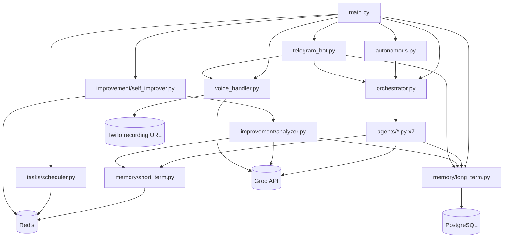
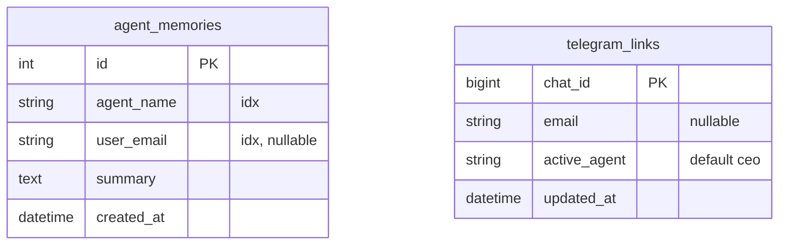

# AgentForge — Technical Flow Document (Phase 0 Audit)

> Living document (see D017 in `decision.md`). Audit date: 2026-11-12. Commit audited: `c841cef` (branch `main`).
> Everything below was derived from reading source, not the README. Status labels: **[Implemented]**, **[Partial]**, **[Documented-only]**, **[Missing]**, **[Unverified]**.
> The repo is small (52 tracked files, ~4.3k lines). All backend files and all frontend `app/` files were read in full.

---

## 1. Project overview

AgentForge ("Multi-Agent Startup OS") is a prototype in which seven LLM "agents" (CEO, Sales, Marketing, Support, Research, Finance, Hiring) each wrap a single Groq chat-completion call with a distinct system prompt and per-user chat memory. Users reach them via:

1. Next.js dashboard (WebSocket for chat, REST for the rest),
2. A Telegram bot (text and voice, long-polling, runs inside the API process),
3. A Twilio phone webhook (voice, routes to the CEO).

**Agents only generate text.** No agent calls any external tool or API (no email send, CRM, web search, payments). The "autonomous execution" feature classifies the generated text by keywords and labels it "completed". See §13 and §23.

## 2. Verified technology stack

| Layer | Verified from | Detail |
|---|---|---|
| Backend | `backend/main.py`, `requirements.txt` | Python, FastAPI, uvicorn (versions **unpinned**) |
| LLM | `backend/agents/*.py`, `improvement/analyzer.py`, `voice_handler.py` | `groq.AsyncGroq`; default model `llama-3.3-70b-versatile` (`MODEL_NAME` env); Whisper `whisper-large-v3` for audio |
| Short-term memory / scheduler store / improvement reports | `memory/short_term.py`, `tasks/scheduler.py`, `improvement/self_improver.py` | Redis via sync `redis-py` |
| Long-term memory | `memory/long_term.py` | PostgreSQL via sync SQLAlchemy 2.x + `psycopg2-binary` |
| Telegram | `telegram_bot.py` | `python-telegram-bot==21.6`, long polling |
| Voice | `voice_handler.py` | Twilio TwiML webhooks (no Twilio SDK; raw XML + `httpx`) |
| Frontend | `frontend/package.json` | Next.js **16.2.9**, React **19.2.4**, TypeScript 5, Tailwind 4, `next-auth` ^4.24 (Google provider), `lucide-react` |
| Declared but **unused** | grep over `backend/**/*.py` | `langchain`, `langgraph`, `websockets` appear in `requirements.txt` and are imported nowhere |
| Not present | `git ls-files` | Dockerfile, docker-compose, NGINX, CI, tests, migrations (Alembic), lockfile for Python |

Deployment evidence in code (not config): frontend hard-codes `https://65-0-30-8.sslip.io` / `wss://65-0-30-8.sslip.io/ws` (a raw-IP sslip.io hostname, implying a single VM behind some TLS terminator — **[Unverified]**, no config in repo) and Telegram bot message links to `https://agentforge-omega-topaz.vercel.app` (Vercel frontend). `.vercel/project.json` exists locally (untracked).

## 3. Repository structure (tracked files)

```
.
├── README.md                      # partly stale (see §22)
├── .gitignore                     # ignores venv, .env*, .next, node_modules, .vercel
├── backend/
│   ├── main.py                    # FastAPI app, lifespan, all routes, WebSocket
│   ├── orchestrator.py            # AgentOrchestrator: name→agent fn, CEO delegation
│   ├── autonomous.py              # AutonomousExecutor: run agent + keyword "actions"
│   ├── telegram_bot.py            # Telegram handlers (517 lines)
│   ├── voice_handler.py           # Twilio TwiML + Groq Whisper transcribe
│   ├── agents/{ceo,sales,marketing,support,research,finance,hiring}.py
│   ├── memory/short_term.py       # Redis chat window
│   ├── memory/long_term.py        # SQLAlchemy engine/models + LongTermMemory + telegram link helpers
│   ├── tasks/scheduler.py         # Redis hash of "scheduled tasks" (store only)
│   ├── improvement/analyzer.py    # LLM performance analyst
│   ├── improvement/self_improver.py # stores reports in Redis
│   └── requirements.txt
└── frontend/
    ├── package.json, next.config.ts (empty config), tsconfig.json, eslint.config.mjs, postcss.config.mjs
    └── app/
        ├── layout.tsx             # fonts, AuthProvider, ThemeProvider
        ├── page.tsx               # 963 lines: agent control center + WebSocket + Telegram connect
        ├── autonomous/page.tsx    # REST: run + schedule tasks
        ├── history/page.tsx       # REST: history
        ├── improve/page.tsx       # REST: self-improvement
        ├── twin/page.tsx          # Digital Twin — pure client-side mock
        ├── api/auth/[...nextauth]/route.ts  # NextAuth Google provider
        ├── auth-button.tsx, session-provider.tsx, theme-provider.tsx, theme-toggle.tsx, globals.css
```
Untracked local: `venv/` (repo root and `backend/`), `.env.local` (contains a Vercel OIDC token; git-ignored by `.env*` — not committed), `.vercel/`.

## 4. File responsibility map

| File | Responsibility | Depends on |
|---|---|---|
| `backend/main.py` | App factory, CORS, routes, WS loop, starts Telegram task in `lifespan` | autonomous, improvement.self_improver, memory.long_term, orchestrator, tasks.scheduler, telegram_bot, voice_handler |
| `backend/orchestrator.py` | `AgentOrchestrator.run_agent`, `run_with_delegation`, `_extract_delegations`, `_overview` | agents.* |
| `backend/agents/<name>.py` | `run(task, user_email)`: load Redis history → Groq call → save to Redis + Postgres | groq, memory.short_term, memory.long_term |
| `backend/autonomous.py` | `AutonomousExecutor.execute/_extract_actions/_describe` | orchestrator |
| `backend/memory/short_term.py` | `ShortTermMemory.get/save/clear`, key `short_term:{email}:{agent}` | redis |
| `backend/memory/long_term.py` | Models `AgentMemory`, `TelegramLink`; `Base.metadata.create_all` at import; `LongTermMemory.save/get/get_history`; `get_link/set_email/set_active_agent` | sqlalchemy |
| `backend/tasks/scheduler.py` | `TaskScheduler.add_task/get_scheduled_tasks/remove_task` | redis |
| `backend/improvement/analyzer.py` | `AgentAnalyzer.analyze` (Groq JSON mode) | groq, both memories |
| `backend/improvement/self_improver.py` | `SelfImprover.improve/get_improvements` | analyzer, redis |
| `backend/telegram_bot.py` | `start_telegram_bot` + handlers; reuses orchestrator, long_term, voice_handler.transcribe_audio | telegram, memory.long_term, orchestrator, voice_handler |
| `backend/voice_handler.py` | TwiML builders, `transcribe_audio`, `process_recording` | groq, httpx |

## 5. Backend architecture

### 5.1 Startup lifecycle
`uvicorn main:app` → import-time side effects (order matters):
1. `main.py` imports `orchestrator` → each `agents/*.py` executes `AsyncGroq(api_key=os.environ["GROQ_API_KEY"])` (**hard crash if unset**) and instantiates `ShortTermMemory()`/`LongTermMemory()`.
2. `memory/long_term.py` import: `create_engine(os.getenv("DATABASE_URL"))` (crashes opaquely if unset) and **`Base.metadata.create_all(engine)`** — schema is created implicitly at import; no migrations.
3. `redis.Redis.from_url(...)` clients are created in three modules (`short_term`, `scheduler`, `self_improver`) — lazy connection, no startup health check.
4. `lifespan`: if `TELEGRAM_BOT_TOKEN` set, `asyncio.create_task(start_telegram_bot())`; cancelled and awaited on shutdown.
5. Module-level singletons in `main.py`: `orchestrator`, `executor`, `scheduler`, `improver`, `long_term`. `telegram_bot.py` builds its own `orchestrator` and `long_term`.

No scheduler loop, no worker process, no startup/readiness check of Redis/Postgres. `/health` returns `{"status":"ok"}` unconditionally.

### 5.2 Middleware / errors / logging
- CORS: `allow_origins=["http://localhost:3000"]`, credentials on, all methods/headers. **The deployed Vercel origin is not allowed** (affects the REST calls from the deployed dashboard — **[Unverified]** whether a different build is deployed or a proxy strips this; WebSocket is not subject to CORS).
- No auth middleware, no rate limiting, no request logging, no exception handlers. Logging uses the `uvicorn.error` logger only in `main.py`/`telegram_bot.py`.
- REST routes let exceptions propagate (HTTP 500; unknown agent in `/autonomous/run` → `ValueError` → 500, not 4xx). WebSocket catches `ValueError` and generic `Exception` and returns `str(exc)` to the client (information leak).

### 5.3 Blocking I/O in async code
All Redis (`redis-py` sync) and SQLAlchemy (sync `psycopg2`) calls run directly inside `async def` handlers and agent `run()` functions, blocking the event loop (`telegram_bot.py` wraps only its own DB calls in `asyncio.to_thread`; agent-internal calls are not wrapped).

## 6. Frontend architecture

- Next.js App Router, all pages are client components (`"use client"`). Routes: `/` (`app/page.tsx`), `/autonomous`, `/history`, `/improve`, `/twin`, `/api/auth/[...nextauth]`.
- Providers (`layout.tsx`): `AuthProvider` (NextAuth `SessionProvider`) → `ThemeProvider` (localStorage key `agentforge-theme`).
- State: plain `useState`/`useRef`; no store, no data-fetching library.
- Auth: Google login via NextAuth; **the session is used only to read `session.user.email`**, which the browser then sends to the backend as an unauthenticated `user_email` field/path segment. No JWT/token is forwarded; no callbacks configured; `NEXTAUTH_SECRET` is not referenced in code (required in production by NextAuth — **[Unverified]** whether set on Vercel).
- API base URLs are **hard-coded string constants per file** (no env vars): `API_BASE` in `autonomous/page.tsx:8`, `history/page.tsx:18`, `improve/page.tsx:8`; `WS_URL` in `page.tsx:246`. `TELEGRAM_BOT_USERNAME="agentforge_official_bot"` in `page.tsx:366`.
- Loading/error states exist per page (`running`/`loading`/`error` state). WebSocket client: auto-reconnect every 2 s, 25 s `{"type":"ping"}` keepalive.
- `app/page.tsx` "Connect Telegram" link: `https://t.me/<bot>?start=<urlsafe-base64(email)>` (`telegramStartToken`).
- `twin/page.tsx`: **all numbers are hard-coded constants (`KPIS`, `REVENUE`) and a feed generated by `Math.random()` + `setInterval` every 5 s (`buildActivity`)**. No backend call, no data source. Does not use the auth session.

## 7. File dependency / import graph


No circular imports found. Coupling issues: each agent module owns its own Groq client, memory instances and persistence; `long_term.py` mixes engine setup, two unrelated models, Telegram-link helpers and the memory service.

## 8. API endpoint inventory (complete — `backend/main.py`)

| # | Method + path | Handler | Request | Response | Calls |
|---|---|---|---|---|---|
| 1 | GET `/health` | `health` | – | `{"status":"ok"}` | nothing (no dependency check) |
| 2 | POST `/autonomous/run` | `autonomous_run` | JSON `AutonomousRequest{agent, task, user_email}` | `{agent, task, response, actions[{action_type,description,status}], executed_at}` | `AutonomousExecutor.execute` → `AgentOrchestrator.run_agent` → `agents.<a>.run` |
| 3 | POST `/tasks/schedule` | `schedule_task` | JSON `ScheduleRequest{agent, task, interval_minutes}` | record `{id, agent, task, interval_minutes, created_at}` | `TaskScheduler.add_task` → Redis `HSET scheduled_tasks` |
| 4 | GET `/tasks` | `list_tasks` | – | list of records | `TaskScheduler.get_scheduled_tasks` → `HGETALL` |
| 5 | DELETE `/tasks/{task_id}` | `delete_task` | path | `{removed, id}` | `TaskScheduler.remove_task` → `HDEL` |
| 6 | POST `/improve/{agent_name}` | `run_improvement` | optional JSON `{user_email?}` | report `{agent_name,user_email,strengths,weaknesses,improvements,updated_strategy,has_history,analyzed_at}` | `SelfImprover.improve` → `AgentAnalyzer.analyze` → Redis+PG reads → Groq → Redis `SET` |
| 7 | GET `/improve/{agent_name}` | `get_improvement` | query `user_email?` | stored report or empty template | `SelfImprover.get_improvements` → Redis `GET` |
| 8 | GET `/history/{user_email}` | `get_history` | path | `[{agent_name, summary, created_at}]` newest first, **unbounded** | `LongTermMemory.get_history` → PG |
| 9 | POST `/voice/incoming` | `voice_incoming` | Twilio form (ignored) | TwiML XML (Say + Record, action `/voice/process`) | `build_incoming_response` |
| 10 | POST `/voice/process` | `voice_process` | Twilio form `RecordingUrl` | TwiML `<Say>` | `process_recording` → httpx GET (Twilio basic auth) → Groq Whisper → `run_with_delegation("ceo", …, "voice-call@agentforge.local")` |
| 11 | WS `/ws` | `websocket_endpoint` | JSON `{agent, task, user_email}` or `{type:"ping"}` | `{agent, result}` / for CEO `{agent, result, primary_agent, primary_response, delegations[]}` / `{error}` | `run_with_delegation` (ceo) or `run_agent` |

Auth on every endpoint: **none**. `user_email` is caller-asserted.

### Frontend → backend mapping

| Screen / file | Call | Endpoint |
|---|---|---|
| `/` `page.tsx` `runAgent` | `ws.send({agent,task,user_email})` | WS `/ws` (#11) |
| `/autonomous` `execute` | POST | #2 |
| `/autonomous` `schedule`/`loadTasks`/`removeTask` | POST/GET/DELETE | #3 / #4 / #5 (global, not per user) |
| `/history` `loadHistory` | GET | #8 |
| `/improve` | POST (`{user_email}`) | #6. **Frontend never calls GET #7** |
| `/twin` | none | – |
| Telegram bot | in-process calls to `orchestrator`/`long_term` | no HTTP |
| Twilio | webhook | #9, #10 |

### Representative traces
- **Dashboard chat (CEO):** `page.tsx runAgent` → WS `/ws` → `websocket_endpoint` → `AgentOrchestrator.run_with_delegation` → `ceo.run` → `ShortTermMemory.get` (Redis `GET short_term:{email}:ceo`) → `AsyncGroq.chat.completions.create` → `ShortTermMemory.save` ×2 (Redis `SET`) + `LongTermMemory.save` (PG `INSERT agent_memories`) → `_extract_delegations` → sequential `run_agent` per sub-agent → JSON back over WS.
- **Autonomous:** `/autonomous/run` → `AutonomousExecutor.execute` → `run_agent` (single agent, **no delegation**) → `_extract_actions` (keyword match) → JSON.
- **Improve:** see #6.

## 9. Internal service call flows
Covered by the traces above; in addition, Telegram: `message_handler` → `get_link` (PG, via `asyncio.to_thread`) → `_process_task` → `orchestrator.run_with_delegation` (if active agent is `ceo`) or `run_agent` → `clean_markdown` → `_split_message` (4096) → `reply_text`.

## 10. Database entities (PostgreSQL, SQLAlchemy 2.x declarative, `memory/long_term.py`)


- No foreign keys, no users table, no workspace/tenant, no composite index `(user_email, agent_name, created_at)`. `created_at` has no index and no timezone (naive UTC via deprecated `datetime.utcnow`).
- `agent_memories.summary` is the **full raw LLM reply**, not a summary. No embeddings/pgvector.
- Migrations: **none**; `create_all` at import only creates missing tables, never alters.
- Sessions: `sessionmaker(expire_on_commit=False)`, session-per-call context managers; `pool_pre_ping=True`, `pool_recycle=1800`.

## 11. Redis keys (all string/hash values; no TTLs, queues, pub/sub or streams)

| Key | Type | Written by | Content |
|---|---|---|---|
| `short_term:{email}:{agent}` (or `short_term:{agent}` when email is falsy) | STRING (JSON list) | `ShortTermMemory.save` | last 20 `{role, content}` messages. Read-modify-write, **not atomic** |
| `scheduled_tasks` | HASH `task_id → JSON` | `TaskScheduler.add_task` | global, not user-scoped |
| `improvements:{agent}:{email}` (or `improvements:{agent}`) | STRING JSON | `SelfImprover.improve` | last report only (no history) |

## 12. Agent orchestration

### 12.1 Agent inventory (all verified; files `backend/agents/<name>.py`)
All seven are the same 43-line function (diffed: only `AGENT_NAME` and `SYSTEM_PROMPT` differ; `ceo.py` and `research.py` differ by 1-2 lines). Common properties:
- Provider/model: Groq, `MODEL_NAME` env (default `llama-3.3-70b-versatile`); no temperature/max_tokens/timeout/retry set.
- Input: `(task: str, user_email: str|None)`. Output: plain `str`.
- Memory access: reads Redis short-term window only (last 20 msgs); **never reads long-term PG memory**. Writes both.
- Tools: **none**. Delegation capability: none in code (only the CEO's prompt text mentions it).
- Error handling: none (exceptions propagate).

| Agent | Role (system prompt) |
|---|---|
| ceo | orchestrator; "break goals into tasks for Sales, Marketing, Research, Support, Finance, Hiring" |
| sales | lead gen, outreach, closing |
| marketing | content, SEO, social, brand |
| support | support replies, complaints, FAQs |
| research | market/competitor research |
| finance | expenses/revenue/cashflow/burn (told to "analyze financial data provided" — none is supplied by the system) |
| hiring | resume screening, interviews, ranking (no resume data/ATS access) |

### 12.2 CEO delegation (`orchestrator.py`)
1. CEO called with the raw user text; returns free-form text. There is **no structured plan, no schema, no goal object**.
2. `_extract_delegations`: scans the CEO reply line-by-line for the literal substrings `"sales agent"`, `"marketing agent"`, `"research agent"`, `"finance agent"`, `"hiring agent"`, `"support agent"`. The first matching line per agent becomes that agent's "subtask" (the line itself, e.g. a bullet). If the CEO writes "Sales team" or "Sales Agent:" in different words, nothing is delegated.
3. Sub-agents run **sequentially** (`await` in a loop), each with only that one line as input (no shared context, no dependency ordering, no retries).
4. Result: `primary_response` = first 3 paragraphs of the CEO reply (the rest is discarded from the response, though the full text is saved in memory); `delegations` = list of `{agent, task, response}`. **There is no aggregation/synthesis step** — the CEO never sees sub-agent results.
5. Delegation only triggers for `agent == "ceo"` in WS and Telegram; `/autonomous/run` never delegates.

### 12.3 Agent-to-agent communication
Only the orchestrator-mediated one-way string hand-off above. No messaging bus, shared workspace memory, or inter-agent protocol.

### 12.4 "Autonomous execution" (`autonomous.py`)
`_extract_actions` lowercases the reply and, if any of a fixed keyword list is present ("plan", "company", "goal", "report", "email", …), emits an action with `status: "completed"` and a canned description (e.g. "Drafted an outreach email based on the request."). `leads_found` takes the first integer in the text as "number of leads". **No external operation happens; "completed" is not evidence of anything.** Almost any reply matches several types (e.g. "plan", "goal"). [Partial → effectively Documented-only for real autonomy.]

### 12.5 Scheduler
`TaskScheduler` persists definitions in Redis and exposes CRUD. `self._runners` is declared and `.cancel()`-ed on removal but **nothing ever creates a runner or executes a scheduled task** — no loop, no worker, no cron. README claims "schedule recurring agent tasks"; only storage is implemented. [Partial/store-only.] Tasks are global (no user_email) and `interval_minutes` is unvalidated.

### 12.6 Self-improvement (`improvement/`)
`AgentAnalyzer.analyze` feeds Redis short-term messages + up to 10 PG entries into Groq (JSON mode) and returns strengths/weaknesses/improvements/updated_strategy; `SelfImprover` stores it in Redis. **The result is displayed only; it is never fed back into an agent's system prompt or behavior** — there is no feedback loop, evaluation metric, or versioned prompt. [Partial: analysis only.] It is user-scoped (commit `2f68f86`) but `user_email` is optional and unauthenticated.

### 12.7 Digital Twin
Client-only mock (see §6). No backend, no data source, no simulation model. README's "CEO forecasts" and "live" are not backed by code. [Documented-only / UI mock.]

## 13. LLM request/response flow
`agents.<a>.run`: `messages = [system] + redis_history + [user task]` → `client.chat.completions.create(model, messages)` (no streaming, no tools, no timeouts/retries, no token budgeting, no usage/cost logging) → `choices[0].message.content` → persisted verbatim. Analyzer adds `response_format={"type":"json_object"}`. Transcription: `voice_handler.transcribe_audio` → `_groq.audio.transcriptions.create`. There is **no provider abstraction**; Groq is imported directly in 4 modules and instantiated in 9 places (7 agents + analyzer + voice_handler).

## 14. Memory lifecycle
1. Request → agent reads last ≤20 messages from Redis `short_term:{email}:{agent}`.
2. After the LLM call, appends user+assistant messages (trimmed to 20) and inserts the reply into PG `agent_memories`.
3. Short-term has no TTL; PG rows never expire or get summarized/compacted.
4. PG long-term is consumed by `/history`, Telegram `/recenthistory`, and the analyzer — **not by the agents**. No semantic retrieval, no embeddings.
5. Per-user isolation is by string key/column match on a client-supplied email.

## 15. Background workers / schedulers
Only one background construct: the Telegram polling task created in `lifespan`. Consequences: running `uvicorn --workers N` would start N pollers (Telegram `Conflict` errors); a crash of the bot task is not restarted or surfaced; `/health` doesn't reflect it. No task queue, no worker container, no scheduler execution.

## 16. WebSocket
Single endpoint `/ws`: accepts without auth/origin check; loop receives JSON; handles `ping`→`pong`; validates `user_email`, `agent`, `task` presence; runs the agent *inline in the receive loop* (a connection can have only one task in flight; a long delegation blocks that socket's ping handling). No connection registry, no broadcast, no streaming tokens (frontend copy says "streams results back live" but the server sends one message per request). Invalid JSON raises (not `WebSocketDisconnect`) and closes the handler with a server error.

## 17. External integrations
| Service | Where | Notes |
|---|---|---|
| Groq chat + Whisper | agents, analyzer, voice_handler | API key via `GROQ_API_KEY` |
| Telegram Bot API | `telegram_bot.py` | long polling, `drop_pending_updates=True` |
| Twilio | `voice_handler.py` | webhooks + authenticated GET of `RecordingUrl` |
| Google OAuth | `frontend/app/api/auth/[...nextauth]/route.ts` | login only |
| Vercel | `.vercel/`, hard-coded URL | hosting of frontend (inferred) |

## 18. Telegram & voice flows (security-relevant)
- Link: `/link <email>` or `/start <base64url(email)>` → `set_email(chat_id, email)` upserts `telegram_links`. **Any Telegram user can link to any email** (no verification), thereby reading that user's history (`/recenthistory`) and acting under their memory namespace. The deep-link token is just base64 of the email, forgeable by anyone.
- Voice (`/voice/process`): `RecordingUrl` is taken from the request form and fetched with the **Twilio SID/auth token as basic auth** (SSRF + credential exfiltration to an attacker-chosen host), with no Twilio signature validation (`X-Twilio-Signature`). Calls are attributed to the shared placeholder `voice-call@agentforge.local`. Responses are truncated to 200 chars for `<Say>`. Telegram's `transcribe_audio` shares the Groq Whisper helper.

## 19. Environment variables (from code; no `.env.example` exists)
| Var | Used in | Required |
|---|---|---|
| `GROQ_API_KEY` | agents, analyzer, voice_handler | **Yes** (KeyError at import) |
| `MODEL_NAME` | agents, analyzer | no (default `llama-3.3-70b-versatile`) |
| `DATABASE_URL` | `memory/long_term.py` | **Yes** (None → crash) |
| `REDIS_URL` | short_term, scheduler, self_improver | no (default `redis://localhost:6379`) |
| `TELEGRAM_BOT_TOKEN` | `main.py`, `telegram_bot.py` | no (bot skipped) |
| `TWILIO_ACCOUNT_SID`, `TWILIO_AUTH_TOKEN` | voice_handler | no (defaults `""`) |
| `GOOGLE_CLIENT_ID`, `GOOGLE_CLIENT_SECRET` | NextAuth route (frontend) | yes for login |
| `NEXTAUTH_SECRET`, `NEXTAUTH_URL` | implied by NextAuth, not referenced in repo | **[Unverified]** |
| `VERCEL_OIDC_TOKEN` | local `.env.local` only (untracked) | n/a |

## 20. Docker & deployment architecture
**Nothing in the repo.** No Dockerfile/compose/NGINX/systemd/CI. README suggests running Redis/Postgres by `docker run` and the API via `uvicorn --reload`. Inferred production (**[Unverified]**): one VM at `65.0.30.8` (sslip.io host) exposing the API over TLS, Vercel-hosted frontend. Redis persistence mode, backups, TLS termination, process supervision, log shipping and secrets management are unknown. README's example DB password (`agentforge123`) and port 5433 are documented defaults.

## 21. Health checks / monitoring
Only `/health` (static). No metrics, tracing, structured logs, Sentry, LLM-usage accounting, or readiness probe for Redis/PG/Telegram.

## 22. Known technical debt
1. Seven near-identical agent modules (copy-paste); config/prompt/memory wiring duplicated.
2. Sync I/O inside async paths (§5.3).
3. `create_all` at import instead of migrations; DB created as a side effect of importing anything that touches memory.
4. Hard-coded production URLs in 4 frontend files; CORS allow-list limited to localhost.
5. `langchain`, `langgraph`, `websockets` unused; no version pins/lockfile for Python.
6. Deprecated `datetime.utcnow()`; naive timestamps.
7. README stale/inaccurate: lists 8 endpoints (omits `/history`, `/voice/*`, Telegram), says "Digital Twin … live", "scheduler", "autonomous execution", "self-improving" as if complete; `README` directory tree omits `telegram_bot.py`, `voice_handler.py`.
8. Telegram bot coupled to the API process.
9. `page.tsx` is a 963-line monolith.
10. Frontend never uses `GET /improve/{agent}`; `TaskScheduler._runners` is dead state.
11. No tests of any kind.

## 23. Missing or incomplete functionality (vs. claims and vs. 2.0 target)
| Area | Status |
|---|---|
| Real tool execution (email, CRM, web, calendar…) | **[Missing]** |
| Structured plans / DAG / persisted task state | **[Missing]** (CEO delegation is regex-on-text) |
| Result aggregation by CEO | **[Missing]** |
| Scheduled task execution | **[Partial]** (storage only) |
| Human approval / permissions | **[Missing]** |
| Multi-provider LLM | **[Missing]** (Groq-only, no abstraction) |
| Auth/authz on backend; multi-tenant workspaces; RBAC | **[Missing]** (email string only) |
| Encrypted credential store | **[Missing]** |
| Semantic memory (pgvector), procedural/shared memory | **[Missing]** |
| Agent evaluation → prompt update loop | **[Partial]** (report only) |
| Digital Twin real data | **[Missing]** (mock) |
| Background workers, Redis Streams | **[Missing]** |
| Docker/CI/tests/migrations/observability | **[Missing]** |
| Telegram bot (text, voice, link, history) | **[Implemented]**, insecure linking |
| Twilio voice | **[Implemented]**, insecure |
| Google login | **[Implemented]** (frontend-only identity) |

---
### Areas not verified
Running deployment (VM config, TLS/reverse proxy, Redis/PG settings, whether a deployed build differs from this commit), Vercel env vars (`NEXTAUTH_SECRET`), actual Postgres schema state, whether any component runs correctly end-to-end (no code was executed; no external calls made).


---

## 24. Update — M0.1 / T0 implementation (2026-11-12)

> Sections 5.1, 5.2 and 19 above describe the audited commit `c841cef`. Where they conflict with this section, **this section reflects the code after T0**. Historical text above is intentionally not rewritten.

**Implemented (T0 only — configuration and test foundation):**

| Area | Actual implementation |
|---|---|
| Settings | `backend/config.py`: frozen pydantic `Settings` (plain `BaseModel`, no `pydantic-settings`), `load_settings(environ=None)`, cached `get_settings()` (calls `load_dotenv(override=False)`; honors `PYTHON_DOTENV_DISABLED`), `reset_settings_cache()`, `ConfigError` (lists `VARIABLE: reason`, never values), `Settings.safe_summary()`. Secrets are `SecretStr`. |
| App construction | `backend/app_factory.py` `build_app(settings, lifespan)`: sets `docs_url`/`redoc_url`/`openapi_url` from `settings.api_docs_enabled`, adds `CORSMiddleware`. Imports nothing from the rest of the backend. |
| CORS | Explicit list from `CORS_ALLOWED_ORIGINS` (normalized, deduped; `*`/`null`/paths/credentials rejected; production requires non-local `https`). `allow_credentials=False`, methods `GET, POST, DELETE`, headers `Authorization, Content-Type`, `max_age=600`. Methods/headers verified against `frontend/app/**` fetch calls (GET/POST/DELETE, `Content-Type` only). Defaults: production = empty list (with startup WARNING); development/test = `http://localhost:3000`. WebSocket origin checks are **not** implemented (T8). |
| Docs/OpenAPI | `API_DOCS_ENABLED`: default on in development/test, off in production; `true` in production is a startup `ConfigError`. When off, `/docs`, `/redoc`, `/openapi.json`, `/docs/oauth2-redirect` return 404. |
| Environment | `APP_ENV` ∈ `development|test|production`; **unset ⇒ production**. |
| Required vars | `GROQ_API_KEY`, `DATABASE_URL` (must be `postgresql[+driver]://`; `sqlite` only when `APP_ENV=test`). `REDIS_URL` keeps its `redis://localhost:6379` default (WARNING in production when unset). `TELEGRAM_BOT_TOKEN`, `TWILIO_*` optional. |
| Auth settings (defined, not enforced) | `AUTH_CONFIG_REQUIRED` (default false), `AUTH_JWT_ISSUER` (`agentforge-web`), `AUTH_JWT_AUDIENCE` (`agentforge-api`), `AUTH_JWT_PUBLIC_KEYS` (JSON `{kid: PEM}`; structural validation only, rejects private-key material; required only if `AUTH_CONFIG_REQUIRED` in production). **No JWT is issued or verified yet.** |
| Startup | `backend/main.py`: `settings = get_settings()` after `load_dotenv()`, `app = build_app(settings, lifespan)`; `lifespan` runs `await asyncio.to_thread(init_db)`, logs `settings.safe_summary()` and settings warnings, and starts Telegram iff `settings.telegram_enabled`. All routes, models and the WebSocket handler are unchanged. |
| DB initialization | `backend/memory/long_term.py`: engine now built from `get_settings().database_url`; **`Base.metadata.create_all` moved from import time into `init_db()`**, called from `lifespan`. Transitional — Alembic (T1) replaces it. Importing `memory.long_term` no longer opens a database connection. Schema unchanged. |
| Tests | `backend/tests/` (70 tests): `test_config.py`, `test_app_policy.py`, `test_app_startup.py`, `test_no_stray_env_access.py`, `conftest.py`. Isolation: `PYTHON_DOTENV_DISABLED=1` before imports; no Telegram token ever set; SQLite file in `tmp_path`; autouse network guard blocking non-loopback-plumbing connections (incl. local Postgres/Redis ports) and external DNS while still allowing in-process ASGI. `pytest.ini` (also disables the unused, transitively installed `langsmith_plugin` via `-p no:langsmith_plugin`), `requirements-dev.txt` (`-r requirements.txt`, `pytest==9.2.0`). Run from `backend/`: `venv\Scripts\python.exe -m pytest`. |

**Behavior changes to be aware of (deployment impact):**
1. If `APP_ENV` is unset the app now behaves as production: docs are off and **no CORS origin is allowed** until `CORS_ALLOWED_ORIGINS` lists the dashboard origin (value to be supplied by the owner; not assumed). Local development must set `APP_ENV=development` (or `test`) — and a SQLite `DATABASE_URL` only works with `APP_ENV=test`.
2. Startup now fails with a clear `ConfigError` for invalid settings (e.g. `DATABASE_URL` not `postgresql://`, `API_DOCS_ENABLED=true` in production).
3. CORS: credentials off, methods/headers narrowed (previously `*` with credentials on).
4. Tables are created at application startup (lifespan), not at import.

**Still unchanged / not implemented (deferred):** the seven agent modules, `analyzer.py`, `voice_handler.py`, `short_term.py`, `scheduler.py`, `self_improver.py` and `telegram_bot.py` still read environment variables directly (allow-list in `tests/test_no_stray_env_access.py`; it may only shrink); Groq clients are still built at import in nine places (dummy key only in tests); no Alembic (T1), users/identity (T2), NextAuth hardening (T3), JWT minting/verification (T4/T5), route protection (T6/T7), WebSocket auth (T8), frontend client changes (T9), Telegram linking (T10), Twilio hardening (T11), rate limiting (T13). All Critical findings in `docs/security/M0.1_AUTH_ARCHITECTURE.md` §2 therefore remain **open**.

**Not verified by T0:** a real `uvicorn main:app` start against PostgreSQL/Redis (no such service was used); the deployed environment (unknown) and how it will receive `APP_ENV`/`CORS_ALLOWED_ORIGINS`.

### 24.1 Update — M0.1 / T1-C: metadata-only model module (2026-11-12)

**Implemented:**
- `backend/memory/models.py` (new): `Base`, `AgentMemory`, `TelegramLink`, moved verbatim from `memory/long_term.py` (verified identical by diffing the definition block against `HEAD`). It imports only `datetime`, `sqlalchemy` and `sqlalchemy.orm` — no settings, engine, session or environment access — so the metadata can be imported without `GROQ_API_KEY`, `DATABASE_URL` or any database.
- `backend/memory/long_term.py`: re-exports `Base`, `AgentMemory`, `TelegramLink` from `memory.models`; keeps `engine`, `SessionLocal`, `init_db()`, `LongTermMemory` and the Telegram link helpers. All existing imports (`agents/*`, `improvement/analyzer.py`, `telegram_bot.py`, `main.py`) are unchanged and still work.
- Tests: `backend/tests/test_models_metadata.py` (9 tests) — exact table set; `long_term.Base is models.Base` and re-exported classes identical; every mapped class in one metadata; no naming convention introduced; import of `memory.models` in a clean interpreter with no app variables and sockets blocked (no `config`, `memory.long_term`, `redis`, `groq`, `telegram` imported); an AST-based source guard that fails if any declarative base/model/`declarative_base()`/`registry()` appears outside `memory/models.py` (excludes `venv`, `tests`, `migrations`; the guard itself is tested for detection); PostgreSQL DDL compiled from the metadata compared with the first SQL block of `docs/database/T1_ALEMBIC_BASELINE_PLAN.md` §3 (whitespace-insensitive), including `SERIAL`/`BIGSERIAL`; column types/nullability/PK/index flags and Python-side defaults preserved.
- `tests/conftest.py`: new `import_fresh(module, **env)` fixture; `import_main` now delegates to it. The suite is now 79 tests.

**Schema:** unchanged — same PostgreSQL DDL, same indexes and defaults, no new constraints or naming convention. Verified by fingerprinting the PostgreSQL DDL and column attributes before and after the move (identical).

**Not changed / deferred:** Alembic (not installed, no scaffolding, no migrations), `init_db()`/`create_all` still used at startup, constraint naming convention (to be decided after PostgreSQL verification), deployed database state still unverified.

### 24.2 Update — M0.1 / T1-D: Alembic scaffolding (2026-11-12)

**Installed (backend/venv only):** `pip install alembic==1.20.1` added exactly three packages — `alembic 1.20.1`, `Mako 1.4.3`, `MarkupSafe 3.0.4`. `pip freeze` before/after differs only by those three lines; no existing package changed. `requirements.txt` / `requirements-dev.txt` are **not** edited yet (see Not done).

**Implemented:**
- `backend/alembic.ini`: `script_location = %(here)s/migrations`, `prepend_sys_path = %(here)s`, `path_separator = os`, `file_template = %%(rev)s_%%(slug)s`, all loggers at WARN. No `sqlalchemy.url`, no credentials.
- `backend/migrations/env.py`: imports only `memory.models` (`target_metadata = Base.metadata`). Offline: placeholder dialect-only URL `postgresql://`, `literal_binds`. Online: URL from new `config.get_database_url()` (imported lazily, online mode only), `create_engine(..., poolclass=NullPool)`, one transaction, `compare_type`/`compare_server_default` on, `include_object` ignoring `alembic_version` and DB-only tables (never a drop), `pg_advisory_xact_lock` on PostgreSQL. Connection/engine errors are re-raised as `Could not connect to the database (<ExceptionClass>)` with the cause suppressed. The URL is never put into Alembic's config, printed or logged. `fileConfig` uses `disable_existing_loggers=False`.
- `backend/migrations/script.py.mako`, `backend/migrations/versions/.gitkeep` (no revisions).
- `backend/config.py`: `get_database_url()` (DATABASE_URL only, same validation as `load_settings` via the shared `_check_database_url`; needs no `GROQ_API_KEY`). `load_settings` behavior unchanged.
- `backend/tests/test_alembic_scaffold.py` (16 tests). Suite: 95 passed.

**Verified [V-test]:** ini has no URL; `ScriptDirectory` loads with zero heads; metadata target is `memory.models.Base.metadata`; offline SQL generated through the real `env.py` (toy revision in tmp) with no database and no `DATABASE_URL`/`GROQ_API_KEY`; clean-interpreter offline run imports none of `config`, `memory.long_term`, `main`, `redis`, `groq`, `telegram`, `langchain`, `psycopg2`; sentinel password never appears in output, logs or tracebacks on success, connection-failure and config-error paths; online mode uses `NullPool` (SQLite temp file, read-only `alembic current`).

**Not verified [NV]:** the PostgreSQL advisory lock and real PostgreSQL online behavior (no PostgreSQL access); psycopg2 error text.

**Not done / deferred:** baseline revision, any upgrade/stamp/downgrade, `init_db()` removal, startup change, adding `alembic` to `requirements.txt`.

### 24.3 Update — M0.1 / T1-D-R1: unmanaged-column protection (2026-11-12)

**Correction to §24.2:** its `include_object` skipped `alembic_version` and database-only *tables* but not database-only *columns* inside managed tables, so autogenerate could have proposed `DROP COLUMN` for an unmanaged column. Found in T1-D review.

**Fix:** `backend/migrations/env.py` `include_object` now also returns `False` for `type_ == "column"` when `reflected and compare_to is None` (database-only column). Metadata-only columns, managed columns, indexes and the type/server-default comparisons are unchanged. Models, schema, advisory lock, manifests untouched; no revision created.

**Tests (+3, suite 98 passed):** `test_include_object_column_rules` (direct filter cases); `test_autogenerate_simulation_without_filter_would_propose_drops` (negative control: with no filter the simulation does report `remove_column`/`remove_table`); `test_autogenerate_simulation_with_env_filter` (real `compare_metadata` + real `env.py` filter: no `remove_*`; `add_column`, `modify_type`, `modify_default` still reported). Mutation check: disabling the column rule made the two filter tests fail; restored.

**Simulation, not PostgreSQL integration [NV for PostgreSQL]:** the "database" is a throw-away SQLite file in tmp_path and the metadata is a small controlled `MetaData`. PostgreSQL reflection, type and server-default comparison behavior is unverified. No migration was run and no server was contacted.

### 24.4 Update — M0.1 / T1-D2: Alembic runtime dependency pinned (2026-11-12)

- **Change:** appended `alembic==1.20.1` as the last line of `backend/requirements.txt` (the file is unordered and mostly unpinned; CRLF line endings preserved). It was not previously present. This closes the gap noted in §24.2 ("not done: adding `alembic` to `requirements.txt`").
- **Not modified:** `requirements-dev.txt`, Python sources, migrations, tests, configuration, deployment files, `decision.md` (the version was already approved).
- **Verified:** `git diff -- backend/requirements.txt` is a single added line; `alembic==1.20.1` appears exactly once; comparing the file with `HEAD` (ignoring line endings) shows only that one line added; `git diff --check` exits 0.
- **Not done:** no `pip install` (Mako and MarkupSafe, Alembic's dependencies, remain unpinned and resolve transitively; the venv already holds Alembic 1.20.1 from T1-D); no tests rerun; no database or external service contacted. Nothing committed.

### 24.5 Update — M0.1 / T1-E: initial Alembic baseline revision (2026-11-12)

**Implemented:** `backend/migrations/versions/0001_baseline.py` — revision ID `0001_baseline`, `down_revision = None`, hand-written explicit `op.create_table` / `op.create_index` calls (not autogenerated; compared against the metadata by test). Represents exactly the T0 schema in `memory/models.py`: `agent_memories` (`id` SERIAL PK, `agent_name` VARCHAR(100) NOT NULL, `user_email` VARCHAR(255) NULL, `summary` TEXT NOT NULL, `created_at` TIMESTAMP NOT NULL; indexes `ix_agent_memories_agent_name`, `ix_agent_memories_user_email`) and `telegram_links` (`chat_id` BIGSERIAL PK, `email` VARCHAR(255) NULL, `active_agent` VARCHAR(100) NOT NULL, `updated_at` TIMESTAMP NOT NULL). Primary keys are unnamed, no server defaults (Python-side defaults stay out of the schema), no foreign/unique/check constraints, no naming convention, no data operations.

**Upgrade:** creates both tables and the two indexes. Intended only for an EMPTY database; an existing matching database is to be adopted by `stamp` after pre-flight (T1-F/T1-G), which this task does not implement.

**Downgrade:** `raise RuntimeError("The baseline revision 0001_baseline is intentionally irreversible ...")`; the function body is only that `raise` — no drops, no deletes.

**Verified [V-test], tests in `tests/test_baseline_revision.py` (7 new) + 1 changed assertion:** single head `0001_baseline` with no parent, discoverable by the real script directory; offline `upgrade base:head --sql` through the real `env.py` yields CREATE TABLE/INDEX statements equal (whitespace-insensitive) to the PostgreSQL DDL compiled from the metadata, with SERIAL/BIGSERIAL, no DEFAULT/FOREIGN/UNIQUE/CHECK/DROP/ALTER; SQLite throw-away database (revision `upgrade()` called in-process, no `alembic upgrade`): `compare_metadata` reports no differences, column order/nullability/PK/indexes match, no server defaults or extra constraints; `downgrade()` raises in-process (zero SQL statements issued, tables intact) and in offline mode (no destructive SQL emitted); AST check that `upgrade()` calls only create_table/create_index/column constructors and `downgrade()` only raises. Mutation checks (user_email NOT NULL, added server default, destructive downgrade) each made 3 tests fail; file restored byte-identical. The T1-D test that asserted zero heads (`test_script_directory_loads_and_has_no_revisions_yet`) was updated to assert the single baseline head. Full suite: 105 passed.

**Limitations [NV]:** no PostgreSQL was available or contacted, so PostgreSQL runtime parity is unverified (actual SERIAL/BIGSERIAL sequences, PG-assigned PK names such as `<table>_pkey`, reflection and `compare_metadata` behavior on PostgreSQL, the advisory lock). SQLite results prove structure only, not PostgreSQL parity. The deployed database state remains unknown.

**Not done / unchanged:** no `alembic upgrade`/`stamp`/`downgrade` against any configured database; no existing database contacted, inspected or changed; `init_db()`/`create_all()` and application startup unchanged; no pre-flight classifier (T1-F); manifests, models, `env.py`, `decision.md` untouched. Nothing committed.

#### 24.5.1 Update — T1-E-R1: actual online upgrade on temporary SQLite (2026-11-13)

**Gap closed:** the T1-E SQLite test called the revision's `upgrade()` through an Operations context and so bypassed Alembic's online runner and `env.py`. New test `test_actual_online_upgrade_on_temporary_sqlite` (`tests/test_baseline_revision.py`) runs the real `command.upgrade(config, "head")` through `env.py`'s online path against a SQLite file under pytest `tmp_path`.

**No blocker, no configuration change:** `env.py` reads the URL via `config.get_database_url()`, which already accepts `sqlite:` when `APP_ENV=test`, so no production code, validation rule, `env.py`, baseline revision or model was modified. The URL is supplied only through `monkeypatch.setenv` (`APP_ENV=test`, `DATABASE_URL`, `GROQ_API_KEY` removed), i.e. for that one test; the test fixtures' network guard stays active.

**Verified [V-test, SQLite only]:** exactly one engine is created, for the `tmp_path` file, with `poolclass=NullPool`; the database contains exactly `agent_memories`, `telegram_links` and `alembic_version`; `agent_memories` has exactly the two expected indexes and `telegram_links` none; `alembic_version` holds exactly one row, `0001_baseline`; `compare_metadata` (Alembic's own table filtered out) reports no differences. Mutation check: removing the `user_email` index from the revision made the test fail; restored byte-identical. Existing direct structural tests are kept. Suite: 106 tests.

**Limitations [NV]:** SQLite is not PostgreSQL. The PostgreSQL advisory-lock branch (`pg_advisory_xact_lock`) is skipped on SQLite and still unexecuted; SERIAL/BIGSERIAL sequences, PG-assigned PK names and PostgreSQL reflection are unverified. The test exercises `upgrade` only; `stamp`/`downgrade` were not run through the online runner, and nothing was run against any configured or existing database. Nothing committed.

### 24.6 T1-F — Read-only pre-flight classifier (2026-11-13)

**Added:** `backend/migrations/preflight.py` (run `python -m migrations.preflight` from `backend/`) and `backend/tests/test_preflight.py` (57 tests). Nothing else changed: baseline revision, models, `env.py`, `config.py`, startup, `init_db()`, manifests and dependencies are untouched. Nothing committed; T1-G and T2 not started.

**Behaviour [V-src, V-test on SQLite]:** `classify(conn)` returns EMPTY / MATCH / DIVERGENT / UNINSPECTABLE / ALREADY_VERSIONED_{CURRENT,BEHIND,UNKNOWN}. Exit codes (owner-approved): 0 EMPTY, 10 MATCH, 11 versioned with a known revision (head = CURRENT, known non-head = BEHIND, both 11), 20 DIVERGENT, 21 versioned with an unknown or malformed version state (no/extra/NULL rows, missing `version_num`), 30 UNINSPECTABLE, 2 configuration error. These are classification results only; they authorize no migration, stamp or adoption.
- EMPTY requires zero tables of any kind (so an unmanaged-only database is DIVERGENT, not EMPTY). MATCH requires `compare_metadata` (compare_type + compare_server_default) to return nothing, plus primary-key columns equal and no check constraints. `env.py`'s `include_object` is not used, so unmanaged tables/columns/indexes are reported. The historical `agent_memories` without `user_email` and its index classifies DIVERGENT.
- Any exception during inspection or connection is UNINSPECTABLE and reports only the exception class name; the URL and raw driver text are never printed. `main()` reads only `APP_ENV`/`DATABASE_URL` via `get_database_url()`.
- Read-only: all issued statements on SQLite are SELECT/PRAGMA (asserted per scenario); the database file is byte-identical after classification; the source contains no create_all/stamp/upgrade/downgrade/DDL/DML tokens. `main()` also asks PostgreSQL drivers for a read-only transaction (`postgresql_readonly`; untested on PostgreSQL).
- PostgreSQL-only checks (`pg_checks`: current schema is `public`, owned sequence via `pg_get_serial_sequence` and `nextval` default for `agent_memories.id` / `telegram_links.chat_id`, PK named `<table>_pkey`) are tested with mocks only.

**Evidence:** `tests/test_preflight.py` 57 passed; full suite 163 passed (previous 106); `git diff --check` clean. Mutation checks (UNINSPECTABLE→EMPTY, unknown revision accepted, comparison removed, EMPTY ignoring unmanaged tables) each made tests fail; file restored byte-identical.

**Not verified [NV]:** any PostgreSQL behaviour (reflection, SERIAL defaults, PK names, `postgresql_readonly`); `compare_metadata` on PostgreSQL may report false DIVERGENT (the safe direction). No pre-flight was run against any configured/real database; the deployed schema remains unknown. No disposable PostgreSQL/Docker was used (out of scope).

#### 24.6.1 Update — T1-F-R1: PostgreSQL schema before EMPTY, safe connection cleanup (2026-11-13)

**Corrections (source review of T1-F):** §24.6 above is unchanged history.
1. **Schema ordering.** `classify()` previously returned EMPTY on an empty table list before any PostgreSQL schema check. It now runs `SELECT current_schema()` (PostgreSQL dialect only) after the ALREADY_VERSIONED branch and before EMPTY; a value other than `public` (including NULL) returns DIVERGENT with the finding `current schema is not public`, whether the inspector sees no tables, managed tables or only unmanaged tables. A failure of that query is UNINSPECTABLE. SQLite never issues the query (tested). `pg_checks` is unchanged and still re-checks the schema; the duplicate read is harmless.
2. **Connection cleanup.** `main()` now enters `with engine.connect() as raw_conn:` first and applies `raw_conn.execution_options(postgresql_readonly=True)` inside it, so the raw connection is closed even if applying the option raises. NullPool, `engine.dispose()` in `finally`, and the UNINSPECTABLE-with-class-name-only handling are preserved.

**Unchanged:** exit-code mapping, classification semantics, ALREADY_VERSIONED behaviour (a recorded known revision is NOT evidence of schema parity: a versioned database is not schema-compared, and a versioned database in a non-public PostgreSQL schema still reports by revision), baseline, models, `env.py`, `config.py`, startup, dependencies.

**Tests [V-test, mocks/SQLite only]:** 11 new tests in `tests/test_preflight.py` (preflight file 57 → 68): PostgreSQL schema `public`/no tables = EMPTY with only the `current_schema` SELECT issued; `public` with tables proceeds to comparison; non-public with no tables, managed tables or only unmanaged tables, and NULL schema = DIVERGENT and never EMPTY; schema query failure = UNINSPECTABLE with no leaked text; SQLite never queries `current_schema`; `main()` requests `postgresql_readonly=True`, uses NullPool, classifies the connection returned by the option call, closes the raw connection and disposes the engine; failure while applying the option still closes the raw connection and disposes the engine (exit 30, no credential text); engine disposal when `connect()` fails. Full suite 174 passed; `git diff --check` clean. Mutation checks (schema check disabled, old connection pattern, option value False) each failed tests; file restored byte-identical.

**Not verified [NV]:** no PostgreSQL connection was made. Actual `postgresql_readonly` runtime behaviour (that psycopg2 applies it before the first statement), real `current_schema()` results, reflection, sequence and PK-name checks remain unverified. Nothing committed; T1-G and T2 not started.

#### 24.6.2 Update — T1-F-R2: PostgreSQL schema guard before version classification (2026-11-13)

**Correction:** §24.6.1 placed the `current_schema()` check after the ALREADY_VERSIONED branch, so a versioned database seen through a non-public PostgreSQL schema was classified by revision. In `classify()` the guard now runs immediately after `inspect(conn)` and before `get_table_names()`, the version read, EMPTY and the schema comparison. PostgreSQL dialect only; `current_schema() != 'public'` (including NULL) returns DIVERGENT with the finding `current schema is not public`; a failed query is UNINSPECTABLE (class name only). With schema `public`, classification is exactly as before, including the ALREADY_VERSIONED_CURRENT/BEHIND/UNKNOWN rules. `pg_checks` and `main()` (R1 connection cleanup) are unchanged; exit codes unchanged. R1's note that versioned databases in a non-public schema still report by revision is superseded by this entry; §24.6 and §24.6.1 are not rewritten.

**Tests [V-test, mocks and SQLite only]:** 14 added (preflight file 68 → 82): public + known version = CURRENT (exit 11); public + unknown / malformed (two rows) / no rows = UNKNOWN (21); non-public + known / unknown / malformed / no rows = DIVERGENT with no table or version reading; NULL schema + versioned = DIVERGENT; schema-query failure + versioned = UNINSPECTABLE with no leaked text; call-order test (`current_schema` before `get_table_names` before the version SELECT); SQLite versioned database never issues `current_schema`. Full suite 188 passed; `git diff --check` clean. Mutation check (guard moved back below the versioned branch): 9 failed, 73 passed; file restored byte-identical (82 passed).

**Not verified [NV]:** no PostgreSQL connection was made; real `current_schema()` results, `postgresql_readonly` runtime behaviour, reflection, sequence and PK-name checks remain unverified. Nothing committed; T1-G and T2 not started.

### 24.7 T1-G — Database adoption runbook (2026-11-13)

**Added (documentation only):** `docs/database/T1_G_ADOPTION_RUNBOOK.md`. No code, migration, test, model, config, requirements, `decision.md` or startup file was touched; no database was contacted and no `alembic`, `pg_dump`, `pg_restore` or `create_all` command was run. Nothing committed; T1-H and T2 not started. **No environment has been adopted and the runbook authorizes no migration or stamp.**

**Contents:** safety gates G1–G6 (per-environment written approval, maintenance window and deployment freeze, prevention of `init_db()`/`create_all`, verified backup, evidence and pre-flight, action-matches-classification); per-environment inventory with `UNKNOWN` fields; `pg_dump -Fc`/`pg_restore` templates with placeholders and a scratch-restore checkpoint list (B1–B7); the seven §12 catalog queries copied verbatim with required/optional marking; pre-flight invocation (`python -m migrations.preflight` from `backend/`), all states and exit codes (0/10/11/20/21/30/2), the `public`-schema rule and the "versioned = revision only, not parity" limitation; the decision matrix (EMPTY → `alembic upgrade head`; MATCH → `alembic stamp 0001_baseline`; DIVERGENT/UNINSPECTABLE/versioned-unknown → STOP; versioned-known → no action without separate review); post-adoption verification templates; forward-only rollback policy (restore from verified backup; never `downgrade`); stop conditions; evidence checklist; list of owner-dependent unknowns.

**Cross-checks against the repository [V-src]:** `main.py` lifespan calls `init_db()` unconditionally and `init_db()` runs `create_all` with no disabling switch, so the runbook's gate G3 is operational (all instances stopped or unreachable) until T1-H; `alembic.ini` has no URL and `env.py` reads it through `config.get_database_url()`; `config.py` accepts only `APP_ENV` in development/test/production (unset = production) and sqlite only under `test`; `alembic==1.20.1` is pinned in `backend/requirements.txt`; `0001_baseline.downgrade()` raises; the runbook's catalog SQL is byte-identical to the T1-A plan §12 block (scripted comparison); the runbook contains no credentials, hosts, URLs or invented infrastructure (scripted scan).

**Unresolved / owner-dependent [NV/UNKNOWN]:** which environments exist and their real state; deployment/stop mechanism; backup tooling and scratch instance; operator/approver/window; whether the README sample password was ever used; how to run smoke checks on live deployments; behaviour of the pre-flight, `alembic stamp`, `alembic current` and the advisory-lock branch on real PostgreSQL (rehearse on the restored scratch copy); removal of `init_db()` is T1-H.

#### 24.7.1 Update — T1-G-R1: runbook alignment with plan §§7, 8.2, 8.3, 9, 10 (2026-11-13)

Documentation-only corrections to `docs/database/T1_G_ADOPTION_RUNBOOK.md`; §24.7 is not rewritten. Gaps found and fixed: (1) MATCH was only `stamp` — it is now sequence M1–M5: verified backup + owner approval, `alembic stamp 0001_baseline`, `alembic current` must show `0001_baseline`, `alembic upgrade head` (no-op while the baseline is the only head; any later revision is a STOP needing separate approval), post-action verification; (2) DIVERGENT is now an explicit corrective path D1–D7 (stop normal adoption, separately reviewed corrective revision or approved manual fix, test on an isolated restored backup, apply only after explicit approval, re-run pre-flight until MATCH, then the MATCH sequence; `0001_baseline` is never run against a divergent database); (3) EMPTY is now E1–E3 (`alembic upgrade head`, verify revision, then start the application); (4)/(5) already satisfied and left unchanged except for restatement in the matrix intro: all app instances stay stopped/unreachable through the whole sequence because there is no startup switch (`init_db()`/`create_all` unconditional until T1-H), and neither the runbook nor any pre-flight exit code authorizes any action (gate G1 required); gate G1 now names the full sequence being approved. No command was run against any database; no code, migration, test, config, requirements or `decision.md` change; `git diff --check` clean. T1-H and T2 not started; nothing committed.

### 24.8 T1-H — Startup schema-version guard replaces `init_db()` / `create_all` (2026-11-14)

**Changed:** new `backend/migrations/schema_guard.py`; `backend/main.py` (removed the `init_db` import and call; `lifespan` now first runs `verify_schema_version(settings.database_url)` via `asyncio.to_thread`, logs `Startup aborted: <code + fixed message> (cause: <exception class>)` and re-raises on failure); `backend/memory/long_term.py` (deleted `init_db()`, comment updated; `engine`, `SessionLocal` and model re-exports kept); `backend/tests/conftest.py` (`migrate_test_db` fixture running the real `alembic upgrade head` on the test's temporary SQLite file; `schema_guard.py` added to the purge exclusions so `SchemaVersionError` keeps its identity); `backend/tests/test_app_startup.py`; new `backend/tests/test_schema_guard.py`; `decision.md` (D024 + index row); `docs/database/T1_G_ADOPTION_RUNBOOK.md` (T1-H banner, §1.3, E3, smoke-check, checklist and §10 wording). Unchanged: baseline revision, models, `env.py`, `config.py`, `preflight.py`, requirements, schema. No database was contacted; nothing committed; T2 not started.

**Guard behaviour [V-src, V-test on SQLite and mocks]:** accepts startup only if (1) the script directory has exactly one head, (2) the database records exactly one non-empty revision, known to the scripts, and (3) it equals that head. Order: script heads (no DB) → engine/connection (`NullPool`; PostgreSQL gets `connect_args={"connect_timeout": 10}`, SQLite none) → read-only option request → **PostgreSQL only: `SELECT current_schema()` must be `public` before `alembic_version` is read** → `MigrationContext.get_current_heads()` (no DDL; `()` when the table is absent) → checks. Codes: `SCRIPT_HEADS_INVALID`, `DB_UNREACHABLE`, `SCHEMA_CHECK_FAILED`, `NON_PUBLIC_SCHEMA` (non-public, NULL or empty schema), `SCHEMA_VERSION_UNREADABLE` (missing column, NULL or empty value), `NO_SCHEMA_VERSION` (no table or no rows), `MULTIPLE_VERSION_ROWS` (including duplicates), `UNKNOWN_REVISION`, `SCHEMA_BEHIND_HEAD`. There is no environment parameter: production, development and test behave identically. The exception carries code + fixed message only (`from None`; class name kept separately in `error_class`); the URL, host, user and raw driver text never appear in exception text, log or stdout/stderr (sentinel tests).

**Tests:** `test_schema_guard.py` 42; `test_app_startup.py` now 11 (unmigrated database aborts and creates nothing, Telegram bot never launches; migrated database serves `/health` and startup changes no table; unknown revision refused; source has no `create_all`/`init_db`; the two other lifespan tests migrate first). Full suite **233 passed** (previous 188), 2 third-party warnings; `git diff --check` clean. Mutation checks (each made tests fail, files restored byte-identical): PostgreSQL schema check disabled (14 failed), non-public schema accepted (12), non-head accepted (1), multiple rows accepted (2), unknown revision accepted (2), multiple script heads accepted (1), empty/NULL revision accepted (2), exception chain leaking (1), connect timeout removed (1), read-only option not requested (2), version read before schema check (15), guard not called from `lifespan` (2).

**Limitations [NV]:** PostgreSQL runtime behaviour is unverified (`current_schema()`, `postgresql_readonly`, `connect_timeout`, real driver errors); the guard checks the recorded revision, not schema parity; connecting to a SQLite file that does not exist creates an empty file (SQLite behaviour, test environment only); an unadopted database now prevents startup, so each environment must be adopted before this code is deployed; `alembic.ini` and `migrations/versions/` must be deployed with the backend; a restart loop under a supervisor is the intended fail-closed outcome; uvicorn's exit behaviour on a failed lifespan was not exercised; no environment has been adopted, deployed or contacted.

### 24.9 T1-I — PostgreSQL runtime verification (2026-11-14)

**Environment [V-test]:** PostgreSQL **16.15 (Debian 16.15-1.pgdg13+2)**, official `postgres` image from the local cache pinned by digest `sha256:ca0bd484cb98bf4b24eb1010e73fb3fcbd6714d240fbc1a10eea5b7dbecb641d`, run as a disposable Docker container (`--rm`, `--pull=never`, random loopback-only port, tmpfs data directory, random password, `fsync=off`, custom marker setting `agentforge.disposable`), Docker Desktop 29.7.2 on Windows 11; client side Python 3.11.9 / psycopg2 2.9.12 (libpq 18.0.3) / SQLAlchemy 2.0.51 / Alembic 1.20.1. The container was created for this task and removed afterwards. Not contacted: the local PostgreSQL service on 5432, the existing `agentforge-postgres` and other containers, AWS, production or any real database. (A first attempt used a throw-away cluster from the local PostgreSQL 16.12 binaries; it was stopped and deleted before any test ran.)

**Changed files:** new `backend/tests/test_postgres_integration.py` (36 opt-in tests), `backend/pytest.ini` (registers the `postgres` marker), this entry. No application code, migration, model, config or schema change; no bug was found in `env.py`, `preflight.py` or `schema_guard.py`. The module is skipped unless `AGENTFORGE_TEST_PG_ADMIN_URL` and `AGENTFORGE_TEST_PG_TOKEN` are set; before touching anything it requires a loopback host, a port other than 5432, and `SHOW agentforge.disposable` equal to the token. Each test uses its own freshly created database, dropped afterwards. No mocks are used in this module.

**Runs (one process at a time; logs kept in the session scratchpad):** timeout + lifespan tests only: 2 passed (28.08 s); complete module: **36 passed** (82.71 s); after that run one test was renamed and its docstring corrected (no logic change, see limitations) and re-run on its own: 1 passed; existing suite excluding the PostgreSQL module and with no PostgreSQL variables set: **233 passed**, 2 third-party warnings (84.34 s); `git diff --check` clean. An earlier module run was killed by the host's memory-pressure reaper and is not counted.

**Actual PostgreSQL findings [V-test]:**
- *Alembic online upgrade on an empty database* creates exactly `agent_memories`, `telegram_links`, `alembic_version`; `alembic_version` = `0001_baseline`. Columns: `agent_memories.id` integer NOT NULL default `nextval('agent_memories_id_seq')`, `agent_name` varchar(100) NOT NULL, `user_email` varchar(255) NULL, `summary` text NOT NULL, `created_at` timestamp without time zone NOT NULL; `telegram_links.chat_id` bigint NOT NULL default `nextval(...)`, `email` varchar(255) NULL, `active_agent` varchar(100) NOT NULL, `updated_at` timestamp without time zone NOT NULL; no other columns and no server defaults besides the two sequences. `pg_get_serial_sequence` returns `public.agent_memories_id_seq` and `public.telegram_links_chat_id_seq`; the sequences are integer and bigint respectively; inserts without an id work. Constraints are exactly `agent_memories_pkey`, `telegram_links_pkey`, `alembic_version_pkc` (all primary keys); indexes are the two expected non-unique indexes plus the primary-key indexes.
- `upgrade head` and `create_all` produce the same structure (columns, indexes, constraints, sequences and sequence ownership compared). Alembic `compare_metadata` against the upgraded database is empty.
- `upgrade head` on a `create_all` database fails (tables already exist) and the database is unchanged afterwards (confirms the runbook's G3 rationale). A migration that fails after DDL rolls back everything (no probe tables, no `alembic_version`) and leaves no advisory lock held. A second run blocks while another session holds the advisory lock (observed as one ungranted advisory lock in `pg_locks`, no DDL executed meanwhile) and completes after release; no advisory lock remains after a normal upgrade.
- `stamp 0001_baseline` on a matching database writes only `alembic_version`; `alembic current` prints `0001_baseline (head)`; a following `upgrade head` is a no-op (full fingerprint unchanged); `alembic current` on an unversioned database prints nothing and creates nothing (the runbook's read-only assumption holds); `downgrade` on the baseline raises and changes nothing.
- *Read-only enforcement:* with `postgresql_readonly=True`, `SHOW transaction_read_only` is `on` and CREATE TABLE, INSERT, ALTER TABLE and DROP TABLE are all rejected with a read-only-transaction error; the setting is not sticky and is reset when a pooled connection is returned.
- *Pre-flight:* empty database = EMPTY; a `create_all` database = **MATCH with no findings** (no false DIVERGENT from PostgreSQL reflection); 12 divergent variants (historical missing `user_email` + index, missing table, unmanaged table, extra column, type drift, nullability drift, missing index, extra unique index, extra check constraint, renamed primary key, dropped `nextval` default, sequence not owned) are all DIVERGENT with the expected finding; versioned states classify as designed (current, known non-head, unknown, two rows, zero rows); `current_schema()` enforcement works: a non-public schema and a NULL schema (a `search_path` naming a nonexistent schema makes `current_schema()` NULL) are DIVERGENT for empty and for versioned databases; the CLI returns exit codes 0, 10, 20 and 30 and never prints the password, host, user or database name (including real libpq error cases).
- *Schema guard:* accepts the head and fails closed with the designed codes (no table, or tables without a version = `NO_SCHEMA_VERSION`; zero rows; unknown revision; multiple rows; known non-head = `SCHEMA_BEHIND_HEAD`; non-public and NULL schema = `NON_PUBLIC_SCHEMA` even when a valid versioned database exists in `public`); refused connection, wrong password and nonexistent database all give `DB_UNREACHABLE` with no URL, host, user, password or database name in the exception; the real application lifespan aborts on an unmigrated PostgreSQL database without creating anything and serves `/health` on a migrated one.
- *Read-only operations leave the database unchanged:* pre-flight and guard runs were compared before/after by a fingerprint of structure, object identities (OID and relfilenode), sequence state and row data: identical in every case, including that no `alembic_version` is created on an empty database.
- *Connect timeout:* against a server that accepts the TCP connection and never answers, the guard gave up with `DB_UNREACHABLE` after 10.06 s (timeout-only run) and 10.02 s (module run), so the 10-second `connect_timeout` is honoured.

**The 4882.1 s anomaly (explained, with evidence):** an earlier timeout-test run measured 4882.1 s. The Windows System event log shows Kernel-Power connected-standby entry at 20:23:55 and exit at 21:45:19 on 2026-11-14, an interval of 81 min 24 s (about 4884 s), covering the test. The earlier 3.5-hour pytest duration for a 3-second run is the same effect. On this host `time.monotonic()` and `time.perf_counter()` also keep counting through standby (they are not a fix), so the test now asserts on `QueryUnbiasedInterruptTime` (Windows) / `CLOCK_MONOTONIC` (elsewhere), which exclude suspended time, and prints monotonic and wall time for comparison; wall-clock time is never asserted.

**Limitations / not verified [NV]:** PostgreSQL 16.15 on Linux in a container only; other versions, a Windows-hosted server and SSL/TLS were not tested. The server-side `BEGIN READ ONLY` was not observed directly (the effect was: `SHOW` and rejected writes). SQLAlchemy's own first-connect initialisation queries run before the read-only option can be applied and fire no cursor events, so they were not observed; the test (renamed `test_inspection_statements_run_with_readonly_set_and_are_reads_only`, docstring corrected after the full-module run and verified on its own) covers only statements visible through cursor events. A real PostgreSQL failure of the `current_schema()` query (`SCHEMA_CHECK_FAILED`) was not induced (mock-tested only). `fsync=off` was used for speed. The deployed environments' real schemas and permissions remain unknown; no environment has been adopted or deployed. Nothing committed.


## 25. M1 Platform Foundation

### 25.1 M1-0 — Decisions, dependencies and compatibility (2026-11-14)

**Scope kept:** no schema, model, migration, route, authentication or application change. No database, Redis, Docker, AWS or production access. Nothing committed. M1-A and later not started.

**Changed:** `decision.md` (appended D018–D021, D025–D029 and a dated clarification; 0 existing lines changed, 103 added; D010 and all earlier entries untouched), `backend/requirements.txt` (two lines appended, CRLF preserved), `frontend/package.json` (one `test` script, no dependency), new `frontend/tests/es256.test.mjs`, this section.

**Python dependencies [V-test]:** `PyJWT==2.13.0` (already installed transitively; now pinned) and `cryptography==50.0.2` (latest at 2026-11-14) pinned after `pip install --dry-run` (also with `--only-binary=:all:`, so no source build). Installed exactly: `cryptography 50.0.2`, `cffi 2.1.1`, `pycparser 3.12` (the last two arrive transitively and are unpinned, like the other transitive packages). `pip freeze` difference before → after is those three additions only; `pip check` reports no broken requirements. Interop check (scratch script, not committed): a token signed by Node's built-in crypto verifies in PyJWT with `algorithms=["ES256"]`, issuer, audience, 30 s leeway and required claims; the `kid` is readable before verification; a DER-encoded signature, a token expired 31 s ago and an HS256-pinned verifier are all rejected.

**Frontend ES256 baseline [V-test]:** `npm test` (`node --test tests/*.test.mjs`) = 8 passed. Facts pinned: ES256 requires the 64-byte IEEE-P1363 signature (`dsaEncoding: "ieee-p1363"`); Node's default DER signature is a different, invalid JWT format (a DER-signed token is rejected by `jose`); `jose` 4.15.9 independently verifies Node-signed tokens and sees the `kid`; tamper, wrong key, `alg: none`/HS256, wrong issuer/audience and the 30 s leeway boundary (29 s accepted, 31 s rejected) behave as required; keys serialise as SPKI/PKCS#8 PEM, and the public half contains no private material. Mutation check (default encoding switched to DER): 4 tests failed; file restored byte-identical (8 passed). `jose` is a transitive dependency of next-auth, used here only to verify; no dependency was added.

**Next.js / NextAuth compatibility [V-test]:** `npm run build` (Next.js 16.2.9, Turbopack) succeeded with dummy values for `GOOGLE_CLIENT_ID`, `GOOGLE_CLIENT_SECRET`, `NEXTAUTH_SECRET`, `NEXTAUTH_URL` set in the process environment (which override `.env.local`; no `.env.local` value was read or printed). Build output lists all seven routes; type checking passed. The route-file `authOptions` export did **not** break the build or type-check (moving it to `lib/auth.ts` stays planned for M1-G as hygiene). The built app was started locally for a few seconds (loopback, then stopped): `/api/auth/providers`, `/api/auth/session` (`{}`) and `/api/auth/csrf` returned 200 with correct JSON and `/` returned 200, so `next-auth` 4.24.14 runs under Next.js 16.2.9. `next build` building the Google fonts (`next/font/google`) succeeded; whether fonts were fetched or came from a cache was not established. The build warns that it inferred the workspace root from `C:\Users\anjan\package-lock.json` (a lockfile outside this repository); `next.config.ts` was not changed. Build did not modify any tracked file.

**Lint [V-test]:** `npm run lint` reports **1 error**, already present: `frontend/app/autonomous/page.tsx:74` (`react-hooks/set-state-in-effect`, `loadTasks()` called in an effect). Not fixed (no behaviour changes allowed in M1-0); it needs a decision before a lint gate can be required.

**Backend suite [V-test]:** 233 passed, 36 skipped (the opt-in PostgreSQL module, skipped without a disposable server), 2 third-party warnings; `git diff --check` clean.

**Not verified [NV] (carried into M1-G):** an actual Google sign-in; `getServerSession(authOptions)` inside an App Router route handler on Next 16; the exact `sub` value `next-auth` v4 puts in the session token for Google; `proxy.ts` behaviour; fonts fetch behaviour offline; any production or Vercel environment. The `typ`/`token_use` values, explicit constraint names and WebSocket close codes recorded in the 2026-11-14 clarification are defaults, not decisions.

### 25.2 M1-A — Identity schema, migration `0002_identity` (2026-11-14)

**Scope kept:** schema only. No authentication service, JWT, provisioning, authorization, workspace tables (0003), memory ownership (0004), route, frontend, Telegram, Twilio or rate-limit change; no backfill; `0001_baseline`, `env.py`, `preflight.py`, `schema_guard.py`, `config.py`, startup and every earlier `decision.md` entry untouched (no new decision added). No real, production or application database was touched; nothing stamped, adopted, deployed or committed. M1-B not started.

**Migration:** revision `0002_identity` (file `0002_identity.py`), down revision `0001_baseline`; the chain is `0001_baseline → 0002_identity`, single head. Upgrade creates only:
- `users`: `id` UUID PK (`users_pkey`), `email` VARCHAR(320) NOT NULL, `email_normalized` VARCHAR(320) NOT NULL, `display_name` VARCHAR(255) NULL, `is_active` BOOLEAN NOT NULL, `created_at` TIMESTAMP NOT NULL; non-unique index `ix_users_email_normalized`.
- `auth_identities`: `id` UUID PK (`auth_identities_pkey`), `user_id` UUID NOT NULL FK → `users.id` (`fk_auth_identities_user_id_users`), `provider` VARCHAR(32), `provider_subject` VARCHAR(255), `email_at_link` VARCHAR(320), `created_at` TIMESTAMP, all NOT NULL; `uq_auth_identities_provider_provider_subject` UNIQUE(`provider`, `provider_subject`); non-unique index `ix_auth_identities_user_id`.
UUIDs use `sa.Uuid()` (native `uuid` on PostgreSQL, `CHAR(32)` on SQLite), generated in Python (`uuid.uuid4`): no PostgreSQL extension and no server default anywhere. Email is never unique. `downgrade()` drops exactly these four objects (dev/test; production stays forward-only). Models `User` and `AuthIdentity` were added to `memory/models.py` with identical names; `compare_metadata` is empty on SQLite and PostgreSQL.

**Interpretations (flag if wrong):** revision id spelled `0002_identity` (as in the approved plan; say so if the literal id `0002` is wanted); "normalized-email lookup index" implemented as a plain `email_normalized` column (casefolded by application code later) with a non-unique index, not an expression index; primary keys are named explicitly (`users_pkey`, `auth_identities_pkey`) to match PostgreSQL's default naming used by the baseline.

**Tests [V-test]:**
- New `tests/test_identity_schema.py` (14, SQLite files in `tmp_path` through the real `env.py` online path): revision graph; upgrade from `0001_baseline` (baseline objects byte-identical in `sqlite_master`, only identity objects added); exact columns/types/nullability/PKs/FK/unique/indexes; metadata parity (`compare_metadata == []`); offline SQL equals the models' compiled PostgreSQL DDL exactly and contains no DROP/ALTER/INSERT, no baseline-table reference, no server default; offline downgrade SQL drops only the four identity objects; email not unique and two identities with the same email never merge; duplicate `(provider, provider_subject)` rejected while same-provider/other-subject and other-provider/same-subject are allowed; FK rejects an unknown user; no rows created and no backfill from legacy emails; downgrade restores every baseline object byte-for-byte with legacy rows unchanged; re-upgrade succeeds with an identical schema; migration-source guard.
- New `tests/baseline_support.py`: a hand-written frozen copy of the baseline metadata (checked against the T1-A plan DDL in `test_models_metadata.py`, so it cannot drift).
- Existing T1 tests re-baselined, not weakened — each assertion on baseline objects stays exact; the edits only make the baseline explicit: `test_models_metadata.py` (expected tables = baseline ∪ identity; baseline DDL and column attributes still compared exactly with the plan; `uuid` added to the models import allow-list, a pure stdlib module with no environment or engine access); `test_baseline_revision.py` (offline SQL, online upgrade and structure now target `0001_baseline` against the frozen metadata; discovery asserts the baseline is the root and the chain is `0002_identity → 0001_baseline`); `test_preflight.py` (autouse fixture points pre-flight at the frozen baseline metadata so every T1-F scenario keeps its baseline meaning; two tests renamed; one new test, see below); `test_alembic_scaffold.py` (head `0002_identity`, base `0001_baseline`); `test_schema_guard.py` and `test_postgres_integration.py` (`HEAD` is read from the script directory instead of a literal); `test_app_startup.py` (expected table set); `test_postgres_integration.py` also targets `0001_baseline` explicitly in the exact-baseline test.
- Results: backend suite **248 passed, 38 skipped** (the opt-in PostgreSQL module), 2 third-party warnings (before M1-A: 233 passed, 36 skipped); `git diff --check` clean.

**PostgreSQL evidence [V-test, disposable container]:** PostgreSQL 16.15 (Debian), official image pinned by digest `sha256:ca0bd484…`, loopback-only random port, tmpfs, random password, `agentforge.disposable` marker; removed afterwards. Full module run once: **38 passed** (36 earlier + 2 new), 77.43 s. Verified on the real server: columns (`uuid`, `character varying(320/255/32)`, `boolean`, `timestamp without time zone`, no defaults), constraints exactly `users_pkey`, `auth_identities_pkey`, `fk_auth_identities_user_id_users` (`FOREIGN KEY (user_id) REFERENCES users(id)`), `uq_auth_identities_provider_provider_subject` (`UNIQUE (provider, provider_subject)`), btree indexes as specified and the email index not unique; two users with the same email allowed; duplicate `(provider, provider_subject)` and unknown `user_id` rejected with the named constraints; `compare_metadata` empty against the models; downgrade restores the exact baseline fingerprint (structure, object identities, sequence state, row data) even with identity rows present; re-upgrade restores the same structure; and the runbook's adoption path works: legacy baseline database → pre-flight MATCH against baseline metadata (including the PostgreSQL sequence/default/PK-name checks) → `stamp 0001_baseline` → `alembic current` shows the baseline without `(head)` → startup guard refuses it (`SCHEMA_BEHIND_HEAD`) → `upgrade head` applies only 0002 with baseline objects and legacy rows unchanged → guard accepts, and the structure equals a freshly migrated database.

**Finding for review (not changed in M1-A; needs a decision):** pre-flight compares an UNVERSIONED database with the LIVE metadata. Now that the metadata contains the identity tables, a legacy baseline-only database classifies **DIVERGENT** against the head (four findings: `add_table` users and auth_identities, their two indexes), although the runbook's adoption path (stamp the baseline, then `upgrade head`) is correct and was verified on PostgreSQL. So before any environment is adopted, pre-flight must be able to classify an unversioned database relative to the baseline revision (or a chosen target revision), and the runbook's MATCH step must be updated accordingly. `test_preflight.py` pins the current behaviour (MATCH for a head-metadata database, DIVERGENT for a baseline-only one). This touches accepted T1-F/T1-G material, so it was not changed here; it fits the pre-flight extension already planned for M1-B but is not covered by the approved decisions as written.

**Not verified [NV]:** the M1-A migration against any real or production database; PostgreSQL versions other than 16.15; behaviour under the application's runtime code (no model is used by application code yet).

### 25.3 M1-A.1 — Unversioned baseline pre-flight compatibility (2026-11-14)

**Problem (found in M1-A, §25.2):** pre-flight compared an unversioned database with the LIVE models, so a legacy baseline-only database became `DIVERGENT` as soon as the models gained the identity tables. The adoption sequence (verify the baseline, stamp `0001_baseline`, upgrade to head, verify with the startup guard) was correct and PostgreSQL-verified; the classification and the runbook wording were not.

**Scope kept:** `0001_baseline.py` and `0002_identity.py` unchanged; no change to models, routes, authentication, startup-guard semantics, `env.py`, `schema_guard.py` or `decision.md` (0 lines removed, 103 added since M1-0, i.e. unchanged); no new decision; M1-B not started. No real or production database, AWS, deployment, stamp (outside throw-away test databases), commit or push.

**Baseline metadata source:** new production module `backend/migrations/baseline_schema.py` (imports only SQLAlchemy; `BASELINE_REVISION`, `BASELINE_TABLES`, `baseline_metadata()`): a hand-written frozen description of what `0001_baseline` creates, never to be edited when the models change. It lives in `migrations/` (not `versions/`, so Alembic does not load it as a revision), and production code never imports `tests`. It is verified independently of the live models: its compiled PostgreSQL DDL equals the T1-A plan DDL (`test_models_metadata.py`), the baseline migration's real schema equals it (`compare_metadata` is empty, offline SQL matches; `test_baseline_revision.py`), and `tests/baseline_support.py` now merely re-exports it (a test asserts they are the same object and that the production modules import no test code). No broad redesign was needed.

**Behaviour (`backend/migrations/preflight.py`):**
- Empty database → `EMPTY` (exit 0), `compared against: none (the database is empty)`.
- Unversioned, non-empty → compared with the frozen baseline: exact match → `MATCH` (exit 10) with `compared against: 0001_baseline (frozen baseline schema, NOT the current head 0002_identity)` and a note that it matches the baseline only, is not authorization, and that stamping and upgrading are separate explicit operator actions; any missing/extra/altered baseline object → `DIVERGENT` (exit 20) with the same target line.
- Unversioned database that equals the CURRENT head schema (identity tables present) but has no `alembic_version` → `DIVERGENT`, with the extra-object findings plus a dedicated finding that it matches the head schema, is not the baseline, and must not be stamped as the baseline. The hint appears only when the database really equals the head schema (a partial head schema gets no hint).
- Versioned databases: unchanged revision-aware behaviour (known head → `ALREADY_VERSIONED_CURRENT`, known non-head → `ALREADY_VERSIONED_BEHIND`, both exit 11; unknown/malformed → exit 21), now also printing `compared against: recorded revision <rev> (revision check only; the schema is not compared)`. UNINSPECTABLE, the PostgreSQL `current_schema()` guard and all exit codes are unchanged. The PostgreSQL sequence/default/primary-key-name checks now run against the two baseline tables for unversioned databases.
- `Report` gained optional `target` and `notes` fields (defaults keep every existing construction valid); `_schema_findings(conn, insp, metadata=None)` defaults to the baseline and still accepts the live metadata explicitly. Pre-flight never stamps and writes nothing (a test asserts the database file is byte-identical).

**Tests [V-test]:**
- New `tests/test_preflight_baseline.py` (21): empty; exact baseline = MATCH with the exact target text; six baseline divergences (missing index, historical missing column, missing table, extra table, extra column, extra unique index) plus altered type and nullability = DIVERGENT; head schema without a version table = DIVERGENT with the dedicated finding (never MATCH), partial head schema = no hint; default comparison is the baseline while the live metadata stays selectable; versioned baseline = BEHIND, versioned drifted database still classified by revision only, versioned head = CURRENT; CLI output through `main()` for EMPTY/MATCH/DIVERGENT/versioned and through `python -m migrations.preflight`; the whole adoption sequence on a temp SQLite database (baseline MATCH → stamp → BEHIND and the guard refuses with `SCHEMA_BEHIND_HEAD` → `upgrade head` → CURRENT and the guard accepts); pre-flight writes nothing; production modules import no test code.
- Existing T1 pre-flight tests: the 82 scenario/unit tests in `tests/test_preflight.py` now run with no patching at all (my M1-A autouse fixture that pointed pre-flight at frozen metadata was removed); the only test changes there are the two that depended on the superseded behaviour (a create_all of the frozen baseline replaces a create_all of the live models; the revision chain assertion) and the removal of the M1-A test that pinned the old behaviour, which the new file replaces.
- Backend suite: **268 passed, 39 skipped** (the opt-in PostgreSQL module), 2 third-party warnings (before: 248 passed, 38 skipped); `git diff --check` clean.

**PostgreSQL evidence [V-test, disposable container]:** PostgreSQL 16.15 (Debian), official image pinned by digest `sha256:ca0bd484…`, loopback-only random port, tmpfs, random password and `agentforge.disposable` marker; removed afterwards. Full module run once: **39 passed** (38 earlier + 1 new), 94.32 s. On the real server: a baseline-only legacy database is `MATCH` against `0001_baseline` (including the sequence, `nextval` default and `<table>_pkey` checks); the CLI exits 10 and prints the `compared against: 0001_baseline (frozen baseline schema, NOT the current head …)` line; all 12 divergent variants built from the baseline are `DIVERGENT`; a head-schema database without `alembic_version` is `DIVERGENT` (`remove_table: users`, `remove_table: auth_identities`, their indexes, plus the dedicated finding) with an unchanged fingerprint; and the adoption path passes end to end (baseline MATCH → `stamp 0001_baseline` → `alembic current` prints `0001_baseline` without `(head)` → the startup guard refuses it as behind → `upgrade head` applies only 0002 → the guard accepts, baseline objects and legacy rows unchanged, structure equal to a freshly migrated database).

**Runbook:** `docs/database/T1_G_ADOPTION_RUNBOOK.md` gained an M1-A.1 banner, an exit-code table that defines MATCH as "matches the frozen `0001_baseline` schema" (and DIVERGENT as including a head-schema database without a version table), an example report, a new §5.3 bullet on what an unversioned database is compared with, and wording in the MATCH row, M1 and D6 so that MATCH always means a baseline match (check the `compared against:` line). Its authorization rules, gates and sequences are unchanged.

**Not verified [NV]:** any real or production database; PostgreSQL versions other than 16.15; a `MATCH` remains a classification, not authorization.

### 25.4 M1-B — Workspace schema, migration `0003_workspaces` (2026-11-14)

**Scope kept:** schema only. No user provisioning, authentication, authorization, routes, frontend, Telegram, Twilio, rate limiting or memory ownership (0004); no rows created and nothing backfilled; `0001_baseline.py`, `0002_identity.py`, `baseline_schema.py`, `preflight.py` (M1-A.1 behaviour), `schema_guard.py`, `env.py`, `config.py`, `main.py` and every `decision.md` entry untouched (0 lines removed; no new decision). No real or production database, AWS, deployment, adoption, commit or push. M1-C not started. `X-Workspace-Id` stays rejected throughout M1; this schema authorizes nothing.

**Migration:** revision `0003_workspaces`, down revision `0002_identity`; chain `0001_baseline → 0002_identity → 0003_workspaces`, single head. Upgrade creates only:
- `workspaces`: `id` UUID PK (`workspaces_pkey`), `name` VARCHAR(255) NOT NULL, `is_personal` BOOLEAN NOT NULL, `personal_for_user_id` UUID NULL FK → `users.id` (`fk_workspaces_personal_for_user_id_users`) with `uq_workspaces_personal_for_user_id` UNIQUE (one personal workspace per user; any number of NULLs for team workspaces), `created_at` TIMESTAMP NOT NULL, and the row-level CHECK `ck_workspaces_personal_consistency`: `(is_personal AND personal_for_user_id IS NOT NULL) OR (NOT is_personal AND personal_for_user_id IS NULL)`.
- `workspace_memberships`: `workspace_id` UUID and `user_id` UUID NOT NULL, `role` VARCHAR(16) NOT NULL, `created_at` TIMESTAMP NOT NULL; composite PK `workspace_memberships_pkey (workspace_id, user_id)`; FKs `fk_workspace_memberships_workspace_id_workspaces` and `fk_workspace_memberships_user_id_users`; CHECK `ck_workspace_memberships_role`: `role IN ('owner', 'admin', 'member')` (no viewer); index `ix_workspace_memberships_user_id` (user → workspaces lookup).
UUIDs use `sa.Uuid()` as in M1-A (generated in Python; no server defaults anywhere). Models `Workspace` and `WorkspaceMembership` were added to `memory/models.py` (constraints declared explicitly and named, FKs via `ForeignKeyConstraint`, the two CHECK expressions as module constants that a test compares with the migration). Foreign keys use the default `NO ACTION`, so a user referenced by a workspace or membership cannot be deleted without first removing those rows (design default for review). `downgrade()` drops exactly these objects (dev/test; production is forward-only).

**Invariants:** the database enforces only row-level facts (personal consistency, valid roles, one membership per user and workspace, referential integrity). "A workspace always has exactly one owner membership" is a SERVICE-LEVEL invariant for a later task; a test documents that the schema deliberately allows zero or several owners and a workspace without memberships. The personal-workspace owner membership is intended to be created atomically with user provisioning later (not implemented here).

**Tests [V-test]:**
- New `tests/test_workspace_schema.py` (30, SQLite files through the real `env.py` online path) and helper `tests/migration_support.py`: revision graph; upgrade from `0002_identity` (every baseline and identity object byte-identical in `sqlite_master`, only the workspace objects added); no rows created and existing rows preserved; exact columns/types/nullability/PKs/FKs/unique/CHECK/indexes via the inspector; `compare_metadata` empty at head; migration CHECK text equals the models' constants; offline SQL equals the models' compiled PostgreSQL DDL exactly (CHECKs included) with no DROP/ALTER/INSERT and no other table touched; offline downgrade SQL drops only the three workspace objects; behaviour: several NULL `personal_for_user_id` accepted, a duplicate personal workspace for one user rejected, personal-consistency CHECK rejects both inconsistent directions, `owner`/`admin`/`member` accepted, `viewer` and seven other unknown spellings (including case variants) and NULL rejected, duplicate `(workspace_id, user_id)` rejected whatever the role, unknown workspace/user/personal-user FKs rejected, one user in many workspaces and many users in one workspace allowed; downgrade restores the exact `0002_identity` schema (every object byte for byte, identity and legacy rows unchanged, `compare_metadata` against the M1-A schema empty), re-upgrade yields an identical schema, and the full chain downgrades to the baseline and back; unversioned baseline pre-flight is still `MATCH` against the frozen baseline (target text names `0003_workspaces` as the not-matched head) and a head-schema database without a version table is still `DIVERGENT` with the dedicated finding and no spurious "unexpected check constraint"; migration-source AST guard.
- Existing tests re-baselined, not weakened — they now target their own revision where they named the head literally: `test_alembic_scaffold.py` and `test_baseline_revision.py` (head `0003_workspaces`, chain of three), `test_models_metadata.py` (expected tables and mapped classes extended; baseline DDL assertions unchanged), `test_preflight.py` (known chain), `test_preflight_baseline.py` (head constant and the exact target text), `test_identity_schema.py` (graph assertion; the re-upgrade now targets `0002_identity` explicitly), `test_app_startup.py` (table set), `test_postgres_integration.py` (the 0002 metadata comparison excludes the later tables; the re-upgrade targets `0002_identity`).
- Results: backend suite **298 passed, 41 skipped** (the opt-in PostgreSQL module), 2 third-party warnings (before M1-B: 268 passed, 39 skipped); `git diff --check` clean.

**PostgreSQL evidence [V-test, disposable container]:** PostgreSQL 16.15 (Debian), official image pinned by digest `sha256:ca0bd484…`, loopback-only random port, tmpfs, random password, `agentforge.disposable` marker; removed afterwards. Full module run once: **41 passed** (39 earlier + 2 new), 105.33 s. On the real server: exact column types (`uuid`, `character varying(255/16)`, `boolean`, `timestamp without time zone`, no defaults); constraints exactly as named (PKs, three FKs, the UNIQUE, both CHECKs) with PostgreSQL storing the checks as `CHECK (((is_personal AND (personal_for_user_id IS NOT NULL)) OR ((NOT is_personal) AND (personal_for_user_id IS NULL))))` and `CHECK (((role)::text = ANY ((ARRAY['owner'::character varying, 'admin'::character varying, 'member'::character varying])::text[])))`; indexes `uq_workspaces_personal_for_user_id` (unique btree), `ix_workspace_memberships_user_id` and the two PK indexes; behaviour: several NULL personal ids accepted, a second personal workspace for one user rejected naming `uq_workspaces_personal_for_user_id`, both personal-consistency violations rejected naming `ck_workspaces_personal_consistency`, the three roles accepted, `viewer`/`superuser`/empty/`Owner` rejected naming `ck_workspace_memberships_role`, a duplicate membership rejected naming `workspace_memberships_pkey`, unknown workspace/user/personal-user rejected naming the three FKs; `compare_metadata` against the models is empty; downgrade restores the exact `0002_identity` fingerprint (structure, object identities, sequence state, rows) even with workspace rows present; re-upgrade restores the structure; and the adoption path (baseline MATCH → stamp `0001_baseline` → guard refuses as behind → `upgrade head` applies 0002 and 0003 → guard accepts) passes, while a head-schema database without a version table is still `DIVERGENT`.

**Limitations:** Alembic's `compare_metadata` does not compare CHECK constraints, so "metadata parity" does not cover them; they are verified separately (inspector on SQLite, `pg_constraint` and behaviour on PostgreSQL). Pre-flight was not extended to compare CHECK constraints (not part of this task): an unversioned database is compared with the frozen baseline, which has none, and a versioned database is not schema-compared, so classification is unaffected; the "matches the current head schema" hint relies on `compare_metadata` and therefore ignores CHECKs (a head-schema database missing a CHECK would still be `DIVERGENT`, with the hint). The migration has not been run against any real or production database; only PostgreSQL 16.15 was tested; no application code uses the new models yet.

### 25.5 M1-C — Memory ownership references, migration `0004_memory_ownership` (2026-11-15)

**Scope kept:** schema only. No memory query filtering, `MemoryScope`, authorization, JWT, provisioning, routes, frontend, Telegram, Twilio, rate limiting or voice change; **no backfill and no inferred ownership**; `0001_baseline.py`, `0002_identity.py`, `0003_workspaces.py`, `baseline_schema.py`, `preflight.py` (M1-A.1 behaviour), `schema_guard.py`, `env.py`, `config.py`, `main.py` and every `decision.md` entry untouched (0 lines removed; no new decision). No real or production database, AWS, deployment, adoption, commit or push. M1-D not started.

**Migration:** revision `0004_memory_ownership`, down revision `0003_workspaces`; chain `0001_baseline → 0002_identity → 0003_workspaces → 0004_memory_ownership`, single head. Upgrade adds only, to `agent_memories`:
- `user_id` UUID NULL, FK `fk_agent_memories_user_id_users` → `users.id`;
- `workspace_id` UUID NULL, FK `fk_agent_memories_workspace_id_workspaces` → `workspaces.id`;
- index `ix_agent_memories_user_id_created_at_id` on `(user_id, created_at DESC, id DESC)` (newest-first history for one user, `id DESC` as the tie-breaker).
Existing columns, the primary key and the two existing indexes are untouched. Models: `AgentMemory` gained the two nullable columns and the two named FKs (via `__table_args__`), and the index is declared after the class with `desc()` columns; neither column has a default, so the model never assigns ownership. `downgrade()` removes exactly these objects and keeps every row (the ownership values in the dropped columns are, necessarily, discarded). Foreign keys use the default `NO ACTION`.

**Legacy data rules [V-test]:** nothing is derived from `user_email`, content or timestamps. Tests seed three legacy rows (with an email, orphaned, and a `voice-call@agentforge.local` row) plus a real user and workspace, including the one tempting case where a legacy `user_email` equals a real user's email: after the upgrade every legacy row is byte-identical with `user_id` and `workspace_id` NULL, no identity or workspace row was created or changed, and the PostgreSQL run shows the same. Legacy rows are therefore quarantined by construction (later ownership-scoped queries filter on `user_id` and never match NULL); no query code was written here. Voice-call memory is not migrated into user memory.

**Dialect behaviour (reported, not hidden):**
- *PostgreSQL:* ordinary `ALTER TABLE ADD COLUMN` / `ADD CONSTRAINT` / `CREATE INDEX`. The index is stored as `CREATE INDEX ix_agent_memories_user_id_created_at_id ON public.agent_memories USING btree (user_id, created_at DESC, id DESC)`; the catalog (`pg_index.indoption`) confirms the column order and the DESC flags (`user_id` ASC, `created_at` DESC, `id` DESC); the planner uses it for the history query shape as an `Index Only Scan` with no sort (sequential scans disabled, tiny table). Adding the columns did not rewrite the table (the table's file identity is unchanged); Alembic's `compare_metadata` against the models is empty on PostgreSQL even with the DESC index.
- *SQLite:* Alembic cannot add a named foreign key by `ALTER` and SQLite cannot drop a column that carries one. The upgrade therefore adds each column with a raw `ADD COLUMN … CONSTRAINT <name> REFERENCES …` (existing rows untouched; the FK names live in the stored DDL, but SQLAlchemy's SQLite inspector does not report names of inline column-level FKs), and the downgrade rebuilds `agent_memories` from the baseline definition under its real name (renaming the old table aside first) and copies the rows back, which restores the stored DDL byte for byte (a plain `batch_alter_table` rebuild was tried and rejected: SQLite rewrites the table name as `"agent_memories"` on rename, so the 0003 text could not be restored). SQLite reflection reports the index's column names and order but not the sort direction; the DESC flags are verified from `PRAGMA index_xinfo` and the stored index DDL. SQLite DDL is not transactional in this runner, so the rebuild downgrade is for development/test only.

**Tests [V-test]:**
- New `tests/test_memory_ownership_schema.py` (SQLite files through the real `env.py` online path): revision graph; upgrade from `0003_workspaces` changes only `agent_memories` and adds only the index (every other object byte-identical); exact columns, types, nullability and FK targets; the index's stored DDL, column order and DESC flags and that SQLite uses it without a temp sort; `compare_metadata` empty at head; offline SQL equals exactly the expected PostgreSQL statements (two `ADD COLUMN … UUID`, the two `ADD CONSTRAINT` statements equal to the models' compiled DDL, the index equal to the compiled `CREATE INDEX`, no data statement, no NOT NULL, no default); offline downgrade SQL drops exactly the index, both constraints and both columns; legacy rows survive unchanged with NULL ownership and no backfill (including the matching-email case); NULL ownership stays permitted; valid users and workspaces can be referenced; unknown user, unknown workspace and both are rejected; downgrade restores the exact 0003 schema (every object byte for byte, ids and all rows kept, an owned row added after the upgrade survives without its ownership) and the re-upgrade is identical with ownership still NULL; the full chain downgrades to the baseline and back keeping the rows; the unversioned baseline is still `MATCH` against the frozen baseline, a head-schema database without a version table is still `DIVERGENT` (never `MATCH`, extra ownership columns reported against the baseline plus the dedicated head-schema finding), a baseline database with a stray `user_id` column is `DIVERGENT`; migration-source guard (no data values touched, one row-copy statement that names only baseline columns).
- Existing tests re-baselined, not weakened — they now target their own revision where they named the head literally, or read the real head, and tests that compared an earlier revision with the live metadata exclude exactly the M1-C objects through a shared helper: `test_alembic_scaffold.py`, `test_baseline_revision.py`, `test_identity_schema.py`, `test_workspace_schema.py`, `test_preflight.py`, `test_preflight_baseline.py` (head read from the script directory; the exact report text is still pinned), `test_postgres_integration.py`, and `migration_support.py`. In `test_models_metadata.py` the T1-C DDL assertion now derives the expected `agent_memories` statement from the frozen T1-A plan statement plus exactly the M1-C additions (so "purely additive" is itself asserted, every other baseline statement unchanged), the column-attribute assertion skips only the two new columns, and the "no constraints beyond the primary key" assertion became exact: `telegram_links` primary key only, `agent_memories` primary key plus exactly the two named FKs. One M1-A PostgreSQL adoption test hashed whole-row text, which changes when a table gains NULL columns; it now compares the baseline columns explicitly.
- Results: backend suite **316 passed, 43 skipped** (the opt-in PostgreSQL module), 2 third-party warnings (before M1-C: 298 passed, 41 skipped); `git diff --check` clean.

**PostgreSQL evidence [V-test, disposable container]:** PostgreSQL 16.15 (Debian), official image pinned by digest `sha256:ca0bd484…`, loopback-only random port, tmpfs, random password, `agentforge.disposable` marker; removed afterwards. Full module run on the final files: **43 passed** (41 earlier + 2 new), 86.55 s (an earlier full run had one failure, the whole-row-hash test artifact above, fixed and re-run). On the real server: exact columns and types (`uuid`, nullable, no defaults) after the five unchanged columns, constraints exactly `agent_memories_pkey` and the two named FKs, the index and its DESC flags as above, a legacy fingerprint-exact downgrade to the 0003 state (structure, object identities, sequence state, rows) and an identical re-upgrade; FK behaviour: valid user/workspace references accepted, NULL ownership accepted, unknown user and unknown workspace rejected naming the right constraint; and the adoption path (baseline `MATCH` → stamp → `upgrade head` over real legacy rows) reaches `0004_memory_ownership` with the legacy rows byte-identical and still unowned, the startup guard accepting it.

**Not verified [NV]:** the migration against any real or production database; PostgreSQL versions other than 16.15; behaviour of any application code (none uses the ownership columns yet); the planner's choice of this index on large real tables (only the tiny-table plan was observed).

### 25.6 M1-D — Backend JWT authentication and Principal provisioning (2026-11-15)

**Scope kept:** the verifier, the identity layer and a FastAPI dependency exist, but **nothing is wired**: no REST route, WebSocket, Telegram, Twilio or voice code uses them (`main.py`, `config.py`, `telegram_bot.py`, `voice_handler.py`, all models and migrations 0001–0004, the manifests and every `decision.md` entry are untouched; no new decision, no migration). No frontend or issuer work (M1-G), no memory filtering or `MemoryScope`, no rate limiting. No real or production database, AWS, secret, deployment, adoption, commit or push. M1-E not started.

**Architecture (`backend/auth/`, no circular imports):** `errors` (three failure types with fixed reason codes), `principal` (frozen `Principal`), `tokens` (verification against an `AuthConfig`; imports `errors`), `provisioning` (resolution and first-use provisioning; imports `errors`, `principal`, `tokens` and `memory.models`), `dependencies` (`get_principal`; imports the rest and `config`). Importing the package builds no engine and pulls in no application module (subprocess-tested). The backend holds public keys only and contains no signing code (source-checked).

**JWT verifier contract [V-test]** (PyJWT 2.13.0, cryptography 50.0.2): header `alg` exactly `ES256` (the requested algorithm is never trusted; `none`, HS256 keyed with the public PEM and every other algorithm are rejected before any key is used), `typ` exactly `JWT`, `kid` present and configured; `crit`, `jku`, `jwk`, `x5u`, `x5c` headers rejected; signature verified before any claim is trusted (a forged token with an invalid claim reports the signature failure); `iss` and `aud` exactly the configured values, `aud` a single string (a list, even containing ours, is refused); required `sub`, `idp`, `email`, `email_verified`, `jti`, `iat`, `exp`, `token_use` (+ `iss`, `aud`); strict types (integer times, the boolean `true`, `token_use == "access"`, `idp` a supported provider, a valid `sub`, a plausible `email`, a bounded `jti`); a `null` claim counts as missing; leeway exactly 30 s (expired 29 s ago and issued 29 s in the future accepted, 31 s rejected); and `exp - iat` at most 600 s (the approved lifetime; defense in depth). The configuration (issuer, audience, `kid → PEM` keys from the existing settings) is cryptographically validated on first use: no keys, blank issuer/audience, unparseable or junk PEM, a private key, a non-EC key or a non-P-256 key all raise a configuration error, and the dependency then fails closed. The settings' `AUTH_CONFIG_REQUIRED` flag does not switch authentication on or off: there is no bypass and no development shortcut.

**Provider and subject policy (implementation default, NOT an approved policy — flag if wrong):** no normalization policy for provider or subject is recorded anywhere, so they are stored and matched **verbatim** (no case folding or trimming; `AbC` and `abc` are different identities) and only validated: the provider must be exactly `google`; the subject a non-empty printable string of at most 255 characters without leading or trailing whitespace. Email is an attribute only.

**Errors:** missing or invalid credentials → 401 `Not authenticated` with `WWW-Authenticate: Bearer`; a valid token for an inactive user → 403 `Forbidden` (never reactivated); missing or invalid server configuration, any database or internal failure and any unrelated integrity error → 500 `Authentication is not available`. Bodies are fixed strings; logs carry only fixed reason codes and exception class names, never a token, key, claim, email, driver text or SQL (checked on every path).

**Principal:** frozen dataclass `(user_id: UUID, provider, provider_subject, email, is_active)`, built only by `resolve_principal` from the verified claims plus the database row; its `email` is the verified token's email attribute. The resolver has no parameter through which a request could supply an identity; query parameters, headers and JSON bodies naming other emails or ids are ignored (tested through the dependency).

**Provisioning and concurrency:** identity is resolved only through `(provider, provider_subject)` (`uq_auth_identities_provider_provider_subject`). A missing identity is provisioned in one transaction: user, personal workspace (`is_personal` true, `personal_for_user_id` set), owner membership and identity (inserted last). A simulated failure after the first three flushes rolls back all four (tested on SQLite and PostgreSQL). On a unique race the loser is rolled back and the identity is re-read in a fresh session; only a violation of that specific constraint counts as a lost race (PostgreSQL via `diag.constraint_name`, SQLite via the column list); every other integrity error propagates after a full rollback, and a "lost race" with no winner raises instead of pretending success. No per-request activity writes: the only write on an existing identity is refreshing the stored email attribute when a verified token carries a different one (best effort; a failure never blocks authentication; never for an inactive user; `email_at_link` and ownership never change). Same email with different subjects or providers never merges users.

**Tests [V-test]:** new `test_auth_tokens.py` (120), `test_auth_provisioning.py` (16), `test_auth_dependency.py` (47) and `auth_support.py` (ephemeral P-256 keys; tokens assembled by hand with `cryptography`, independent of PyJWT's encoder, including unsigned and HS256-confusion tokens; migrated SQLite fixture with foreign keys enforced). Covers every case requested for JWT, identity/provisioning (including 4 real threads racing and a deterministic lost race) and the dependency (missing and malformed headers, a *valid* token in a wrong header format, invalid credentials, inactive user, client-supplied email, configuration failures through the real settings path, leak checks on bodies and logs). Mutation check: 20 mutations of the verifier, provisioning and dependency (algorithm pin, `typ`, `kid` fallback, leeway, signature verification, `email_verified`, `token_use`, provider list, lifetime cap, audience list, forbidden headers, non-atomic provisioning, every integrity error treated as a race, a loose conflict detector, reactivation, lookup by email, principal email from the stored user, loose bearer parsing, a leaking 500, a configuration bypass) — the first pass left 3 weak checks (two behavioral gaps in my tests and an anchor error), which were fixed; the second pass **killed all 20**, with the unmutated 183 passing and the files restored. A test-ordering bug of mine (a runtime import re-importing a purged module and so raising a different exception class) was found by the full suite and fixed.
- Results: backend suite **499 passed, 45 skipped** (the opt-in PostgreSQL module), 2 third-party warnings (before M1-D: 316 passed, 43 skipped); `git diff --check` clean.

**PostgreSQL evidence [V-test, disposable container]:** PostgreSQL 16.15 (Debian), official image pinned by digest `sha256:ca0bd484…`, loopback-only random port, tmpfs, random password, `agentforge.disposable` marker; removed afterwards. Full module run once: **45 passed** (43 earlier + 2 new), 99.41 s. On the real server: the first token provisions exactly one linked user, personal workspace, owner membership and identity (native `uuid`); real `IntegrityError`s expose `diag.constraint_name` and only `uq_auth_identities_provider_provider_subject` is recognised as a lost race (the personal-workspace unique constraint and a foreign-key violation are not); same email with a different subject is a different user; an inactive user is refused and stays inactive with its email attribute unchanged; a simulated mid-provisioning failure and an unrelated check-constraint violation (`ck_workspace_memberships_role`) both leave nothing behind and the latter propagates; **8 threads racing for one new identity produced 7 lost races, each recognised, and exactly one user, personal workspace, owner membership and identity**; and the dependency authenticates end to end against PostgreSQL (401 without or with a bad token, 403 after deactivation).

**Limitations / not verified [NV]:** the dependency is not attached to any route (M1-F); tokens issued by the real Next.js issuer do not exist yet (M1-G; Node-signed ES256 verification by PyJWT was proven in M1-0); `jti` is validated but not tracked, so there is no replay or revocation list (revocation lag is bounded by the 10-minute lifetime and by user deactivation); every authenticated request performs a database lookup (no cache); keys come from the settings, which are cached per process, so rotating `AUTH_JWT_PUBLIC_KEYS` needs a restart; only the `google` provider is supported; production behaviour, other PostgreSQL versions and the real deployment's key distribution were not examined.


### 25.7 M1-E — Authorization and domain identity isolation (2026-11-15)

**Scope kept:** domain/service layer only. `main.py`, `telegram_bot.py`, `voice_handler.py`, `config.py`, `auth/*`, all models and migrations 0001–0004, `baseline_schema.py`, `decision.md` and the frontend are untouched; no migration, no new decision, no route/WebSocket wiring (M1-F), no issuer (M1-G). No production or real database, AWS, secret inspection, deployment, adoption, commit or push. M1-F not started.

**Caller map:** memory stores — `memory/long_term.py` (`LongTermMemory`, PostgreSQL/SQLite), `memory/short_term.py` (Redis), `improvement/self_improver.py` (Redis reports). Consumers — the 7 agents (`run`), `orchestrator.run_agent` / `run_with_delegation`, `autonomous.AutonomousExecutor.execute`, `improvement.analyzer.AgentAnalyzer`, `SelfImprover`. Entry points that still pass an email string — `main.py` (`/autonomous/run`, `/improve/*`, `/history/{email}`, `/ws`), `telegram_bot.py` (`_process_task`, `recent_history_command`), `voice_handler.process_recording` (fixed `voice-call@agentforge.local`).

**New package `backend/authz/`:** `errors` (`AuthorizationError`, `ScopeError`; fixed reason codes only), `scope`, `workspaces`. `memory/repository.py` holds the scoped repository.

**`MemoryScope`:** frozen dataclass `(user_id: UUID, workspace_id: UUID)`. Its constructor always raises (so `dataclasses.replace` raises too); the only issuer is the private `_issue_scope`, which needs a module-private proof token and two real non-nil UUIDs, and is called only by `authz.workspaces.authorize_memory_scope` (source-guarded by a test). That function takes a trusted M1-D `Principal` (active, internal UUID) and a `UUID` workspace id and **reads membership from the database on every call**. A string workspace id, an email, JSON, a header or a query parameter cannot produce a scope. `require_scope` rejects anything that is not a genuine scope with valid ids. This guards against accidental misuse, not against code deliberately subverting Python's object model.

**Memory operations audited (every one calls `require_scope`, then constrains by BOTH `user_id = scope.user_id AND workspace_id = scope.workspace_id`):** `save` (stores the scope's ids; `user_email` is left NULL), `get` (agent, newest first, `id` as tie-break, limit 10), `get_history`, `update_summary(id)`, `delete(id)` (ownership plus row id; return `False` and change nothing for a foreign, legacy or missing id). Short-term Redis keys are `short_term:v2:<user_id>:<workspace_id>:<agent>` and improvement reports `improvements:v2:<user_id>:<workspace_id>:<agent>`; the unscoped and email fallbacks are removed. `user_email` is gone from analyzer/improver outputs. Agents, orchestrator and executor validate the scope **before** any LLM call.

**Legacy quarantine and voice [V-test]:** a NULL `user_id`/`workspace_id` never satisfies an equality predicate, so legacy rows are unreachable: not returned, updated or deleted, never inferred from `user_email`, content or time, never backfilled (a legacy row whose email equals a real user's email, and rows owned by only one of the two ids, stay inaccessible; row counts are unchanged after use). `voice-call@agentforge.local` rows are neither migrated nor exposed; a CallSid or any string is not an identity. **Voice webhook security (S2) is NOT solved.**

**Roles and permissions:** exactly `owner`, `admin`, `member` (no viewer). Any role authorizes only the caller's OWN scope in that workspace. The approved decisions define no permission matrix, so nothing role-specific was invented: `admin` and `member` have no extra capability and the only membership operations (`remove_membership`, `change_role`) are **owner-only (deny by default)**. **Open question for the owner:** whether admins may manage members. A non-empty `X-Workspace-Id` is still rejected (`reject_workspace_header`; M1-F wires it).

**Owner invariant:** exactly one `owner` per workspace; a personal workspace has exactly one membership, owned by `personal_for_user_id`. Checked on every authorization decision (an inconsistent workspace is refused) and, for membership changes, inside the same transaction under a `FOR UPDATE` lock on the workspace row, before commit (a violation rolls back). The sole owner cannot be removed or demoted by anyone, itself included; promoting to `owner` is refused. **Owner transfer is not implemented** (no existing operation needs it); there is no add/invite operation. No cascading deletes; foreign keys stay NO ACTION. M1-D provisioning is unchanged and still yields an authorizable workspace (tested).

**Legacy callers (fail closed, not adapted — that is M1-F/G/H):** all of the above now raise `ScopeError` for an email argument: `/history/{email}`, `/autonomous/run`, `/improve/*` and the `/ws` agent path (`/ws` replies `Agent failed: ...` as before); the Telegram task path (existing friendly error reply); `voice_handler.process_recording` (the existing code does not catch it, so a voice call currently returns a server error). Each has a test; `test_app_startup` was re-baselined (its email-keyed memory round trip became a fail-closed assertion; the Telegram link assertions are kept). **Telegram `/recent` history is also broken until M1-H.** This is a deliberate, visible loss of function, not a regression bug.

**Tests [V-test]:** new `test_authz_memory.py` (41) and `test_authz_workspaces.py` (18). Mutation check: 26 mutations of repository, short-term, scope and workspaces — **25 killed; 1 survivor is an equivalent mutant** (the extra "personal workspace belongs to the caller" check is unreachable because the preceding consistency check already forces the sole member to be the personal owner; kept as defense in depth). One initial run exposed anchor errors in my runner (CRLF) and an ordering bug in my own test (a runtime import after the module purge created a second `Principal` class); both fixed. Not mutation-testable on SQLite: the row lock (`FOR UPDATE`).

**PostgreSQL evidence [V-test, disposable container]:** PostgreSQL 16.15, official image pinned by digest `sha256:ca0bd484…`, loopback-only random port, tmpfs, random password, `agentforge.disposable` marker; removed afterwards. Module: **46 passed** (45 + 1 new). On the real server: native `uuid` ownership predicates isolate users and workspaces, legacy and voice rows stay unreachable, and 8 concurrent threads (double-removal of one member, non-owner attempts, attempts to remove, demote or replace the owner, a promotion) leave exactly one owner, a consistent workspace, no cascaded deletes, and every refusal reason observed.

**Limitations / not verified [NV]:** no route enforces any of this yet (M1-F); the workspace-membership operations have no API; production behaviour was not examined; Redis was only exercised through a fake client (no real Redis contacted); existing Redis keys of the old format are simply unused (not migrated, not deleted).


### 25.8 M1-F — REST and WebSocket security (2026-11-15)

**Status: implemented and verified module by module (the single full-suite command was NOT completed; see "Verified / not yet verified").** No new decision, no migration, no schema change, no dependency change. No real or production database, AWS, secret, deployment, commit or push. M1-G/H/I not started. Telegram secure linking (S1), Twilio signature validation (S2) and rate limiting (S3) are NOT implemented.

**Endpoint inventory** (`main.py`; there are no included routers):

| Route | Auth | Scope / side effects |
|---|---|---|
| `GET /health` | public (unchanged) | static `{"status":"ok"}` |
| `POST /autonomous/run` | bearer Principal + personal workspace (`get_scope`) | body `{agent, task}`; runs the agent with the scope; memory is written under the scope |
| `POST /tasks/schedule` | `get_scope` | record in Redis hash `scheduled_tasks:v2:<user_id>:<workspace_id>` |
| `GET /tasks` | `get_scope` | lists only that hash |
| `DELETE /tasks/{task_id}` | `get_scope` | `HDEL` on the caller's hash only; a foreign id returns `removed: false` |
| `POST /improve/{agent}`, `GET /improve/{agent}` | `get_scope` | analyzer/improver use the scope; report key `improvements:v2:<user_id>:<workspace_id>:<agent>` |
| `GET /history` (replaces `/history/{user_email}`) | `get_scope` | keyset-paginated, ownership-scoped |
| `POST /voice/incoming`, `POST /voice/process` | **PUBLIC — pending S2, NOT secure** | no Principal; no user memory; the agent run fails closed (`ScopeError`) and the webhook answers a fixed "not available" TwiML |
| `WS /ws` | first-message bearer authentication (below) | scope bound at connect |
| `/docs`, `/redoc`, `/openapi.json` | per the existing policy (disabled in production) | — |

Unknown agent names return 404 `Unknown agent` (REST) or `{"error":"Unknown agent."}` (WS). No protected contract has an email parameter (checked against the generated OpenAPI schema).

**Authentication and scope propagation:** `authz.dependencies.get_scope` = `get_principal` (M1-D: verified ES256 bearer token → internal Principal; 401 / 403 inactive / sanitized 500) → reject any non-empty `X-Workspace-Id` (400 `X-Workspace-Id is not supported`; authentication is checked first, an empty header is ignored) → `authorize_personal_scope` → M1-E scope or 403 `Forbidden`. Identity is never read from the body, query, path or other headers (forged emails are ignored; tested). Scope flows route → orchestrator → agent → short-term / long-term memory and the improver/analyzer; the legacy global keys `scheduled_tasks`, `improvements:*`, `short_term:*` are never read, written or deleted and are not migrated (a test seeds them and checks they stay untouched).

**Workspace resolution [approved 2026-11-15]:** REST and WebSocket use the caller's own personal workspace, looked up server-side by the internal user UUID (`personal_for_user_id`, `is_personal`) and then authorized by M1-E (`authorize_memory_scope`): the membership is read from the database, the personal workspace must belong to the caller, exactly one owner, the sole membership is the personal owner. A missing, inconsistent or foreign workspace → 403 (REST) / 4403 (WS). No client-selected workspace exists in M1.

**History cursor:** `GET /history?limit=<1..100, default 50>&cursor=<opaque>` → `{"items":[{id, agent_name, summary, created_at}], "next_cursor": str|null}`. Order `created_at DESC, id DESC`. The cursor is `v1.<base64url(json {"t": iso timestamp, "i": id})>.<first 8 hex of sha256(payload)>`; the query is a keyset condition `created_at < t OR (created_at = t AND id < i)` fetching `limit+1` rows, so there are no duplicates or omissions at page boundaries, including equal timestamps, and no phantom empty last page. A malformed, wrong-version, oversized, mistyped or checksum-mismatching cursor → 400 `Invalid cursor`; `limit` outside 1..100 → 422. **The checksum detects corruption and casual tampering only; it is not a secret or authorization:** isolation comes from the scope predicates (`user_id` AND `workspace_id`), so a forged but well-formed cursor can only pick another position inside the caller's own rows (tested: replaying another user's cursor shows only the caller's rows). Legacy NULL-owned rows and other workspaces' rows are invisible.

**WebSocket protocol (`realtime.py`) [approved 2026-11-15]:**
1. The connection is accepted, then `Origin` must be present and exactly equal to an entry of the configured CORS allow-list (`CORS_ALLOWED_ORIGINS`; no wildcard, no normalization of the header; an empty list rejects every browser connection). Otherwise close **4403** before any frame is read.
2. The first frame must arrive within exactly **5 seconds** and be exactly `{"type":"auth","token":"<access token>"}` (any other key — an email, a workspace id — is refused). Verification is the M1-D verifier + Principal resolution + personal-workspace authorization. Failures: **4401** (no frame, timeout, malformed, non-text, invalid/expired token); **4403** (inactive user, workspace refused); **1011** (internal failure or unusable authentication configuration, after the Origin check); **1009** (oversized). Success → `{"type":"authenticated"}`.
3. The scope is bound for the life of the connection. A later `auth` frame gets `{"error":"Already authenticated."}`; `user_email`, `workspace_id` and similar fields in later frames are never read. The first frame received after the token's `exp` closes with 4401 (clients re-authenticate by reconnecting).
4. Frames over **64 KiB** (bytes, after UTF-8 encoding) close with **1009**; the check runs after receipt, so the transport limit (uvicorn `--ws-max-size`) still bounds buffering. One job at a time per connection (a second job gets `{"error":"A job is already running on this connection."}`); `ping` → `pong` works while a job runs; on disconnect or a closing error the running job is cancelled and awaited. Invalid frames get fixed errors and the socket stays open. Agent failures return `{"agent":…,"error":"Agent failed."}` (no exception text). Close frames carry no reason text.

**Public exceptions and pending work:** the two Twilio webhooks stay public and unsigned until **S2** (official signature validation, SSRF handling, anonymous service principal with an isolated CallSid namespace). They attach no Principal, expose no user memory and introduce no CallSid-to-user mapping; today the voice agent run raises `ScopeError`, which the route turns into a fixed "not available" TwiML (the old behaviour was an unhandled server error). Telegram is untouched: its task and history paths already fail closed (M1-E, `ScopeError`); the legacy `/link <email>` and base64 `/start` handlers **still exist** and still store an email, but that email grants no identity or memory access; disabling them and secure linking are **S1**. `/voice/process` form parsing needs `python-multipart`, which is listed in `requirements.txt` but is **not installed in this venv**; nothing was installed.

**Verified / not yet verified:**
- *Verified [V-test, SQLite; the real `main` app, real ES256 verifier with ephemeral keys, fake Redis, fake agents, no network]:* run in separate commands after the final M1-F edits — regression batches (`test_app_startup`, `test_app_policy`, `test_models_metadata`, `test_no_stray_env_access`, `test_alembic_scaffold`; `test_authz_memory`, `test_authz_workspaces`; `test_auth_dependency`, `test_auth_provisioning`; `test_identity_schema`, `test_memory_ownership_schema`, `test_workspace_schema`; `test_auth_tokens`, `test_config`, `test_schema_guard`, `test_baseline_revision`) **455 passed**; M1-F modules `test_m1f_rest.py` 20 + `test_m1f_history.py` 16 + `test_m1f_ws.py` 22 = **58 passed**; `test_preflight.py` + `test_preflight_baseline.py` **103 passed**. Total **616 SQLite tests passed, 0 failed**. The obsolete M1-D guard test (`main.py` must not use authentication) was replaced by positive assertions read from `main.py`'s route registrations and the `get_scope` dependency tree (protected set, public set, Twilio marked pending S2, Telegram/voice free of `auth`/`authz`).
- *Verified [V-test, PostgreSQL]:* the integration module on a disposable PostgreSQL 16.15 (digest-pinned image, loopback-only random port, tmpfs, disposable marker, removed afterwards): **47 passed**, including the new keyset-pagination/scope test (repository and scope resolution only; the HTTP routes and the WebSocket were NOT exercised against PostgreSQL).
- *Mutation checks [V-test]:* 46 single-invariant mutations of the M1-F code (REST auth and workspace scope, task/improvement isolation, history predicates, cursor validation, WebSocket Origin, first frame, size limit, close codes, one job, expiry, cleanup, error text); the first pass left 2 survivors (cursor timezone check; running job not cancelled on disconnect) and revealed two tests that hung instead of failing; after three test-only fixes **all four affected mutations were killed, each run twice**, and all 11 production files were byte-identical to their snapshot afterwards. The other 42 mutations were not re-run after those test fixes.
- *NOT verified:* the single full backend command (`pytest -q` over everything) did not complete: a run was stopped by the host for low memory (not by a test failure) and was not retried; real Redis (fakes only); a real browser or the real token issuer (M1-G); uvicorn's transport-level WebSocket limit; production behaviour; the Telegram and voice paths beyond their fail-closed tests.

**Known limits:** the history cursor checksum is not a MAC (see above); the WebSocket size check runs after the frame is received; a job already running when the token expires is not interrupted (the next frame closes the connection); the legacy Telegram `/link <email>` and base64 `/start` handlers still exist (S1); the Twilio webhooks are public and unsigned (S2); no rate limiting (S3). A WebSocket or REST request cannot select a workspace in M1 (D025).


### 25.9 M1-G — NextAuth configuration and ES256 access-token issuer (2026-11-15)

**Review decisions (2026-11-15) — approved and applied:** (1) environment variables `BACKEND_TOKEN_PRIVATE_KEY`, `BACKEND_TOKEN_KID` (required) and optional `AUTH_JWT_ISSUER` / `AUTH_JWT_AUDIENCE` overriding the backend-compatible defaults, validated strictly (a missing or invalid key or kid, or an unusable configuration, never silently issues a token); (2) `POST /api/backend-token` per D018, keeping same-origin protection, no-store headers and sanitized errors; (3) the four-page `proxy.ts` gate as a UX convenience, **not** an authorization boundary (backend verification stays mandatory); (4) same-origin: a present, exact `Origin` equal to the `NEXTAUTH_URL` origin (the request origin only when `NEXTAUTH_URL` is unset), and `Sec-Fetch-Site`, if present, must be `same-origin`; (5) **privacy: the Google `sub` is no longer exposed through the browser-visible session** (see below).

**Scope kept:** frontend server code only. No backend change (M1-D/M1-F untouched), no schema or migration, no frontend API client migration (M1-H), no Telegram S1, Twilio S2 or rate limiting S3, no dependency change (`jose` stays test-only), no new `decision.md` entry. No real Google sign-in, no production credentials or database, no AWS, deployment, commit or push. M1-H not started.

**Files:** new `frontend/lib/auth-callbacks.ts` (pure callbacks), `frontend/lib/auth.ts` (the single `authOptions`), `frontend/lib/backend-token.ts` (issuer and endpoint logic), `frontend/app/api/backend-token/route.ts`, `frontend/proxy.ts`; changed `frontend/app/api/auth/[...nextauth]/route.ts` (now only imports `authOptions`, so the route module exports HTTP methods only; audit F14) and `frontend/next.config.ts` (see "Environment finding"); tests `frontend/tests/auth-callbacks.test.mjs`, `backend-token.test.mjs`, `next-server.test.mjs`, helper `token-helpers.mjs`.

**NextAuth (`lib/auth.ts`, `lib/auth-callbacks.ts`):** Google provider; `session: {strategy: "jwt", maxAge: 7 days}` (D018); explicit `secret: NEXTAUTH_SECRET`. `signIn` refuses unless `account.provider === "google"`, `profile.sub` is a valid subject (non-empty, ≤255, untrimmed, no control characters) **equal to `account.providerAccountId`**, `profile.email_verified === true` and an email is present. `jwt` (sign-in call only) stores the **exact Google `sub`** as `providerSubject`, plus `provider`, `emailVerified`, `email`; later calls never overwrite it. `session` is rebuilt from an **allow-list** (`user.name`, `user.email`, `user.image`, `expires`): **the Google `sub`, `provider`, `emailVerified`, any access/ID/refresh token and any key are never visible to browser code** (the UI only needs the user's name, email and image). The exact `sub` lives only in the encrypted server-side NextAuth JWT, which the token endpoint reads with NextAuth v4's server-side `getToken`.

**Token contract issued (`lib/backend-token.ts`), identical to the M1-D verifier:** header `{alg: "ES256", typ: "JWT", kid}`; claims `iss` (default `agentforge-web`), `aud` (default `agentforge-api`), `sub` (exact Google subject), `idp: "google"`, `email`, `email_verified: true`, `token_use: "access"`, `jti` (random UUID), `iat`, `exp = iat + 600`. Signed with `node:crypto`, IEEE-P1363 signature (64 bytes). Configuration (server environment only): `BACKEND_TOKEN_PRIVATE_KEY` (PKCS#8 PEM; real or literal `\n` newlines; must be an EC P-256 key), `BACKEND_TOKEN_KID` (required, ≤128 printable characters), optional `AUTH_JWT_ISSUER` / `AUTH_JWT_AUDIENCE` (same names and defaults as the backend). **These variable names were approved at review (2026-11-15).** Missing or invalid key or kid → sanitized 500, nothing issued. The issuer refuses to sign anything the backend would reject (other provider, bad subject, unverified or malformed email).

**Endpoint `POST /api/backend-token` (D018):** order of checks: method (anything but POST → 405 with `Allow: POST`) → same origin (`Origin` must be present and equal the `NEXTAUTH_URL` origin, else the request's own origin; `Sec-Fetch-Site`, if present, must be `same-origin`; else 403, and the session is not even looked up) → server-side identity via `getToken({req, secret})` (the decrypted NextAuth JWT; none, or no `providerSubject`/email → 401; an expired cookie decodes to nothing) → verified Google identity (else 403) → signing configuration (else sanitized 500). Every response, errors included, carries `Cache-Control: no-store` and `Pragma: no-cache`. Success: `{"token": "...", "expires_at": <unix>}`. **The token is returned only in this response, for the in-memory client of M1-H; it is never stored by this task** (D028).

**`proxy.ts` (Next 16, replaces middleware):** `/autonomous`, `/history`, `/improve`, `/twin` redirect to `/api/auth/signin?callbackUrl=<path>` unless a valid NextAuth session cookie with `providerSubject` and `emailVerified === true` is present. `/` and all `/api/*` routes are not matched. **This is a convenience gate, not the security boundary** (the backend verifies a bearer token on every API call). *The four-page scope was approved at review as a UX convenience only.*

**Environment finding:** this machine has a stray `C:\Users\anjan\package-lock.json` and `node_modules` in the parent of the user profile. Turbopack inferred the project root from it, which broke module resolution (`Cannot find module 'next-auth'` in the NextAuth route) and made `next dev` hang. `next.config.ts` now pins `turbopack.root` to the project directory (`process.cwd()`); with a clean `.next` cache all real-server checks pass. Not isolated: whether the pin alone suffices without clearing a previously built `.next` (a stale cache from the wrong root kept failing until it was deleted).

**Verified [V-test]:** `npm test` from `frontend/`: **37 passed, 0 failed** with `RUN_NEXT_SERVER_TESTS=1` (32 passed, 5 skipped without it) — 8 M1-0 baseline tests (unchanged), 8 callback tests, 16 issuer/endpoint tests, 5 real-server tests. Covered: exact header and claims; the exact Google subject preserved (case, length, Unicode); every refusal reason; an independent verifier (`jose`) accepts the token, rejects a wrong key, a tampered payload and wrong issuer/audience; **the real backend verifier (Python, M1-D `verify_access_token`) accepts the issued token and returns the exact subject, and rejects a wrong key, unknown kid, wrong issuer/audience, expired, tampered and corrupted tokens**; signing-configuration failure cases without key leakage; endpoint 401/403/405/500 and no-store; same-origin rules. **Real Next.js server (`next dev`, forged session cookies made with next-auth's own `encode`, test secret):** `getToken` inside the App Router route handler (no cookie → 401; valid cookie → a token whose `sub` is the exact Google subject from the server-side JWT and which the Python backend verifier accepts; foreign-secret, garbage, unverified-email, non-Google and subject-less cookies never get a token); the real NextAuth session endpoint returns exactly `{user, expires}`: **the Google subject, `providerSubject`, `provider`, `emailVerified` and planted access/id/refresh tokens never appear in it**, and the session lifetime is ≈ 7 days; `proxy.ts` redirects and pass-through; the landing page and `/api/auth/providers` stay public. `tsc --noEmit` and `eslint` (new and changed files) clean.

**Not verified [NV]:** a real Google sign-in or OAuth round trip (all Google behaviour is mocked or forged); the `signIn` callback against a real Google response; `next build` / production build and Vercel behaviour; token refresh timing and the browser in-memory client (M1-H); key rotation with overlapping `kid`s; production key handling; mutation checks of the M1-G code; the backend and earlier suites were not re-run (no backend change).


### 25.10 M1-H — Frontend API client migration (2026-11-15)

**Scope kept:** frontend only. Backend, migrations, `decision.md`, M1-F/M1-G contracts, the NextAuth/token-issuer design, Telegram (S1), Twilio (S2) and rate limiting (S3) are untouched; no dependency added. No real Google OAuth, production credentials or database, AWS, deployment, commit or push. Not started: any further milestone.

**Architecture (`frontend/lib/`, framework-free so it is unit-tested directly under `node:test`):** `api-config.ts` (validated backend origin), `api-client.ts` (token manager, typed client, `ApiError`), `agent-socket.ts` (authenticated WebSocket client), `backend.ts` (lazy application wiring: one token manager per tab, `getApi()`, `getSocketUrl()`, `backendTokens`). Pages changed: `app/autonomous/page.tsx`, `app/improve/page.tsx`, `app/history/page.tsx`, `app/page.tsx` (WebSocket), `app/auth-button.tsx` (sign-out clears the token). `app/twin/page.tsx` makes no backend call and is unchanged.

**Configuration:** `NEXT_PUBLIC_API_BASE` replaces five hard-coded `https://65-0-30-8.sslip.io` / `wss://…` constants (D028). It must be a bare origin: `https` (`http` only for localhost), no credentials, path, query or fragment. Unset is a development default (`http://localhost:8000`); **unset in production fails closed** (`ApiError("config")`, "AgentForge isn't configured correctly"). The socket URL is derived from it (`https` → `wss`, path `/ws`). **Deployment consequence:** the deployed frontend needs this variable set, and the backend's `CORS_ALLOWED_ORIGINS` (REST) and WebSocket Origin allow-list must contain the frontend's origin.

**Token lifecycle and memory-only handling:** the 10-minute backend access token comes from the same-origin `POST /api/backend-token` (M1-G; `credentials: "same-origin"`, `cache: "no-store"`, no body) and lives only in the token manager's closure. It is never written to localStorage, sessionStorage, IndexedDB, a cookie, a URL or a log; no `console.*` is used in these modules; it is never part of an error, a status callback or a message handed to the UI. It is renewed 60 s before `expires_at`; concurrent callers share one in-flight acquisition; a failed acquisition is not cached. `invalidate(token)` drops the cached token only if it is still the rejected one, so concurrent 401s cause exactly one refresh. Sign-out clears the token before `signOut()`. The Google subject is never visible to browser code (M1-G).

**Requests:** `Authorization: Bearer <token>` on every protected call; `credentials: "omit"` (no cookies); no `X-Workspace-Id`, no email, no user or workspace id in any request. On a 401 the stale token is dropped, a fresh one acquired and the request retried **exactly once**: safe even for POST/DELETE because the backend rejects before executing anything. No other status and no network error is ever retried (a network error on a POST may have been processed). A persistent 401, or an unavailable fresh token, stops without a further request. Errors are `ApiError`s with a stable `kind` (`auth`, `forbidden`, `validation`, `not_found`, `rate_limited`, `server`, `network`, `config`) and a fixed user-facing message; backend response bodies are never echoed to the UI. Endpoint path segments are URL-encoded.

**Endpoint-to-frontend migration map** (derived from `backend/main.py`, `backend/realtime.py` and the generated OpenAPI):

| Frontend use | Before | Now (client method → backend contract) |
|---|---|---|
| Autonomous run | `POST /autonomous/run {agent, task, user_email}` | `runAutonomous` → `POST /autonomous/run {agent, task}` + bearer |
| Task list / schedule / delete | unauthenticated `GET /tasks`, `POST /tasks/schedule`, `DELETE /tasks/{id}` | `listTasks`, `scheduleTask {agent, task, interval_minutes}`, `deleteTask(id)` + bearer; failures are now shown instead of silently ignored |
| Improvement | `POST /improve/{agent} {user_email}` | `analyzeAgent` → `POST /improve/{agent}` (no body) + bearer (`GET /improve/{agent}` has no frontend use and was not added) |
| History | `GET /history/{email}` (array, all rows) | `getHistory({limit?, cursor?})` → `GET /history?limit&cursor` → `{items, next_cursor}` |
| Home page agents | `wss://…/ws`, `{agent, task, user_email}`, connected even when signed out | `AgentSocket`: opened only for a signed-in session; first frame `{"type":"auth","token"}`; jobs `{agent, task}` |
| "Connect Telegram" deep link | base64 of the user's email in a `t.me` URL | **unchanged, deliberately** — no backend call; pending S1 (see limitations) |

**History pagination:** the first page is the newest `limit` (backend default 50, max 100; the client sends no `limit`). "Load more" sends the `next_cursor` from the previous response back unchanged (`?cursor=`, URL-encoded); `next_cursor: null` removes the button; the response shape is validated (`items` array, `next_cursor` string or null, else a server error). Entries are keyed and de-duplicated by `id`, so a repeated record can never render twice; expansion state is keyed by `id`. A failure while loading more keeps the entries already shown and shows an inline error. No offset pagination anywhere.

**WebSocket client (`AgentSocket`):** implements the backend protocol exactly (first-frame auth within the backend's 5 s, wait for `{"type":"authenticated"}`, only that frame completes the handshake). The backend runs one job per connection, so jobs are queued client-side and sent one at a time in order (the old socket's sequential behaviour); an agent-less server error fails the job in flight. Close codes: **4401** → drop the token, reacquire, reconnect (two consecutive failures to authenticate stop with "unauthenticated": no retry loop); **4403** → forbidden, no reconnect; **1009/1011/other** → reconnect after 2 s with a fresh authentication. Tokens expire mid-connection (the backend checks expiry only when a frame arrives), so an idle connection is replaced shortly before expiry with queued jobs kept, no ping is sent while a job runs, and a running job is never interrupted. Jobs over 60,000 bytes are refused locally (the backend closes a connection at 64 KiB). Pending jobs are failed with a visible error if the connection is lost (previously they stayed "running" forever).

**Tests [V-test]** (`npm test` from `frontend/`): **83 passed, 0 failed** with `RUN_NEXT_SERVER_TESTS=1` (77 passed, 6 skipped without it). New: `api-client.test.mjs` 21 (configuration, token lifecycle, expiry, concurrency, header attachment, one-time 401 retry, no loops, no retry of other statuses or network errors, error kinds, no browser-storage access, history paging with cursors passed back unchanged, **and a contract test that compares every client request with the OpenAPI document generated by the REAL FastAPI app**: paths, methods, query parameters, body fields, required fields, history `limit` default 50 / max 100, and the absence of `user_email`); `agent-socket.test.mjs` 17 (against a fake socket speaking the backend protocol); `m1h-source.test.mjs` 7 (source guards: no storage/cookie/console in the token modules, no hard-coded host, no `user_email`, no workspace selection, pages use only the typed clients, history uses the cursor/id keys/"Load more", sign-out clears the token); the real-server test gained a check that every migrated page compiles and renders on `next dev` without the old host or the Google subject. Earlier tests (M1-0, M1-G) unchanged. `tsc --noEmit` and `eslint` (app, lib, tests, proxy, config) clean; `git diff --check` clean.

**Mutation check [V-test]:** 33 single-change mutations of the client, socket, pages and sign-out. A first run was discarded as invalid (my runner mis-decoded the test output and one mutation hung the test process on leftover timers; the runner was stopped, the one mutated file restored and hash-verified, the runner fixed with a forced exit and per-test timeout, and an unmutated run confirmed exit 0 / 44 passed). Second run: **32 killed, 1 survivor** (a stray frame before the handshake being treated as authentication); a test for exactly that was added and the mutation is now killed. All 15 source files were byte-identical to their snapshot afterwards.

**Known limitations / deferred [NV]:** no real Google sign-in, browser, or hosted environment was exercised (Google, the session cookie and the backend are mocked or forged; the real-server test covers compilation, the route handler, the session callback and `proxy.ts`); the UI components themselves have no automated tests (no DOM test library is installed and none was added) — page behaviour is covered by source guards, `tsc`/`eslint` and the compile-and-render check; `next build` and Vercel were not run; response shapes in the client tests come from fixtures (only request shapes are checked against the real backend); the "Connect Telegram" button still builds a `t.me` deep link from the user's email (pending S1; the backend no longer maps it to an identity and Telegram agent runs fail closed, so the bot cannot run agents or show history until S1); each browser tab acquires its own token; the backend REST rate limit (S3) and Twilio signature validation (S2) are not addressed; the deployed environment needs `NEXT_PUBLIC_API_BASE` and matching backend origins configured before this can work end to end.


### 25.11 M2-A — Agent platform foundation: definitions, templates, custom agents, versions (2026-11-15)

**Scope kept:** backend only; no frontend change, no execution/orchestration rewrite, no new identity or tenancy model, no dependency added, no new `decision.md` entry (D003 "agents become data" is the motivating decision). No real or production database, AWS, deployment, commit or push. Nothing here *runs* a custom agent.

**Existing capabilities reused:** the M1-D Principal and the M1-E `MemoryScope` / `authorize_personal_scope` (ownership is the `(user_id, workspace_id)` pair from the scope, never from a request); `get_scope` (M1-F) on every route; `get_session_factory` (so tests override the database like every other route); the Alembic conventions (explicit constraint names, `memory/models.py` as the only model module, SQLite/PostgreSQL parity, pre-flight and the startup guard picking up the new head); the seven built-in agent prompts as the reference for the templates (inspected: `backend/agents/*.py` are near-identical hard-coded prompts that build their own Groq client).

**Gaps found, handled without inventing architecture:** (1) there is **no provider abstraction** (D005 is "not implemented"): the definition's `model` block is configuration data only, with `provider` restricted to `"groq"`; (2) there is **no tool registry** (D014): `allowed_tools` is validated against an EMPTY registry, so any non-empty list is rejected instead of being silently accepted and unenforced; (3) the two AgentForge "master context" Markdown files named in the task were not found in the repository or the user's profile; they were not created or edited.

**Agent definition (`agentplatform/schema.py`, pydantic, frozen, unknown fields rejected everywhere):** `name` (2–80), `description` and `purpose` (10–500), `role` (2–120), `instructions` (20–8000, the system prompt), `capabilities` (≤12 unique short lowercase labels), `allowed_tools` (empty registry), `input_expectations` / `output_expectations` (≤1000), `model {provider: "groq", name, temperature 0–2 (default 0.7), max_tokens 1–8192 | null}`, `metadata` (≤10 string pairs; credential-like keys refused). Text is plain data: no templating, no code, no control characters except tab/newline. A conservative heuristic refuses probable secrets (API-key shapes, private-key blocks, JWTs, bearer tokens, `password=` assignments, credentials inside URLs) with a message that does not echo the value. A canonical JSON form and SHA-256 content hash identify a definition. Slugs: 3–40 characters, lowercase letters/digits/hyphens, starting with a letter, no `--`, never a built-in key (`ceo`, `sales`, `marketing`, `support`, `research`, `finance`, `hiring`) or a reserved word.

**Templates (`agentplatform/templates.py`):** five built-in, code-defined (not database rows, so there is no write path), stable ids with a `version`, validated by the same schema at import: `sales-outreach`, `support-triage`, `market-research-brief`, `weekly-update-writer`, `job-description-writer` — chosen because they are recurring early-founder workflows that need only text in, text out (no tools) and map to the existing sales/support/research/finance-reporting/hiring prompts. Each prompt says it cannot browse the web or act on accounts, to flag what needs verifying, and not to invent facts. Instantiation deep-copies a template into a user-owned agent (`template_id`, `template_version` recorded); the template is never modified.

**Data model and migration `0005_custom_agents` (head):** `custom_agents` (`id`, `user_id` and `workspace_id` NOT NULL FKs, `slug`, `status` active|archived, `latest_version`, `current_version`, optional template pair, timestamps; unique `(workspace_id, slug)`; CHECKs for status, version range and template pair) and `custom_agent_versions` (`id`, `agent_id` FK, `version`, JSON `definition`, `content_hash`, `change_note`, `restored_from_version`, `created_by` FK, `created_at`; unique `(agent_id, version)`; CHECKs). All foreign keys NO ACTION (no cascades). **Version rows are insert-only at the database level:** triggers reject UPDATE and DELETE (SQLite `BEFORE UPDATE/DELETE` triggers; PostgreSQL one plpgsql function and a `BEFORE UPDATE OR DELETE` row trigger). The migration is additive: no existing table, row or constraint is touched (tested byte-for-byte on SQLite and on PostgreSQL); `downgrade()` drops exactly the new objects (tables, index, triggers, function). Head-pointer assertions in the earlier migration tests were updated to the new head; their meaning is unchanged.

**Version lifecycle (chosen: every save is a new immutable version, no mutable draft):** `POST /agents` creates v1. `PATCH` needs `base_version` (the latest the caller saw): a stale base → 409 `version_conflict` with `latest_version` (compare-and-set on `latest_version` plus the unique `(agent_id, version)` key as an independent backstop). Saving a definition identical to the current one creates nothing. Rollback inserts a NEW version copied from an old one (`restored_from_version`, default note "Restored version N"); rolling back to content that is already current is a no-op. Archiving flips `status` only (history kept, edits refused until restored, slug stays reserved); unarchive restores. `current_version` always equals `latest_version` today and is its own column so a later release can pin or promote versions without a schema change. Safety limits (implementation defaults): 200 agents per workspace, 100 versions per agent, 409 `limit_reached`.

**Ownership and security:** every service operation takes a `MemoryScope` and constrains by BOTH `user_id` and `workspace_id`; rows store the scope's ids; a foreign or unknown agent id is 404 for every operation (no existence leak). Per the accepted M1-E model, agents are private to their creator even inside a shared workspace (workspace-wide sharing would need its own decision). Request bodies forbid unknown fields, so a client-supplied `user_id` / `workspace_id` is refused (422). **422 bodies never echo submitted values** (FastAPI's default repeats every rejected `input`, which would repeat a pasted credential); the sanitized handler is registered app-wide in `main.py` and also applies to the older routes. Stored definitions are re-validated when read, so a corrupted row is never served as valid. No user-defined code is executed anywhere: a definition is inert data.

**REST contract (all routes use `get_scope`; JSON; no internal ids in responses):** `GET /agent-templates`, `GET /agent-templates/{id}`, `POST /agent-templates/{id}/instantiate` (optional `{slug, name}`) → 201; `POST /agents` `{slug, definition, change_note?}` → 201; `GET /agents?status=active|archived|all`; `GET /agents/{id}`; `PATCH /agents/{id}` `{base_version, definition, change_note?}`; `POST /agents/{id}/archive` and `/unarchive`; `GET /agents/{id}/versions` and `/versions/{n}`; `POST /agents/{id}/rollback` `{to_version, base_version}`. Errors: 401/403/400 as M1-F; 404 `{"detail":{"code":"not_found"|"version_not_found"}}`; 409 `slug_taken` | `agent_archived` | `version_conflict` (+ `latest_version`) | `limit_reached`; 422 validation.

**Execution-runtime integration (not done; documented boundary):** `AgentService.resolve(scope, key)` is a read-only lookup for the next milestone: a built-in key always resolves to `source="builtin"` (still executed by `orchestrator`, which is unchanged and still holds exactly the seven built-ins; custom slugs cannot shadow them), an active custom slug resolves to its CURRENT version with the exact `version_id` an execution record can pin, archived/unknown/foreign keys resolve to nothing. **Known gaps for M2-B:** `/autonomous/run` and `/ws` reject a custom slug as "Unknown agent" (tested); executions do not record an agent version yet (there is no execution table; the pin is `custom_agent_versions.id`); the agent modules still use hard-coded prompts and a module-level Groq client, so running a definition needs a provider-agnostic runner (D005) and, for tools, D014.

**Tests [V-test]:** new `test_agent_schema.py` 15, `test_agent_service.py` 20, `test_agent_api.py` 13, `test_custom_agents_schema.py` 9 = **57 on SQLite**, covering schema validation (secrets, bounds, unknown fields, tools, model, metadata, hashes, slugs), the five templates (stability, validity, immutability, independent copies), CRUD and archive, ownership and cross-user / cross-workspace / same-workspace isolation, version creation and immutability (including the database triggers), history and rollback, stale edits and 8-thread / 6-thread races (exactly one winner, no orphan or duplicate version), limits, `resolve`, the REST contract and its 401/403/400/404/409/422 behaviour on every route, the secret-echo check, and built-in compatibility; the migration tests prove an additive upgrade (every pre-existing object byte-identical, every row kept), constraints with foreign keys on, insert-only triggers, exact downgrade and an identical re-upgrade. Existing tests changed only where the head moved (revision-graph, table-set and head-name assertions, plus `test_m1f_rest`'s route table, which now flattens FastAPI's included-router wrapper and lists the 12 new routes). **Results (separate commands, PostgreSQL variables unset):** regression batches 61 + 58 + 274 + 165 + 58 passed, the new 57 passed — **673 passed, 0 failed on SQLite**; the frontend contract test (`api-client.test.mjs`, which compares the client with the backend's generated OpenAPI) 21 passed. **PostgreSQL 16.15** (disposable container, digest-pinned image, loopback-only random port, tmpfs, marker; removed afterwards): module **48 passed** (47 + the new test: real constraint names, insert-only trigger and function, `compare_metadata` empty, 8-way edit race and 6-way slug race each with exactly one winner, downgrade/upgrade with data preserved). **Mutation check:** 40 single-change mutations of the service, schema, API and migration; **39 killed**, 1 survivor that is an equivalent mutant (dropping the compare-and-set: the unique `(agent_id, version)` key independently turns the lost race into the same `version_conflict`, so two guards protect version creation); one gap found while planning the mutations (per-user privacy inside a shared workspace) got its own test first; all production files were byte-identical to their snapshot afterwards.

**Limitations / not verified [NV]:** the full single-command backend suite was not run (separate batches instead); no frontend screen uses these routes yet (the visual workstream is separate); pagination is not needed under the 200-agent / 100-version limits but would be if they were raised; the secret detector is a heuristic, not a guarantee; model names are format-checked only (an unknown Groq model fails at run time, not at save time); the `/agents` routes are not covered by Twilio/Telegram work (S1/S2) or rate limiting (S3); production behaviour was not examined.


### 25.12 M2-B — Agent execution runtime and version-pinned executions (2026-11-15)

**Status: implemented and verified (2026-11-16). History of the verification: a first final-regression attempt (2026-11-15) was stopped by the host for low memory — not by a test, and it is neither a pass nor a failure; the regression was then re-run in seven bounded batches, one at a time, with one guard-test correction (see "Final regression" below).** Scope kept: no orchestration rewrite (the seven built-in modules and `orchestrator` are unchanged), no frontend change, no new tool or action capability, no dependency added, no new `decision.md` entry (the work implements D005 and D003 within the accepted decisions). No live provider call, no real credentials, no production or real database, AWS, deployment, commit or push. M2-C not started.

**Provider abstraction (`agentplatform/providers.py`, D005):** typed `ProviderRequest` (model, system, messages, temperature, max_tokens, `timeout_seconds`) and `ProviderResponse`; a `Provider` protocol (`async complete`); `ProviderError` with a stable code and a FIXED user-safe message (`timeout`, `rate_limited`, `unavailable`, `auth`, `unsupported_model`, `unsupported_provider`, `bad_request`, `invalid_response`); `ProviderRegistry` (providers created lazily by the validated `model.provider`; an unknown name is `unsupported_provider`; no fallback to another provider or model). **Groq adapter:** `AsyncGroq` with `max_retries=0` (the SDK default of 2 would hide duplicate attempts: one call is one attempt), the request deadline passed per call, no stream/tools/functions in the request, the key taken from the validated settings (`get_settings().groq_api_key`) and handed only to the SDK client; every SDK failure (timeout, rate limit, connection, authentication/permission, not found, bad request with `model_not_found`/`model_decommissioned`, 5xx, other status, malformed response) is mapped to a fixed code, with upstream text, bodies and credentials never placed in an exception, log or record. Models are not allow-listed (a provider catalogue cannot be verified offline): the provider's own "model not found" becomes the actionable `unsupported_model`. Installed Groq SDK 1.4.0 supports a per-request `timeout`, `max_tokens` and the typed errors; no contract issue was found. Built-in agents still call Groq directly (unchanged); `provider_error_code` classifies their SDK failures too.

**Resolution (`AgentService.resolve`, M2-A, the single resolution point):** a built-in key → the existing built-in implementation, never shadowed (custom slugs cannot be built-in keys); an ACTIVE custom slug → its CURRENT immutable version with the validated definition and `version_id`; archived, unknown and foreign keys → nothing, so they are indistinguishable (`Unknown agent.`, nothing recorded). Definitions are data: no code, tools or templating are ever executed.

**Execution lifecycle (`agentplatform/execution.py`, one runtime for REST and WebSocket):** validate the task (text, 1–4000 characters, no control characters) → resolve → check concurrency limits → write a `running` record that PINS the resolved version → run → finish exactly once (`succeeded` / `failed` / `cancelled`). Custom: fixed platform guard prompt, then the agent profile and instructions (`prompting.py`), then recent history (the same short-term memory the built-ins use) and the task as user messages; the answer is truncated to 20,000 characters, checked for emptiness, and written to the same short-term and long-term memory as the built-ins (best effort: a memory problem never fails an execution). Built-in: the unchanged orchestrator (`run_with_delegation` only for the WebSocket CEO, as before). Deadlines: 60 s per provider call, 90 s per custom execution, 180 s per built-in execution; no retries, no fallback, so one request is one provider call. Failures end as a fixed code with fixed text (`timeout`, `rate_limited`, `unavailable`, `auth`, `unsupported_model`, `unsupported_provider`, `bad_request`, `invalid_response`, `internal_error` = the pre-existing "Agent failed."); unexpected exceptions are logged by class name only. **Concurrency:** in-process limits of 8 running executions in total and 3 per user; beyond that a request is refused at once (`busy`, nothing recorded) instead of queueing without bound. Trade-off stated: execution stays in the API process (I/O-bound LLM calls on one VM) and the limits are per process; a distributed queue (D012 Redis Streams) was not introduced because nothing requires it yet.

**Version pinning guarantees:** the definition used for the provider call is the one resolved when the record is written (never re-read), so editing or archiving the agent mid-execution cannot change it (tested with edits both after the record is written and just before the request is sent, and with an edit while the provider call is in flight); the record stores the exact immutable `custom_agent_versions.id` plus the version number; the browser never supplies an owner or a version id (bodies are ignored for identity); later edits and rollbacks create new versions and old executions keep theirs. **Built-in strategy:** `agent_source='builtin'`, key only, `agent_version_id` and `agent_version` NULL by constraint: built-in prompts are code (git revisions), so there is deliberately no fake version id.

**Persistence and ownership — migration `0006_agent_executions` (head):** table `agent_executions` (owner `user_id` and `workspace_id` NOT NULL FKs; `agent_source` builtin|custom, `agent_key`, `agent_name`; `agent_version_id` FK to the immutable version row and `agent_version`; `status` running|succeeded|failed|cancelled; redacted `task`; `result`; `error_code` and fixed-text `error_message`; `provider`, `model`; `created_at`, `started_at`, `completed_at`). CHECKs: source, status, version pin (custom ⇔ version id and number set, ≥ 1; built-in ⇔ both NULL), completion (`completed_at` set exactly when final), outcome (`succeeded` has no error code, `failed` has one). FKs are NO ACTION (no cascades). **Guard triggers** (SQLite `BEFORE UPDATE/DELETE`; PostgreSQL one plpgsql function and a `BEFORE UPDATE OR DELETE` row trigger): a finished row can never change, identity, task, timestamps and the version pin are fixed from the moment the row is created (only the running → final transition may set status, result, error, provider, model and `completed_at`), and rows can never be deleted. Additive: every pre-existing object is byte-identical, `downgrade()` drops exactly the new objects. The stored task is a redacted copy (probable credentials replaced by `[redacted]`; the provider still receives what the user wrote); stored errors are only the fixed messages. Every read and write is constrained by the scope's user AND workspace (so two members of one workspace, and one user's personal and team workspaces, do not see each other's executions); foreign and unknown ids are both 404. **Crash cleanup:** at startup, rows left `running` are closed as `failed` / `interrupted` (`ExecutionStore.fail_orphaned`, best effort, never blocks startup).

**REST:** `POST /autonomous/run` (still `get_scope`; identity only from the token) keeps its original fields (`agent`, `task`, `response`, `actions`, `executed_at`) and adds `execution_id`, `status`, `agent_source`, `agent_version`. Errors: 404 `Unknown agent` (unchanged body), 422 `task_invalid`, 429 `busy` with `Retry-After: 5` or `rate_limited`, 504 `timeout`, 503 `unavailable`/`auth`, 422 `unsupported_model`/`unsupported_provider`, 502 `bad_request`/`invalid_response`, 500 `internal_error`; each failure body is `{detail: {code, message, execution_id}}` with fixed text and the record to inspect. New read-only, scoped history: `GET /executions` (newest first, `limit` 1–100 default 20, opaque `(created_at, id)` cursor, optional `agent` filter, summaries without task or result) and `GET /executions/{id}` (detail with task, result, error and the exact `agent_version_id` and number). `/improve` and `/tasks/schedule` remain built-in-only.

**WebSocket (`realtime.py`):** the first-frame authentication, Origin rules, close codes, size limit and one-job-per-connection behaviour are unchanged. Each job runs through the same `ExecutionService`; success frames keep their shape and gain `execution_id` (the CEO keeps `primary_agent`, `primary_response`, `delegations`); failure frames carry the fixed safe message and `execution_id`; unknown/archived/foreign agents still get exactly `{"error": "Unknown agent."}` without starting a job. A disconnect cancels the job and the service records `cancelled` SYNCHRONOUSLY before the cancellation propagates (an awaited worker thread could be cut short while a socket or server is closing; a first version that awaited one left a `running` row in a test, which is how this was found). Over-long tasks now answer with the `task_invalid` text instead of being sent to the provider.

**Security and capability boundaries:** the runtime offers the model no tool, function schema or action channel; the fixed guard (first in the system message) says it has no tools, must not claim or imply actions it cannot take, must not invent facts or handle credentials, and wins over the profile and the user; user task text is never part of the system message. A prompt cannot make a model obey, so this is a mitigation, not a sandbox; the structural guarantee is that `allowed_tools` must stay empty (D014) and nothing executes user-supplied code or tool names. A future tool registry needs its own permissions, schemas and audit trail. Credentials stay server-side and are never stored, logged or returned.

**Tests and evidence [V-test, completed runs only]:** new `test_providers.py` **33 passed** (the real Groq SDK code path against an in-memory httpx mock transport: no network, no credentials), `test_execution_service.py` **35 passed**, `test_execution_api.py` **25 passed** (REST and WebSocket, real app and verifier, fake provider), `test_agent_executions_schema.py` **7 passed** (SQLite migration: additive upgrade, constraints, guards, exact downgrade and identical re-upgrade). Existing tests were updated only where behaviour or structure intentionally changed (head and table-set assertions, the route table, WebSocket frames gaining `execution_id`, the M2-A "custom agents are not executable" assertion, one timing margin in the WebSocket expiry test, the handler signature). Completed after those updates, with no failure: the migration/schema modules (scaffold, baseline, identity, workspace, ownership, models, preflight, custom agents) **189 passed**; `test_agent_api`, `test_m1f_ws`, `test_m1f_rest`, `test_m1f_history` completed without failures (their summary line was not captured, so no count is claimed). **PostgreSQL 16.15** (disposable container, digest-pinned image, loopback-only random port, tmpfs, marker; removed afterwards): module **49 passed** (48 + the new test: native-uuid pin, named constraints, the guard trigger, an edit during an in-flight execution, ownership, orphan sweep, 12 concurrent executions, `compare_metadata` empty, downgrade/upgrade with data preserved). **Mutation check:** 41 single-change mutations of the runtime, providers, prompt, API, WebSocket and migration; the first pass killed 37 and found 4 gaps in my tests (ownership inside shared workspaces, an edit between resolving and building the request, truncation of what is remembered), each closed with a new test and **all 41 are now killed**; an unmutated run of the four mutation suites passed 98; all production files were byte-identical to their snapshot afterwards.

**Final regression (2026-11-16) [V-test; the earlier results above remain as recorded and predate this run]:** the seven planned backend batches were run ONE AT A TIME from `backend/` with the PostgreSQL variables unset, checking free memory before each (2.0–2.4 GB free throughout):
- B1 `test_app_startup`, `test_app_policy`, `test_models_metadata`, `test_no_stray_env_access`, `test_alembic_scaffold` — **61 passed**, exit 0
- B2 `test_authz_memory`, `test_authz_workspaces` — **58 passed**, exit 0
- B3 `test_auth_dependency`, `test_auth_provisioning`, `test_auth_tokens`, `test_config`, `test_schema_guard`, `test_baseline_revision` — **first run: 273 passed, 1 FAILED**, exit 1 (see below); **after the approved test-only correction: 274 passed**, exit 0
- B4 `test_identity_schema`, `test_memory_ownership_schema`, `test_workspace_schema`, `test_preflight`, `test_preflight_baseline` — **165 passed**, exit 0
- B5 `test_m1f_rest`, `test_m1f_history`, `test_m1f_ws` — **58 passed**, exit 0
- B6 `test_agent_schema`, `test_agent_service`, `test_agent_api`, `test_custom_agents_schema` — **57 passed**, exit 0
- B7 `test_providers`, `test_execution_service`, `test_execution_api`, `test_agent_executions_schema` — **100 passed**, exit 0

**Total of the final run: 773 passed, 0 failed, 0 skipped on SQLite** (61 + 58 + 274 + 165 + 58 + 57 + 100; B3 counted from its corrected run). The frontend OpenAPI contract test (`node --test tests/api-client.test.mjs`, which compares the client's requests with the OpenAPI document generated by the real, current FastAPI app) — **21 passed**, exit 0. `git diff --check` — 0 issues. All 14 production source files were byte-identical to their snapshot during the final verification and to the pre-mutation snapshot; only a test file changed in this phase.

**The one failure and its correction:** in B3 the M1-H guard test `test_main_routes_use_the_authenticated_principal_and_workspace_scope_and_public_ones_are_explicit` required every protected route in `main.py` to depend on exactly `{get_scope}`; `POST /autonomous/run` gained a second dependency, `get_execution_service`, in M2-B. This was an over-strict equality in a guard test, not an authentication or authorization regression. The test (the only file changed) now asserts, for every protected route, that `get_scope` is present, `get_principal` is absent and the only other permitted direct dependency is `get_execution_service` (present on `POST /autonomous/run` only); and it inspects the REAL `get_execution_service` callable: its only direct dependency is `get_session_factory`, and neither `get_principal`, `get_scope` nor `get_auth_config` appears anywhere in its dependency graph; `main.get_scope` is still the M1-F dependency. The public-route assertions and every other check are unchanged.

**NOT verified [NV]:** the single full-suite command (one `pytest` over everything) has still never been run in one process (the suite was run in the batches above plus the PostgreSQL module); the PostgreSQL module (49 passed) was run before the late test additions to the service and API tests and was not repeated in the final regression (no PostgreSQL test file or production code changed since); the frontend suite beyond the contract test was not re-run in this phase (no frontend file changed in M2-B); no live Groq call, real credentials or hosted environment was used (the real adapter ran only against a mock transport); production behaviour is unexamined.

**Known limitations / deferred:** the current frontend (M1-H) only knows the seven built-in agents, so custom agents have no UI yet (the REST and WebSocket paths work); `/improve`, `/tasks/schedule` and the Telegram path remain built-in-only; concurrency limits and the orphan sweep assume a single API process; an execution record is one row per top-level request (the CEO's delegated sub-runs are not recorded separately); executions are not resumable and there is no queue or cancellation endpoint; model names are format-checked, so an unavailable model surfaces at run time as `unsupported_model`; tools remain impossible until D014 exists.

### 25.13 M3-A — Structured orchestration and planning engine (2026-11-16)

**Scope.** Planning and persistence only. An objective becomes a structured, validated, persisted, revisable and approvable plan. **Nothing is executed**: creating, revising or approving a plan starts no worker, calls no agent, runs no tool and writes no `agent_executions` row (verified by tests). Execution of an approved plan is M3-B/M4.

**Reused (not rebuilt):** the M2-B `Provider`/`ProviderRegistry`/`ProviderError` abstraction (one model call, `max_retries=0`, no second abstraction); the M2-B shared `Limits` (planning takes a slot, so it cannot bypass the concurrency caps; busy → 429 + `Retry-After`); M2-A `AgentService.resolve` (agent lookup, archived/foreign agents are "unavailable") and the immutable `custom_agent_versions` rows for pinning; M1-E `MemoryScope` on every store call (`require_scope`); M1-F `get_scope` on every route; M1-A `clean_text`/secret redaction; the M1-F cursor helper for paging.

**Modules.** `agentplatform/dag.py` (pure DAG validator), `agentplatform/planning.py` (proposal schema, agent catalog, system prompt, strict parser, assembly, `Planner`), `agentplatform/plans.py` (`PlanStore`, `PlanningService`), `agentplatform/plans_api.py` (router), `memory/models.py` (4 models), migration `0007_plans` (head).

**Flow (create).** validate objective (text, 10–2000 chars, no control characters) → take a concurrency slot → build the catalog of agents *available to this scope* (7 built-ins + active custom agents, archived/foreign never offered) → ONE provider call (planner model/temperature fixed in `PlannerConfig`, timeout + `deadline_grace_seconds` outer deadline) → **untrusted** output parsed strictly (bounded JSON, `extra=forbid`, `StrictBool`, size caps; failure → `invalid_output`, raw text discarded) → each task's agent resolved through `AgentService.resolve` → DAG validation → persist as revision 1. Model output is never trusted for identity, ownership, versions or status: pins and levels are computed by the server.

**Capability honesty.** Agents only produce text. The planner prompt says so; the proposal carries an `unsupported` list (what no agent can do), `feasible=false` → 422 `objective_not_plannable` with interpretation + reasons (no fake plan), and a heuristic `possible_external_action` warning marks task descriptions that sound like real-world actions (send, post, pay, deploy…). Warnings are advisory and stored with the revision.

**DAG semantics (`dag.py`).** `validate_dag(list[TaskNode]) -> DagResult(valid, errors, order, levels, level_of)`. Task ids `^[a-z][a-z0-9_-]{0,31}$`; max 12 tasks, max 8 dependencies per task; state must be `planned`. Rejected: empty plan, duplicate task ids, invalid ids/states, self-dependency, missing dependency, duplicate dependency, too many tasks/dependencies, **cycles** (reported as a deterministic path). All errors are reported together, sorted by `(code, task, message)`; a graph with broken references is not also cycle-analysed. **Levels are longest-path layers** (a task waits for its deepest dependency); ties and order inside a level follow input position only (no sets/hashing), so equivalent plans give identical results; `order` is a stable topological order; each level is the set of mutually independent tasks. Messages are fixed text (no model text echoed).

**Assignment and pinning.** Each task names an agent key (`research|sales|marketing|finance|hiring|support|ceo` or a custom slug). A custom task pins the **exact** `custom_agent_versions` id + number at planning time (`agent_version_id`/`agent_version`), a built-in has both NULL — enforced by the CHECK `ck_plan_tasks_version_pin` (mirrors M2-B). Later agent edits never change an existing plan; a revision keeps an unchanged task's pin and adds a `newer_version_available` warning, while a new/changed task pins the current version. Archived/unknown/foreign agents → `agent_unavailable`; tasks depending on them → `dependency_unsatisfiable`. Approval **re-validates** against the agents available now (archived since planning → 409 `plan_invalid`, nothing changes); a newer version alone does not block approval.

**Data model (migration `0007_plans`, additive, head).** `plans` (mutable header: owner `user_id`+`workspace_id` NOT NULL FKs, redacted `objective`, `status` draft|approved|cancelled, `latest_revision`, `approved_revision`, timestamps; CHECKs `ck_plans_status`, `ck_plans_latest_revision_positive`, `ck_plans_approval`); `plan_revisions` (immutable; `uq_plan_revisions_plan_id_revision`; origin model|revised; interpretation, warnings, unsupported, provider/model); `plan_tasks` (immutable; unique `(revision_id, task_key)` and `(revision_id, position)`; level, title, description, expected_output, rationale, dependency_reason, complexity, priority, agent identity + pin); `plan_task_dependencies` (immutable; composite FKs to `(revision_id, task_key)` so an edge cannot cross revisions; `ck_plan_task_dependencies_not_self`). Indexes `ix_plans_workspace_id_user_id_created_at_id`, `ix_plan_tasks_agent_version_id`. No cascades. The three revision tables are **insert-only in the database** (SQLite `BEFORE UPDATE/DELETE` triggers `<table>_no_update|delete`; PostgreSQL one function `plan_rows_immutable` + `<table>_immutable` triggers). Acyclicity cannot be a CHECK: the validator guarantees it before a revision is written and revisions never change afterwards. Downgrade removes exactly these objects (production policy remains forward-only).

**Revisions and concurrency.** Editing = a new immutable revision (`origin='revised'`, no model call, validated exactly like model output). Optimistic concurrency: the caller sends `base_revision`; a stale base → 409 `revision_conflict` with `latest_revision` (no silent merge). The write is compare-and-set on `plans.latest_revision` (+ not cancelled) with the unique `(plan_id, revision)` as backstop; a revision resets status to `draft` and withdraws any approval. Approval is also CAS (`latest_revision == revision`, `status == draft`), idempotent for the same revision. Limits: 200 plans per workspace, 50 revisions per plan (409 `limit_reached`).

**API (every route `get_scope`; bodies `extra=forbid`, so a client-supplied user/workspace id → 422; foreign == unknown → 404 `not_found`).**
- `POST /plans {objective}` → 201 plan detail (revision 1). Errors: 422 `objective_invalid` | `objective_not_plannable` | `plan_rejected` (with fixed-code `errors`), 429 `busy`/`rate_limited`, 502 `invalid_output`/`invalid_response`/`bad_request`, 503 `unavailable`/`auth`/`unsupported_model`, 504 `timeout`, 500 `internal_error` (codes and fixed messages only).
- `GET /plans?status=active|draft|approved|cancelled|all&limit=1..100&cursor=` → `{items[{id, objective(≤200), status, latest_revision, approved_revision, task_count, created_at, updated_at, approved_at}], next_cursor}` (newest first; `active` hides cancelled; bad cursor → 400 `invalid_cursor`).
- `GET /plans/{id}` → detail: header + current revision (`levels`, `tasks[{id, position, level, title, description, expected_output, rationale, dependency_reason, depends_on, complexity, priority, agent{source,key,name,version,version_id}}]`, `warnings`, `unsupported`, `interpretation`, `provider`, `model`) + `execution: {started: false}`.
- `GET /plans/{id}/revisions`, `GET /plans/{id}/revisions/{n}` (history, 404 `revision_not_found`).
- `POST /plans/{id}/validate` → read-only report `{valid, errors, warnings, levels}` against the agents available now.
- `POST /plans/{id}/revisions {base_revision, interpretation?, tasks[1..12]}` → new revision (409 `revision_conflict`/`plan_cancelled`/`limit_reached`, 422 `plan_rejected`).
- `POST /plans/{id}/approve {revision}` → 409 `revision_conflict`/`plan_invalid`/`plan_cancelled`; `POST /plans/{id}/cancel` (idempotent).

**Security boundaries.** The stored objective is a redacted copy (secrets replaced by `[redacted]`; the planner sees the original for that single call). Raw provider output, exception text, stack traces and credentials are never returned, logged into records or stored; unexpected provider exceptions are mapped to `internal_error`. The planner has no tool/function channel. No client-supplied identity, workspace or version id is accepted. Tests assert a planted secret never appears in responses or tables.

**M3-A / M3-B / M4 boundary (documented, not built).** Not in M3-A: running a plan, task states beyond `planned`, workers, queues/schedulers, tool calls, RAG/memory retrieval into planning, a plan studio UI, cost accounting. Integration points for later milestones: (1) the pinned `agent_version_id` per task lets an executor run exactly the planned version — `ExecutionService` currently resolves the *current* version, so a "run this pinned version" entry point is needed; (2) per-plan run/task-run tables must reference `plan_revisions`/`plan_tasks` (immutable, so safe FK targets) and link `agent_executions`; (3) execution must start only from an approved revision (`approved_revision`) and re-check agent availability; (4) `levels` give the parallelism groups; (5) the `execution` block in the plan detail is the placeholder for run status.

**Tests and evidence [V-test, completed runs only].** SQLite: `test_plan_dag` **15**, `test_planning` **80**, `test_plan_service` **43** (38 + 5 deterministic interleaving tests added by the CAS review), `test_plan_api` **24**, `test_plans_schema` **7** (= **169 passed** together, after one test-only fix of a class-identity import hazard in the slow-planner test). PostgreSQL 16 (disposable container with the `agentforge.disposable` rail, loopback port ≠ 5432, tmpfs, stopped afterwards): `test_postgres_integration.py` **50 passed** including the new M3-A test (native uuids, named constraints, insert-only triggers, composite FKs, pins, ownership, 10-way concurrent revision = one winner, creation across users, `compare_metadata` empty, exact downgrade/re-upgrade). Regression (SQLite, bounded sequential batches, PG module excluded): 106 + 290 + 83 + 86 + 164 + 208 = **937 passed, 0 failed** across all 34 non-PG modules. Frontend OpenAPI contract test (`node --test`) **21 passed**. `git diff --check`: no whitespace errors. Mutation checks (SHA-256-verified restore): cycle detection off, longest-path level off, owner scope weakened, `StrictBool` loosened, provider-exception mapping removed, `started` flag flipped, insert-only trigger removed, self-dependency CHECK removed — all **killed**; two **survived** the first campaign (the `latest_revision` compare-and-set predicate in `add_revision` and in `approve`) and were then reviewed individually — see **CAS review** below (the revision one is equivalent, the approval one is NOT: it is now killed by deterministic tests).

**CAS review (2026-11-16, targeted; implementation unchanged).** Code under review (`PlanStore`): `add_revision` runs ONE transaction: read plan → pre-check `status`/`base_revision == latest_revision` → INSERT revision `latest+1` (unique `(plan_id, revision)`) and its tasks/edges → `UPDATE plans … WHERE id, owner, latest_revision == base, status != 'cancelled'` setting `latest_revision`, `status='draft'`, approval cleared; `rowcount != 1` → conflict (rollback). `approve` runs one transaction: read → pre-checks → `UPDATE plans … WHERE id, owner, latest_revision == revision, status == 'draft'` setting approval; `rowcount != 1` → conflict. Default READ COMMITTED (PostgreSQL) / SQLite serialised writers.
- *Revision mutant (drop `latest_revision == base`) is EQUIVALENT.* Invariant: the header's `latest_revision` always equals the highest `plan_revisions.revision` (revisions are insert-only and contiguous, and the header is moved in the same transaction as the insert). A writer that read `latest = base` inserts number `base+1`; that insert can succeed only if no `base+1` row exists, i.e. only if `latest` is still `base`. So a loser (stale base) always fails at the INSERT with the unique constraint (on PostgreSQL the second inserter blocks on the uncommitted key and fails after the winner commits), before the UPDATE is reached; the transaction rolls back, so no revision, task or edge row survives and the pointer is untouched, and the `IntegrityError` handler turns it into the same `PlanConflict` with the real latest revision. The remaining predicates (`status != 'cancelled'`, owner) stay and are covered separately (revision racing a cancel). The unique constraint protects exactly this invariant (it guards revision NUMBERS, i.e. the child rows); it does NOT protect any mutable header field — which is why the approval mutant below is different. Evidence: mutant survives the deterministic tests (as an equivalent must) and a 3x repeat of the 10-way concurrent revision test on PostgreSQL 16 with the mutant applied still gives exactly one winner, revisions `[1, 2]`, header `latest_revision = 2`, 4 task rows.
- *Approval mutant (drop `latest_revision == revision`) is NOT equivalent — the earlier claim in this section was wrong.* The unique constraint does not apply (approval inserts nothing) and `ck_plans_approval` only requires `approved_revision <= latest_revision`, so a stale approval is a legal row. Interleaving: approve reads `latest=1, draft`, passes its pre-check; a revision commits (`latest=2`, `status='draft'`, approval cleared); approve's UPDATE with only `status == 'draft'` still matches and writes `status='approved', approved_revision=1` while revision 2 is the latest — the plan is "approved" for a revision that is no longer the current one. With the predicate, the UPDATE matches zero rows (PostgreSQL re-evaluates the WHERE on the committed row version) and approval is refused with 409. The shipped implementation HAS the predicate, so this is a test gap, not a product defect. The opposite order (approval committed first, then revision) is safe in both versions because a revision always resets to draft and clears the approval in the same UPDATE, so a revision can never leave the plan marked approved.
- *Deterministic tests (SQLite, `test_plan_service.py`, a hook commits the competing operation after the read and before the write):* `test_a_revision_that_lost_the_race_leaves_no_trace_and_cannot_move_the_pointer`, `test_a_revision_racing_a_cancel_cannot_resurrect_the_plan`, `test_an_approval_that_lost_to_a_committed_revision_is_refused_not_stale`, `test_an_approval_racing_a_cancel_cannot_approve_a_cancelled_plan`, `test_approved_revision_always_names_the_latest_complete_revision`. Mutation results on the focused file: drop `latest_revision` in revise → SURVIVED (equivalent); drop `latest_revision` in approve → KILLED; drop `status` predicate in revise → KILLED; drop `status` predicate in approve → KILLED.
- *Observation (not changed):* on a lost approval race the 409 body carries the `latest_revision` the transaction read (stale) rather than the committed one; the client re-reads the plan anyway. Proposed optional fix if wanted: re-select `latest_revision` after the failed UPDATE, as `add_revision`'s `IntegrityError` path already does.

**Existing tests adjusted (head moved to `0007_plans`; meaning kept):** `test_alembic_scaffold`, `test_baseline_revision`, `test_identity_schema`, `test_workspace_schema`, `test_memory_ownership_schema`, `test_models_metadata`, `test_preflight`, `test_app_startup`, `migration_support`, `test_postgres_integration` (head/table-set assertions), `test_custom_agents_schema`, `test_agent_executions_schema` (exclude later tables when checking intermediate revisions), `test_m1f_rest` (route table gains the 9 plan routes). No accepted M1/M2 API or authentication contract changed.

**NOT verified [NV]:** a single one-process full-suite run (suite run in batches, as before); no live Groq call (fake provider only, by rule); plan quality with a real model (prompt/parser are tested against crafted outputs, not against model behaviour); the external master-context files (below).

**External master context files.** `/mnt/data/agentforge_context/AgentForge_2.0_Master_Context.md` and `/mnt/data/agentforge_context/AgentForge_Master_Context_2026-11-14.md` do **not exist** in this environment (`/mnt/data` is absent), so they were **not updated**; this section is the record until the correct paths are provided.

**Known limitations.** Plans are not executable yet; no UI for plans (M1-H frontend unchanged); the possible-external-action warning is a keyword heuristic; one provider/model for planning (config constant, no per-user choice); levels use longest-path (no resource limits).

### 25.14 M3-B — Approved-plan execution engine (2026-11-16)

**Scope.** Real execution of an APPROVED plan through the existing M2-B runtime: tasks run in dependency order, independent tasks in parallel inside the shared limits, progress is persisted and pollable, failures are reported honestly. No workers, queues, tools, RAG or UI (M3-C/M4 unchanged).

**Architecture and transaction-boundary map.**
- `POST /plans/{id}/runs` → `PlanRunService.start`: (1) gate pre-check in a worker thread (`_validate_gate`: plan owned by scope, `approved`, `approved_revision == latest_revision`, DAG valid, every task's agent still resolves **at its approved version** via the new `AgentService.resolve_pinned`); (2) **one transaction** in `PlanRunStore.create` that re-checks the approval itself, takes a compare/lock on the plan row (`UPDATE plans SET updated_at = updated_at WHERE id AND status='approved' AND approved_revision=…`), reads the immutable revision, refuses a running run / an already-succeeded revision / limits, and inserts the `plan_runs` row plus one `plan_task_runs` row per task (all `pending`, agent identity and pin copied from the immutable `plan_tasks`); (3) the scheduler coroutine is launched on the app's event loop (`RunRegistry`) and the request returns `202` with the run (status `running`). Nothing in the request is taken from the client (empty body; extra fields → 422).
- Scheduler (`PlanRunService._drive`, one per run, the only writer of that run's task states): loop { mark tasks whose prerequisite failed/skipped/cancelled `skipped`; start ready tasks in `(level, position)` order up to `max_parallel` (3); wait for the first completion }. Each task is executed by **`ExecutionService.run`** (unchanged runtime, records, timeouts, safe errors, shared `Limits`) with two new optional, backward-compatible hooks: `pin=<version id>` (run exactly that immutable version, never the current one) and `on_started(execution_id)`.
- Task start transaction: `on_started` runs right after the M2-B `running` execution row exists and before the agent is called; it does `pending → running` **and** links `execution_id` in one compare-and-set UPDATE. So a task run is never `running` without an execution, a second dispatch of the same task run matches no row (and fails), and `Busy` (no free slot) leaves the task `pending`.
- Task finish: `succeeded` is written only after `ExecutionService.run` returned (its execution record already `succeeded`); failures take the M2-B error code; each write is a single guarded UPDATE (shielded against cancellation). Run finish: all succeeded → `succeeded`; some but not all → `partial`; none → `failed`; cancelled → `cancelled`.
- Input to an agent: the plan's (redacted) objective, the task's own description and expected output, and the results (≤1500 chars each, control characters removed) of its **direct** prerequisites from this run; total ≤ 4000 chars. The stored execution input is the usual redacted copy.
- Results are **not duplicated**: `plan_task_runs.execution_id` links `agent_executions` (result, provider, model); task/run APIs join it under the same scope.

**Schema — migration `0008_plan_runs` (head, additive).** `plan_runs` (id, plan_id, revision_id → immutable `plan_revisions`, owner `user_id`+`workspace_id`, `attempt`, status running|succeeded|partial|failed|cancelled, error code/message, timestamps; `uq_plan_runs_plan_id_attempt`; **partial unique indexes** `uq_plan_runs_one_active` (one running run per plan) and `uq_plan_runs_one_success` (one succeeded run per revision)); `plan_task_runs` (run, revision, task_key, position, level, agent identity + pin copy, status pending|running|succeeded|failed|skipped|cancelled, `execution_id` unique FK, error code/message, timestamps). Composite FKs `(run_id, revision_id) → plan_runs(id, revision_id)` and `(revision_id, task_key) → plan_tasks` guarantee a task run belongs to its run's own revision. CHECKs: status, completion, pin, execution link (`running|succeeded` ⇒ execution; `pending|skipped` ⇒ none), outcome (`failed|skipped` ⇒ code). Triggers (SQLite and PostgreSQL): no deletes; identity and agent pin fixed; a run only `running → final` and a finished run is frozen; a task run only `pending → running|skipped|cancelled|failed` and `running → succeeded|failed|cancelled`, link fixed once set, finished rows frozen. No cascades. Downgrade drops exactly these objects.

**Lifecycle.** Run: `running → succeeded | partial | failed | cancelled`. Task run: `pending → running → succeeded | failed | cancelled`, `pending → skipped` (a prerequisite did not succeed / interrupted), `pending → cancelled`, `pending → failed` (could not start: agent became unavailable, busy for too long, internal error). Enforced twice: guarded UPDATEs in the store (`WHERE status IN …`) and the database triggers.

**Delivery semantics (actual, not exactly-once).** At-most-once dispatch per task per run (compare-and-set before the agent call); no automatic retry of anything; a failed task stays failed and its dependants are `skipped`; the user starts a NEW run (a new `attempt`; earlier runs are never modified) — that is the explicit retry policy. A revision that already `succeeded` cannot be run again (revise the plan). A crash mid-task leaves it unknown whether the provider call took effect: the startup sweep marks that task `failed/interrupted` (never re-run). Plan revisions/approval changes after a run started do not affect it (it runs its own immutable revision); cancelling the *plan* does not cancel a running run (cancel the run).

**Scheduling and limits.** In-process only (single process, no queue — D030). Each task consumes one shared `Limits` slot through `ExecutionService.run`, so REST/WebSocket/planning/plan-runs share one budget; per run at most 3 tasks in flight; at most 2 active runs per user; at most 20 runs per plan. A ready task that finds no free slot waits (poll 0.25 s, budget 120 s) and then fails with `busy` — never over the budget, never silently dropped. Cancellation: `POST /plan-runs/{id}/cancel` cancels the scheduler task, which cancels in-flight executions (each records `cancelled`), marks open task runs `cancelled`, and finishes the run `cancelled` before the request returns; idempotent. A scheduler bug is caught: remaining tasks are closed and the run is `failed/internal_error` (never left `running`). Startup: `PlanRunStore.fail_orphaned()` (after the M2-B execution sweep) closes runs a crash left running: running tasks → `failed/interrupted`, unstarted → `skipped/interrupted`, completed work kept, run → `partial` or `failed` with code `interrupted`.

**API (all routes `get_scope`; foreign == unknown → 404 `not_found`; errors are fixed codes only).**
- `POST /plans/{plan_id}/runs` (empty body) → **202** run detail. 409: `plan_not_approved`, `plan_cancelled`, `plan_stale`, `run_in_progress`, `already_executed`, `limit_reached`, `plan_invalid` (+ `errors[{code, task}]`, e.g. `agent_unavailable`).
- `GET /plans/{plan_id}/runs` → `{items[{id, revision, attempt, status, error?, counts, created_at, completed_at}]}` newest attempt first.
- `GET /plan-runs/{run_id}` → `{id, plan_id, revision, attempt, status, error?, counts{pending,running,succeeded,failed,skipped,cancelled,total}, created_at, completed_at, tasks[{id, position, level, title, status, depends_on, blocked_by, execution_id, agent{source,key,name,version,version_id}, error?, created_at, started_at, completed_at}], outputs[{task, title, execution_id, result}]}` (`outputs` = results of succeeded leaf tasks of a succeeded/partial run, each read from its execution record).
- `GET /plan-runs/{run_id}/tasks/{task_key}` → the task plus `execution{id, status, provider, model, input, result, started_at, completed_at}` (404 `task_not_found`).
- `POST /plan-runs/{run_id}/cancel` → run detail (idempotent).
- **Progress is by polling**, not WebSocket: the existing `/ws` protocol is a first-frame-authenticated single-job protocol and was deliberately left untouched; a run is a background job, and `GET /plan-runs/{id}` is the reliable contract.

**Existing code touched (backward compatible).** `ExecutionService.run` gained `pin=None, on_started=None` (all other callers unchanged); `AgentService.resolve_pinned` added; `main.py` wiring + startup sweep; models; migration; M1-F route table test; head-move assertions in existing tests; one assertion in `test_identity_schema` that listed *all* unique indexes now excludes the two run indexes. The plan detail response (M3-A) gained, additively, `latest_run` (see Final verification below); `plans.py` got the read-only `PlanStore.latest_run` and `plan_runs.py` now imports `PlanNotFound` at module level (a late import made exceptions differ across the test suite's module re-imports).

**Tests and evidence [V-test, completed runs only].** New: `test_plan_runs` **27** (service level: gate, exact revision, pinning, ordering, parallelism/limits, busy budget, partial failure, no auto-retry, provider failures/timeouts, scheduler bug, cancellation, concurrent starts, active-run limit, restart sweep, isolation incl. shared workspace, redaction, revision-withdrawn-between-gate-and-insert, run keeps its own revision), `test_plan_runs_api` **10** (REST/polling contracts, forged bodies, 401s, 404s, cancel, failures, pinning), `test_plan_runs_schema` **10** (constraints, partial indexes, composite FKs, legal transitions, no cascades, exact downgrade). Regression, SQLite, sequential batches (exit 0 each): B1 **106**, B2 **290**, B3 **83** (after a one-assertion fix in `test_identity_schema`, first run 1 failed/82 passed), B4 **86**, B5 **169** (M3-A), B6 **47** (M3-B), B7 **208** = **989 passed, 0 failed**. PostgreSQL 16 (disposable container with the `agentforge.disposable` rail, loopback, tmpfs, removed afterwards): `test_postgres_integration.py` **51 passed** incl. the new M3-B test (native uuids, named indexes, partial indexes, triggers, composite FK, real run through the M2-B runtime, 8 concurrent starts → exactly one run, ownership, orphan sweep, `compare_metadata` empty, exact downgrade/re-upgrade). Frontend OpenAPI contract test (`node --test`) **21 passed**. `git diff --check`: clean. Mutation checks on the new logic (SHA-256-verified restore): 10 of 11 killed (pin ignored, dependants not skipped, wrong final status, Busy treated as failure, `on_started` removed, wait-for-success weakened, owner scope removed, store-level approval check removed, result propagation removed, cancel cleanup removed); 1 **survived** — removing the explicit `RunInProgress` pre-check in `PlanRunStore.create`: equivalent, the partial unique index `uq_plan_runs_one_active` rejects the insert and the `IntegrityError` handler raises the same `RunInProgress` (index verified directly in the schema test and on PostgreSQL).

**Final verification (2026-11-16, review follow-up; no behaviour of accepted M1/M2/M3-A contracts removed).**
- *Startup recovery, real lifespan.* `test_app_startup.py::test_startup_recovery_sweep_closes_orphaned_plan_runs_and_is_idempotent` migrates a disposable SQLite database, inserts an orphaned `running` run (task 1 succeeded, task 2 `running` with a `running` execution, task 3 `pending`) and a finished `partial` run with its executions, then starts `main.app` with the real lifespan. Verified: both sweeps were invoked (log lines "Closed 1 execution(s)…" and "Closed 1 plan run(s) left running by a previous process"); the orphaned run is `partial`/`interrupted` with the fixed message; its tasks are `succeeded` / `failed(interrupted)` / `skipped(interrupted)`; the in-flight execution is `failed(interrupted)`; the finished run, its task runs, the completed executions, and the plan/revision/task rows are byte-for-byte unchanged; a second startup logs no recovery and changes nothing. Mutation check: replacing the plan-run sweep call in `main.py` with a no-op makes this test fail (file restored, SHA-256 verified).
- *`latest_run` in the plan detail.* Every plan response (`POST /plans`, `GET /plans/{id}`, revise, approve, cancel) now has `latest_run`: `{id, status, attempt, created_at, completed_at}` for the newest attempt, or `null` when the plan was never run (scope-constrained, read-only). All existing fields are preserved; `execution` is now `{"started": <true once a run exists>}` and the static "Plans are not executed yet…" note was removed. Tests: `test_plan_detail_keeps_every_existing_field_and_latest_run_is_null_without_a_run` (old fields, new field null, state across get/approve/cancel) and `test_plan_detail_reports_the_latest_run` (running → failed → new attempt shows the newest run; the plan header never changes because of a run; foreign users get 404).
- *Cancellation contract.* (1) **Plan cancellation prevents future runs** (a start on a cancelled plan → 409 `plan_cancelled`). (2) **An already-running run is not touched by it**: it continues to completion unless it is cancelled explicitly with `POST /plan-runs/{id}/cancel`. (3) **Run cancellation never cancels or rewrites the plan**: plan status, approval, revisions and `updated_at` stay as they were, and the plan can be started again (a new attempt). Tests: `test_cancelling_the_plan_prevents_future_runs_but_a_running_run_continues_until_cancelled_itself` and `test_cancelling_a_run_never_cancels_or_rewrites_the_plan` (the explicit run cancellation itself is covered by `test_cancelling_a_running_plan_stops_work_records_everything_and_leaves_nothing_running` and the REST cancel test).
- *Focused runs (SQLite, exit 0 unless noted).* `test_app_startup` + `test_plan_runs_api`: **23 passed**; `test_plan_api` + `test_plan_runs` (+ `test_plan_runs_schema`) together: **64 passed** (a first combined run had 1 failure — `PlanNotFound` identity across the suite's module re-imports, fixed by the module-level import above); `test_plan_runs_api` + `test_m1f_rest` + `test_plan_service`: **74 passed**. The full suite was not re-run (no concrete regression; the changes are additive and covered by these focused runs). `git diff --check`: clean. Files changed in this follow-up: `agentplatform/plans.py`, `plans_api.py`, `plan_runs.py`, `tests/test_app_startup.py`, `test_plan_api.py`, `test_plan_runs.py`, `test_plan_runs_api.py`, `flow.md`.

**NOT verified [NV].** A single one-process full-suite run (batches only); no live Groq call and no real built-in agents under plan execution (fake provider/orchestrator by rule); behaviour across multiple processes (the design is single-process: limits, registry and the sweep assume it); no load/soak test.

**External master context files.** `/mnt/data/agentforge_context/AgentForge_2.0_Master_Context.md` and `/mnt/data/agentforge_context/AgentForge_Master_Context_2026-11-14.md` are **not available** (`/mnt/data` does not exist here), so they were **not updated**; this section and D030 are the record.

**Known limitations / open items.** (1) Resolved in the final verification (`latest_run`). (2) Task executions appear in `/executions` history like any execution (no filter by plan yet). (3) Plan cancellation does not cancel a running run (documented contract below). (4) The agents see only direct prerequisites' truncated results (≤1500 chars each). (5) Busy-wait budget and the parallelism caps are constants. (6) Built-in agents also write their usual short/long-term memory when run by a plan. (7) Multi-process deployment would need a shared limiter, a leased-ownership driver and a queue (M4).

### 25.15 M3-C — AgentForge Studio (frontend product experience) (2026-11-16)

**Scope.** A user-facing product layer over the accepted backend (M2-A agents/templates, M3-A plans, M3-B runs). Frontend only: no backend schema, route or contract change (one backend *test* file was added, see Tests). No workflow editor, tools, RAG or backend work.

**Information architecture (all under `/studio`, gated by `proxy.ts` and a session check in the layout; the classic dashboard `/`, `/autonomous`, `/history`, `/improve`, `/twin` is unchanged except for one "Studio" link on `/`).** Overview `/studio` (objective composer, how-it-works, recent plans, workforce) · Plans `/studio/plans` (composer + filtered, cursor-paged list) and `/studio/plans/[id]` (interpretation, findings, stages, validate, edit, approve, start run, cancel, revision history, runs of the plan) · Runs `/studio/runs` (execution history) and `/studio/runs/[id]` (live status, task outputs, failures, cancel) · Agents `/studio/agents`, `/new`, `/[id]` (definition editor, immutable version history, restore, archive/unarchive) · Templates `/studio/templates`, `/[id]` (detail + instantiate). Main path: Overview → generate plan → read it → approve → start run → watch. Sidebar on desktop, bottom tab bar on mobile.

**Design system (`app/studio/studio.css`, scoped to `.st`, follows the existing light/dark switch).** Identity "forge floor": graphite surfaces, molten **ember** accent (colour = state: ember in motion, green done, red failed, amber needs attention, grey idle), hairline rules instead of stacked cards, mono micro-labels, Space Grotesk display + Inter + JetBrains Mono (already loaded). Signature element: the **execution rail** — a plan/run is numbered stages on a dotted spine; everything in one stage is independent (can run at the same time), every task names its agent (custom agents with the pinned `v#`), what it waits for and what it delivers; in a run each task shows the backend's real state. Motion is purposeful (state pulse, rise-in, spinner) and disabled under `prefers-reduced-motion`. State is never colour-only (labels and glyphs).

**User journeys.** *Delegate:* objective (10–2000 chars, example starters) → "Generate plan" shows the real elapsed seconds (no invented percentage) → plan page. Backend refusals are shown as returned: `objective_not_plannable` (interpretation + unsupported requirements), `plan_rejected` (validation findings), busy/timeout/provider codes. *Review:* "How AgentForge understood it", unsupported requirements and warnings (e.g. possible real-world action, newer agent version), stages/tasks/dependencies/agents/pins, "Validate" (re-checks against agents available now), revision history (view any older revision read-only). *Revise:* structured form (fields, agent select, dependency checkboxes, add/remove task; not a visual workflow builder) → new revision with the base revision the user saw (409 conflict → reload prompt). *Approve:* confirm dialog stating "Approving does not start any work". *Run:* separate "Start run" confirm dialog; then the run page. *Cancel plan/run, archive agent, restore version:* confirm dialogs. *Agents:* create from template (name/identifier optional), create from scratch (client-side checks mirror the backend; server field errors are mapped to fields), edit (saves as a new version from the version the user loaded), version history, restore = a NEW version, archive/unarchive. Tools are shown as **not available yet** and are never selectable or sent.

**Execution workspace.** One poller per run page (`lib/studio/poller.ts`): one request in flight, one timer, 2 s interval, paused while the tab is hidden and refreshed on return, exponential backoff on transient errors, stops at a terminal status and on auth/forbidden/not-found, ignores late answers after unmount. Browser refresh/navigation: the page reloads the run by its URL id. Partial success: headline "N of M tasks succeeded", per-status chips, a "needs attention" list (failed first, then skipped with "Blocked by: …") using only the backend's fixed error texts; task output/input/execution id load on demand (`GET …/tasks/{id}`), final outputs come from the run's `outputs`. Nothing is estimated or marked successful by the UI. Execution history `/studio/runs` aggregates `GET /plans/{id}/runs` over the approved plans (the backend has no global run list), bounded to 4 parallel requests, not polled.

**API integration.** All calls go through the one typed M1-H client (`lib/api-client.ts`, memory-only token, no storage/cookies); 29 methods added: templates (3), agents (9), plans (9: create/list/get/revisions/revision/validate/revise/approve/cancel), runs (5). Additive client changes: `ApiError.detail` (whitelisted, size-bounded: stable `code`, fixed backend `message`, `latestVersion`/`latestRevision`, `limit`, `interpretation`, plan `errors`, `unsupported`, 422 field paths+messages — never the raw body) and a new error kind `conflict` for 409 (previously 409 mapped to `server`); `userMessage` texts of existing kinds are unchanged. 401 → sign-in prompt; 403 "No access"; 404 "Not found"; 409 conflict/stale with reload; 422 field errors; 429 busy; 5xx/network fixed texts. Pagination keeps the backend cursor unchanged. No request body contains an ownership id, workspace or version id (`startRun` has no body; `approve` sends the revision the user saw; agents are pinned by the backend). `tsconfig.json` got `allowImportingTsExtensions` so the logic modules are importable by the Node test runner.

**Tests and evidence [V-test, completed runs only].** New: `tests/studio-logic.test.mjs` (**16**: every client method's method/path/query/body; error-body sanitising; poller guarantees (single loop, no overlap, terminal stop, hidden pause, backoff, fatal stop, late-answer drop, give-up); stage grouping; run summaries/explanations for partial success and failed dependencies; plan lifecycle rules; error explanations; time handling; agent form and plan editor rules; workflows: **creating, revising and approving never call `startRun`**, `startRunFlow` refuses non-approved plans, saves/rollbacks use the loaded version), `tests/studio-contract.test.mjs` (**6**: every new client call checked against the REAL backend's OpenAPI (routes, methods, query names, body fields); `backend/tests/test_studio_samples.py` drives the whole journey through the real app with a fake provider and records the real JSON — response shapes equal the TypeScript contracts key-for-key, status vocabularies are covered, real error bodies flow through the client and explanations), `tests/studio-source.test.mjs` (**10**: no direct fetch/WebSocket/auth headers, no browser persistence or token use, no ownership identity/host, single `startRun` call site behind an explicit confirmed action, approval dialog cannot start/navigate, one poller per run page, tools unavailable, confirmations, auth gating/proxy, a11y basics), `tests/next-server.test.mjs` extended to the Studio routes (**6 passed** with `RUN_NEXT_SERVER_TESTS=1`: every Studio page redirects to sign-in without a verified session and compiles/renders for a signed-in session on the real `next dev` server). Whole frontend suite: `node --test tests/*.test.mjs` → **115 tests, 109 pass, 0 fail, 6 skipped** (the 6 are the opt-in real-server tests, run separately as above); includes the unchanged M1-H client/contract tests (**21** in `api-client.test.mjs`). `npx tsc --noEmit` exit 0; `npx eslint` on all changed/new files exit 0; `npx next build` compiles and lists all Studio routes; `git diff --check` clean.

**Browser verification [real Chromium via Playwright, 2026-11-16].** Real Next dev server + the REAL backend app (real JWT verification, SQLite, planner/executor/scheduler) with ONE substitution: the model provider and seven built-in agents were scripted stand-ins (no credential exists; their text is labelled "[scripted … output]"). Session cookie forged with next-auth's own encoder (Google not involved). Verified end to end: overview; objective → real planning (3 s) → plan page; approval created **0 runs and 0 executions** in the database (checked); start run → live run page (2 tasks running in parallel, others "Waiting for: …", live indicator) → completed with expandable result and traceable final output; a run with a deliberate scripted failure → "Partly completed", failed + skipped explanations, polling stopped (0 requests in the 5 s after the final state); unplannable objective (backend interpretation and unsupported requirement shown); plan edit → revision 2 (approval-needed notice) → validate → Escape closes the approval dialog → approve → start → cancel run (tasks/execution recorded cancelled); template → create agent → edit (v2) → client validation error → restore v1 as v3 ("restored from v1"); mobile (390 px) and light theme screens. Screenshots are kept outside the repository (scratchpad `studio_dev/screens`). The harness itself is not part of the repo. Console: only the two expected errors (the CORS finding below and the intended 422 of the unplannable objective). **Not run in a browser:** the Google sign-in round trip; production build served with `next start`; Safari/Firefox; screen-reader testing; automated accessibility audit.

**FINDING (backend CORS blocked agent editing) — RESOLVED with explicit approval (2026-11-17).** `backend/app_factory.py` `ALLOWED_METHODS` was `["GET", "POST", "DELETE"]` while the M2-A edit endpoint is `PATCH /agents/{id}`, so in a real cross-origin browser saving an agent edit failed (preflight 400 `Disallowed CORS method`; UI "Can't reach AgentForge"). Fix: `"PATCH"` added to `ALLOWED_METHODS` only; origins, headers, credentials (`allow_credentials=False`) and every other control are unchanged. `tests/test_app_policy.py`: `test_allowed_methods` now covers GET/POST/PATCH/DELETE; `test_disallowed_methods` covers PUT and TRACE (PATCH moved to allowed). Verified: policy tests, agent API/service, M1-F REST and startup tests pass, and in real Chromium (throwaway harness WITHOUT its former PATCH patch) editing an agent sent `PATCH /agents/{id}` -> 200 and produced version 2.

**Known limitations.** (1) (resolved — see the CORS finding above). (2) No global run list in the backend: the Runs page reads runs per approved plan (first 20 plans per page, "Check older plans" for more) and is not auto-refreshing. (3) The built-in agent list on the Agents page and in the plan editor's agent select is a static UI list of the seven built-in keys (there is no API for it); custom agents come from the API. (4) Plan editing is a form, intentionally not a visual workflow editor (M6). (5) Task/plan search, run comparison and notifications are not built. (6) Execution history, plan list and agent list are not live; only a run page polls. (7) Accessibility: native dialogs, labelled fields, focus rings, reduced motion and landmarks are in place and source-tested, but no automated or assistive-technology audit was run. (8) The classic dashboard pages were not redesigned.

**External master context files.** `/mnt/data/agentforge_context/AgentForge_2.0_Master_Context.md` and `…/AgentForge_Master_Context_2026-11-14.md` are **not available** here (`/mnt/data` does not exist), so they were not updated; this section is the record.

### 25.16 M4 — Execution runtime: audit and design (AUDIT/DESIGN ONLY — nothing implemented) (2026-11-17)

**Status.** Read-only audit of the accepted M2-B/M3-A/M3-B runtime plus a proposed M4 plan. No application code, schema, test or decision was changed. Evidence tags: **[V-code]** read in source this session (file:line); **[V-run]** a command executed this session; **[UNVERIFIED]** inferred, not exercised. **No test suite was run for this task**, so no test result is claimed; behaviours below come from reading the code and from the earlier accepted milestone reports (§25.12–25.14). `decision.md` is deliberately not modified: its register records *accepted* decisions and has no "proposed" status, so the open decisions are listed below (Q1–Q12) and become D031+ only after the owner approves them. Already-accepted direction that M4 must honour: D004 (autonomous with configurable human approval; needs action records, approval queue, audit log, tool risk levels), D012 (Redis Streams as *initial* event/task transport), D013 (persisted DAG, retries, aggregation), D014 (permission-controlled tool interface), D016 (workspace isolation, encrypted credentials), D030 (in-process scheduler, at-most-once dispatch).

**1. Lifecycle as built (approved plan → terminal state) [V-code].**
1. *Approve* (`plans.py:280`): CAS `draft→approved` on `latest_revision`, stores `approved_revision`, `approved_at`. Starts nothing.
2. *Start* (`PlanRunService.start`, `plan_runs.py:488`): gate pre-checks (status, DAG, every agent still resolvable **at its approved version id**), then `PlanRunStore.create` (`:213`) in ONE transaction: re-checks approval, no running run for the plan, revision not already succeeded, ≤20 runs/plan, ≤2 active runs/user; inserts `plan_runs(running)` + one `plan_task_runs(pending)` per task (agent + pinned version copied from the approved revision). Partial unique indexes (migration 0008) are the race backstop. The client sends nothing (`extra="forbid"`).
3. *Launch*: `RunRegistry.launch` → `asyncio.ensure_future(_drive)` in the API process (`:407`). The HTTP call returns the run immediately.
4. *Schedule* (`_drive`, `:527`): loop in one coroutine; skips tasks with a failed/skipped/cancelled prerequisite; starts ready tasks in (level, position) order, ≤3 per run; `busy` tasks stay pending and are re-tried every 0.25 s for up to 120 s, then fail `busy`.
5. *Dispatch/execute* (`_run_task` → `ExecutionService.run`, `execution.py:326`): `Limits.acquire` (8 total, 3/user, **per process**) → `ExecutionStore.start` writes `agent_executions(running)` pinned to the version → `on_started` runs `mark_running`: ONE CAS `pending→running` that also links `execution_id` (`plan_runs.py:332`) → provider/built-in call under `wait_for` (custom 90 s, provider 60 s, built-in 180 s) → `ExecutionStore.finish` (single `running→final`, guarded `WHERE status='running'`).
6. *Persist + propagate*: after the execution row is final, `finish_task(succeeded)` (a **separate** transaction). The dependants' input is built from the in-memory `results` dict (`:574`, `compose_input`), bounded and control-stripped. The durable copy of every result is the execution row (≤20 000 chars).
7. *Terminal*: when nothing is pending/running, `finish_run(final_status)` (succeeded / partial / failed); cancel → `close_unfinished(cancelled)`; scheduler bug → `failed/internal_error`. DB triggers (0006/0008) reject illegal transitions and any edit of a final row.

**2. Execution model, limits and failure windows [V-code].**
- *Model*: in-process asyncio tasks in the API process; no queue, no worker, no lease, no heartbeat, no worker/process identity on any row. Blocking SQLAlchemy/Redis calls run via `asyncio.to_thread` in the new runtime, but legacy agents/memory are synchronous inside the loop (flow.md §5.3).
- *Concurrency scope*: `Limits` (`execution.py:286`) is a plain in-memory counter → global 8 / per-user 3 **per process**. Per-run parallelism 3 (`plan_runs.py:44`). Per-user active-run cap (2) is count-then-insert (`:243–247`) with **no DB constraint** (only "one running run per plan" and "one succeeded run per revision" are DB-enforced).
- *Restart*: `lifespan` (`main.py:56–64`) runs `fail_orphaned` for executions and plan runs: **every** row with status `running` becomes failed/`interrupted`, unstarted tasks `skipped`. Correct for exactly one process; the UPDATE has no owner or age predicate.
- *Multi-process*: unsafe today by construction (see R1, R4, R6). D030 already states this is a single-process design.
- *At-most-once*: dispatch is at-most-once (CAS before the call; second dispatch of the same task run matches no row). It is **not** exactly-once and not "effects at most once": the window between "provider call sent" and "finish recorded" has an unknown outcome (accepted in D030).
- *Timeouts/cancellation*: all awaits are bounded; `asyncio.CancelledError` is recorded synchronously (`execution.py:383`). Cancelling an asyncio task closes the client request; whether the provider still processed it is unknowable. There is no run-level deadline (only per-task bounds + 120 s busy budget) and no watchdog for a driver that stops making progress.
- *Side effects*: **none can occur today** — see §3. Therefore no repeat or uncertain external effect exists *now*; the failure windows matter the moment a tool exists.
- *Built-in agents*: each `agents/*.py:11` builds `AsyncGroq(...)` with SDK defaults. **[V-run]** the installed `groq 1.4.0` reports `max_retries = 2`, so a built-in execution can make up to 3 upstream attempts, unlike custom agents (`max_retries=0`, `providers.py:89`). Harmless without side effects; it contradicts "one call = one execution" for built-ins. CEO delegations (`orchestrator.py` `_extract_delegations`, keyword match) run sub-agents with **no execution record of their own**.

**3. Tools [V-code].** *Declared, not executable.* `TOOL_REGISTRY = frozenset()` (`schema.py:24`); `allowed_tools` exists on the definition (max 8, unique) and is rejected unless it names a registered tool (`:162–169`), i.e. always empty. The system-prompt guard tells the model it has no tools (`prompting.py`). There is no function-calling schema, no tool-call loop, no invocation record, no credential store (D016 not implemented), no permission model beyond scope/workspace membership. `autonomous.py` `ACTION_PATTERNS` classify text by keywords (e.g. `email_draft`): nothing is sent. `tasks/scheduler.py` stores scheduled tasks in Redis and never runs them (`_runners` is declared and popped only). Telegram/voice call the orchestrator directly (`telegram_bot.py:201–206`), outside the execution service (no records, no limits) [UNVERIFIED whether the string-as-scope call is rejected by `require_scope`; it cannot reach tools either way]. **Reusable boundary:** `allowed_tools` is already a versioned, validated, per-agent-version capability list; replacing the empty registry with a code-defined registry turns it into the allow-list without a schema change. **Adding tools without arbitrary code execution:** tools are *code-defined, server-side, versioned entries* (name, version, JSON-schema in/out, risk class, side-effect class, timeout), never data supplied by a user or model; the model may only *request* a registered name with schema-validated arguments; there is no `eval`, shell, plugin loading or user-supplied URL/code path.

**4. Human approval [V-code].** Only **plan** approval exists: it binds the *plan revision* (and, via the revision, each task's agent + pinned version) and is enforced at start (`create` re-checks `approved_revision == latest_revision`; revising adds a revision and resets the plan to `draft` with `approved_revision/approved_at` cleared in the same CAS, `plans.py:252–278`, so a modified plan cannot start without a new approval). This is a sound gate for "which agents do what", and nothing else: there is **no action/approval-request model**, no `waiting` run/task state, no binding to an action payload, no tool risk class, no expiry. Plan approval cannot cover run-time actions whose parameters the model generates after approval. Both `PlanStore.cancel` (`plans.py:307`) and `add_revision` (`:252–278`) set `approved_revision/approved_at` to NULL, so no approval history is retained (only the latest approval state exists; there is no approver or approval record).

**5. Recovery, duplicates, idempotency, audit, isolation [V-code].**
- *Orphans*: handled by the global startup sweep (single process only). A task whose execution row is `succeeded` but whose `finish_task` never ran is swept to `failed/interrupted` although its result exists (R5).
- *Duplicates*: protected within one process (CAS dispatch, partial unique indexes). `POST /autonomous/run` has no idempotency key (each call is a new execution, by design). Starting a run has natural idempotency (one running run per plan; a succeeded revision cannot run again).
- *Retry safety*: nothing retries (by decision); a new attempt is a new run. `busy` is retried *before* dispatch only, which is safe.
- *Audit*: immutable terminal rows with `created/started/completed` timestamps, pinned versions and fixed error codes (strong); **no transition/event history, no actor** on cancel/approve, no append-only audit log (D004 requires one).
- *Isolation*: every store read/write is keyed by `MemoryScope(user, workspace)`; foreign == unknown → 404; version pin FKs; triggers freeze rows (strong, covered by accepted M1-E/M2/M3 tests). A future worker must carry/verify scope from the persisted row, never from the queue message.

**6. Current-state vs target-state.**

| Capability | Current (evidence) | Target for a dependable workforce | Gap type |
|---|---|---|---|
| Execution ownership | None; whole process owns everything | Worker identity + lease + heartbeat per run/task | **Build** |
| Dispatch | In-process CAS, at-most-once | DB-claimed dispatch (`FOR UPDATE SKIP LOCKED`/CAS), still at-most-once | Extend (reuse CAS) |
| Recovery | Global startup sweep | Lease-expiry recovery, per-owner, reconciles "execution done / task running" | **Build** (replaces sweep) |
| Cancellation | In-process registry; foreign process falls back to DB close | Persisted `cancel_requested`, honoured by the owner | **Build** |
| Concurrency limits | Per process; per-user run cap racy | DB-enforced (per-user, per-workspace) | Extend |
| Timeouts | Per call/execution; busy budget | + run deadline, stuck-driver watchdog | Extend |
| Retries | None; busy pre-dispatch only | Explicit per-failure-class policy; never after a possible side effect | **Build** (policy) |
| Tools | Declared-empty registry, prompt guard | Code-defined registry, allow-list, invocation records | **Build**; hook exists (`allowed_tools`) |
| Credentials | None | Reference-only, vault per D016 | Defer (no credentialed tools in M4) |
| Human approval | Plan-revision approval (works) | Action-bound approval requests, run/task `waiting` state, expiry | **Build** (plan gate reused) |
| Audit | Immutable terminal rows | Append-only event log with actor | **Build** |
| Tenant isolation | Scope on every query, FKs, triggers | Same, carried into worker claims | Reuse |
| Observability | Polling, fixed error codes, logs | + structured events/metrics per run/task/tool | Extend |
| Plan/DAG, pinning, API, Studio | Complete | Unchanged, additive fields only | Reuse |

**7. Prioritised risks.**

| # | Sev | Risk | Evidence |
|---|---|---|---|
| R1 | High | The orphan sweep marks every `running` run/execution failed at any process start; a second process, rolling deploy or overlapping restart kills another process's live work. | `execution.py:248`, `plan_runs.py:389`, `main.py:56–62` |
| R2 | High | Once a tool exists, dispatch-then-call has an unrecorded effect window: no per-effect intent record, no idempotency key, no `uncertain` outcome; a crash reports `failed/interrupted` as if nothing happened. Latent today (no tools). | `plan_runs.py:7–12`, `execution.py:351–371`, `schema.py:24` |
| R3 | High | No action-level approval: plan approval cannot authorise run-time effects whose arguments are model-generated. Sensitive tools MUST NOT ship before this exists. | §4, D004 |
| R4 | High (once tools exist) / Med now | Cancellation is per-process: with several processes, `cancel` closes the rows in the DB while the real driver keeps calling the provider (later DB writes are refused by guards, but the calls — and any future tool calls — continue). | `plan_runs.py:401–431, 515–523` |
| R5 | Medium | Crash between `ExecutionStore.finish` and `finish_task` leaves a task `failed/interrupted` while its execution row holds a good result; work is lost, not recovered. | `execution.py:367` vs `plan_runs.py:627`, sweep `:395` |
| R6 | Medium | `Limits` are per process; per-user active-run cap is check-then-insert without a DB constraint. | `execution.py:286`, `plan_runs.py:243–247` |
| R7 | Medium | Built-in agents retry hidden (SDK default `max_retries=2`, verified); CEO delegations leave no record. | [V-run] groq 1.4.0; `agents/*.py:11`; `orchestrator.py` |
| R8 | Medium | No event/audit history: no actor on cancel/approve, approval state erased on revise/cancel, no transition timeline; D004's audit log absent. | `plans.py:307`, models |
| R9 | Low–Med | Legacy paths (Telegram, voice, `/tasks/schedule`) bypass the runtime; schedule is stored-but-never-run, which can mislead users. | `telegram_bot.py:201`, `tasks/scheduler.py` |
| R10 | Low–Med | No run-level deadline/watchdog; synchronous legacy calls inside the event loop can stall every timeout. | §2, flow.md §5.3 |
| R11 | Low | A restart fails the whole run (no resume); accepted in D030, becomes a product limit for long workflows. | `plan_runs.py:7–12` |

**8. Reuse vs build.** *Reuse unchanged:* ExecutionService resolve→record→run→finish and its fixed-error/redaction behaviour; immutable `agent_executions` + triggers; `PlanRunStore` state machine, CAS dispatch, partial unique indexes, pinning and gate; the DAG scheduler logic in `_drive` (becomes the body of a claimed run); `MemoryScope` isolation; provider abstraction (`max_retries=0`, per-call deadline); the `allowed_tools` field and validation seam; the REST/polling contract and all Studio pages; the PostgreSQL disposable-container test pattern and deterministic interleaving/mutation techniques. *Genuinely new:* ownership/lease/heartbeat, claim protocol and lease-based recovery, persisted cancel request, event/audit log, retry policy, tool registry + invocation records + bounded tool-call loop, approval requests + `waiting` states, DB-enforced limits.

**9. Proposed milestones (each bounded, separately approved, no deployment).**
- **M4-A — Durable ownership and recovery (no tools).** Additive migration `0009`: owner/lease columns on `plan_runs` and `plan_task_runs`, `cancel_requested_at`, append-only `execution_events` (state transitions with actor and fixed codes). Claim protocol on the existing CAS (`SKIP LOCKED` on PostgreSQL), lease heartbeat, lease-expiry recovery replacing the global sweep, reconciliation of "execution succeeded / task running" (R5), persisted cancel honoured by the owner (R4), DB-enforced per-user run cap (R6), run deadline. Default stays **embedded** (API process owns and claims its own runs), so a single-process deployment behaves as today; a separate worker entrypoint reuses the same code but is not deployed. Built-in `max_retries=0` (R7) if approved. API additive only.
- **M4-B — Tool registry and controlled invocation (read-only / local tools only).** Code-defined versioned registry (JSON-schema in/out, risk class, side-effect class, timeout); `allowed_tools` becomes the per-agent-version allow-list; provider function-calling (additive); bounded tool-call loop (max steps/time/bytes); `tool_invocations` table persisted **before** the call (intent, args hash + redacted args, idempotency key, status incl. `uncertain`), recovery marks in-flight invocations `uncertain`, never auto-retried. First tools are deterministic, in-process, no network, no credentials, no filesystem — enough to prove the boundary. Side-effecting tools are blocked until M4-C.
- **M4-C — Human approval gates.** `approval_requests` bound to (run, task, invocation, tool + version, canonical-args hash, requester scope), `pending/approved/rejected/expired/consumed`; additive `waiting_approval` task/run state; approve/reject API; the executor re-hashes the exact payload at execution and refuses any mismatch; single-use; expiry; cancel/restart interplay; a minimal Studio approval panel (full inbox can follow). Write-class tools may be enabled only after this milestone.

**10. Migration and compatibility.** Additive columns/tables only; CHECK constraints and the 0006/0008 transition triggers must be rewritten for new states (`waiting_approval`, `uncertain`) on **both** SQLite and PostgreSQL with parity tests; existing rows stay valid (new columns nullable/defaulted); `ExecutionService.run(…, pin, on_started)` and every REST/TypeScript contract stay unchanged (status vocabularies in `lib/studio/view.ts`/`types.ts` gain values, so the UI must treat unknown statuses safely — a Studio change to confirm in M4-A/C); recovery changes from "immediate at restart" to "within one lease TTL", which is user-visible and needs approval; the legacy Redis task/scheduler and Telegram/voice paths are untouched and stay tool-less. Rollback: each migration has a downgrade; features are gated behind settings that default off.

**11. Test strategy (planned, not run).** Reuse `tests/api_support.py`, deterministic interleaving hooks (the M3-A CAS pattern) and SHA-restoring mutation scripts. *Concurrency:* two claimers racing for one run/task on SQLite and PostgreSQL (exactly one wins), per-user/global limits under contention, cancel-vs-complete races. *Crash recovery:* a real subprocess killed (TerminateProcess/SIGKILL) at each window — after run create, after `mark_running`, after provider return, between `ExecutionStore.finish` and `finish_task`, mid tool invocation, while an approval is pending — then restart and assert terminal states, no duplicate dispatch, `uncertain` marking, and that live work of a *second* process is not touched (R1). *Lease:* injectable clock for expiry/heartbeat. *PostgreSQL:* disposable container only (`postgres@sha256:ca0bd484…`, loopback port ≠ 5432, tmpfs, `agentforge.disposable` token), `SKIP LOCKED`, trigger parity, advisory/unique-index limits. *Tools:* a fake tool with a side-effect counter proves at-most-once, schema rejection, allow-list denial, step/time bounds and that no tool exists outside the registry. *Approval:* tampered/stale/expired/replayed/foreign-scope payloads must all fail; approval of payload A cannot execute payload B. *Isolation:* cross-workspace claims, cancels and approvals are 404. Frontend: status-vocabulary contract tests and unknown-status rendering.

**12. Decisions requiring owner approval.**
- **Q1 Transport.** PostgreSQL-backed claims/leases (recommended: one source of truth, transactional with state; Redis here is a sync legacy client without TTLs) versus Redis Streams as approved in D012 ("initial"). Choosing PostgreSQL partially supersedes D012.
- **Q2 Topology.** Embedded-in-API default plus a same-code worker entrypoint (recommended) versus separate workers from the start.
- **Q3 Recovery semantics.** Lease TTL/heartbeat (suggested 30 s / 10 s) and that recovery after restart takes up to one TTL; whether a task that may have had a side effect ends `failed/interrupted` or a new `uncertain`.
- **Q4 Retry policy.** Recommended: no automatic retry once a task is dispatched; automatic retry only before dispatch; user-initiated retry stays "new attempt" (or add "retry failed tasks in the same run"?).
- **Q5 State model.** Approve additive `waiting_approval` (task/run), `cancelling`, `uncertain` (invocation/task) — they extend accepted vocabularies.
- **Q6 First tools.** Which deterministic local tools; whether to use Groq function-calling; step/time/byte caps.
- **Q7 Approval semantics.** Per-invocation, single-use, payload-hash bound, default expiry, owner-only approver (no RBAC yet, D016), in-app only; plan approval never pre-authorises write-class tools (recommended).
- **Q8 Credentials.** Confirm M4 ships no credentialed tools; a vault decision (D016) precedes the first one.
- **Q9 Audit log.** Append-only `execution_events`, actor + fixed codes, redacted args only, retention policy.
- **Q10 Legacy paths.** Telegram/voice/`/tasks/schedule` out of M4 (they cannot reach tools) versus migrating them onto the execution service.
- **Q11 Built-in retries.** Set `max_retries=0` on the built-in agents (changes accepted M2-B built-in behaviour, so needs approval).
- **Q12 DB-enforced limits.** Approve per-user/global limits enforced in the database across processes (changes the meaning of the current in-memory `Limits`).

**13. Not verified / out of scope.** No test or database was run for this audit (the only command executed was the groq `max_retries` check). Multi-process behaviour is derived from code, not exercised. Provider-side behaviour after a client cancellation is unknowable from here. No production, AWS, credential, deployment, commit or push. The external master-context files (`/mnt/data/agentforge_context/…`) are not available, so they were not updated.

### 25.17 M4 Phase 1 — deep audit, architecture decisions and implementation-slice selection (AUDIT ONLY) (2026-11-17)

Builds on §25.16 (lifecycle, reuse/build matrix, risks R1–R11, questions Q1–Q12), which is not repeated. Evidence tags as in §25.16 ([V-code] read in source; [V-run] executed; [UNVERIFIED] inferred). **No test was run and no code, schema or decision was changed in this phase.** Existing direction that binds M4: D004, D012, D013, D014, D016, D030.

**A. Transaction and side-effect boundaries of the real lifecycle [V-code].**
`approve` (1 tx, CAS) → `start` gate pre-checks (read, no lock) → `PlanRunStore.create` (**tx 1**: run + all task runs, approval re-check, partial unique indexes) → `registry.launch` (process memory only; nothing durable says "a driver exists") → per task: `Limits.acquire` (memory) → `ExecutionStore.start` (**tx 2**: execution `running`) → `mark_running` (**tx 3**: CAS task `pending→running` + `execution_id`) → **provider call = the only external boundary today** (no state change possible outside AgentForge) → custom agents then write short/long-term memory (`_remember`, `execution.py:426`, *before* the result is committed) → `ExecutionStore.finish` (**tx 4**) → `finish_task` (**tx 5**) → `finish_run` (**tx 6**). Transactions 4 and 5 are separate, and the memory write precedes tx 4; both are windows (F4/F5 below). Mutating code paths are tenant-scoped on every read/write; the driver acts with the `scope` captured at start and **never re-verifies membership or agent/tool availability after dispatch** [V-code: `_drive` uses `scope` unchanged; only `_validate_gate` re-checks, at start].

**B. Failure-window matrix** (existing behaviour → recoverable → duplicate → uncertain effect → required protection). "Effect" = an external side effect; none is possible today (no tools), so the *uncertain* column describes what becomes true the moment a tool exists.

| # | Scenario | Existing behaviour [V-code] | Recoverable | Duplicate | Uncertain effect | Required protection |
|---|---|---|---|---|---|---|
| F1 | Crash after run creation, before any task | Run `running`, tasks `pending`, no driver. Startup sweep: run failed/`interrupted`, tasks skipped | No resume; user starts a new attempt | No | No | Lease recovery; optional safe *resume of never-started runs* (nothing dispatched ⇒ re-claim is safe) |
| F2 | Crash before a given task starts | Finished tasks kept; pending → skipped; run `partial` | Partly (new attempt reruns **all** tasks) | **Yes, on the new attempt:** `create` copies every task as `pending`, so already-succeeded tasks run again (F11) | Yes with tools | "Retry failed/unstarted only" or per-task idempotency record |
| F3 | Crash during provider call | Execution + task `failed/interrupted` | No | No | Provider may have finished; text only today (cost), tool effect later | Invocation intent persisted before the call; outcome `uncertain`, never auto-retried |
| F4 | Crash after provider reply, before persistence | Reply lost; memory may already hold it (`_remember` precedes `finish`) while the execution says `failed` | No (lost tokens) | No | No (text) | Persist the reply before side-channel writes; reconciliation |
| F5 | Crash between execution `finish` (tx 4) and `finish_task` (tx 5) | Task swept to `failed/interrupted` although the execution row is `succeeded` with a result | **Yes, deterministically**, from the execution row | No | No | Reconcile on recovery (task := succeeded from its linked execution) |
| F6 | Crash after an external side effect | Not reachable today | n/a | At-most-once dispatch means no automatic re-run | **Yes** | `tool_invocations` intent row before the call, `uncertain` status, idempotency key, human resolution |
| F7 | Duplicate dispatch of a task | Impossible in-process: CAS `pending→running` matches one row; partial unique indexes stop second runs | Yes | No | — | Keep CAS; add owner fencing when more than one claimer exists |
| F8 | Concurrent workers / multi-process | Unsupported: limits and registry are per process; the startup sweep fails **another process's live work** (R1) | No | Not for dispatch, but live runs are killed | Yes with tools | Lease ownership + lease-expiry recovery |
| F9 | Cancel during execution | In-process: task cancelled, rows closed synchronously. From a different process: DB rows closed, the real driver keeps calling the provider (R4) | Rows yes | No | Yes with tools (calls continue) | Persisted cancel request honoured by the owner |
| F10 | Provider timeout | Bounded (60/90/180 s); `failed/timeout`; no retry. Built-ins may retry inside the Groq SDK (`max_retries=2`, [V-run]) | Yes (new attempt) | Built-ins: up to 3 upstream attempts | Provider may have completed | `max_retries=0` for built-ins (Q11); tool timeouts need cooperative cancel |
| F11 | Retry after an uncertain/failed result | Only by a new attempt, which **re-executes every task** | Operationally | **Yes (effects of earlier succeeded tasks repeat)** | Yes | Idempotency key `(plan, revision, task_key, step)` + "reuse recorded success" |
| F12 | Database connection loss | `pool_pre_ping=True` only revalidates at checkout. If the DB drops inside `_drive`, `_record` raises, the generic `except` calls `close_unfinished` — also DB — which raises again **outside any handler**: the driver task dies, the run stays `running`, the plan is blocked (`RunInProgress`, per-user active cap held) until a restart or manual cancel [V-code `plan_runs.py:584–590`; behaviour under a real outage **[UNVERIFIED]**] | Only at restart/cancel | No | Yes with tools | Heartbeat stops with the driver ⇒ lease expiry ⇒ recovery (**no new code path needed once leases exist**) |
| F13 | Stale approval / authorization change | Plan approval is revision-bound and revising resets to `draft` (safe). An approved plan can start months later (no expiry). Membership revocation, archived agent or changed tool policy after dispatch are not observed by a running driver | n/a | n/a | n/a | Approval expiry; re-authorization at start and at every tool consume (§D) |

Semantics today: **dispatch is at-most-once**; no component is at-least-once (nothing retries after dispatch); **effectively-once** is not provided and must not be claimed — it is achievable only per tool that accepts an idempotency key *and* whose invocation intent is persisted before the call, and even then a crash inside the window leaves the outcome `uncertain` by definition.

**C. Tool execution design (proposal; nothing built).** *Today:* declarations only (§25.16 §3). *Registry:* a **code-defined, import-time, immutable** table of `ToolSpec` — `name` (`namespace.verb`), integer `version`, pydantic input and output models (rendered as JSON-schema, `extra="forbid"`), `risk` (`read` | `write` | `external`), `side_effect` (`none` | `idempotent` | `non_idempotent`), `timeout_s`, `max_output_bytes`, declared credential **slot names** (references, never values), and a handler function living in the repository. Tools are never data: no user, model, workspace or template can create, edit or load one. *Permissions:* the existing per-agent-version `allowed_tools` is the allow-list (a call is permitted only if registry ∩ agent version ∩ workspace policy ∩ global kill switch); versions are pinned at agent-version creation. *Invocation pipeline:* model *requests* a name + arguments → authorise (scope re-checked, agent version unchanged, tool still enabled) → validate arguments against the schema → canonicalise (sorted JSON) and hash → **persist invocation (intent) before anything runs** → approval gate if `risk != read` → execute under timeout with a `ToolContext` (scope, invocation id, idempotency key, just-in-time credential handle) → persist redacted bounded output and status → feed back to the model as *untrusted data*, never as instructions. *Security properties:* no `eval`/exec/shell/subprocess/dynamic import; no handler takes code, a shell command, a filesystem path or an unrestricted URL (network tools use an explicit host allow-list plus an SSRF guard, private ranges denied); output size and step count bounded; credentials resolved only inside the handler and never enter prompts, args, logs or events; secrets redacted on the way in (existing `redact_secrets`) and out. *Audit:* every state change is an `execution_events` row. *First tools (M4-B):* deterministic in-process ones (e.g. a safe arithmetic evaluator with its own parser, text statistics) — they exercise schemas, allow-list, bounds and uncertainty handling without credentials or network. Credentialed/real-world tools wait for the D016 vault decision.

**D. Human-approval design (proposal).** Approval is a **first-class, single-use, payload-bound record**, separate from plan approval (which keeps meaning "which agents do what").
*State model.* Invocation: `proposed → awaiting_approval → approved → executing → succeeded | failed | uncertain`; terminal side branches `rejected | expired | cancelled`. Approval request: `pending → approved | rejected | expired | cancelled`, then `consumed` (one CAS `approved→consumed` committed in the same transaction that moves the invocation to `executing`). Task run gains an additive `waiting_approval`; the run stays `running`.
*Binding.* Every request stores: workspace, user, run, task run, invocation, agent key + pinned `agent_version_id`, tool name + version, canonical arguments (redacted copy for display), `binding_hash = SHA-256(domain-tag ‖ approval_version ‖ workspace ‖ run ‖ task_run ‖ invocation ‖ agent_version_id ‖ tool name ‖ tool version ‖ canonical args)`, `expires_at`, `approval_version` (hash-scheme version), decided_by/at/note. The invocation's arguments are **frozen by trigger** after the intent row; there is **no edit endpoint** — a changed payload is a new invocation and a new approval.
*Bypass analysis.* Payload modification → the executor recomputes the hash from the persisted row; mismatch ⇒ refuse. Stale approval → `expires_at` and revision/agent/tool-version checks at consume time. Replay/duplicate submit → same decision is idempotent (returns the existing state), a conflicting decision is 409, `consumed` can never execute twice. Cross-workspace → every query is scoped; foreign == unknown → 404. Authorization change → membership, plan not cancelled, run `running`, agent version still allows the tool, tool still enabled and same version are re-verified at decision *and* at consume. UI/server mismatch → the client must send the `binding_hash` it displayed; a different hash is 409 (the user can only approve what they saw). Plan approval never pre-authorises a `write`/`external` tool.
*API contract (additive).* `GET /approvals?status=pending&limit&cursor`, `GET /approvals/{id}` (tool, agent+version, redacted args, risk, run/task links, `binding_hash`, `expires_at`, status), `POST /approvals/{id}/approve` `{binding_hash, note?}`, `POST /approvals/{id}/reject` `{note?}`; run/task JSON gains additive `waiting_approval` and `pending_approvals` counts; fixed error codes (`approval_expired`, `approval_mismatch`, `approval_not_pending`).

**E. Architecture comparison and recommendation.**

| Question | Options | Recommendation and reason |
|---|---|---|
| Scheduling | In-process drivers vs dedicated workers | **Stay in-process (modular monolith).** Work is I/O-bound LLM/tool calls; the proven defect is *ownership*, not throughput. Keep the code path identical so a separate worker entrypoint is a later configuration, not a rewrite. |
| Durable claiming | PostgreSQL leases/claims vs Redis Streams | **PostgreSQL.** State and claim commit atomically in one transaction (no dual-write reconciliation); works on SQLite for tests via CAS; `SKIP LOCKED` only becomes necessary when a *queue of unclaimed work* exists (a later `queued` state for separate workers). Redis in this repo is a sync client without TTLs/persistence guarantees (flow.md §11/§5.3) and would be a second source of truth. D012 named Streams only as the *initial* transport; superseding that needs your approval (Q1). |
| Ownership | Lease + heartbeat + fencing | **Required.** Owner id = random per process boot; lease TTL ≫ heartbeat; extension is a CAS that only the current owner can win; a driver whose extension fails *stops itself* (fencing). |
| Retry/dead-letter | Auto retry vs none | **No automatic retry after dispatch.** Pre-dispatch (`busy`) retry stays. The "dead letter" is the existing terminal `failed` row plus the new `uncertain` state surfaced in Studio's attention list; a human decides. |
| Idempotency | Keys | `idempotency_key = SHA-256(plan_id, revision, task_key, step)` stored with the invocation; a recorded `succeeded` outcome with the same key is **reused, not re-executed**, across attempts. |
| Approval persistence | Table | PostgreSQL table, §D. |
| Event/audit | Append-only table vs external log | **`execution_events` in PostgreSQL**, no UPDATE/DELETE (trigger), ordered by `(created_at, id)`; export later. No Kafka/OTel dependency yet. |
| Provider isolation | Subprocess/sandbox vs in-process | In-process async HTTP with per-call deadlines is sufficient while no tool runs foreign code (it never will); isolate only a future tool that needs it. |

No new infrastructure (Redis Streams, Kafka, Kubernetes, microservices) is justified by evidence.

**F. Milestones.**
- **M4-A (split).** **A1 — run ownership, process-safe recovery, persisted cancel** (today's slice, §G). **A2 — audit/event log, queued state + worker entrypoint, DB-enforced limits, built-in `max_retries=0`, "retry failed tasks only"/idempotent reuse (F2/F11).**
- **M4-B** — tool registry, allow-list activation, invocation records with intent-before-call and `uncertain`, bounded tool loop, deterministic tools only.
- **M4-C** — approval requests/API/state model (§D), `waiting_approval`, expiry, minimal Studio panel; write/external tools only after this.

**G. Selected slice for implementation: M4-A1 "Run ownership leases, process-safe recovery and persisted cancellation".** *Why this one:* it fixes the highest-severity proven defects (R1 global sweep, R4 cross-process cancel, R5 lost-result window, F12 stuck-after-DB-error) with no new product surface and no credentials; every later milestone (tools, approvals, workers) depends on trustworthy ownership; and it is testable deterministically.
*Design.*
1. **New table `run_leases`** (`run_id` PK/FK, `owner_id`, `expires_at`, `cancel_requested_at`, `updated_at`) — **a separate mutable table on purpose**: the accepted 0008 trigger on `plan_runs` aborts *any* UPDATE whose new status is `running` [V-code `0008_plan_runs.py` `OLD.status <> 'running' OR NEW.status = 'running' …`], so a heartbeat on `plan_runs` would require rewriting an accepted trigger on two dialects. Nothing in M2/M3 tables or triggers changes.
2. `PlanRunStore.create` inserts the lease in the **same transaction** as the run (a run can never exist without an owner).
3. The driver runs a heartbeat (extend `expires_at` by CAS on `owner_id`; on loss of ownership or a persisted cancel request it cancels itself — fencing). Defaults: TTL 30 s, heartbeat 10 s, settings-configurable.
4. **Recovery replaces the unconditional startup sweep** for plan runs: a sweeper (at startup and every N seconds in the lifespan) takes over *only* runs whose lease is expired or missing (CAS on the lease row so two sweepers cannot both recover), then `close_unfinished` **plus reconciliation**: a task whose linked execution is `succeeded` becomes `succeeded` with its result (F5), its dependants stay skipped, the run ends `partial`; running executions of that run are closed `interrupted`. Graceful shutdown releases leases so a normal restart still recovers immediately.
5. **Standalone executions** (REST/WS) have no run: `fail_orphaned` becomes *stale-only* — `running` and older than `BUILTIN_TIMEOUT + grace` (300 s), a bound no live execution can exceed — instead of "all running rows".
6. **Cancel**: `PlanRunService.cancel` writes `cancel_requested_at`; the owner's heartbeat executes the existing in-process cancel; if the lease is expired/missing it closes the run directly (today's fallback). The REST contract is unchanged.
*Success criteria (all must be shown by tests):* (a) a second service instance on the same database does not touch a run whose lease is live; (b) after the owner stops heartbeating, exactly one recoverer closes the run once the lease expires, preserving finished tasks and reconciling the F5 window; (c) a cancel issued through a non-owner instance stops the owner's driver within one heartbeat and calls the provider no further; (d) a driver that cannot reach the database stops heartbeating and the run no longer blocks its plan after expiry; (e) no existing M3-B behaviour regresses except the startup-recovery timing in D-4 below.
*Out of scope for A1:* events table, queue/worker process, DB-enforced limits, retries, tools, approvals, any frontend change (status vocabularies are unchanged).
*Files expected to change:* `backend/migrations/versions/0009_run_leases.py` (new); `backend/memory/models.py` (`RunLease`); `backend/agentplatform/plan_runs.py` (lease in `create`, heartbeat/fencing in `_drive`, `recover_expired`, reconciliation, persisted cancel); `backend/agentplatform/execution.py` (stale-only `fail_orphaned`); `backend/main.py` (instance id, sweeper task, shutdown release); `backend/config.py` (lease TTL/heartbeat/sweep interval); `backend/migrations/schema_guard` expected head; tests: new `test_run_leases.py`, `test_run_recovery.py`, PostgreSQL cases appended to `test_postgres_integration.py`; `test_app_startup.py` recovery test and the M3-B cancel/recovery tests are *adjusted* where they assert the old unconditional sweep. `flow.md` (§25.18) and — after your approval — `decision.md` (D031). No frontend change.
*Migration risks.* (1) New table only; downgrade drops it; pre-existing `running` rows have no lease and are treated as expired (identical to today's sweep). (2) The schema-version guard fails closed until `0009` is applied — a deployment ordering requirement, not new behaviour. (3) SQLite/PostgreSQL trigger parity is untouched (no trigger edits). (4) Clock: lease comparison uses the app's UTC clock across processes; TTL ≫ expected skew, documented; a starved event loop can let a live lease expire — the fencing rule (the driver stops on failed extension) prevents two owners acting. (5) Recovery after a *crash* is delayed by up to TTL + sweep interval (≈40 s) instead of immediate — user-visible, needs approval. (6) `test_app_startup` and cancel tests encode the old semantics and must be revised deliberately, not silently.
*Test and verification plan (planned, not run).* Deterministic, injectable clock and heartbeat; two `PlanRunService`/store instances on one SQLite file and on **disposable PostgreSQL only** (`postgres@sha256:ca0bd484…`, loopback port ≠ 5432, tmpfs, `agentforge.disposable` token); interleaving hooks for sweeper-vs-heartbeat and cancel-vs-complete (exactly one winner); a real subprocess killed at: after run create, after `mark_running`, after provider return, between `ExecutionStore.finish` and `finish_task`; a fake provider with controllable latency counting calls (cancel-from-other-instance ⇒ no further calls); a DB-failure injection making the store raise inside `_drive`; mutation checks (SHA-restoring) on the CAS conditions; full M3-B regression (SQLite) in bounded sequential batches plus the PostgreSQL integration file; `tsc`/frontend untouched. Success is reported only for runs actually completed.

**H. Decisions requiring explicit approval.** *(Q1–Q12 of §25.16 remain open; those the slice depends on are repeated.)*
- **D-1 (Q1)** PostgreSQL leases, not Redis Streams (partially supersedes D012).
- **D-2** Separate `run_leases` table rather than rewriting the accepted 0008 triggers.
- **D-3 (Q3)** Lease TTL 30 s / heartbeat 10 s / sweep interval 10 s; crash recovery within ≈ one TTL.
- **D-4** Change the accepted M3-B startup contract from "close every running run at boot" to "close runs whose lease expired (graceful shutdown releases immediately)", and revise the tests that pin the old behaviour.
- **D-5** Standalone executions are recovered by an age bound (300 s) instead of "all running at boot".
- **D-6** Persisted-cancel semantics (owner honours within one heartbeat; REST contract unchanged).
- **D-7** Slice excludes events, queue/worker, limits, retries (A2), tools (B) and approvals (C).
- **D-8** Record D031 in `decision.md` only after D-1…D-7 are approved.

**I. Not verified.** No tests or databases were run in this phase; F12's behaviour under a real outage and the graceful-shutdown status of in-flight runs (cancelled vs interrupted) are read from code only and must be proven by A1's tests. Not done: production/AWS access, credentials, deployment, commit or push; external master-context files remain unavailable.

### 25.18 M4-A1 — Run ownership: leases, fencing, lease-based recovery, persisted cancellation, graceful shutdown (2026-11-17)

**Scope (owner-approved D-1…D-8, recorded as D031–D034).** The plan-run runtime of M3-B gets durable ownership and process-safe recovery. Out of scope and NOT built: tools, human approval, automatic retries or re-dispatch, a general queue, an event/audit log, database-enforced global limits, Redis, any frontend change. The modular monolith is unchanged (the scheduler is still in-process); no separate worker or queue. Accepted M1–M3 contracts are preserved: no REST/WebSocket/auth/Studio contract changed except one **additive** fixed error, `503 {"code":"shutting_down"}`, for a stopping process.

**Evidence tags.** **[V-test]** a command run to completion this session (exact commands and counts in "Test evidence"); **[V-code]** read from source; **[UNVERIFIED]** not exercised. Nothing here is claimed from a test that was not run.

**1. Migration `0009_run_leases` (head, on top of `0008_plan_runs`).** One new table, `run_leases` (`run_id` PK/FK → `plan_runs.id` NO ACTION, `owner_id` varchar(100), `generation` int ≥ 1 [`ck_run_leases_generation_positive`], `expires_at`, `cancel_requested_at` nullable, `created_at`, `updated_at`; index `ix_run_leases_expires_at`). Nothing existing is altered: no `ALTER`, no trigger created, dropped or changed [V-test: `test_run_leases_schema.py` compares every pre-existing object's DDL byte for byte and rejects any ALTER/TRIGGER text in the migration file]. **Why a separate table:** the accepted 0008 trigger on `plan_runs` aborts any UPDATE whose new status is `running`, so a heartbeat on that table is impossible without rewriting an accepted trigger [V-test: the same test asserts that trigger still refuses the UPDATE]. Existing data is preserved: a pre-migration `running` run simply has no lease and is treated as expired (same outcome as the old sweep). **Downgrade** drops the index and the table only; runs and task runs are untouched (with the 0008 code a run left `running` is closed by that version's startup sweep); production policy stays forward-only [V-test SQLite and PostgreSQL: rows kept, re-upgrade identical]. The schema-version guard needed **no code change** (it compares the recorded revision with the script directory's single head, now `0009_run_leases`); the tests that pin the head or the table list were updated deliberately (list below) [V-test: `test_schema_guard.py`; PostgreSQL `verify_schema_version == HEAD`]. Not run against any shared or production database.

**2. Lease and fencing semantics (`agentplatform/run_leases.py`).** A running run has exactly one lease row: `(owner_id, generation, expires_at, cancel_requested_at)`. `owner_id` is unique per process start (`host:pid:random`), so a restarted process is a new owner. `generation` is the fencing token: it starts at 1 when the run is created (the lease is inserted **in the same transaction** as the run, so a run never exists without an owner) and increases by one at every takeover.
- *Acquire/takeover:* a single conditional `UPDATE … WHERE run_id AND expires_at <= now AND the run is still running`; a run without a lease row (legacy) is adopted by an INSERT under the primary key (the loser gets an integrity error → `None`). Exactly one caller wins per expiry. A finished run's lease is never taken.
- *Renew (heartbeat):* `UPDATE … WHERE (run, owner, generation) AND expires_at > now`: an expired or released lease is **never resurrected**, so a late or in-flight renewal cannot undo a release or outlive a takeover; `owned=False` means "lost".
- *Fence check:* every driver write (`mark_running`, `finish_task`, `finish_run`, `close_unfinished`) first runs `touch` — an UPDATE of the lease row matching `(run, owner, generation)` **inside the same transaction** — and raises `LeaseLost` (nothing written) otherwise. The UPDATE takes the row lock, so a writer in flight holds a concurrent takeover back until it commits, and a takeover that committed first makes the stale writer's check match no row. A stale owner therefore cannot complete a task, propagate a result (a task only becomes `succeeded` through the fenced write), change a run's state or overwrite what a newer owner wrote [V-test].
- *Time:* on PostgreSQL every expiry is computed and compared with the **database** clock (`timezone('UTC', now())`); the application clock is ignored there [V-test: an application clock set to 2100/1999 changes nothing]. SQLite (development/tests, single host) uses the store's injectable clock. The heartbeat's self-fence uses the process's monotonic clock.
- *Settings* (`LeaseConfig`, D031 initial values): TTL 30 s, heartbeat 10 s, recovery sweep 10 s, shutdown grace 10 s; the constructor requires TTL ≥ 2 × heartbeat. They are code constants, **not** environment variables (no `config.py` change).

**3. Runtime integration (`agentplatform/plan_runs.py`).** `RunRegistry` is the per-process identity (owner id, lease settings, live drivers, `closing`). `PlanRunService.start` creates the run+lease, then launches a **supervisor** (`_drive`) that runs the scheduler (`_schedule`, the former `_drive` body, now fenced) and a **heartbeat** concurrently. The heartbeat renews every 10 s, observes the persisted cancel request, and stops the scheduler **without writing** if ownership is lost or cannot be renewed for a whole lease term (for example an unreachable database). The supervisor settles the run according to why the scheduler ended (`cancel` → cancelled; `shutdown` → interrupted; scheduler bug → `failed/internal_error`; ownership lost → write nothing) and only then releases the lease. Every driver-side state change carries `fence=fence` [V-test: a source guard asserts it and that no unfenced driver write or `fail_orphaned` remains].

**4. Recovery (replaces the global startup sweep of plan runs).** At startup (before serving) and every 10 s, `PlanRunStore.recover_expired` closes only running runs whose lease is expired or missing, once, via `recover_run`: read-only expiry check → compare-and-set takeover (new generation) → ONE fenced transaction that (a) **reconciles** — a running task whose linked execution already ended becomes that outcome (`succeeded` keeps its result and traceability; `failed` keeps its code) instead of being reported as interrupted; (b) closes every remaining running task `failed`/`interrupted` and every unstarted task `skipped`/`interrupted`; (c) closes the linked execution records still `running` (`failed`/`interrupted`, or `cancelled` for a cancel); (d) sets the run to `partial`/`failed` with `error_code=interrupted` (or `cancelled` if a cancel had been requested) — then releases its recovery lease.
- **No automatic redispatch.** Recovery runs no agent and starts no driver [V-test: provider/orchestrator call counts stay unchanged after recovery, in-process and with real killed processes, on SQLite and PostgreSQL]. A run is re-attempted only by the existing explicit "new attempt".
- **Uncertain outcomes.** A task in flight when its owner died ends `failed`/`interrupted` ("The server restarted before this task finished."): the existing, safest status the accepted schema supports. This does **not** claim the provider call did not happen. **Limitation:** the vocabulary cannot say "outcome unknown"; no `uncertain` status was added (planned with tools in M4-B).
- A late answer of a driver that was taken over is **not adopted**: its fenced write raises `LeaseLost`, the task stays as the new owner recorded it, and nothing is re-dispatched [V-test].
- **Standalone executions (D-5).** `ExecutionStore.fail_orphaned` keeps its semantics (close every `running` standalone execution at startup) with no age policy. Its single change: it no longer touches an execution that belongs to a task of a still-`running` plan run (their lease owner, or lease recovery, closes it with the run) [V-test; also mutation-tested]. Unchanged consequence: a second process's startup still closes a *live standalone* (REST/WebSocket) execution of another process — it has no owner record (see risks).

**5. Cancellation (D-6/D-33).** `PlanRunService.cancel` persists the request first (`cancel_requested_at`, any process, idempotent). In the owner's process the live driver is stopped at once (as before). In another process the owner observes the request at its next heartbeat (≤ one heartbeat): no further task is started, in-flight agent calls are cancelled (the asyncio call is cancelled; whether a request already sent to a provider is still processed is unknowable — no tool or external side effect exists today), tasks/run/executions are recorded `cancelled`. A **non-owner never writes run state while the lease is live** [V-test with a spy on its store]; if the lease is expired or missing the non-owner takes the run over and closes it as cancelled. A stale owner cannot overwrite a cancellation or any terminal state (fenced). A foreign user's or workspace's cancel is `404` and leaves no request behind [V-test]. M3-B plan cancellation (`PlanStore.cancel`) is unchanged.

**6. Graceful shutdown (lifespan).** On shutdown the recovery loop is stopped and `RunRegistry.shutdown()` runs: `closing=True` (a new start is refused: `ShuttingDown` → `503 shutting_down`), no further task is dispatched, running tasks are cancelled and recorded `failed`/`interrupted`, with a bounded wait (10 s). A lease is released **only after its driver has stopped** (the supervisor releases after the scheduler ended). A driver that ignores the stop request keeps — and keeps renewing — its lease until it ends; the heartbeat then ends by itself and the lease expires, so lease recovery closes the run [V-test: both the "driver ignores the stop" and the "supervising task cancelled" cases, with and without the release]. The execution record of a shut-down task is `cancelled` (written by the M2-B runtime when its call is cancelled) while the task run says `failed`/`interrupted`.

**7. Database outage.** If the run store loses its database: the heartbeat cannot renew for a whole term → the driver fences itself and stops without writing (nothing to clean up; no unhandled exception); a database failure while a task completes is logged ("recovery will close it"), the run is left `running` with an expiring lease, and after expiry recovery closes it — **reconciling the already-persisted success** so finished work is kept; the plan is not permanently blocked (a new attempt is possible after recovery) [V-test, `Flaky` session factory, event-loop exception handler asserted empty, no "Traceback" in the log].

**8. Files changed.** New: `backend/agentplatform/run_leases.py`; `backend/migrations/versions/0009_run_leases.py`; `backend/tests/test_run_leases_schema.py` (4 tests); `backend/tests/test_run_recovery.py` (22 tests); `backend/tests/crash_child.py` (a child process used by the real-crash tests; not a test module). Modified: `backend/memory/models.py` (`RunLease`); `backend/agentplatform/plan_runs.py` (fenced store methods, `close_unfinished` reconciliation, `recover_run`/`recover_expired`, `DriveContext`, `RunRegistry`, supervisor/heartbeat/scheduler, persisted cancel, `run_recovery_loop`, `ShuttingDown`; `PlanRunStore.fail_orphaned` removed); `backend/agentplatform/plan_runs_api.py` (`503 shutting_down`); `backend/agentplatform/execution.py` (`fail_orphaned` excludes executions of still-running plan runs); `backend/main.py` (lifespan: standalone sweep, startup recovery, recovery loop, shutdown). Tests revised because they pinned the replaced global sweep or the old head: `test_plan_runs.py` (the orphan-sweep test now closes a run only after its lease expired; same outcomes), `test_app_startup.py` (startup-recovery test revised; two tests added), `test_postgres_integration.py` (the orphan-sweep section; two tests added; head pin), `test_plan_runs_api.py` (one test added); head/table-list pins only: `test_agent_executions_schema`, `test_alembic_scaffold`, `test_baseline_revision`, `test_custom_agents_schema`, `test_identity_schema`, `test_memory_ownership_schema`, `test_plans_schema`, `test_plan_runs_schema`, `test_preflight`, `test_workspace_schema`, `test_models_metadata`, `migration_support.py`. `config.py`, the schema guard, the frontend, `flow.md` earlier sections and the other decisions are unchanged.

**9. Test evidence [V-test, completed runs only].** SQLite suite in bounded sequential batches (`cd backend && venv/Scripts/python.exe -m pytest <files> -q -p no:cacheprovider`): agent/app batch **110 passed**; auth/authz/config/baseline batch **299 passed**; execution/identity/M1-F/ownership/models batch **160 passed**; plan API/DAG/runs-API/schema/service/planning batch **192 passed**; plan runs/preflight/providers/leases/recovery/schema-guard/studio-samples/workspace batch **263 passed, 1 skipped** (the opt-in `test_studio_samples`, `STUDIO_SAMPLES_OUT` not set) — **1,024 passed, 1 skipped** SQLite tests in total (1,078 collected incl. the 53 PostgreSQL tests below). Frontend `node --test tests/*.test.mjs`: **115 tests, 109 pass, 0 fail, 6 skipped** (the opt-in real-server tests), unchanged from M3-C; no frontend file changed and no API shape or status vocabulary changed. Soak: the 26 lease/recovery tests were run **5 consecutive times** (26 passed each) and the 2 new PostgreSQL tests **3 times** (2 passed each) after the last code change; an earlier flaky failure of the cross-process cancel test (a non-owner polling a just-released lease) and one of the shutdown test (an in-flight renewal re-extending a released lease) led to the two design fixes now described in §2/§4 (takeover requires a still-running run; an expired lease cannot be renewed).

**10. PostgreSQL evidence [V-test].** A disposable container only: new container `af-m4a1-disposable` from `postgres@sha256:ca0bd484…`, loopback `127.0.0.1:55439` (not 5432), tmpfs data directory, `agentforge.disposable` token verified by the test fixture, `MSYS_NO_PATHCONV=1`; none of the user's own containers was touched; stopped and removed after the run. `AGENTFORGE_TEST_PG_ADMIN_URL=… AGENTFORGE_TEST_PG_TOKEN=… pytest tests/test_postgres_integration.py` → **53 passed** (51 existing — including the revised plan-run orphan section — plus 2 new). The new tests verify on a real server: column types/constraints/index of `run_leases` and that the accepted `plan_runs_guard` trigger is intact; leases written with **database time** and expiry independent of a wrong application clock (2100 / 1999); an expired lease cannot be renewed; a **fenced writer's row lock holds a concurrent takeover back** (order `writer committed` → `takeover finished`), after which the stale writer's check raises `LeaseLost`; **12 concurrent takeovers → exactly one winner (generation 3)** and **12 concurrent recoveries → exactly one closes the run**, nothing dispatched; downgrade to 0008 keeps runs, re-upgrade; two service instances racing to start the same plan (one owner, one `RunInProgress`); a second process's sweeps leaving a live run untouched across more than a lease term (the heartbeat renewing against the DB clock); a cancel requested by a non-owner reaching the owner and cancelling the in-flight call (within one heartbeat plus margin); a foreign user's cancel → `RunNotFound`; and a **real OS child process hard-killed mid-run** (`Popen.kill()`), recovered after the lease expired with the run `failed/interrupted`, its execution closed, and the provider never called again.

**11. Concurrency and failure-injection evidence [V-test].** Two registries/stores on one database (SQLite and PostgreSQL); a real child process killed mid-run (SQLite and PostgreSQL); 4 (SQLite) and 12 (PostgreSQL) threads racing to recover; a stale owner whose agent answers after a takeover; a driver ignoring the stop request at shutdown, and a cancelled supervisor; a switchable-database session factory (heartbeat loss and a failure at completion); deterministic lease expiry by SQL, controllable agents (gates/events), and an event-loop exception handler. **Mutation check:** 11 deliberate defects were applied one at a time and the named tests had to fail (files restored byte for byte, SHA-256 verified): fence removed from `finish_task`; takeover ignoring expiry; renewal of an expired lease; takeover of a finished run; no reconciliation; heartbeat ignoring the cancel request; standalone sweep closing live runs' executions; no self-fence on renewal failure; lease released while the driver can write (the test then **hangs** and was killed after 150 s — counted as "caught", the mutant breaks it); heartbeat not ending with the driver; a non-owner closing the run directly. In the final full pass 10 were caught at once and one (takeover of a finished run) survived because its test only asserted a still-live lease; the test was strengthened and the mutant then failed it. The first full pass had also surfaced three weak tests (all fixed, plus the heartbeat/supervisor design hole above).

**12. Remaining risks (honest list).**
1. **Standalone executions still have no owner record**: another process's startup closes a live standalone REST/WebSocket execution (unchanged D-5 semantics). A narrow variant: an execution created for a plan task but not yet linked (milliseconds between its `running` record and `mark_running`) can be closed by another process's startup sweep; the task then still runs and the execution row says `failed/interrupted` while the task says `succeeded` — no re-run, but inconsistent accounting. [V-code, UNVERIFIED by a test.]
2. **Per-process limits** (`Limits`, per-user active-run cap) are not database-enforced (excluded by D-7); the cap is still check-then-insert.
3. **Recovery is delayed after a crash** by up to TTL + sweep interval (≈ 40 s); a *graceful* shutdown records the interruption at once, a crash cannot.
4. **Event-loop starvation longer than the TTL** (30 s, for example heavy synchronous legacy agent code, flow.md §5.3) would make a live driver lose its lease and be recorded `interrupted`, its late answer discarded (fencing keeps this safe, not lossless). Not exercised with a real 30 s stall.
5. **A cancelled provider call cannot be recalled** once sent; cost may still accrue; no external side effect exists yet (M4-B/C change this).
6. The status vocabulary cannot express "outcome unknown"; `failed/interrupted` is the safest existing status (see §4).
7. SQLite uses the application clock (single host only). PostgreSQL multi-host behaviour was exercised with threads and a local child process against one server, not across hosts.
8. Final-state writes on the cancel/shutdown/close paths are **synchronous** (bounded single-transaction writes on the event loop, as in M3-B); a slow database delays the loop briefly.
9. Lease settings are code constants, not environment-configurable; recovery runs only while at least one process is up (expected).
10. No automatic redispatch means an interrupted run needs a user-started new attempt that re-runs **all** tasks (F2/F11 of §25.17 remain for M4-A2).

**13. External master-context files.** `/mnt/data/agentforge_context/AgentForge_2.0_Master_Context.md` and `/mnt/data/agentforge_context/AgentForge_Master_Context_2026-11-14.md` are **not accessible** in this environment (`/mnt/data` does not exist), so they were **not updated**. The exact text to append to each is this section (§25.18) and decisions D031–D034 of `decision.md`, appended verbatim.

### 25.19 M4-A2 — Durable orchestration: atomic task commits, explicit retry attempts, durable worker, execution history, process ownership and database-wide limits (2026-11-18)

**Status.** Implemented and verified locally; **not accepted**: browser verification of the Studio retry action and the opt-in real-server frontend tests were NOT run (see §12). Evidence tags: **[V-test]** a command run to completion this session; **[V-code]** read in source; **[UNVERIFIED]** not exercised. Baseline preserved: M1–M4-A1 contracts, migrations 0001–0009 and their triggers are untouched (no `ALTER`, no trigger change); `RUN_EXECUTION=embedded` (default) behaves as before. Out of scope and NOT built: tools (M4-B), approval gates (M4-C), credentialed integrations, Redis/Kafka, a generic queue, deployment.

**1. Migration `0010_orchestration` (head, on `0009_run_leases`).** Five new tables, nothing else: `execution_events` (append-only; `id` BIGINT identity is the total order; run/user/workspace scope; closed event-type and actor vocabularies), `plan_run_retries` (lineage; `retry_of_run_id` UNIQUE so a run is retried at most once), `plan_task_carryovers` (a task of a retry run that reuses the persisted result of an earlier task run), `worker_processes` (one heartbeat row per API/worker process; no host, address or pid), `execution_owners` (which process runs an execution). Triggers make events, retries, carry-overs and owners append-only (UPDATE/DELETE refused, both dialects). Existing rows are preserved; rows that predate it simply have no event/owner. **Why new tables, not columns:** `plan_task_runs` requires a unique execution per succeeded task, and the accepted 0006/0008 triggers freeze `agent_executions`/`plan_runs`. **Downgrade** drops exactly these objects (their rows are discarded); runs, task runs and executions are kept. Production policy stays forward-only. [V-test: `test_orchestration_schema.py` (4: every older object byte-identical, models equal DB, exact downgrade, constraints/triggers); PostgreSQL downgrade to 0009 and re-upgrade; schema-guard/preflight/head pins updated deliberately.]

**2. Actual architecture.** Still a modular monolith; the same database-backed ownership protocol (M4-A1 leases, fencing, takeover by compare-and-set) serves three kinds of process: an **embedded API** (default: drives the runs it creates), an **api-only API** (`RUN_EXECUTION=api-only`: records a run as UNCLAIMED — a lease born expired, owner `unclaimed` — and returns), and a **worker** (`python worker.py`, `agentplatform/worker.py`: heartbeats its own `worker_processes` row, claims unclaimed runs, continues orphaned runs that had nothing in flight, recovers/cancels, graceful shutdown on SIGTERM/SIGINT/Ctrl+Break). The worker is the embedded code started on its own; it needs the API's environment, opens no port, needs no new infrastructure. A run's scope is re-authorised from the database at claim time (`authorize_run_scope`): a deactivated user's run is closed, not executed.

**3. Transaction boundaries (Part 1).** *Task start* (`PlanRunStore.start_task`): ONE fenced transaction creates the `running` execution (database-wide admission, owner row) and moves the task run `pending→running` linked to it, with its `task_started` event. *Task finish* (`finish_task_execution`): ONE fenced transaction finishes the execution and the task run (and writes the event); it is the only success/failure/cancel write path of a plan task. Consequences [V-test, failure injection at every boundary]: an injected failure inside either transaction rolls BOTH back (no execution without its task, never "execution succeeded, task not"); a stale owner's start/finish raises `LeaseLost` and writes nothing (both records stay `running` for lease recovery); admission refusal leaves the task `pending` with nothing written (the honest M3-B `busy` outcome); a task that is no longer `pending` cannot be started twice; an execution closed elsewhere is never adopted as a success; a database outage at start or finish leaves no half-written pair and recovery closes both together. The unlinked-execution window of M4-A1 is closed for plan tasks. Custom-agent memory is written only AFTER the commit, so memory never holds a reply its record does not. The old crash window (execution ended, task not) can no longer arise from the runtime; recovery's reconciliation remains as the safety net and for legacy rows.

**4. State transitions.** Task run: `pending → running` (start_task) `→ succeeded | failed | cancelled` (finish_task_execution / close_unfinished) ; `pending → skipped | failed | cancelled` (never dispatched). A shutdown records a cancelled call as `failed/interrupted`; a lost lease writes nothing. Run: `running → succeeded | partial | failed | cancelled` (unchanged accepted vocabulary). Retry/claim: an UNCLAIMED run is claimed by takeover (generation 2, event `run_claimed` by a worker); an orphaned run with NO task in flight is continued by a worker (`run_resumed`); one WITH a task in flight is closed by recovery (that task `failed/interrupted`, dependants `skipped`, run `partial/failed`) — **never re-dispatched**.

**5. Retry and recovery guarantees (Part 2).** A retry (`POST /plan-runs/{id}/retry`, `PlanRunService.retry`) is a NEW attempt of the same approved revision of a run that ended `partial`, `failed` or `cancelled`, and only of the LATEST attempt, once. Succeeded tasks are carried over: never dispatched again, their persisted results (read from the execution records) feed their dependants; every other task is `pending` again, pinned to the same approved agent versions (an agent edited since still runs at its pinned version). The attempt links to the one it retries (`retry_of`/`retried_by`), records who authorised it and which uncertain tasks were acknowledged, and chains reuse the FIRST execution of each task. Concurrent retries create exactly one attempt (one lineage row; losers get `already_retried`, `run_in_progress` or `already_executed`). **Classification** (`retry_class`): a task never dispatched, or rejected by the provider before it did work (`rate_limited`, `unavailable`, `auth`, `unsupported_model`, `unsupported_provider`, `bad_request`), is `safe`; every other outcome of a dispatched call (`timeout`, `interrupted`, `internal_error`, `invalid_response`, cancelled in flight) is `uncertain` and is retried only if the request lists it in `acknowledge_uncertain` (otherwise `409 uncertain_outcome` names it). Today agents have no tools, so the only effect of re-running is cost; the rule exists so no future capability inherits a silent retry. **Not changed:** `POST /plans/{id}/runs` still starts a FULL new attempt (explicit, as in M3-B); no automatic retry or redispatch exists anywhere. The accepted status vocabulary cannot say "outcome unknown"; `failed/interrupted` plus the `uncertain` retry class is the representation (no new status was added).

**6. Event history contract (Part 4).** `execution_events`: types `run_created, run_claimed, run_resumed, task_started, task_succeeded, task_failed, task_skipped, task_interrupted, task_cancelled, task_reused, cancellation_requested, cancellation_acknowledged, recovery_performed, retry_authorized, run_completed`; each written in the SAME transaction as its transition (an event exists iff the transition committed [V-test: injected failure]); scope copied from the run; actor TYPE (`user|api|worker|recovery`) and an internal actor id that the API never returns; `detail` built only from a whitelist (status, codes, reason, attempt numbers, generation, counts, task keys, bool `resumed`); anything else raises, so task text, results, provider output, credentials and tokens cannot be stored [V-test: secrets in objective and result never reach the table]. Total order = `id`; `GET /plan-runs/{id}/events?after=&limit=` pages it (scoped: foreign == unknown == 404). Lease renewals are deliberately NOT recorded (noise). Standalone executions have no event history (their record is the execution row).

**7. Concurrency and ownership (Part 5).** Every process heartbeats `worker_processes` (database clock on PostgreSQL). Every execution records its owner process (same transaction). `ExecutionStore.fail_orphaned` now closes a running standalone execution only if it is not linked to a still-running plan run AND its owner process is not alive (no owner row = legacy: closed at startup as before; missing/expired owner: closed); a second process starting up no longer closes a live process's REST/WebSocket execution. **Database-wide admission** (`DbLimits`, proposed defaults 16 total, 3 per user, across all processes): checked inside the execution-creating transaction against executions of LIVE processes only, serialised by a PostgreSQL advisory lock (SQLite: its write lock); executions of dead processes do not occupy slots. The per-process `Limits` stay as a local cap. The per-user active-run cap is serialised per user (PostgreSQL row lock on the user). [V-test: 24 concurrent admissions over two processes never exceed the limits; 8 racing creators produce exactly 2 active runs.]

**8. API/UI (Part 6).** Additive only: run JSON `retry_of`, `retried_by`, `ownership` (`live|expired|unclaimed|none`, running runs only, never says which process), `retry_options {allowed, reason, uncertain}`; task JSON `reused {run_id, attempt}`, `retry` (`safe|uncertain|null`); `503 shutting_down` also for retry. No worker identity, host or credential is exposed. Studio: typed client `retryRun`/`getRunEvents`, a "Retry unfinished tasks" action with per-task acknowledgement checkboxes for uncertain tasks, attempt lineage and "reused without running again" text on the run page; the event list has a client method but NO UI. The contract guard test was updated key-for-key.

**9. Files changed.** New: `agentplatform/{run_events,processes,worker}.py`, `worker.py`, `migrations/versions/0010_orchestration.py`, tests `test_orchestration_schema.py` (4), `test_m4a2_{consistency(10),retry(14),events(15),limits(10),api(6),worker(15)}.py`, `tests/worker_child.py`. Modified: `config.py` (`RUN_EXECUTION`), `memory/models.py` (5 models), `authz/workspaces.py` (`authorize_run_scope`), `agentplatform/{run_leases,execution,plan_runs,plan_runs_api}.py`, `main.py` (process registration, recovery loop with standalone sweep, shutdown order, `RUN_EXECUTION`); frontend `lib/api-client.ts`, `lib/studio/types.ts`, `app/studio/runs/[id]/page.tsx`, two frontend test files. Existing tests changed only where they pinned the head/table lists/route inventory or the old behaviour (orphan-sweep wording, startup writes one process row, the DB-failure-at-completion test now asserts the stronger atomic outcome, `test_plan_runs_api`/`test_run_recovery` guards list the new fenced methods). Git: the 26 pre-existing tracked modifications are unchanged in number; everything else is untracked as before.

**10. Test evidence [V-test, exit 0 each, run sequentially on the frozen code].** Frozen-code SHA-256 over `agentplatform authz memory migrations config.py main.py worker.py` was identical before and after the final verification (`c112d346…`). SQLite batches (`cd backend && venv/Scripts/python.exe -m pytest <files> -q -p no:cacheprovider`): agent/alembic/policy/startup **110 passed**; auth/authz/config/baseline **300 passed**; execution/identity/M1-F/ownership/models **160 passed**; plan API/DAG/runs-API/schema/service **192 passed**; plan runs/preflight/providers/leases/recovery/schema-guard/studio-samples/workspace **263 passed, 1 skipped** (opt-in `STUDIO_SAMPLES_OUT`); M4-A2 suites **70 passed**; `test_orchestration_schema.py` **4 passed** → **1,099 passed, 1 skipped**. PostgreSQL: `AGENTFORGE_TEST_PG_ADMIN_URL=… AGENTFORGE_TEST_PG_TOKEN=… pytest tests/test_postgres_integration.py` → **56 passed** (53 existing/A1 incl. the updated startup test + 3 new). Frontend: `node --test tests/*.test.mjs` **115 tests, 109 pass, 0 fail, 6 skipped** (opt-in real-server tests), `npx tsc --noEmit` exit 0, `npx eslint` on the changed files exit 0. Soaks: the worker/recovery suites 4× and the other M4-A2 suites 3× green after the last change; one earlier soak failure (an in-flight heartbeat renewal could commit after a lease release) was fixed. Two long durations in the log (batch 2: 1 h 01 m, batch 3: 8 h 24 m) coincide with the machine being suspended (the wall clock jumped 02:02 → 10:27); the same suites take 90–230 s normally; no hang was found.

**11. SQLite, PostgreSQL, failure-injection and process evidence [V-test].** *Real processes* (Windows host): a real worker claims runs recorded by an api-only service and stops gracefully (Ctrl+Break → `STOPPED`, exit 0, process row and leases released); a worker hard-killed mid-provider-call is recovered after lease expiry with nothing re-dispatched and a retry that needs acknowledgement; two real workers racing for four runs execute each of 12 tasks exactly once (SQLite and PostgreSQL); the real `python worker.py` entrypoint registers and stops gracefully. *PostgreSQL:* identity ids strictly ordered under 16 concurrent writers, 12 racing retries → one attempt, 24 concurrent admissions never above the limits, 12 racing claimers → exactly one claim, atomic-commit rollback by injected failure, advisory-lock admission, database-clock process expiry, reversible migration. *Mutation check:* 11 deliberate defects (execution not finished with its task, unfenced start, no carry-over, no acknowledgement, everything "safe", admission off, owner-blind sweep, resume with a task in flight, missing run event, workers not claiming, unrestricted event details) were each caught by the named test; files restored byte for byte (SHA-256 verified).

**12. Known limitations and gaps (honest list).** (1) **Not browser-verified:** the Studio retry action, acknowledgement dialog and lineage text were checked only by TypeScript, ESLint and the contract/logic tests; the opt-in real-server compile/render tests and a real-browser journey were NOT run. (2) Graceful stop was exercised with Ctrl+Break on Windows; the POSIX `SIGTERM` path is in the code and untested here. (3) No multi-host evidence: cross-process tests used one database server and local processes. (4) `api-only` needs a worker: an unclaimed run waits indefinitely (visible as `ownership: "unclaimed"`; no timeout or alert exists). (5) After a crash, standalone executions of that process are recovered when its process row expires (≈ one TTL, ≈ 30–40 s), not at once; legacy executions keep the old startup rule. (6) The retry classification is a conservative table keyed by error code; it is not proof that a provider call had no effect. (7) Carried-over results are read from the execution record (≤ 20,000 characters, as stored). (8) Event history exists for plan runs only; no retention policy; no UI for it. (9) Standalone executions are still not fenced on finish (a closed one is simply not overwritten). (10) `worker.py` imports `main` (the same environment: database, Groq key, Redis settings). (11) The SQLite admission lock relies on a write statement taking the write lock (verified by a 12-thread test; PostgreSQL uses an advisory lock). (12) A task started during a database outage may be retried explicitly only after recovery has closed it. (13) The accepted M1–M4-A1 files are mostly untracked, so there is no git baseline for them: "no accepted behaviour changed" rests on the full regression suites, not on a diff.

**13. Decisions requiring owner approval (proposed; recorded as D035–D039).** (a) Default database-wide limits 16 total / 3 per user. (b) The retry classification table and the per-task acknowledgement rule. (c) Auto-continuation of orphaned runs with no task in flight, by workers only (embedded API keeps the M4-A1 close-on-expiry behaviour). (d) `api-only` as an opt-in mode, `embedded` staying the default. (e) The event vocabulary and exposing only actor TYPE. (f) Standalone recovery by process expiry (≈ one TTL delay) instead of "every other process's startup". (g) A timeout/alert policy for unclaimed runs. (h) Whether the plain "start" (full re-run) should be restricted once a retry is possible. (i) Browser verification of the Studio retry flow before acceptance.

**14. External master-context files.** `/mnt/data/agentforge_context/…` is still **not accessible** (no `/mnt/data`), so neither file was updated. The exact text to append to each is this section (§25.19) and decisions D035–D039 of `decision.md`, appended verbatim.

### 25.20 M4-A2 acceptance sprint — real-browser retry verification and the opt-in real-server tests (2026-11-18)

**Scope.** Closes the two gaps §25.19 §12 listed as open (browser verification of the Studio retry experience; the six opt-in real-server tests). **No application code, schema or test of the product changed**: the backend frozen-code SHA-256 (`c112d346…`), the 26 git-tracked modifications and the frontend sources were identical before and after (the frontend copy used for verification was byte-identical to `frontend/`, 0 differences). §25.19 is left as written; this section supersedes its gap (1) and the "not accepted" status only to the extent stated here. Nothing below marks any proposed decision as approved.

**1. Isolation [V-test].** The existing Studio harness (Next on 3010 PID 34708, old-code backend on 8010 PID 3288, `studio_dev.db`) was not touched. A separate stack ran on its own ports and database: backend 8020 (real FastAPI app, real JWT verification, real planner/executor/scheduler/retry/events on a fresh `studio_a2.db`; only the model provider and the seven built-in agents were scripted stand-ins, with one-shot scripted failures keyed per objective) and a real `next dev` on 3020 started from a byte-identical COPY of `frontend/` (a real copy of `node_modules`: Turbopack rejects a junctioned `node_modules`). The session cookie was forged with next-auth's own encoder (no Google, no provider credential). Chromium via Playwright, real Studio pages, the real typed API client, the real backend routes; no frontend state was edited.

**2. Browser journeys [V-test; screenshots in the scratchpad `studio_a2/screens/`, outside the repository].**
- *A — uncertain failure (`demo failure A`).* Objective → plan → approve → start from the UI: attempt 1 "Partly completed" (2 of 4 succeeded, `message` failed, `outreach` skipped) with "Retry unfinished tasks" shown (`01`). The dialog lists the uncertain task with a checkbox ("These tasks may already have taken effect before they failed. Tick the ones you accept running again") (`02`). **Confirming without ticking sent exactly one `POST …/retry` and the server answered 409; the UI showed "Couldn't start the retry — These tasks may already have taken effect. Acknowledge them to run them again." and created nothing** (`03`). After ticking (`04`) and confirming (a deliberate second rapid click was sent as well) there was exactly one `POST …/retry → 202`; the browser moved to attempt 2, which completed: "All 4 tasks succeeded", "Retry of attempt 1. Reused without running again: Research the market and competitors (attempt 1), Draft pricing and packaging options (attempt 1)", all four tasks "Succeeded", final output traceable to its execution (`05`).
- *B — safe failure (provider rate limit).* Same journey: the dialog has NO checkbox (no acknowledgement is asked for a task the provider rejected), one `POST …/retry → 202`, attempt 2 completed with the same lineage text (`06`, `07`).
- *C — stale second tab.* A second tab opened the same attempt while it was retryable; tab 1 retried (202); tab 2 then clicked Retry on the now-superseded attempt: `409`, and the UI showed "Couldn't start the retry — That action conflicts with the current state. Refresh and try again."; no duplicate attempt was created (`08`).
- *Database and call-log evidence (read-only, after all three journeys).* Each plan has exactly 2 attempts (`1:partial, 2:succeeded`), 3 lineage rows for 3 distinct source runs, 6 carry-overs; the agent call log shows per plan: `research` 1, `finance` 1, `sales` 1, `marketing` 2 (the failed call plus the retry) — succeeded tasks were never executed again; the retried `message` task's stored input contains the carried `research` and `finance` results (dependency outputs survived); the event history of attempt 2 reads `retry_authorized, task_reused ×2, run_created, run_claimed, task_started/succeeded message, task_started/succeeded outreach, run_completed`; the recorded acknowledgement is `["message"]`.

**3. Opt-in real-server tests [V-test].** `RUN_NEXT_SERVER_TESTS=1 node --test --test-reporter=spec tests/next-server.test.mjs` from the isolated copy (it needs the dev lock, so the isolated Next was stopped first): **6 tests, 6 passed, 0 skipped, exit 0** (getToken route, forged sessions, same-origin rules, NextAuth session callback, `proxy.ts` redirects, and "every migrated page compiles and renders on the real server for a signed-in session", which includes the changed run page; 18.3 s). Environmental problems met and resolved without touching application code: a second `next dev` in the same directory collides with the running harness (solved by the isolated copy) and Turbopack rejects a junctioned `node_modules` (solved by a real copy).

**4. Findings from the browser run (honest; none is a failed acceptance check, none was fixed because application code was frozen).**
1. The dialog's Retry button is **not disabled until the uncertain tasks are ticked**; the guarantee holds because the server refuses with 409 and the UI says why, but the first click is a wasted request. Proposed small change: disable "Retry" until every listed uncertain task is ticked.
2. Reuse is shown in the **summary line** ("Reused without running again: …") and in the data, **not as a badge on each task row**; `_run.tsx` was not changed. Proposed small change: a "reused from attempt N" chip per row.
3. The stale-tab refusal shows the generic conflict text ("Refresh and try again"); it does not say "already retried". Acceptable, but a specific message is possible.
4. The browser console shows one logged error per refused request (the 409s above); no unexpected console error was observed in these journeys.
5. The browser run drove the **uncertain** path with an internal-error failure; an **interrupted** (crash) task shares the same classification and dialog, and was verified in the backend/real-process suites (§25.19 §11), not in the browser.
6. The harness is not part of the repository; the event list has no UI (client method only), as stated in §25.19.

**5. Targeted re-checks.** Because no file changed, no suite was re-run and the evidence of §25.19 §10 stands for the same SHA: SQLite batches 110 / 300 / 160 / 192 / 263 (+1 skipped) / M4-A2 suites 70 / orchestration schema 4 (= 1,099 passed, 1 skipped), PostgreSQL 56 passed, frontend 115 tests (109 pass, 6 opt-in skipped — now run: 6 passed), `tsc` and `eslint` exit 0.

**6. Decision review (for the owner; implemented behaviour is unchanged; "approved" is NOT claimed for any proposal).**

| # | Topic | Implemented now | Proposed policy / open question | Owner approval |
|---|---|---|---|---|
| a | Database-wide limits | Admission across all live processes; **16 total / 3 per user** (constants `DB_MAX_CONCURRENT`, `DB_MAX_PER_USER`) | Keep, or size per deployment (needs an env setting) | Pending |
| b | Retry classification | `safe` = never dispatched, or provider rejection (`rate_limited`, `unavailable`, `auth`, `unsupported_*`, `bad_request`); everything else dispatched = `uncertain`, retried only when acknowledged per task | Confirm the table; tighten/loosen codes; disable the button until acknowledged (finding 1) | Pending |
| c | Worker auto-continuation | A worker continues an orphaned run only when no task is in flight; otherwise it is closed (never re-dispatched). Embedded API keeps A1 close-on-expiry | Confirm; or make it opt-in per deployment | Pending |
| d | Modes | `embedded` default; `api-only` opt-in (`RUN_EXECUTION`) | Confirm defaults; document that api-only requires a worker | Pending |
| e | Events | 15-type closed vocabulary, whitelisted details, API shows actor TYPE only | Confirm vocabulary; add `lease_renewed` only if wanted; retention policy; an events UI | Pending |
| f | Standalone recovery | Recovered when the owner process row expires (≈ 30–40 s after a crash; at once after a graceful stop); legacy rows closed at startup | Accept the delay, or shorten TTL/heartbeat | Pending |
| g | Unclaimed runs | Wait indefinitely; visible as `ownership: "unclaimed"` | Timeout/alert policy (e.g. fail or notify after N minutes) | Pending |
| h | Ordinary start | `POST /plans/{id}/runs` still starts a FULL new attempt | Restrict it once a retry is possible, or keep it as the explicit "start over" | Pending |

**7. Cleanup [V-test].** Stopped: the isolated Next (3 processes by working directory), the isolated backend (PIDs 35264, 6492), the playwright page; removed the scratch frontend copy (confirmed a real directory, not a junction; the original `node_modules` verified intact). Not touched: harness PIDs 34708 (Next 3010) and 3288/36784 (backend 8010) and their database, and your containers (`agentforge-postgres`, `agentforge-redis`, `xenom-personal-publish-postgres-1`). No database container is running; no PostgreSQL was needed in this sprint.

**8. External master-context files.** `/mnt/data/agentforge_context/AgentForge_2.0_Master_Context.md` and `…/AgentForge_Master_Context_2026-11-14.md` are **not accessible** (`/mnt/data` does not exist), so neither was updated and the "identical" check cannot be performed. The exact text to append to each: §25.19, §25.20 and D035–D039 as recorded in `flow.md` / `decision.md`.


---

### 25.21 M4-B — Versioned tool registry, durable tool invocation and the Studio tool screens (2026-11-18)

**Update:** §25.22 supersedes parts of this section: B3 now passes in full (160), the browser journeys listed as untested in §9 were completed, `business_days_between` became constant-time, and the timeout wording was corrected.

**Status.** Implemented and verified as described in §9; **not committed, not deployed, not yet accepted by the owner.** M4-C (approvals, side-effecting tools) has **not** been started. Legend: [V-test] = verified by a test or a run I executed and whose output I read; [Unverified] = not run.

**1. What was built.**
- **Registry** (`agentplatform/tools/registry.py`): code-defined, immutable `ToolSpec`s (id `namespace.name`, integer version, risk `read|write|external`, side-effect class `none|idempotent|non_idempotent`, lifecycle `active|deprecated|disabled`, timeout and output-size limits, strict pydantic input/output models, honest `limitations`, a valid `example`). `ToolRegistry.get(id[, version])` resolves the newest active version (then deprecated, never disabled); `pin("id[@v]")` returns the exact `id@version`. `ToolPolicy.decide`: **allow only `risk=read` and `side_effect=none`**; everything else is `requires_approval` and is **not executable** (there is no approval path yet). A model-facing wire name is `id.replace(".","__")__v{n}`.
- **Built-in tools** (`tools/builtin.py`, all read-only, pure, no I/O): `math.calculate` (AST whitelist, no names/calls/attributes, bounded size/pow), `finance.unit_economics` (LTV, LTV:CAC, payback with the rule that produced the assessment), `text.analyze` (counts, Flesch, keywords), `data.summarize_csv` (≤5,000 rows/30 columns), `time.date_math` (add/between days and business days, weekday). Handlers are trusted functions; there is **no** arbitrary Python, shell, network or model-generated code anywhere in the layer.
- **Invoker** (`tools/invoker.py`) and table `tool_invocations` (migration `0011_tools`, Alembic head). One call = one row. Pipeline: (1) the tool must be in the agent's **granted, pinned** set (`not_permitted` otherwise; an unregistered name is `unknown_tool`); (2) lifecycle/policy (`tool_unavailable`, `approval_required`); (3) argument size/JSON/pydantic validation — errors name **field paths only**, never submitted values; (4) canonical arguments, `args_hash`, idempotency key `sha256(execution|seq|ref|hash)`; (5) the **intent row is written `running` BEFORE the handler runs** (for plan tasks inside a fence-checked transaction, so a stale owner can start nothing); (6) bounded execution (`asyncio.to_thread` under `wait_for`); (7) output model check, secret redaction, size cap; (8) finish **once** (fenced). Every refusal is recorded as `rejected` with a fixed code. Statuses: `running, succeeded, failed, timed_out, rejected, cancelled, interrupted, uncertain`.
- **Agent runtime** (`ExecutionService._tool_loop`): an agent is offered **only** the tools in its stored definition (`allowed_tools`, pinned `id@version` at save; the server re-validates and pins every id and refuses non-executable tools). Limits: 4 rounds, 8 calls per execution, 4 per round (**proposed numbers**, D043); the final answer is requested without tools. The model is told tool results are data, not instructions; the no-tools prompt guard is unchanged. Provider layer stays neutral: `ToolDefinition`, `ToolCall`, `Message(role="tool")`, `ProviderRequest.tools`, `ProviderResponse.tool_calls`; the Groq adapter maps the OpenAI-compatible wire format.
- **API** (`tools_api.py`, all read-only, workspace-scoped, authenticated): `GET /tools`, `GET /tools/{id}`, `GET /tool-invocations` (filters `run_id, execution_id, tool_id, agent, status, limit, cursor`), `GET /tool-invocations/{id}`, `GET /plan-runs/{run_id}/tool-invocations`. The catalog reports the policy (`max_risk: read`, `side_effects: none`, `approvals: not_available`), per-tool usage and which of the caller's agents hold the tool. **There is no endpoint that runs a tool.**
- **Studio** (Next.js 16): "instrument rack" catalog `/studio/tools`, detail `/studio/tools/[id]` (versions, limits, schemas as input/output "ports" in plain language, what it cannot do, a real example, who can use it, recent calls), activity `/studio/tools/activity` (tool/outcome filters, cursor paging, expandable redacted input/output), a tool picker in the agent editor (lists the real catalog; non-executable tools are disabled; no free-text entry), and a "Tools used" trail under each task on the run page (plus a "reused · attempt N" chip for retried work). Everything is real backend data; no browser code can run a tool.

**2. Failure and recovery semantics.** A crash between intent and outcome leaves a `running` row; recovery (`close_open`, called by lease-based plan-run recovery and the standalone startup sweep, in the same transaction that fails the execution) closes it `interrupted`, or **`uncertain` if the tool has side effects** (it may have taken effect). A call is **never silently re-run** after an uncertain or interrupted outcome; a retry attempt creates new executions and new rows (a finished call is never reused). Timeout → `timed_out/timeout`; handler exception → `failed/tool_error` (exception text is never stored or returned); semantic rejection → `failed/invalid_input` (a short fixed-vocabulary detail); wrong output type → `output_invalid`; oversize → `output_too_large` (output discarded); cancellation → `cancelled` and the cancellation propagates. **Not claimed:** exactly-once external effects (no tool has external effects), and a CPU-bound handler thread cannot be killed on timeout (the call is recorded `timed_out` and abandoned; the five tools are bounded by construction).

**3. Security boundaries.** Model output is untrusted at every step (name, arguments, count). Grants are server-side and per agent *version*; a user's text cannot add a tool (tested with an injection prompt). Rows are scoped by user and workspace; a second user sees no calls, no grants (browser-verified). Inputs/outputs are redacted with the platform's `redact_secrets` before storage (verified in the stored rows); field-path-only validation errors never echo values. The table is guarded by a database trigger (no delete; only `running→final`; identity, input, tool and sequence columns immutable; CHECKs on status/outcome/completion) on SQLite and PostgreSQL. **M4-C boundary:** side-effecting tools are unavailable by policy, plan approval is **not** treated as tool permission, and each row stores tool id, exact version, validated canonical arguments, `args_hash`, execution and idempotency identity, so a future approval can be bound to exactly that tuple. No approval gate was implemented.

**4. Migration `0011_tools`.** One new table, `tool_invocations` (FKs to users, workspaces, agent_executions, plan_runs; unique `(execution_id, seq)` and `idempotency_key`; indexes; guard trigger; reversible). Downgrade to `0010_orchestration` removes only that table and function and keeps executions (PostgreSQL-verified).

**5. Decisions** D040–D044 in `decision.md` (accepted mechanisms vs. proposed numbers and M4-C items).

**6. Known limitations / not verified.**
- **Live provider function calling is NOT verified** (no credential exists). The Groq mapping is tested with a fake SDK client; the browser journeys used a scripted provider. Behaviour with a real model (argument quality, parallel calls) is unmeasured.
- No tool lifecycle events were added to `execution_events` (the invocation rows are the record); a vocabulary is proposed in D040, not implemented.
- Built-in agents (the seven) are given no tools; only custom agents can hold tools.
- The two `demo.*` tools exist only in the throw-away browser harness (to show the "needs approval" and "switched off" states); they are not in the repository's registry.
- The pre-M4-B "tools are not available yet" notice and the test asserting the request type has no `tools` attribute were replaced (the invariant is now: an agent with no tools is offered `tools == ()` and no tool prompt section).

**7. Tests added.** `tests/test_tools.py` (38), `tests/test_tools_api.py`, `tests/test_tools_schema.py` (4), a PostgreSQL test `test_tool_invocations_schema_triggers_duplicate_dispatch_recovery_and_reversibility_on_postgresql`, protected-route rows in `test_m1f_rest.py`, tool samples in `test_studio_samples.py`; frontend `tests/studio-tools.test.mjs` plus extended contract/source tests. Schema-head pins updated to `0011_tools` (`tests/…` via the head pin helper).

**8. Efficiency notes.** Heavy batches ran one at a time. One six-batch script was killed once by the harness for low system memory (free RAM ≈1.6 GB of 16 GB); its output was filtered so a B3 failure and three B5 failures could not be recovered; B3 was re-run alone (deterministic; a test regression, fixed) and B5 was re-run twice (passed both times; the original three failures are unexplained and are reported as such).

**9. Test evidence [V-test].** Commands run from `backend/` with `venv/Scripts/python.exe -m pytest <files> -q -p no:cacheprovider`:
- **B1** agent/alembic/policy/startup **110 passed**. **B2** auth/authz/baseline/config/custom-agents-schema **300 passed**. **B3** execution/identity/M1-F/ownership/models **159 passed, 1 failed** → the one failure, `tests/test_execution_service.py::test_user_text_cannot_override_the_platform_rules_or_add_tools`, was a **test regression** (it asserted the request type has no `tools` attribute; M4-B deliberately added one); the assertion was changed to the stronger current invariant (`request.tools == ()`, no `functions`, no tool section in the prompt); that file then ran **35 passed, exit 0**. B3 was not re-run as a whole after the fix. **B4** plan API/DAG/runs/service/planning **222 passed**. **B5** plan runs/preflight/providers/leases/recovery/schema-guard/studio-samples **233 passed, 1 skipped** (opt-in `STUDIO_SAMPLES_OUT`), exit 0, **twice**. **B6** M4-A2 suites + orchestration/tools schema + tools + tools API **122 passed**, exit 0. Sum of the last verified results: 1,146 passed + the 1 B3 test verified in isolation, 1 skipped. (B1, B2, B4 results come from the first six-batch script run; B5's first run in that script also had 3 failures that did not recur.)
- **PostgreSQL** (new disposable container, loopback 55432, tmpfs, marker token; removed afterwards): `tests/test_postgres_integration.py` **56 passed** (3 min 16 s), then the new M4-B test **1 passed** (`-k tool_invocations`). The full file was not re-run after adding the 57th test. The new test covers the table/trigger/constraints, a real call, six racing dispatches of one (execution, seq) → exactly one row, finish-once, tamper rejection (update/delete/fixed columns/CHECK), recovery closing an in-flight call, and downgrade/upgrade.
- **Mutation tests** (`mut_tools.py`, one change at a time, files restored byte-for-byte): grant check bypassed, policy gate ignored, policy allows everything, validation skipped, fence not checked, output not redacted, duplicate dispatch swallowed, timeout not enforced, output size cap off, `uncertain` class lost → **10 of 10 killed** by `test_tools.py` + `test_tools_api.py`.
- **Frontend:** `node --test tests/studio-tools.test.mjs tests/studio-contract.test.mjs tests/studio-logic.test.mjs tests/studio-source.test.mjs tests/api-client.test.mjs` → **61 tests, 61 pass, 0 fail, 0 skipped**; `npx tsc --noEmit` exit 0; `npx eslint app/studio lib tests/studio-tools.test.mjs` exit 0. The contract test spawns the backend sample recorder, so real tool responses are compared with the TypeScript types.
- **Real-browser journeys** (isolated stack: real FastAPI app, real JWT verification, throw-away SQLite DB on :8030; Next dev from a byte-identical copy of `app/` and `lib/` on :3030; forged NextAuth cookies; scripted provider; Playwright): (1) catalog loaded from `/tools` (7 tools incl. two demo tools; the two non-runnable ones labelled "Needs approval · unavailable" / "Switched off" — a gap found and fixed during this run); (2) tool detail with readable input/output ports, limits, example, empty "who can use it"/"recent calls"; (3) agent editor: 7 tools listed, the 2 non-runnable disabled; created agent `analyst` with Calculator + Date arithmetic — the browser sent `["math.calculate","time.date_math"]` and the server stored `["math.calculate@1","time.date_math@1"]`; (4) objective → plan → approve → start from the UI: a run whose task called both tools through the real agent/task path, with the "Tools used · 2 calls" trail (durations 13 ms/11 ms); (5) three more runs: invalid arguments → **Refused** ("arguments did not fit… nothing ran"), a tool the agent was not given → **Refused** ("asked for a tool it has not been given"), a credential-shaped argument → **Failed** with the input shown as `[redacted] + 1`; (6) Tool activity: 5 calls, outcome filter (2 refused) and tool filter (3 Calculator calls), expanded input/output; (7) tool detail after use lists the granting agent ("uses v1") and the recent calls; phone width 390 px: no horizontal scroll; (8) a second user: 0 calls, no grants, "No tool has been used yet". The SQLite rows were read directly and matched the UI (statuses `succeeded, succeeded, rejected/invalid_input, rejected/not_permitted, failed/invalid_input`; all linked to run and task; the credential-shaped string was **not** present in any stored column). 0 console errors during the journeys; every backend call 200/201/202; no non-GET request to a tool endpoint. Screenshots are in the scratchpad `studio_m4b/screens/` (outside the repository).
- **Not tested in a browser:** the retry flow after M4-B changes (verified in §25.20, not repeated), the `uncertain` and `timed_out` outcome renderings (covered by logic/unit tests only), pagination beyond one page, light theme, and the opt-in real-server tests (`RUN_NEXT_SERVER_TESTS=1`, not run).

**10. Cleanup.** Temporary backend (:8030) and Next (:3030) processes stopped; the existing Studio harness (Next PID 34708 on 3010, backend on 8010) untouched; `af-m4b-pg` stopped and removed; no other container touched.

**11. External master-context files.** `/mnt/data/agentforge_context/AgentForge_2.0_Master_Context.md` and `…/AgentForge_Master_Context_2026-11-14.md` are **not accessible** (`/mnt/data` does not exist); neither was updated. Append: §25.21 above and D040–D044 as recorded in `decision.md`.


---

### 25.22 M4-B final targeted verification pass (2026-11-18)

**Update:** §25.23 records the owner's acceptance and decisions, and supersedes the "remaining ember contrast" statement in §4 below (small-text ember was fixed; only the primary-button label exception remains).

**Scope.** Closes the items §25.21 §9 left open. No broad regression was repeated (B1, B2, B4, B5, B6, the 56 PostgreSQL tests were not re-run). Application code changed in three small places (listed in §3); the focused tests were re-run for them. Not committed, not deployed; M4-C not started.

**1. B3 closed [V-test].** The one B3 failure of the first run was `test_execution_service.py::test_user_text_cannot_override_the_platform_rules_or_add_tools`, a **test regression** (it asserted the request type has no `tools` attribute; M4-B added one on purpose). After the fix the complete B3 batch (`test_execution_api, test_execution_service, test_identity_schema, test_m1f_history, test_m1f_rest, test_m1f_ws, test_memory_ownership_schema, test_models_metadata, test_no_stray_env_access`) ran once: **160 passed, exit 0** (184 s, ≈3.4 GB free RAM afterwards). The three initial B5 failures remain **historical and unexplained**: they occurred in the first six-batch run while the machine was low on memory (≈1.6 GB free); B5 then passed twice in isolation (233 passed, 1 skipped each). They are recorded as *resource-correlated*, **not** as proven flakes. SQLite total of the last verified batches: 110 + 300 + 160 + 222 + 233 + 122 = **1,147 passed, 1 skipped**.

**2. Runaway-thread limitation reviewed [V-test].** A Python thread cannot be forcibly terminated. `asyncio.wait_for` over `asyncio.to_thread` stops *waiting* at the time limit; the handler thread runs on until the function returns. What bounds this for the shipped tools:
- *Bounded by construction.* Raw arguments are capped at 8,000 characters before validation (tighter than the models' own 20,000/100,000 limits for text and CSV); the calculator is an AST whitelist with node/power limits; the CSV tool takes ≤5,000 rows/30 columns. I measured every tool on adversarial worst-case input: calculator ≈0.3 ms, unit economics 0.04 ms, text analysis ≈5 ms, CSV ≈5 ms, `add_business_days` ±36,500 days ≈24 ms. **One real finding:** `time.date_math business_days_between` iterated day by day, so year 1 → year 9999 took ≈1.9 s of a 2 s limit (finite, but close enough that a loaded machine would time out and leave the thread running for seconds). **Fixed:** a closed-form weekday count (`_weekdays_through`), identical to the old loop on 8,000+ random and edge cases (0 mismatches), now ≈0.03 ms. Two permanent tests: brute-force equivalence plus a constant-time bound, and a test that every shipped tool finishes its worst case in under a quarter of its time limit (it fails if a sixth tool is added without a worst-case entry). A mutation of the closed form is caught.
- *A timed-out call can never count as a success.* It is recorded `timed_out/timeout`, no output is stored, the model receives a fixed error, and the row is final (database trigger). Existing test covers timeout, failure, oversize and redaction; the browser showed "Timed out · 312 ms" for a real 1 s handler under a 0.3 s limit.
- *An uncertain or interrupted call is never silently re-dispatched.* `(execution, seq)` and the idempotency key are unique, recovery closes in-flight rows `interrupted`/`uncertain` without re-running, and a retry attempt creates new executions and new rows (browser/DB-verified: a retried plan reused its successful task and wrote no new tool row).
- *Work cannot accumulate without bound.* Calls within a round run **one after another** (an `await` per call); each execution is capped at 8 calls and 4 rounds; at most 8 executions (3 per user) run per process (`Limits`), 16 database-wide (proposed default, D039). So at most 8 tool threads are in flight per process, and each shipped tool finishes in milliseconds. An abandoned thread would only exist if a handler outlived its timeout, which no shipped tool does.
- **Conclusion:** the limitation is **not** a safety or resource-exhaustion vulnerability for the five shipped tools. It **is** a known limitation for *future* tools: a tool that can block (network, file, subprocess, unbounded loop) must enforce its own deadline or run out of process before it is registered. That requirement is recorded in D041.
- Wording fixed: the UI and the model-facing message said a timed-out tool "was stopped"; they now say AgentForge stopped waiting and used no result.

**3. Code changes in this pass.** (a) `agentplatform/tools/builtin.py`: constant-time `business_days_between`. (b) `agentplatform/tools/registry.py` and `frontend/lib/studio/tools.ts`: honest timeout wording. (c) `frontend/app/studio/studio.css`: three light-theme colour tokens darkened for contrast (`--st-ink-3`, `--st-good`, `--st-warn`; see §4). Plus tests: `tests/test_tools.py` now 40 tests; `tests/next-server.test.mjs` page lists gained `/studio/tools`, `/studio/tools/activity`, `/studio/tools/math.calculate`.

**4. Targeted browser verification [V-test]** (same isolated stack as §25.21: real FastAPI app on a throw-away SQLite database, scripted provider, Next dev from a byte-identical frontend copy, forged cookies; Playwright). Harness-only additions, declared: a one-shot failure of a built-in task, and a demo tool `demo.slow` (read-only, 0.3 s limit, sleeps 1 s). The two demo tools from §25.21 (`demo.restricted`, `demo.retired`) are registry entries used as clearly identified fixtures.
- **Retry still works and reuses work.** Attempt 1: "Partly completed" (analyst task succeeded with two real tool calls, built-in task failed). The retry dialog listed the failed task with an acknowledgement checkbox. Confirming **without** acknowledgement sent `acknowledge_uncertain: []` and the server answered **409**; the page showed "Couldn't start the retry — These tasks may already have taken effect. Acknowledge them to run them again." and no run was created. Confirming **with** it sent `["summary"]`; attempt 2 completed in 1 s with "Reused without running again: Work out the numbers (attempt 1)" and a "reused · attempt 1" chip. Database/log evidence: `tool_invocations` stayed at 2 rows, no new model request for the analyst (`calls.log`), executions went 2 → 3 (only the failed task re-ran), one `plan_task_carryovers` row, runs `(1, partial), (2, succeeded)`.
- **Timed-out tool outcome.** A run whose analyst called `demo.slow`: the trail showed "Timed out · 312 ms"; activity (outcome filter) expanded it with "The tool did not finish within its time limit; AgentForge stopped waiting and used no result." and "No result."; the run continued and completed.
- **Uncertain tool outcome.** A genuine uncertain row arises only when the process dies during a side-effecting tool, and no shipped tool has side effects; so it was produced as a **test fixture** through the real `ToolStore.begin` and `close_open` against the harness database (not through a crash). The run trail and the activity filter ("Outcome unknown") showed it with "The server stopped while the tool was running; whether it took effect is unknown."
- **Unavailable / switched-off states** come from the real registry entries: the catalog row says "Needs approval · unavailable" / "Switched off", the detail pages say "Needs approval" / "Switched off", and the editor picker disables both.
- **Light theme.** Switched with the real toggle; screenshots of catalog, detail, activity (expanded), run page and agent editor. A contrast probe over all visible text found **tool-screen failures of WCAG AA (4.5:1)** caused by three shared light-theme tokens (muted text 4.1:1, success green 3.9:1, warning amber 4.0:1); after darkening them (to 5.6:1, 5.5:1, 5.5:1) the probe reports **no failures on `/studio/runs`, `/studio/tools`, tool detail, `/studio/tools/activity` (all rows expanded) and the run detail page**. **Remaining, pre-existing, not M4-B:** white text on the ember primary buttons (3.97:1) and ember numerals/labels (3.55:1) on `/studio`, `/studio/plans`, `/studio/agents` and the agent editor. The brand colour was not changed; an owner decision.
- **Real-server frontend tests [V-test]:** `RUN_NEXT_SERVER_TESTS=1 node --test tests/next-server.test.mjs` from the isolated copy: **6 tests, 6 pass, 0 fail, 0 skipped, exit 0** (the real Next server compiled and rendered every listed page including the three new tool routes). A temporary directory junction let the copied tests find the backend; it was removed afterwards.

**5. Final focused evidence.** Backend `test_tools.py + test_tools_api.py + test_tools_schema.py + test_m1f_rest.py`: **70 passed, exit 0**. Frontend `studio-tools + studio-logic + studio-source + studio-contract`: **40 pass, 0 fail, 0 skipped**; `npx tsc --noEmit` exit 0; `npx eslint app/studio lib tests/studio-tools.test.mjs tests/next-server.test.mjs` exit 0.

**6. Cleanup [V-test].** Backend (8030) and Next (3030) of this pass stopped (no listeners); the existing Studio harness (Next PID 34708 on 3010, backend on 8010) untouched; the junction removed; no container was used in this pass (`af-m4b-pg` was already removed).

**7. Not verified / remaining.** Live provider function calling (no credential). The `uncertain` outcome from a real crash (fixture only). Pagination beyond one page in a browser. PostgreSQL was not re-run (no schema or database code changed; the new PostgreSQL test and the 56 existing tests were run before this pass). Ember-on-light contrast on earlier screens (above). An unexplained resource-correlated B5 failure in the first run (above).

**8. Master-context files.** `/mnt/data/agentforge_context/…` are still not accessible; neither was updated. Append-ready text: §25.21, §25.22 and D040–D044 with the 2026-11-18 addendum, as recorded in `flow.md` and `decision.md` (a combined copy is in the session scratchpad: `master_context_append_m4b.md`).


---

### 25.23 M4-B formal acceptance and closure (2026-11-18)

**Status: M4-B is formally ACCEPTED by the owner, with the non-blocking caveats below.** Owner decisions recorded in `decision.md`: the execution limits (4 / 8 / 4) are approved (D043 addendum); the brand ember colour is preserved and kept out of small text (D045). Nothing was committed, pushed or deployed. M4-C has **not** been started.

**1. Approved execution limits.** 4 tool rounds per task, 8 tool calls per execution, 4 calls per round (`MAX_TOOL_ROUNDS`, `MAX_TOOL_CALLS`, `MAX_CALLS_PER_ROUND` in `agentplatform/execution.py`; unchanged in code). The rationale in §25.22 / the D043 addendum stands. Future considerations, **not** done: validating the limits against a live provider, and a cap on the total size of tool results per execution (a worst-case execution can add ≈96 KB of tool results to the model context).

**2. Brand ember colour (D045).** The brand ember is preserved. In the light theme it fails WCAG AA as *text* (3.55:1 on the page background), so a text-only token `--st-ember-text` (`#b43e00`, 5.2:1; identical to ember in the dark theme) now carries the six small-text uses (list-row hover title, active badge, active stage number, the "Active"/selected tab labels on Agents and Plans, the overview step numerals). Ember fills, borders, accents and the primary-button background are unchanged. **Remaining, accurately stated exception:** the white label on the ember primary-button fill is **3.97:1** in the light theme (below the 4.5:1 AA target for normal-size text); it appears on "Generate plan", "New agent", "Create from scratch", "Go to plans" and "Create agent". The owner chose to keep the brand fill. The dark theme was not measured in this pass.

**3. Evidence for the ember change [V-test].** `npx tsc --noEmit` exit 0; `npx eslint app/studio` exit 0; `node --test tests/studio-source.test.mjs tests/studio-logic.test.mjs tests/studio-tools.test.mjs` 33 tests, 33 pass, 0 fail, 0 skipped. A real-browser light-theme contrast probe (isolated stack as in §25.21/25.22) over `/studio`, `/studio/plans`, `/studio/agents`, `/studio/runs`, `/studio/tools`, `/studio/tools/activity`, `/studio/agents/new`, `/studio/templates`: **no failures except the primary-button label above**. The previous failures (ember numerals 3.55:1 and the selected tab label 3.55:1) are gone.

**4. What this pass did NOT do (kept accurate).** B1, B2, B4, B5 and B6 were **not** re-run and are **not** claimed as passing in this pass; their results are the earlier ones recorded in §25.21/§25.22, including the three unexplained, resource-correlated B5 failures of the first run (historical; B5 later passed twice in isolation). The 56 PostgreSQL tests and the migration-0011 test were not re-run. The frontend 61-test set and the 6 real-server tests were not re-run after the ember change (only the 33 tests above). **Live provider tool-calling was not validated** (no credential). **Pagination beyond a single page was not validated in a browser.** The inaccessible master-context files were **not** updated; `master_context_append_m4b.md` (session scratchpad) is preserved for later synchronization and now also contains this §25.23 and D045.

**5. Accepted non-blocking caveats.** (1) Live-provider function calling unverified. (2) Pagination beyond one page unverified in a browser. (3) The `uncertain` tool outcome was verified via a fixture, not a real crash (no shipped tool has side effects). (4) Light-theme primary-button label contrast 3.97:1 (brand exception, D045). (5) Three historical, unexplained B5 failures (resource-correlated). (6) A future tool that can block must enforce its own deadline (D041 addendum). (7) Master-context files unsynchronised.

**6. Cleanup [V-test].** Temporary backend (8030) and Next (3030) stopped (no listeners); the existing Studio harness (Next PID 34708 on 3010, backend on 8010) untouched; no container or junction in use.


---

### 25.24 M4-C — Human approval of one exact tool call, and the Studio approval experience (2026-11-18)

**Update (2026-11-19):** §25.25 closes the four gaps of §9 below (durable suspension, a trusted allowlist, approval events, approver roles) and supersedes the statements in §1 "Recovery", §9 and the D048/D049 summaries where they say the wait is in memory, that events are not written, or that policy trusts metadata.

**Status.** Implemented and verified as described in §8 on SQLite, PostgreSQL and a real browser against the real local backend; **not committed, not deployed, not yet accepted by the owner.** M4-A and M4-B are not reopened. Legend: [V-test] = verified by a test or a run I executed and whose output I read; [Unverified] = not run.

**1. What was built.**
- **Table `tool_approvals`** (migration `0012_approvals`, Alembic head; `memory/models.py::ToolApproval`). One row binds a human decision to **one exact action**: workspace and user, execution (and plan run and task), agent and its exact version, exact tool id **and version**, the redacted canonical **validated** arguments, and `payload_hash` = sha256 of the canonical envelope of all of those (`approvals.payload_hash`, pure and deterministic). Also: the agent's stated reason (untrusted, redacted, ≤500 chars), `risk`/`side_effect` at request time, `expires_at`, `decided_at`/`decided_by`, `consumed_at`, and `invocation_id`.
- **Lifecycle** (strict, enforced by a database trigger on SQLite and PostgreSQL): `pending → approved | rejected | expired | invalidated`; `approved → consumed | expired | invalidated`; every other state is final; binding columns never change; rows are never deleted; `consumed ⇔ invocation_id IS NOT NULL` (CHECK). `(execution_id, seq)` is unique (one approval per step) and so is `invocation_id` (an approval authorises one invocation).
- **Where the exact binding is enforced** (`agentplatform/tools/approvals.py`): (1) at decision time the server recomputes the hash from the stored binding and compares it with the stored hash, and compares the hash the browser says it displayed only as a **staleness check** (`approval_stale` → 409; the browser's hash is never proof of anything); (2) at **consumption** the server recomputes the hash from the **live** parameters about to run (workspace, user, execution, step, run, task, agent, agent version, tool, tool version, argument hash) and compares it with the approval. Any difference invalidates the approval and nothing runs. Consumption is a compare-and-swap `approved → consumed` that also requires `expires_at > now`, and it happens in the **same transaction** as the invocation's intent row (`ToolStore.begin(..., approval_id)`), which rolls both back on refusal. So an approval cannot be replayed, cannot be consumed twice, and its invocation is linked to it.
- **Policy** (`ToolRegistry.gated`, `ToolPolicy`): anything the policy does not explicitly `allow` needs approval for **every** call; an unknown verdict fails closed (tested). Read-only, side-effect-free tools keep running with no approval and no approval row. **A grant is not an approval:** an agent definition may pin a gated tool (only when the registry opts in with `allow_gated`; the default registry does, no shipped tool is gated), but each call still pauses for a human. A model asking for a tool it was not granted is refused (`not_permitted`) and opens no approval. Plan approval is a different thing and never substitutes.
- **Invoker** (`ToolInvoker(store, registry, approvals)`): for a gated tool it validates the arguments first, opens a `pending` approval for exactly that step, and **waits** (polling the database, bounded by the approval's expiry) while the task shows as running; on `approved` it consumes the approval inside `begin` and runs the tool through the normal M4-B path (timeouts, redaction, finish-once, `uncertain` on a crash). Without an approval service the call is refused `approval_required` (fail closed). New fixed outcomes recorded as `rejected` invocations: `approval_rejected`, `approval_expired`, `approval_invalid`; the model receives only the fixed text.
- **Durable orchestration.** The waiting task is a normal running task: independent tasks continue (browser-verified: the Finance task finished while the Notifier task was paused), dependents wait, and only the paused task resumes when its own approval is decided. An agent whose tools include a gated one gets the approval window added to its execution timeout. Approval requests are opened inside the lease-fence check (a stale owner cannot open one, tested).
- **Recovery (fail closed, and not a durable pause).** If the process dies while a task waits, existing recovery fails the execution and `close_open` now also marks that execution's `pending` and `approved` approvals `invalidated`. An approved-but-unconsumed approval is **never** executed after a restart; a retry attempt creates a new request that must be decided again. Cancelling a waiting task invalidates its approval. **Not claimed:** that an approval survives a worker restart and resumes the same call; the wait is held in-process (see §9).
- **API** (`approvals_api.py`, every route uses `get_scope`; another workspace's approval is indistinguishable from an unknown one): `GET /approvals` (status/run filters, pending count), `GET /approvals/{id}`, `POST /approvals/{id}/approve`, `POST /approvals/{id}/reject` (typed strict body: an optional 64-hex `payload_hash`, unknown fields refused). The catalog now reports `requires_approval` and `grantable` per tool and `policy.approvals = "per_call"`.
- **Simulated fixture tool** (`agentplatform/tools/fixtures.py`): `demo.send_note`, `external` / `non_idempotent`, **simulated**: it sends nothing anywhere, returns a deterministic receipt and records each dispatch in an in-memory list so tests can prove how often it ran. It is **not** in the default registry; the test-suite and the browser harness opt in explicitly.
- **Studio** (Next.js 16): `/studio/approvals` (the inbox: "Waiting for you" oldest first with a live countdown, then "Decided"; one poller) and `/studio/approvals/[id]` (a "warrant" laid out as **Who** — agent, role, exact version; **What** — tool, exact version, the validated values as rows, a fingerprint bound to this action only; **Why** — objective, task, and the agent's own words labelled as unverified; **Impact** — what could change, reversibility stated as *not declared* (never guessed), the tool's honest limitations; **Decision** — "Approve this exact action" / "Reject this action", the explanation that it covers one call once, and a stamped state after the decision with the execution lineage). The run page shows "Paused: waiting for your approval" under the task with a link, a banner, and what was decided afterwards. The agent editor's picker shows an **"Asks you first"** tag; the tool catalog and detail pages say so. Small text that was ember now uses the accessible text token of D045; the brand colour is untouched. All data is real backend data; there is no "approve all", "trust this agent" or remembered choice anywhere (a source test pins this).

**2. Security properties and how they were checked.** Exact argument binding; changed arguments, tool version, step, agent, run or workspace never match; a never-decided approval cannot be consumed; expired approvals can be neither decided nor consumed; rejected actions never run; one winner among concurrent decisions and among concurrent consumptions; replay refused; foreign workspace sees nothing; sensitive values redacted in the stored approval (arguments and reason); recovery invalidates; a stale owner cannot open one; unknown policy fails closed; read-only tools unaffected. Evidence in §8.

**3. Migration `0012_approvals`.** One new table, guard trigger, reversible; downgrade removes only that table and function (PostgreSQL-verified: invocations and executions untouched).

**4. Decisions** D046–D049 in `decision.md`. D040 and D042 keep their recorded status: the implemented binding follows the D042 proposal, but D042 is not marked accepted by this document.

**5. What was NOT changed.** Accepted limits (4 rounds, 8 calls, 4 per round), retry semantics, leases/fencing, immutable rows, the five shipped tools, the D045 brand colour decision.

**6. Browser journeys [V-test]** (isolated stack: real FastAPI app, real approval/invoker/plan-run code, a throw-away SQLite database on :8030, Next dev from a byte-identical copy of `app/` and `lib/` on :3030, forged session cookies, scripted provider, the simulated fixture tool, approval window 40 s instead of the 900 s default; Playwright):
1. *Approve.* Created the `notifier` agent in the editor (picker shows "Asks you first"; saved pinned `demo.send_note@1`); delegated an objective; the planner produced three tasks; approved the plan; started the run. **Result:** Finance finished while the Notifier task was **paused**; the dependent summary task waited; the run page showed the banner and "Paused: waiting for your approval". The inbox listed the request with a countdown; the detail page showed Who/What/Why/Impact/Decision with real values. Clicking "Approve this exact action" sent `POST /approvals/{id}/approve` with the displayed hash; the page then showed "Approved and run" with the dispatched invocation (`succeeded`, 24 ms). **Database and dispatch log:** one approval `consumed` and linked to its invocation, the tool dispatched **exactly once**, the run `succeeded`, all three tasks `succeeded`.
2. *Reject.* Second run: "Reject this action" → the approval `rejected`, the invocation recorded `rejected / approval_rejected`, the agent finished its task saying nothing was sent, the run `succeeded`, **no second dispatch**.
3. *Expire.* Third run, nobody decided: after the 40 s window the detail page switched to "Expired" with no decision buttons left; invocation `rejected / approval_expired`; the task finished without the action; **still one dispatch in total**.
4. *Other user.* A second user saw an empty inbox and "This item doesn't exist or isn't yours" for the first user's approval link.
Screenshots (outside the repository): scratchpad `studio_m4b/screens/30–38*.png`.

**7. Test evidence [V-test].**
- **Security tests:** `tests/test_approvals.py` (**20** tests) and `tests/test_approvals_api.py` (**4**), run in that order (the API fixtures reload app modules): **24 passed**.
- **Mutation checks** (`mut_approvals.py`, one change at a time, files restored byte for byte): live-parameter hash check removed; a pending approval consumable; expiry not enforced at consume; workspace scoping removed from decide; argument hash dropped from the envelope; stale-view check removed; recovery not invalidating; stale owner can open a request; approval wait skipped (sensitive tool runs unapproved); no approval service still lets a gated tool through; cancelling a waiting task leaves its approval open; approval not consumed with the intent row; unknown policy verdict treated as allowed → **13 of 14 killed**. **One survived:** removing the compare-and-swap predicate in `decide`. Reason: on SQLite the early write in the same transaction takes the single-writer lock, which serialises the racers, and the table trigger independently forbids a second transition, so the mutation is not observable there. The real race is exercised on PostgreSQL (below); the mutation itself was not re-run on PostgreSQL.
- **PostgreSQL** (new disposable container, loopback 55433, tmpfs, marker token; removed afterwards): `tests/test_postgres_integration.py` — **57 passed, 1 failed on the first full run**; the failure was the existing test that pinned the head to `0011_tools` (a stale pin, fixed to `0012_approvals` and re-run alone: passed) → **58 of 58**. The new test `test_tool_approvals_schema_triggers_races_recovery_and_reversibility_on_postgresql` covers the trigger and constraints, a **12-way** racing decision with exactly one winner, a **6-way** racing consumption linking exactly one invocation, other-workspace refusal, changed arguments and replay refused, tamper and delete refused, recovery invalidation, and downgrade/upgrade.
- **Schema pins** moved to `0012_approvals` (alembic/baseline/identity/ownership/workspace/plans/runs/leases/orchestration/tools/custom-agents/preflight/startup/models tests): passed.
- **Impacted backend suites** (one sequential batch: approvals, approvals API, tools, tools API, tools schema, M1-F REST, execution service/API, plan runs and API, run recovery, all M4-A2 suites, agent schema/API/service, app startup, models metadata, providers, studio samples): **391 collected: 390 passed, 1 skipped (the opt-in `STUDIO_SAMPLES_OUT` sample recorder), 1 failed, exit 1** (11 min 22 s). The failure, `test_m1f_rest.py::test_every_protected_route_is_in_the_auth_tables`, was a **test gap the suite caught**: the four new approval routes were not in the authentication tables. They were added (each route is now asserted to answer 401 without a login) and the file was re-run alone: **20 passed**. The whole batch was **not** re-run after that fix. B1/B2/B4 and the other broad batches of earlier milestones were **not** re-run in this sprint and are not claimed.
- **Frontend [V-test]:** `node --test tests/studio-approvals.test.mjs tests/studio-source.test.mjs tests/studio-logic.test.mjs tests/studio-tools.test.mjs tests/studio-contract.test.mjs tests/api-client.test.mjs` → **68 tests, 68 pass, 0 fail, 0 skipped**; `npx tsc --noEmit` exit 0; `npx eslint app/studio lib tests/studio-approvals.test.mjs tests/next-server.test.mjs` exit 0. Failures found and fixed on the way: a comment matched by my own 'no vague labels' test, and an untyped decision body that the OpenAPI contract test rejected (replaced by a strict typed model that also refuses unknown fields and a malformed hash). The contract test compares the real backend OpenAPI with the client and includes the four approval routes. **Opt-in real-server tests** (`RUN_NEXT_SERVER_TESTS=1`, from the isolated copy, a temporary directory junction to the backend, removed afterwards): **6 tests, 6 pass, 0 fail, 0 skipped, exit 0**, with `/studio/approvals` and `/studio/approvals/<id>` added to the compiled-and-rendered page list.

**8. Cleanup [V-test].** Temporary backend (8030) and Next (3030) stopped; the existing Studio harness (Next PID 34708 on 3010, backend on 8010) untouched; `af-m4c-pg` stopped and removed; no other container touched.

**9. Limitations and what is NOT verified (read these before claiming anything).**
- **No durable pause.** The wait is held in-process for up to the approval window (900 s default, **proposed**, D046). A process death fails the task and invalidates the request; the user decides again after a retry. A real "suspend the task and resume it later from another process" is **not built**. The worker-restart behaviour was tested at the `close_open`/lease-recovery level and on PostgreSQL, **not** by killing a live worker mid-wait.
- **No approval events in the run's event history.** The lifecycle (status, timestamps, who decided, the linked invocation) is durable in `tool_approvals` and shown in the Studio, but `execution_events` has a database-enforced event vocabulary and was not extended (it needs a migration). Proposed in D049.
- **Any member of the workspace may decide.** `decided_by` is recorded; there is no role-based approver restriction (for example owner-only), and the multi-member case was not exercised in a browser.
- **The policy still trusts tool metadata.** `ToolPolicy` is server code and fails closed on anything unknown, but a tool author who mislabelled a sensitive tool as `read`/`none` would run with no approval. An explicit allowlist of auto-run tool ids is proposed (D047), not implemented.
- **Exactly-once external effects are not claimed.** The system dispatches an approved action at most once; a tool that takes effect and then loses the process is closed `uncertain` and never re-run.
- **Live provider tool calling is unverified** (no credential); the browser journeys used a scripted provider. The only sensitive tool is a **simulation**; no real integration exists.
- **Not verified:** the approval screens' colour contrast (the small-text ember token was applied; the D045 primary-button exception remains, so full WCAG AA is **not** claimed), mobile and screen-reader behaviour of the approval screens, a pending-count badge in the navigation (not built), notifications of any kind, pagination of the inbox beyond 50 items, and the 900 s production window in a browser (a 40 s window was used).

**10. External master-context files.** `/mnt/data/agentforge_context/…` are still not accessible; neither was updated. Append-ready text: §25.24 and D046–D049 as recorded in `flow.md` and `decision.md` (also appended to `master_context_append_m4b.md` in the session scratchpad).


---

### 25.25 M4-C finalization — durable suspension, a trusted allowlist, approval events and approver roles (2026-11-19)

**Status.** Implemented and verified as described in §8; **not committed, not deployed, not yet accepted by the owner.** It closes the four gaps §25.24 §9 listed. M4-A and M4-B are not reopened.

**1. Durable suspension (replaces the in-memory wait for plan tasks).**
- When a plan task reaches a call that needs a human approval, the tool loop persists its state and **stops**: one transaction writes the approval (`pending`), its events, and a `tool_suspensions` row holding the **redacted** conversation so far, the calls of the round and which one waits. The task and its execution stay `running`; the in-process capacity (`Limits`) is released and the suspended execution no longer counts against the database-wide limit; the scheduler **parks** the run when nothing else can run (the run stays `running`, its lease is released, no thread or task is held for the wait).
- **Resuming** (`ExecutionService.resume`, `PlanRunService._resume_task`): any process that executes runs (a worker, or the API in embedded mode) claims the run, re-enters the tool loop at the exact call with the pinned agent version and the persisted conversation, **re-validates the arguments, and consumes the approval atomically with the invocation's intent row** (the hash is recomputed from the live parameters: workspace, user, run, task, agent and version, tool and version, arguments; the lease fence is checked in the same transaction). A rejected, expired, invalidated or already-used approval produces a recorded refusal and the agent is told with fixed text; the tool never runs. `tool_suspensions.resumed_at` is written exactly once, in the same transaction as the consumption or the refusal, so a suspension stays open until its outcome is durable.
- **Recovery.** A suspended task is no longer "in flight": a worker restart (crash or graceful stop) closes **only** what was really in flight (`failed`/`interrupted`; tool calls end `interrupted`, or `uncertain` for side effects; never redispatched) and leaves the suspended task, its pending approval and its pending dependants alone; the run is resumed by the next process once the approval has an outcome. A parked run with nothing to do is not claimed (no lease churn, no event noise); a sweep that cannot execute runs never fails a suspension. Cancelling the run still closes its tasks and **invalidates** their approvals. An approved-but-unconsumed approval whose process died is **resumed** (consumption is atomic, so it still dispatches at most once); one whose execution was really closed is invalidated.
- Standalone executions (`/autonomous/run`, WebSocket) have no run to park and keep the bounded in-process wait of §25.24.

**2. Trusted tool policy (an allowlist, not metadata).** `ToolPolicy.auto_run` (`agentplatform/tools/policy.py::AUTO_RUN`) names the **exact `id@version`** refs that may run without approval: the five shipped tools. A tool runs unattended only if it is on the list **and** its declared class is still read-only with no side effect; everything else, including an unlisted new version of a listed tool, an unknown classification, and a tool whose metadata merely claims to be safe, needs a human approval for every call. The list is code (reviewed and released), not configuration, and nothing a model, an agent definition or a tool's metadata says can change it. `ToolPolicy.fingerprint` identifies the list and is recorded in the `approval_requested` event, so a change of policy is visible in history. Agent grants stay independent of approvals.

**3. Approval events in the run history (migration `0013_suspension`).** Eight event types were added to the closed vocabulary: `approval_requested`, `approval_approved`, `approval_rejected`, `approval_expired`, `approval_invalidated`, `approval_consumed`, `task_suspended`, `task_resumed`. Each is written **in the same transaction as its state transition**, only when the transition really happened (so recovery and retries do not duplicate them), with the actor type and, for a human decision, the deciding user's id (internal; the API shows the actor type only). Details are whitelisted keys only: the exact tool ref, the step, the approval id, the policy fingerprint, a short reason: **never a value**. They are returned by the existing `GET /plan-runs/{id}/events`. Approvals of standalone executions have no run and therefore no events.

**4. Approver permissions (D050).** Only a workspace **owner or admin** may approve or reject; a plain member can see the requests but not decide (HTTP 403 `approver_role_required`, checked **before** the state so a member learns nothing about it; the API reports `can_decide`, the Studio explains it). The decision is recorded as `decided_by`. No separation-of-duties rule: an owner or admin may approve an action that their own run requested. Note: the API currently issues personal-workspace scopes only (the caller is always the owner there), so the multi-member rule is exercised against real team workspaces at the service level and its HTTP contract with a replaced store; a real multi-member HTTP case is not reachable yet.

**5. Studio.** The warrant and inbox are unchanged in design; they now distinguish **Suspended · waiting for you**, **Approved · resuming**, **Approved · resumed and run**, rejected, expired and no-longer-valid, say plainly that a suspended task is saved and survives a restart, show an owner/admin-only notice for a member, and the run page gains a **Run history** section fed by the real event log (approval and suspension lines by default, every event on request). Nothing is invented: no counts, no notifications.

**6. Migration `0013_suspension`.** One new table (`tool_suspensions`, guard trigger: never deleted, transcript and position fixed, `resumed_at` NULL → value once) and a rebuilt/altered event-type CHECK (SQLite rebuilds the table preserving rows, ids, indexes and the append-only triggers; PostgreSQL alters the constraint). Reversible: downgrade restores the old vocabulary (event rows of the new types are discarded) and keeps runs and executions.

**7. Decisions** D050–D053 and the D048/D049 addenda in `decision.md`. D040, D042 and the 900 s window (D046) keep their recorded status.

**8. Evidence [V-test].**
- **New security and recovery tests** (`tests/test_approvals.py` 24, `tests/test_approvals_api.py` 5, `tests/test_m4c_worker_recovery.py` 2, `tests/test_suspension_schema.py` 3): durable suspension with the first process gone and a **different** process resuming exactly that call once; **four processes racing** to resume one decided task (one winner, one dispatch); rejected, expired and **altered** approvals never executing after a resume; a **mislabelled** "safe" tool unable to run unattended; the owner/admin rule with real team workspaces (member refused, admin allowed); cancel invalidating; no database-wide slot held while suspended; the exact event lineage (`approval_requested, task_suspended, approval_approved, run_resumed, approval_consumed, task_resumed, run_completed`) with no duplicates and no values; and **REAL worker processes**: one **killed** (and, in a second case, **stopped gracefully**) while one task is suspended and another is still in flight; a second worker process recovers the run, the in-flight task is closed `failed/interrupted` and not re-run, the pending approval **survives**, a human approves, and the call is dispatched **once, by the second process** (the dispatch log carries each child's real pid). The three files `test_approvals.py`, `test_approvals_api.py`, `test_m4c_worker_recovery.py` ran **three times in a row: 30 passed each time** (before the last test was added; 31 tests now, the new one passing alone).
- **Focused regression** (one sequential batch, SQLite: approvals, API, worker recovery, suspension schema, tools, tools API, M1-F REST incl. the four approval routes, execution service/API, plan runs and API, run recovery, all M4-A2 suites): **292 collected: 290 passed, 2 failed.** The two failures were my new real-process tests, which passed alone but failed inside the batch because other files reload the app modules and my test imported a stale fixture; the fixture was made self-contained and the three approval files then passed three times in a row. The unchanged accepted suites in that batch (plan runs, recovery, M4-A2 retry/events/worker/limits/consistency, tools, execution) **all passed**, which is the evidence that the recovery and scheduler changes preserved existing behaviour. The batch was not re-run as a whole after the fixture fix.
- **Schema pins** moved to `0013_suspension`: alembic, baseline, identity, ownership, workspace, plans, runs, leases, orchestration, tools, custom-agents, preflight, startup and models tests: **239 passed.**
- **Mutation checks** (13 breakages: recovery failing suspended tasks; a parked run claimed needlessly; graceful shutdown failing the suspension; a still-pending approval letting the task resume; the suspension not closed with the consumption; the approver role unchecked; metadata alone granting permission; the resume not checking the approval state; the missing `task_resumed`/expired events; suspended executions occupying slots; a plan task waiting in memory instead of suspending; an allowlisted id trusting every version): **13 of 13 caught** (the last one by `test_tools.py`'s policy test, not the file set of the runner). **The earlier survivor** (the compare-and-swap predicate in `decide`) was investigated on PostgreSQL: it is not observable while the table trigger exists, because the trigger independently refuses any second transition and an early re-read closes most of the window, so a relaxed predicate yields an exception instead of a clean conflict, never a second decision. A new PostgreSQL test **drops the trigger** and races 16 deciders over six rounds: the real code gives exactly one winner every round, and **with the mutation 9 and 5 "win"**: it is now caught.
- **PostgreSQL** (new disposable container, loopback 55434, tmpfs, marker token; removed afterwards): `tests/test_postgres_integration.py` **60 passed** (the 57-minute wall time is the machine being suspended, not test time). New: the 0013 schema, trigger and extended CHECK, and a **real killed worker process** recovered by a second one against PostgreSQL (pending approval survives; dispatch once by the second pid; event order), plus the reversible migration; and the trigger-less decision race.
- **Frontend:** `node --test` over approvals, source, logic, tools, contract and api-client files: **71 tests, 71 pass, 0 skipped**; `npx tsc --noEmit` exit 0; `npx eslint app/studio lib tests/studio-approvals.test.mjs` exit 0. The real-server frontend tests (`RUN_NEXT_SERVER_TESTS=1`) were **not** re-run in this pass.
- **Real-browser journey** (isolated stack as before: real FastAPI app with the real approval, suspension and run code on a throw-away SQLite database, Next from a byte-identical copy, scripted provider, the **simulated** tool, a 900 s window): created the notifier agent, delegated the objective, approved the plan, started the run → the Finance task finished and the Notifier task showed **"Suspended: saved, waiting for your approval"** with a banner and a run history ("run claimed", "Approval requested", "Task suspended: waiting for a person"). **The backend process (pid 35516) was killed.** The database still held the pending approval, the open suspension and the `running` task and run. A **new process (pid 584)** was started against the same database; its startup recovery left everything untouched. In the UI the approval was still **"Suspended · waiting for you"** (13:57 left). **Approve this exact action** → the page showed **"Approved · resumed and run"**; the dispatch log shows `DISPATCH pid=584` **once** (the model request that suspended it came from pid 35516, the resumed one from 584); the run `succeeded`; the history read: run claimed → approval requested → task suspended → approved by a person → run resumed → the approved action was dispatched, once → task resumed. Screenshots (outside the repository): scratchpad `studio_m4b/screens/40–43*.png`.

**9. Cleanup [V-test].** Temporary backend (8030) and Next (3030) stopped; the existing Studio harness (Next PID 34708 on 3010, backend on 8010) untouched; `af-m4c2-pg` removed; no other container touched; no process of mine left.

**10. Limitations and what is NOT verified.**
- **Resume latency.** After a decision an embedded API resumes the task at once (a nudge) and a worker within its poll interval (seconds); there is no push notification.
- **Pending dependants of a parked run** are skipped only when the run is next driven (after the decision), so a partially failed run reads as "running" until then.
- **Capacity of a resumed execution:** the database-wide limit counts an execution through its original owner process; a resumed execution whose original process is gone is not counted until it finishes (the in-process limit still applies). Documented, not fixed.
- **Standalone executions** (not plan tasks) still wait in memory and fail closed on a restart.
- **Approver rule:** no separation of duties, and no multi-member HTTP path yet (see §4).
- **Not verified:** live provider tool calling (scripted provider; the only sensitive tool is a simulation); the real-server frontend tests after the UI changes; colour contrast and mobile behaviour of the new history and the member notice (the D045 primary-button exception remains, so **full WCAG AA is not claimed**); a long-running parked run beyond the 900 s window in a browser; the PostgreSQL run of the browser journey (the real-process test covers PostgreSQL); a pending-count badge and notifications (not built).
- **The 900 s approval window is still Proposed (D046).**

**11. External master-context files.** `/mnt/data/agentforge_context/…` are still not accessible; neither was updated. Append-ready text is in `master_context_append_m4b.md` (session scratchpad), now including §25.25 and D050–D053.


---

### 25.26 M5 — Product and demo readiness: the launch-readiness workflow, demo mode, a first-run Studio (2026-11-19)

**Status.** Implemented and verified as described in §6; **not committed, not deployed, not accepted.** No infrastructure milestone was added; the accepted M4 architecture is unchanged. Everything below that is scripted or simulated is labelled as such in the product and here.

**1. The use case (chosen from what really exists).** *Launch readiness for a subscription plan.* Three specialists use three of the five shipped tools for real: a **Unit Economics Analyst** (`finance.unit_economics`, `math.calculate`), a **Launch Planner** (`time.date_math`, `math.calculate`) and a **Launch Communications** lead (`text.analyze`, and in demo mode the simulated `demo.send_note`). The plan has three tasks: *Check the unit economics* and *Set the launch date* run in parallel; *Tell the first customer* depends on both, checks its draft's readability with a real tool and stops for a human approval before the (simulated) send. The numbers come from the user's own objective (price, margin, churn, CAC; documented defaults otherwise), so changing them changes the real computed results. With weak numbers the communications lead **declines to send** and asks for no approval (judgment on real results, not a script branch the user cannot influence).

**2. Demo mode (`AGENTFORGE_DEMO_MODE=1`, refused in production by config).** Changes exactly two things and says so: the **model** is a script (`agentplatform/demo.py::DemoProvider`, model name `demo-script`) that plans only launch/pricing objectives (anything else is declined with an explanation) and asks for tools in a fixed order; and the **sending tool** `demo.send_note` is a simulation, registered only in this mode, needing approval for every call. A Studio banner states both on every screen; `GET /demo` reports the mode. Everything else (planner validation, plan approval, scheduler, durable suspension, exact-action approval, history, the three real computing tools) is the real product. `docs/demo.md` is the reproducible walkthrough and disclosure. Limits: the scripted model is not intelligent and not a live model; the legacy built-in agents read `GROQ_API_KEY` from the environment at import, so demo mode needs *a placeholder value* (not a real key); live provider tool calling remains unverified.

**3. The starter workforce (a product feature in every mode).** Three new templates (`unit-economics-analyst`, `launch-planner`, `launch-comms`; their tools are pinned, real and read-only) and `POST /starter-workforce` (idempotent by slug, never changes an existing agent, per workspace). The overview offers it in one click when the workspace has no agent, and shows afterwards exactly which tools each specialist may use.

**4. First-run experience and overview (`/studio`).** One **next step** computed from real data only (`lib/studio/home.ts`): a pending approval first, then assemble the workforce, review a draft plan, follow a run in progress (real run status of the newest approved plan), see the last result, or delegate; the headline states the concept; a three-line **"Where you stay in control"** (runs by itself / asks you first / always recorded); the objective composer with the example; a "Waiting for you" list of real approvals; the workforce. No invented metric, count or activity. The demo banner, the approval and decision screens, the run history and the responsive layout (no horizontal scroll at 390 px on overview, inbox, run and approval screens) are part of the same product.

**5. Fixes made because the journey exposed them.** The scripted note claimed the price "holds" for a marginal verdict (now: not sent, with the reason); the Flesch field name was wrong in the approval reason; the primary next-step button only scrolled (now it creates the workforce); the overview called an already-run plan "ready to run" (now uses the real run); the client sent a body the endpoint does not take (caught by the contract test).

**6. Evidence [V-test].**
- **Backend:** `tests/test_demo_mode.py` (**5 passed**): config (demo needs no key, refused in production, off by default); the scripted planner reads the user's numbers, plans one workflow and declines everything else; the starter workforce is idempotent, per workspace and authenticated; **the whole journey over REST with real results** (LTV $1,306.67, LTV:CAC 3.27x, "healthy"; the send needs approval and happens once, exactly the approved values; events and history); weak numbers → no send, no approval. Together with the existing suites that the changes could touch (config, app policy, stray-env guard, agent API/service/schema, M1-F REST incl. the two new routes, app startup): **148 passed + 48 passed after updating three tests** that encoded the old template list and the auth-route table (all three were deliberate-change updates, not weakened assertions).
- **Frontend:** `node --test` over home, approvals, source, logic, tools, contract (against the real backend OpenAPI) and api-client: **75 tests, all pass** after one fix; `npx tsc --noEmit` exit 0; `npx eslint` exit 0.
- **Real-browser journey** (the REAL app in demo mode on a throw-away SQLite database, Next from a byte-identical copy, forged session cookie as the only test stand-in, 1280 px and 390 px): new user → banner and the first-run overview → **Add the starter workforce** (three specialists with their exact tools) → example objective → **Generate plan** → plan review (3 tasks, two parallel, one dependent) → approve → start → the two specialists succeeded with real tool calls (57 ms and 38 ms; unit economics `healthy`; the launch date 2026-12-02, Wednesday) → the third **suspended for approval** → the warrant (exact tool, version, values, reason, impact) → **Approve this exact action** → "Approved · resumed and run" → the run **Completed** with "…sent to first.customer@example.com (simulated: demo mode sends nothing anywhere)" and the full history. Also verified: an unsupported objective **declined** with an honest explanation; the **Reject** path ("The note was NOT sent: A human rejected this action"); **weak numbers** ($20, 60%, 8%, $500 → LTV:CAC 0.3x, unprofitable) → "Not sent", no approval requested, and the overview then said "Your last run finished · See the result"; **no horizontal overflow at 390 px** on overview, inbox, run and approval. Screenshots (outside the repository): scratchpad `studio_m4b/screens/50–60*.png`. One browser call stalled for ~13 minutes when the machine was suspended; the run was then closed by lease recovery as `interrupted`, and the same scenario rerun completed in 29 s.

**7. What is simulated, scripted or unverified.** Scripted: the planner and the agents' wording (demo mode). Simulated: the send. Real: the three computing tools and everything around them. **Unverified:** any live model (planning quality, tool-use quality, cost); a live external integration (none exists); the opt-in real-server frontend tests after the overview changes; PostgreSQL for this sprint's changes (no schema change was made; the earlier PostgreSQL evidence stands); accessibility of the new screens (contrast and screen-reader use were not measured; the D045 primary-button exception remains, so **full WCAG AA is not claimed**); costs and token metrics (none are recorded, so none are shown).

**8. Remaining production risks (unchanged by this sprint, stated accurately).** Standalone executions (REST/WebSocket) still wait for approval in memory and fail closed on a restart; the API issues personal-workspace scopes only, so the multi-member approval path has no HTTP route yet; a resumed execution is not counted against the database-wide limit once its original process is gone; the 900 s approval window is still Proposed (D046); the approver rule (D050) awaits owner confirmation; the legacy built-in agents, voice and improvement modules read the model key from the environment directly; there is no notification when an approval is requested; the Studio has no per-run cost view because no cost is recorded.

**9. Cleanup [V-test].** Temporary backend (8030) and Next (3030) stopped; the existing Studio harness (Next PID 34708 on 3010, backend on 8010) untouched; no container used in this sprint.

**10. Master-context files.** `/mnt/data/agentforge_context/…` are still not accessible; neither was updated. Append-ready text is in `master_context_append_m4b.md` (session scratchpad), now including §25.26 and D054–D056.


### 25.27 M6 — Productization sprint: live model, a real integration, shared approvals, notifications, usage and cost, accessibility, capacity (2026-11-19)

Status labels: **Implemented** (code), **Tested locally** (automated), **Browser verified** (real browser against the real app), **Live-provider verified** (a real Groq call), **Simulated**, **Blocked**, **Proposed**, **Accepted**.

**1. Priority status.**
| # | Priority | Status |
|---|---|---|
| 1 | Real model + one real integration | Implemented; **Live-provider verified**; the integration call **verified live**; see 3 for what did and did not work |
| 2 | Multi-member workspace approvals | Implemented; **Tested locally** (HTTP); **Browser verified** (member, admin) |
| 3 | Notifications and inbox badge | Implemented; **Tested locally**; **Browser verified** |
| 4 | Per-run tokens and cost | Implemented; **Tested locally**; **Live-verified** numbers shown in the browser |
| 5 | Accessibility and mobile | Implemented; axe-verified at 3 widths x 2 themes; **no WCAG conformance claimed** |
| 6 | Resume capacity accounting | Implemented; **Tested locally** (SQLite); standalone recovery reviewed, unchanged |

**2. What changed.** Migration `0014_usage_notifications` (two tables, append-only guards on SQLite and PostgreSQL; PostgreSQL trigger test passes). Default model `openai/gpt-oss-120b` (the previous default was retired by the provider: found by a live call). `GET /plan-runs/{id}/usage`; `GET/POST /workspaces...`; `X-Workspace-Id` verified server-side (D057); `GET /notifications`, `/notifications/count`, `POST /notifications/{id}/read`, `/notifications/read` (D058); the tool `calendar.public_holidays` (D061); admission on resume (D060); `/demo` now says `model_name` and `live_tools`. Studio: workspace switcher, Team page, inbox badge with a polite live-region announcement, approval context for another member's run, "Tokens and cost" panel, LIVE MODEL / DEMO MODE banner, accessible primary button.

**3. Live journey [Live-provider verified, partly].** Real app, real JWT verification, throw-away SQLite, **live Groq model**, forged session cookies as the only test stand-in. Four people sign in; a shared workspace "Launch team" with an owner, an admin and a member; the starter workforce; the live model planned a 3-task launch-readiness plan (correct agents and dependencies); the owner edited the announcement task to say plainly to call the send tool and approved revision 2; specialists did real work with real tools (unit economics, date arithmetic, **a real Nager.Date call returning 17 holidays**); the announcement task reached the (**simulated**) send and **paused**; the owner and admin were notified, the member and the stranger were not; the member could inspect but not decide; **the admin approved in the browser**, the badge fell and announced "No approvals are waiting.", the exact call was dispatched once, the run succeeded, and the browser showed 8 requests, 11,366 input / 3,076 output tokens, $0.004011 (calculated). The send itself is **simulated** (nothing was sent anywhere).
Honest findings: (a) **real provider rate limiting** (HTTP 429) failed individual tasks many times when requests came in bursts; AgentForge recorded `rate_limited`, did not fall back to a script, and the explicit retry reused finished tasks and succeeded; (b) the live model asked for approval IN PROSE instead of calling the send tool until the agent's and the plan's wording said to call the tool and that the system pauses the send (the template text was fixed); (c) the first live objective produced a task that only "drafts", so the plan needed a human edit before the send happened: the product does not make the model do the sensitive step, it only gates it.

**4. Not verified.** Restart recovery of a pending approval was **not** re-run on the live stack this sprint (it is covered by the M4-C real-process tests and the PostgreSQL test); multiple OS processes racing resumes against PostgreSQL were **not** run (the capacity test is SQLite, in one test process with two independent service stacks); no screen-reader test; the native `<dialog>` focus behaviour was reviewed in source, not exercised in a browser; price table not checked against the provider; cached-token discounts not applied; no live call to any provider other than Groq; Google sign-in not used (cookies forged).

**5. Evidence [V-test].** Backend, one pytest process per file (the suite's module-purging fixtures need isolated files; a single combined process shows stale-class artifacts, not product failures): 59 of 60 files green after fixing four stale assertions (default model x2, head revision, tool list), `test_studio_samples` skipped by design; new: `test_usage` (8), `test_usage_schema` (3), `test_workspace_approvals` (6), `test_capacity_resume` (2, with a mutation check), `test_holidays_tool` (7), CORS preflight (1); PostgreSQL integration (disposable container): 61 passed including the new 0014 trigger/downgrade test. Frontend: `node --test` 136 pass / 0 fail / 6 skipped, `tsc` clean, `eslint` clean. Browser: axe (WCAG 2.0/2.1/2.2 A and AA rules) found and I fixed: dimmed history rows below contrast, unfocusable scrollable regions (usage tables, output blocks), CORS blocking the workspace header; then clean on overview, team, approvals, approval detail, runs, run detail, plans and agents at 390/820/1280 in dark and light, no horizontal overflow.

**6. Remaining production risks.** Provider rate limits need a retry/backoff policy (today a person retries); one provider; the integration depends on a third party's availability; costs are configured not verified; members cannot see each other's plans/runs; no invitations for people who never signed in; standalone executions still fail closed on a restart; no live deployment was touched; the owner has not confirmed D046's 900 s window or D050.


### 25.28 M6b — Live demo reliability: provider retry, a structural required action, repeated live journeys (2026-11-19)

Labels: Implemented / Tested locally / Browser verified / Live-provider verified / Simulated / Blocked.

**1. Implemented.** Provider retry layer (D063, migration 0015 `provider_events`, `GET /plan-runs/{id}/provider-events`), the required-action contract (D064, `plan_tasks.required_tool`, planner prompt lists agent tools, server validation, one forced correction, completion only on a recorded success), `malformed_tool_call` as a transient code, `Retry-After` parsing, longer execution deadline, and the Studio's **Model provider** and **Required actions** sections (waiting before retry, retrying, recovered, rate limit exhausted, provider unavailable; usage-limit wording). The demo and simulated-send disclosures are unchanged and still visible.

**2. Tests [V-test].** Backend, one process per file: `test_resilience` 16 (retry after 429, Retry-After honoured and never undercut, jitter bounds, repeated 429s exhaust after 4 attempts with waits 1+2+4 s, a Retry-After longer than the cap does not sleep, total budget, permanent errors not retried, unavailable/timeout reported as `failed` not `exhausted`, concurrency limit never exceeded with 8 concurrent callers, provider-wide cooldown, per-loop semaphores, header parsing, env config, failing sink harmless, real adapter passes `Retry-After`); `test_resilience_run` 2 (a burst recovers inside the task with events persisted and nothing re-run; an exhausted budget fails only that task as `rate_limited`, and the explicit retry reuses the finished task: alpha ran once); `test_required_action` 7 (validation, prose never satisfies even after the forced correction, prose then a structured call completes, pause before dispatch, approve dispatches once, reject never dispatches, an ungranted tool cannot satisfy it; mutation check: 4 of 7 fail without the completion check); `test_resilience_schema` 2; PostgreSQL integration with the new 0015 test; focused regression over the affected files; frontend 147 tests, `tsc` and `eslint` clean.

**3. Live journeys [Live-provider verified, with limits].** Real app and real JWT verification, throw-away SQLite, **live Groq `openai/gpt-oss-120b`**, real Nager.Date holiday lookups, the send is **simulated** (nothing sent anywhere), forged session cookies. **17 runs** of the subscription launch-readiness scenario were started across three retry policies:
- **Approve journeys that completed end to end (6):** live plan (the live planner set the required send itself), parallel specialists with real tools, real holiday call, the send paused for exact-action approval, owner and admin notified (member and stranger not), admin approved, the simulated send ran exactly once, the run succeeded, usage and cost persisted (about 9-11 requests, 12-18k input tokens, about $0.004-0.005 each). During them the retry layer recorded 92 waits (longest slept 22 s under the first policy), 57 recoveries and no task was re-run.
- **Rejection journeys (2):** the approval was rejected, nothing was dispatched, the task failed as `required_action_missing`, finished tasks kept their results.
- **Failed on provider limits (9):** 3 early runs under the first policy (a task exhausted after 4 attempts; one provider 400 `tool_use_failed`, now mapped to a retried `malformed_tool_call` but NOT re-verified live; one task exhausted after its send had already run), 3 runs whose `Retry-After` exceeded 45 s, and 3 whose `Retry-After` was 623-875 s: the key's quota was spent, the layer correctly refused to sleep that long, and the Studio said so.
So **6 of 17 runs succeeded and 2 more ended as designed; the journey is NOT reliably reproducible on this free-tier key**, which rate-limits bursts and then hits a long usage limit. A rate-limited task recovering without re-running finished tasks is shown by the tests and by the 57 live recoveries; an explicit run retry reusing finished tasks is covered by the real plan-run test and by the previous sprint's live retry, not repeated in this batch.

**4. Browser [Browser verified].** Run pages of a recovered run, a rejected run, a run whose task exhausted after its send, and a usage-limit run showed the retry states, the required-action status, real tokens and cost, at 390, 820 and 1280 px in both themes; axe found `listitem` (a list inside `role="status"`), fixed, then clean everywhere; no horizontal overflow. The approval badge, notification and admin approval were browser-verified in the previous sprint and re-exercised through the API in these runs.

**5. Not verified / remaining blockers.** Reliability needs provider headroom (a paid key or a second provider); only Groq exists. A retried task cannot know that an earlier attempt already performed its required action. Retry state (cooldown, concurrency) is per process. Restart recovery was not re-run live. No WCAG conformance claim. Prices unverified.


### 25.29 P0 safety sprint — durable side-effect execution (2026-11-19)

Labels: Implemented / Tested locally (SQLite) / Tested on PostgreSQL / Simulated / Not verified.

**1. Audit (before the change; verified in code, schema and tests).** Path: plan task -> `ExecutionService._tool_loop` -> `ToolInvoker.invoke` -> (gated) approval request + durable suspension -> decision -> resume -> `ToolStore.begin` (ONE transaction: `running` intent row + approval consumption + lease touch) -> handler in a worker thread under `wait_for` -> `ToolStore.finish` (fenced) -> task completion -> retry/recovery. Gaps found: (a) `running` could not say whether anything was SENT, so recovery marked every side-effecting `running` row `uncertain`, even one that never left; (b) a handler timeout became `timed_out`, any exception `failed/tool_error`, a cancellation `cancelled`: confirmed non-outcomes for a call that may have been delivered; (c) the idempotency key was `sha256(execution|step|tool|args)`: a second step in the same execution (the model asking again after a timeout) or a new execution (a retry) got a FRESH key; (d) `retry_class` treated `rate_limited`/`unavailable`... as `safe` regardless of tool effects (the live case: the send was consumed and dispatched, the closing model request was rate limited, the retry re-ran the task); (e) the `acknowledge_uncertain` retry re-ran a whole task blind; (f) a tool had no remote-idempotency or lookup contract. No integration supported idempotency keys or lookup; only the simulated send exists.

**2. The lifecycle now.** `authorized` (intent + approval consumption + dispatch authorisation in one transaction) -> `dispatching` (own fenced transaction, committed before the handler runs) -> `succeeded` | `failed` (confirmed) | `unknown`; recovery closes `authorized` as `cancelled` (never sent) and `dispatching` as `unknown`; `unknown` -> `reconciled_*` only through an audited record (D066-D068). Crash points: before the invocation exists (nothing written); inside the authorisation transaction (rolled back as one: no consumed approval without a dispatch, no dispatch without a consumed approval); after authorisation, before the network (`cancelled`, retry sends once, generation 2); after dispatch started (`unknown`); after the remote answered but before local persistence (`unknown`; the stale process's late write is rejected); after local success but before task completion (the retry REPLAYS); during shutdown/cancellation (`unknown`, never `cancelled`); during lease expiry and takeover (the stale worker cannot start or overwrite anything).

**3. What AgentForge guarantees and what it cannot.** GUARANTEED: for a side-effecting tool in a plan task, at most ONE automatic dispatch per logical operation (same task, tool and canonical arguments), whatever crashes, retries or concurrent attempts happen; an outcome that is not proven is never presented as a failure and is never dispatched again automatically; a confirmed success is never repeated by a retry (it is replayed); the approval is consumed atomically with the dispatch authorisation and cannot authorise another invocation. NOT GUARANTEED: exactly-once effects against an arbitrary external service (a local database cannot prove that); that two differently worded requests are one logical operation (a different message is a different operation and needs its own approval); anything for a standalone REST/WebSocket execution across executions (no cross-attempt identity; it fails closed on a restart and is not auto-retried); remote truth: reconciliation by an operator is a recorded statement, not proof.

**4. Per integration.** `calendar.public_holidays` (real, read-only): no side effect, repeats are harmless. Built-in computing tools: no side effect. `demo.send_note` (SIMULATED): sends nothing; its simulated remote honours the idempotency key and can be queried, so an unknown outcome can be proven either way; retry policy `never`. No real side-effecting integration exists yet; any future one must declare `retry_policy`, `remote_idempotency`, `delivery`, and a `lookup` if its service can be asked.

**5. Evidence [V-test].** Backend, one process per file, 46 files green: new `test_durable_dispatch` (26: state machine; DB-layer transition refusals; boundaries 1-12 below; replay; policy retry; timeouts/errors; approval cycle; reconciliation roles, attestation, hidden status; idempotency key stability), `test_dispatch_api` (5), `test_dispatch_schema` (2); PostgreSQL integration 63 passed including `test_durable_dispatch_state_machine_gate_and_concurrency_on_postgresql` (16 concurrent authorisations -> exactly one; 20 rounds of finish-versus-recovery with real concurrency -> never a dispatch and invocation that disagree; 12 concurrent reconcilers -> one winner and one record; downgrade and re-upgrade); frontend 145 pass (6 skipped), `tsc` and `eslint` clean. Boundaries covered: 1 before invocation creation; 2 after invocation creation (atomicity); 3 after approval consumption before dispatch authorisation; 4 after authorisation before the network; 5 after dispatch started before the response; 6 remote success but local persistence lost; 7 after local success before task completion (the live hazard); 8 worker shutdown; 9 lease expiry and takeover; 10 concurrent retries/authorisations; 11 simultaneous reconciliation; 12 a stale worker's write. The fake remote records every request, accepts the idempotency key, can refuse, accept-then-fail, accept-then-time-out, stall, and hide or expose operation status. **Mutation checks: 13 mutations (gate always proceeds; unknown not blocking; replay disabled; error or timeout treated as confirmed failure; dispatch start not persisted before the call; recovery cancels a started dispatch; retry ignores unknown outcomes; operation identity includes the execution; reconcile without compare-and-swap; reconcile role unchecked; finish not atomic with the dispatch; required action satisfied by prose): all 13 KILLED. One further mutation, removing the PostgreSQL advisory lock, SURVIVED three runs: the lease-row lock already serialises authorisations within a run, so that lock is defence in depth and is NOT claimed as independently proven.**

**6. Not verified.** The Studio side-effects section, reconcile form and retry-blocked notice are covered by type checks, source-level tests and wording tests only: the browser tool was unavailable in this session, so there is NO real-browser or accessibility (axe) verification of the new UI and no live-provider journey was run. No real side-effecting integration exists to reconcile against. Multi-OS-process concurrency was exercised with threads on PostgreSQL and with a stalled-then-recovered process on SQLite, not with several real OS processes against PostgreSQL. A standalone execution's cross-attempt identity is not addressed.


### 25.30 P0 closure: durable-dispatch Studio UI verified in a real browser; readiness probe; CI gate (2026-11-19)

Labels: Implemented / Tested locally / Browser verified / Not verified.

**1. Browser verification [Browser verified].** Isolated stack (real FastAPI app on a throw-away SQLite DB :8030, Next dev from a copy of `app/` and `lib/` on :3030, forged NextAuth cookie, scripted provider, SIMULATED `demo.send_note` wrapped so a recipient name selects the outcome: `ok` / `refuse` (DefinitiveFailure) / `boom` (remote accepted, answer lost) / `lost` (remote never accepted)). Real headless Chromium 1243 driven by playwright-core 1.63 (the Playwright MCP profile was locked; build 1223 crashed pages). Seen in the browser and matching the API: **Confirmed performed** (remote reference shown, "a retry replays this result"), **Confirmed not performed**, **Outcome unknown** (Automatic retry: "No: reconcile it first", Reconciliation required: Yes), reconciliation through the UI by **asking the remote service** (-> "Reconciled: not performed", evidence and actor shown) and by **recording a decision** (labelled "A person's statement, not proof from the remote service"); approval consumed and event history ("The approved action was dispatched, once"). Dark 1280 px and light 390 px: no horizontal overflow, 0 console errors, axe (wcag2a/2aa/21aa/22aa) clean on all four run pages.
Defects found and fixed: (a) **the card stayed on "unknown" after a successful reconciliation** (the tool-call loader did not depend on the resolved counter; a second submit then got 409): fixed in `runs/[id]/page.tsx`, regression test in `studio-dispatch.test.mjs`; (b) dark `--st-ink-3` was 4.44:1 on cards (axe color-contrast): `#85837c` -> `#8d8b84`.
**Observations, not changed:** a plan task whose side-effecting call ended `unknown`/`failed` still reports the task `succeeded` when the model answers in prose and no `required_tool` is set (the card flags it; D064 required actions are the control); a run in that state is `run_not_retryable` (409) so the retry-blocked path is covered by the API and unit tests, NOT by a browser run; "ask the remote" with `not_found` counts as confirmed-not-performed only because the tool declares `remote_idempotency`.
**Not browser-verified:** retry button state for an unknown outcome; successful-invocation replay on task retry (API/unit tests only); keyboard/screen-reader use of the reconcile form.

**2. Also added.** `GET /ready` (database reachability, 503 with no detail on failure; `/health` stays pure liveness); `.github/workflows/ci.yml` (per-file backend tests, PostgreSQL job against a disposable container with the existing safety rails, frontend tsc/eslint/test). The workflow has NOT been run anywhere.

**3. Evidence [V-test].** Focused backend: `test_durable_dispatch` + `test_dispatch_api` + `test_dispatch_schema` 33 passed; `test_app_startup` 14 passed (with `/ready`). Frontend: 151 tests, 145 pass, 0 fail, 6 skipped; `tsc` and `eslint` clean. The full per-file backend batch was started and **stopped by the system for low memory after 6 files** (all green); it was NOT completed, and the PostgreSQL integration was NOT re-run this session.

**4. Remaining production blockers (assessed, not implemented).** No HTTP/WebSocket rate limiting or abuse protection; no metrics, tracing or structured (JSON) logs; cooldown/concurrency limits are per process; no backup/restore or rollback runbook; no load test; CI never executed; no real side-effecting integration exists to prove the dispatch protocol against; multi-OS-process PostgreSQL concurrency not run; WCAG conformance not claimed.


### 25.31 Sprint 2: execution truth, regression evidence, rate limits, observability, shared provider coordination, operations (2026-11-19/20)

Labels: Implemented / Tested locally (SQLite) / Tested on PostgreSQL / Tested with real processes / Drilled / Not verified.

**1. Execution truth (D069) [Implemented; Tested locally; PostgreSQL suite green].** Gap closed: a plan task whose side-effecting call ended unknown or confirmedly failed could report `succeeded` when the model answered in prose and no `required_tool` was set. `ToolStore.side_effect_state` reads the dispatch ledger; `ExecutionService._tool_loop` refuses to complete ANY task when an execution's dispatch is unknown / in flight / confirmedly failed (without a later success of the same tool): the task fails as `side_effect_outcome_unknown` (409) or `side_effect_failed`. Intent is derived from the existing `required_tool` (D064): none = reasoning (no tool needed, tested); a tool with no side effect; a tool with a side effect (needs a recorded success; prose alone = `required_action_missing`). Approval pending / rejected / refused remain covered by `test_required_action.py` (they were already enforced). Retry after an uncertain outcome is refused by the existing gate (tested). A stale or recovered worker cannot complete the task (assertion added to the stall/recover test). Concurrent authorisation and reconciliation races stay covered by tests 10 and 11 of `test_durable_dispatch` and the PostgreSQL test; there is NO new test of two simultaneous task-completion attempts. Mutation check: guard disabled -> 6 tests fail; restored.

**2. Rate limiting (D070) [Implemented; Tested locally].** `ratelimit.py`: per-user fixed windows in Redis (shared across processes), bounded per-process fallback with a breaker; 429 + `Retry-After`, no identity. Covered: plan create/revise/approve, run start/retry, approval decisions, reconciliation, agent run, improve, WebSocket connections and job messages (per user across all sockets). Health/ready/metrics unlimited. Tests (10): window, isolation, two-process shared budget (shared fake Redis), 8 threads x 4 limiters never exceed the limit, Redis outage, bounded memory, HTTP 429 shape, real-app agent-run limit, WebSocket job and connection budgets. NOT covered: token issuance (a Next.js route), unauthenticated floods (reverse proxy), real Redis in the limiter tests, limits as configuration.

**3. Observability (D072) [Implemented; Tested locally].** `observability.py`, `GET /metrics` (404 unless `METRICS_TOKEN`; bearer; hidden whether disabled or wrong), `GET /ready`, `LOG_FORMAT=json`, correlation ids (workspace/run/task/execution) bound at run/task/tool-loop start, secrets redacted (a bug found and fixed: `Authorization: Bearer x` left the token in the message). Metrics: runs/tasks finished (status+code), tool invocations, unknown dispatches, approval decisions and wait histogram, provider events and waits, tokens and cost, lease takeovers, rate-limited by bucket, gauges (running runs, unresolved dispatches, pending approvals, workers). Bounded labels, no ids. Tests: 4 + 1 (a real run with an unknown outcome moves the counters). NOT done: distributed tracing, invocation/provider-request ids in every log line, alert rules, a dashboard. Metrics are per process.

**4. Shared provider coordination (D071) [Implemented; Tested with 3 real OS processes against a disposable Redis].** `agentplatform/coordination.py` (Lua, Redis server clock): shared cooldown and a global slot cap with leases, bounded admission, release on every path. Verified: the cap (3) is never exceeded by three real processes (max observed 2-3, all slots released), a 429 in one process holds back another, a dead holder's slot is freed by lease expiry; 4 in-process tests with a fake coordinator (shared cooldown, 429 publishes cooldown, bounded admission, unchanged without a coordinator). Not tested: behaviour under a real Redis failover.

**5. Regression evidence [V-test].** Backend, ONE PYTEST PROCESS PER FILE, sequentially (`for f in tests/test_*.py` except `test_postgres_integration.py`): 72 files, **1,303 passed, 0 failed, 1 file skipped by design** (`test_studio_samples`). Four failures appeared mid-run and were fixed, then the four files re-run green: `test_auth_dependency` (48) and `test_m1f_rest` (21) (the public-route inventories now list `/ready` and `/metrics` explicitly), `test_m4a2_api` (6) and `test_m4a2_retry` (14) (stale assertions: the retry options gained `reconcile` in the P0 sprint). Also fixed: `agentplatform/resilience.py` read `os.environ` directly, which `test_no_stray_env_access` rejects (now `Settings.provider_tuning`). PostgreSQL 16 disposable container (loopback port 54329, `agentforge.disposable` token): `test_postgres_integration.py` **63 passed**. That run printed a real **deadlock** between the finish path (invocation then dispatch) and recovery (`close_open_in`: dispatch then invocation); PostgreSQL aborted one side (no inconsistency) but the lock order was wrong: `close_open_in` now locks the invocation first. After the fix the race test passed 4 of 4 with thread-exception warnings escalated to errors, and the SQLite `test_durable_dispatch` (26) still passes. The full PostgreSQL file was NOT re-run after the lock-order fix (only the durable-dispatch test, 4 times). Migration 0016 upgrade/downgrade/re-upgrade is in the PostgreSQL suite and was also drilled by hand (section 6). Frontend this sprint: `npm test` 145 pass / 6 skipped / 0 fail, `tsc` and `eslint` clean (run at the start of the sprint; the frontend changed only by one regression test since, run alone: 5 pass).
**CI:** `.github/workflows/ci.yml` parses as YAML; it has NEVER run on GitHub, so "the CI PostgreSQL job works" is NOT verified (its commands were exercised locally one by one, not through GitHub Actions).

**6. Operations [Drilled on disposable PostgreSQL 16 in Docker].** `pg_dump -Fc` (131 KB) into a new database via `pg_restore`: 30 tables, 2 users, `alembic_version` identical to the source; `verify_schema_version` on the restored copy returns head `0016_durable_dispatch`; `alembic downgrade 0015` removed `tool_dispatches` and `tool_reconciliations`, `upgrade head` restored them, user rows intact. Runbook, configuration/secret checklist, release and incident procedures: `docs/operations.md`. Not done: WAL/point-in-time recovery, restore on a staging environment, a worker graceful-shutdown drill (existing tests cover shutdown while in flight).

**7. Load baseline (local, one process, SQLite, 20 concurrent clients, 400 requests each):** `/health` 296 req/s, p50 54 ms, p95 215 ms; `/ready` 268 req/s, p50 73 ms, p95 78 ms; 0 errors. Authenticated and model-bound load was NOT measured (it needs the Next token minter and a model). It is a regression baseline, not a capacity statement.

**8. Studio / browser.** No new browser run this sprint. The new failure codes reach the UI as ordinary failed-task states and 429s as API errors; the new wording is NOT verified in a browser.

**9. Remaining production blockers.** CI never run on GitHub; no WAL/PITR; no staging restore; no authenticated or provider-bound load test; no distributed tracing or alert rules; token issuance and unauthenticated traffic are not rate limited by the app; limits are constants; metrics are per process; no real side-effecting integration exists yet to prove the protocol end to end; the owner has not confirmed D069-D072 or D046/D050; no WCAG conformance claim.


### 25.32 Sprint 3: release-candidate verification and operational hardening (2026-11-20)

Labels: Implemented / Tested locally (SQLite) / Tested on PostgreSQL / Tested with real processes / Browser verified / Drilled / Defined, not live / Not verified.
Environment: Windows 11, Python 3.11 venv, PostgreSQL 16 and Redis 7 in disposable Docker containers on loopback non-default ports (54339, 56389; removed afterwards), headless Chromium 1243 via playwright-core 1.63, isolated app on 8030 and Next on 3030 (stopped afterwards). Ports 3010/8010 untouched. No commit, push, deployment, production access or `backend/.env` change.

**1. PostgreSQL after the lock-order fix [Tested on PostgreSQL].** (a) Full file, `AGENTFORGE_TEST_PG_ADMIN_URL=... pytest tests/test_postgres_integration.py -W error::pytest.PytestUnhandledThreadExceptionWarning`: **62 passed, 1 failed** (`test_real_startup_lifespan_against_postgresql`); I was editing `main.py`/`config.py` while that run was in progress, and the same test passed when run alone (1 passed). That is the only reason I believe the failure was the concurrent edit; it was NOT reproduced as a product bug. (b) The deadlock test (`-k durable_dispatch`) passed 4 of 4 with thread-exception warnings escalated to errors, and no deadlock was printed. (c) NEW test `test_sprint3_completion_race_retry_race_stale_fencing_and_injected_failures_on_postgresql`: 8 rounds of two simultaneous completions of one task (exactly one winner; task, execution agree; run finishable), 8 concurrent explicit retries of a failed run (exactly one new attempt, 7 refused), a worker whose lease was taken over cannot start or finish a dispatch while the new owner can (dispatch/invocation unchanged), and failures injected after the dispatch row was written and during the dispatch close leave nothing half written. It passed (1 passed). The existing PostgreSQL test already covers the illegal-transition triggers, 16 concurrent authorisations, 20 finish-versus-recovery rounds, 12 concurrent reconcilers and migration 0016 down/up. **NOT DONE: a single clean uninterrupted run of the whole PostgreSQL file after the last code edits (the lineage guard, observability and configuration changes came after run (a)).** *(Superseded by 25.33 B: the clean uninterrupted run on the unchanged final tree passed, 64 passed.)*

**2. Browser [Browser verified; isolated stack; stubbed provider, simulated send tool].** Verified: `side_effect_outcome_unknown` ("An external action of this task has an unknown outcome, so the task is not reported as done. Reconcile the action first.") on both unknown cases, `side_effect_failed` ("...failed, so the task is not reported as done.") on a confirmed failure, run status "Partly completed" (never "Completed"/"All tasks succeeded" for those runs, `falseSuccess` false), the live in-flight "Sending" dispatch card turning into "Confirmed performed" while the run finished, "Retry is blocked ... Reconcile it under Side effects first; acknowledging is not enough" for unknown outcomes (and the API answers `409 reconciliation_required`), reconciliation through the UI (ask the remote -> "Reconciled: not performed", task stays failed), the consumed-approval line ("Approved · resumed and run"), a retry attempt showing "Reused without running again" for the successful task, desktop dark 1280 px and mobile light 390 px with no horizontal overflow, 0 console errors, axe (wcag2a/2aa/21aa/22aa) clean on all four run states in both layouts, and keyboard-only: Tab reaches "Reconcile this outcome", Enter opens the form, focus moves into it (the submit button is correctly skipped while disabled). **A real defect was found by this journey** (attempt 2 of a confirmed-failed task showed Completed because the retry's send was refused by policy and the guard looked only at the current execution) and fixed (lineage-aware guard, D069 amendment, regression test that fails without it, re-verified in the browser: attempt 2 now "Partly completed"). Not verified in a browser: the light theme at 1280 px and dark at 390 px (only dark/desktop and light/mobile were run), screen readers, `side_effect_failed` on a required-action task.

**3. Configuration [Implemented; Tested locally].** Per-user limits, WebSocket limits and provider tuning are validated configuration (`config.RATE_LIMIT_DEFAULTS`, `PROVIDER_BOUNDS`, `PROVIDER_REDIS_DOWN`); invalid or dangerous values refuse to start, naming the variable and never echoing the value (14 new `test_config` cases + a behavioural test that a configured limit overrides the route default). The Next.js token route now has a per-person ceiling (`TOKEN_ISSUE_PER_MINUTE`, in memory per process; 2 new tests; invalid values fall back to the default). Frontend: **154 tests, 148 pass, 0 fail, 6 skipped; `tsc` and `eslint` clean.** Unauthenticated floods are NOT protected by the application: documented as an edge-proxy requirement (docs/operations.md section 11).

**4. Load test [Tested with real processes; measured; stub provider].** `backend/tests/ops/load_test.py` + `load_backend.py`: real HTTP, real JWT verification and authorisation, real plan -> approve -> run -> poll -> tool-invocation paths, a calculator tool, real provider-resilience and Redis coordination, a stub model (80 ms mean, 5% 429 unless stated), disposable PostgreSQL 16 and Redis, 1 or 2 API processes with embedded run execution, per-user plan-creation limit 15/min. Every virtual user mints a fresh 10-minute token per plan. Machine: this Windows laptop (CPU not measured; memory = working set of the API process trees).
- **S1: 1 process, 8 users, 40 s:** 83 plans completed (115 per minute), 0 errors; end-to-end p50 4.0 s / p95 4.9 s / p99 6.0 s (includes 0.4 s polling); queue delay (run created -> first task started) p50 274 ms / p95 482 ms; endpoint p95: create_plan 753 ms, approve 492, start_run 773, poll 392, tool-invocations 324; PostgreSQL connections max 12, sessions waiting on a lock 0; Redis clients 11, 159 ops/s; provider slots in use max 3 of 4; API memory 152 MB; the rate-limit probe admitted 15 of 60.
- **S2: 2 processes, 16 users, 40 s (final run; 3 runs gave 138-146 plans):** 138 plans (194 per minute), 0 errors; e2e p50 4.7 s / p95 6.3 s / p99 6.7 s; queue p50 271 ms / p95 468 ms; create_plan p95 1.0 s; PostgreSQL connections max 15 (2-3 sessions waiting on a lock in two of the three runs, 0 in the last); Redis 24 clients, 416 ops/s; **highest provider concurrency measured ACROSS processes (atomic Redis counter inside the stub) = 4 = the configured global cap**; API memory about 299 MB; the rate-limit probe, aligned to one window, admitted exactly 15 of 60 across the 2 processes (shared budget). An earlier probe that straddled a minute boundary admitted 30: the documented fixed-window 2x burst, not an unshared budget; the probe now aligns itself.
- **S3 (stress): 2 processes, 24 users, cap 2, stub 429 rate 30%:** 87 plans (111 per minute); e2e p50 9.2 s / p95 15.8 s; queue delay p95 3.1 s, max 7.8 s; cross-process concurrency 2 = cap; 198 stub 429s absorbed by ~196 wait/retry events, 2 requests exhausted their budget so 2 runs ended `failed`/`partial` (the designed honest outcome, counted as errors by the script); 116 HTTP 429s from the per-user plan-creation limit (users re-submitting faster than the limit, counted separately from errors).
Not measured: CPU, PostgreSQL pool wait time, real-provider behaviour, more than 2 API processes, separate worker processes (`RUN_EXECUTION=api-only` + `worker.py` were not part of this load), approval-gated tools under load, long-running steady state. The `/health`+`/ready` numbers in 25.31 are a different workload (SQLite, no auth) and are not comparable.

**5. Redis failure behaviour [Drilled against a real container].** `backend/tests/ops/redis_failure_drill.py`, 13 of 13 checks: shared cap enforced while up; Redis stopped: `degrade` mode still grants a slot (per-process limits only), `fail_closed` grants none, calls return in under 3 s, the per-user limiter keeps limiting locally, every outage is counted (`agentforge_redis_unavailable_total`); Redis restarted gracefully: leases survive (RDB) and the cap is enforced against them; non-persistent loss (modelled with FLUSHDB): holders forgotten, the cap can be briefly exceeded (documented); a 0.5 s lease is reclaimed after expiry. Plus 3 unit tests (degrade then resume, fail-closed, unreachable Redis at construction/startup). The default is `degrade` (counted and alerted, never silent); `PROVIDER_REDIS_DOWN=closed` is available. NOT tested: Sentinel/Cluster failover and reconnection.

**6. Observability and alerts [Implemented; Tested locally; alerts Defined, NOT LIVE].** Added on top of D072: correlation ids for invocation, approval, dispatch and provider request in log lines; HTTP request count and latency by route TEMPLATE (an unmatched path is one label); readiness-failure counter; DB pool gauges; Redis-outage counter. `ops/alerts/agentforge-alerts.yml` has 16 alerts; `tests/test_alert_rules.py` (4) verifies each is well formed and queries only metrics that exist in the code or are declared external (backup/restore jobs publish two of them; no such job exists). No monitoring backend is configured, so nothing pages anyone; thresholds are starting points; promtool not run; no distributed tracing. Tests: 5 in `test_observability` (route template labels, no identity), 1 in `test_observability_run`.

**7. PITR [Drilled locally (disposable Docker only)].** `ops/pitr_drill.sh`: archive_command to a volume, `pg_basebackup`, 100 rows before the target instant and 100 after, restore to the instant in a new container: exactly 200 rows, 0 from after the instant (PASSED). Design, retention/verification policy, RPO/RTO assumptions and a precise staging drill checklist are in docs/operations.md section 13; the staging drill is **UNVERIFIED** (no authorised staging environment); RPO/RTO are assumptions, not measurements.

**8. CI [Not executed on GitHub].** The workflow (`.github/workflows/ci.yml`, new this programme and untracked) now: runs on pull requests and pushes to main, `permissions: contents: read`, cancels superseded runs, needs no repository secret, runs the backend per-file loop, then an `integration` job with disposable Redis and PostgreSQL (migrations up/down/up with the schema guard, the FULL PostgreSQL file, real-process coordination tests, the Redis failure drill, a bounded authenticated load smoke with pass/fail assertions, the PITR drill), and the frontend job. **`actionlint` (run in Docker) reports no problems** after fixing one shellcheck warning; the migration step, the Redis drill, the load test and the PITR drill were each run locally against disposable containers. YAML/actionlint is NOT evidence of a successful run: pushing to trigger it is prohibited, no existing workflow was run, and the job has never executed on GitHub's runners (Docker-in-runner behaviour, 45-minute budget and the full-PostgreSQL step's duration there are unverified).

**9. Regression evidence [corrected].** After the last code edit the full backend suite was run one process per file, sequentially, in the background (`for f in tests/test_*.py`, every file except `test_postgres_integration.py`): **73 files, 1,330 passed, 1 failed, 1 file skipped by design** (`test_studio_samples`). (A system notice said the run had been stopped for low memory; the log shows it in fact ran to the end, 73 results then DONE. I first reported it as stopped after 7 files; that was wrong.) The one failure was in `test_run_recovery` (21 passed, 1 failed, 87 s, about three times its normal 29 s, i.e. under memory pressure). The log kept only the summary line, so WHICH test failed is not recorded. The file passed 22 of 22 on four immediate re-runs (29 s each). I therefore treat it as a timing-sensitive test under load, NOT as a confirmed product bug, but it is NOT proven to be a flake and the failing test was not identified; the next full run should keep the full output. Earlier in the sprint, four files failed on stale assertions and were fixed (see items above). Frontend 154 tests, 148 pass, `tsc` and `eslint` clean. **The full PostgreSQL file has still not been re-run cleanly after the last code edits** (see item 1).

**10. Remaining production blockers.** One `test_run_recovery` failure under load was not identified (it passed 10 of 10 isolated reruns; see 25.33 A); the PostgreSQL file is now verified clean (25.33 B); CI never executed on GitHub; no staging restore and no measured RTO; no monitoring backend (alerts not live) and no backup/restore jobs publishing their metrics; unauthenticated-flood protection depends on an edge that does not exist here; Redis failover untested; load testing used a stub provider, 2 API processes, no separate worker processes, no CPU data and no real-provider behaviour; no distributed tracing; tests for browser light/desktop and dark/mobile combinations and screen readers not run; owner confirmation of D069-D072 (and D046/D050) still pending; no real side-effecting integration exists.


### 25.33 Sprint 3.1: final verification closure (2026-11-20)

Labels: Tested on PostgreSQL / Tested locally / Unresolved. Environment: Windows 11, 12 logical cores, 16 GB RAM with only 0.5-2.4 GB free during the work (Docker's WSL VM 2.2 GB, browsers and an editor were the largest consumers; none of them mine, none touched). No commit, push, deployment, production access or `backend/.env` change; ports 3010/8010 untouched; the only resources created (one PostgreSQL 16 container, CPU/memory-hog helper processes, test child processes) were mine and are gone.

**A. `test_run_recovery.py` — diagnosis [Unresolved: the failing test was never identified; no product defect found].**
- *What the record holds:* the original final-tree run kept only the summary line (`1 failed, 21 passed ... 86.96s`); no test name, no traceback, no memory data. The file's normal duration is 29-43 s. I cannot know which test failed and I do not claim to.
- *Reproduction attempts (full output captured, `-v -rA --durations`):* baseline 22/22 (42.8 s); with 14 busy-loop processes on 12 cores (runs 2-3x slower, 90-104 s, the same slowdown as the original) 3 of 3 runs 22/22; with 1.5 GB of resident memory held (free memory 1.1 GB) 2 of 2 runs 22/22; plus the four earlier reruns 22/22. Ten isolated runs, **zero failures reproduced**. The slowest test (`test_a_real_process_killed_mid_run_is_recovered_after_its_lease_expires`) took 6-8 s in every mode.
- *Mechanism identified in the code (a hypothesis about the failure, demonstrated as behaviour):* that test starts a REAL child process with a 2.0 s lease and 0.5 s heartbeat, then waits 2.6 s asserting that a second process recovers nothing because "only the child's heartbeat keeps the run owned". A child that is starved or paged out for more than the lease term loses the lease legitimately, and the assertion `other.recover_expired() == []` would then fail. Several other tests in the file use a 0.9 s lease (`FAST`) with a 0.3 s heartbeat and are sensitive in the same way. NEW test `tests/test_run_recovery_stall.py` (Windows: suspends the whole process tree; POSIX: SIGSTOP) proves the product behaves correctly in that situation: a live owner frozen for longer than its lease term is recovered by another process exactly once, and when it wakes its run stays as recovery decided (`failed/interrupted`, one execution record, no second recovery). Passed 3 of 3. (Its first version froze only the venv launcher stub, which spawns the real interpreter as a child, and failed; it now freezes the tree and kills the tree afterwards.)
- *Classification:* not a confirmed product defect; most plausibly a timing assumption of the test under resource starvation; **not proven to be that, and not declared flaky**. No change was made to `test_run_recovery.py` (changing it on an unproven hypothesis could hide the real cause). *Follow-up for the next full run:* save the full pytest output (not only `tail -1`) so a failure is identifiable; if it recurs, widen the child lease term in that test.

**B. Full PostgreSQL integration on the unchanged final tree [Tested on PostgreSQL].** PostgreSQL 16.15 in a fresh disposable container (loopback 54359, `agentforge.disposable` token). Command (from `backend/`): `AGENTFORGE_TEST_PG_ADMIN_URL=postgresql://postgres:ci@127.0.0.1:54359/postgres AGENTFORGE_TEST_PG_TOKEN=s31-token python -m pytest tests/test_postgres_integration.py -v --durations=10 -p no:cacheprovider -W error::pytest.PytestUnhandledThreadExceptionWarning`, one uninterrupted process, started 16:02:09Z, ended 16:05:54Z. **Result: 64 passed, 0 failed, 2 warnings, exit code 0, 222.06 s.** Thread-exception warnings were escalated to errors, so a deadlock or crashed worker thread printed by a test would have failed the run. The SHA-256 fingerprint of every backend source/config file and the frontend `app/` and `lib/` trees (257 files) was identical before and after the run (`984e6e73...5d5c`); nothing was edited during it. This run includes the sprint-3 race/fencing/injected-failure test, the lock-order deadlock test, migration 0016 up/down/up and the real-startup lifespan test that failed once in the earlier run (it passed here, inside the full run; the earlier failure therefore did not recur, and its cause, which I attributed to my concurrent edits, remains a hypothesis).

**C. Code changes and further regression.** No product code changed in 3.1. The only repository changes are the new test `backend/tests/test_run_recovery_stall.py` and documentation. Consequently no new full backend regression was run or needed: the last full per-file run (73 files, 1,330 passed, 1 failed = the unidentified `test_run_recovery` failure, which passed on ten isolated reruns) stands as the final-tree backend baseline for the product code, with the limitation above (its failure was not captured). After adding the new test: `test_run_recovery_stall` 1 passed (3 runs), `test_run_recovery` 22 passed (reruns). Browser/API paths were not re-run because no UI or API behaviour changed.

**D. Remaining release blockers (unchanged by 3.1 except the two verification items, which are now closed or characterised).** CI never executed on GitHub; no staging restore and no measured RTO; no live monitoring and no backup/restore metric publishers; unauthenticated-flood protection depends on an edge that does not exist here; Redis failover untested; load testing used a stub provider, 2 API processes, no separate worker processes, no CPU data; no distributed tracing; the unidentified `test_run_recovery` failure is characterised (timing sensitivity under starvation is plausible and the product behaviour is correct) but not explained; owner confirmation of D069-D072 and D046/D050 pending; no real side-effecting integration exists. This is not a production-readiness declaration.


### 25.34 Sprint 4: production completion programme (2026-11-20/21)

Labels: Implemented / Tested locally / Tested with real processes / Drilled / Browser verified / Not verified. Environment: Windows 11 (12 logical cores, 16 GB RAM, 0.5-2.4 GB free during most work), Python 3.11 venv, PostgreSQL 16.15, Redis 7 (alpine), nginx (alpine latest), python:3.11-slim, alpine/openssl, rhysd/actionlint, headless Chromium 1243 via playwright-core 1.63. Every PostgreSQL/Redis/nginx/Sentinel instance was a disposable container on loopback or a private Docker network and is removed. Ports 3010/8010 untouched; no commit, push, deployment, production or staging access, no real credential used, no `backend/.env` change. **No migration was added** (head stays `0016_durable_dispatch`).

**Honest headline.** Workstreams A-G were implemented and drilled locally. The final-tree full backend regression is clean (below). **The final-tree FULL PostgreSQL integration run was NOT completed**: it was killed by the system for low memory at about 76% (49 tests had passed, none failed, no exit code); I did not restart it. GitHub CI, staging, a real monitoring receiver and a real Resend call remain unexercised. This is not a production-readiness claim.

**A. Live alerting [Implemented; Tested locally with a local receiver; NOT delivered to any production receiver].** `backend/alerting.py` + config (`ALERT_WEBHOOK_URL`, `ALERT_EVAL_INTERVAL`, `BACKUP_STATUS_FILE`), started in the API lifespan only when a webhook is configured. 11 rules, severity page/ticket, `for` periods, one firing and one resolved notification, 4 h reminder, Redis claims for de-duplication across processes (dead Redis = deliver anyway), 3 bounded attempts, failed deliveries stay pending and are retried and counted. 12 tests in `test_alerting.py` + config tests. `ops/backup_job.py` is the publisher of the backup/restore signals (status JSON + Prometheus textfile). New metrics: `agentforge_alert_notifications_total`, `agentforge_alert_delivery_failures_total`. See D074, docs/operations.md section 18.

**B. Redis failover and independent workers [Drilled with real containers/processes].** (1) Sentinel support: `redis_client.py`, `REDIS_SENTINELS`/`REDIS_SENTINEL_MASTER` (validated); `ops/sentinel_failover_drill.sh` (1 master, 1 replica, 3 sentinels, client inside the network running the real Coordinator): the replica was promoted and the client recovered in both modes, measured client-side outage 36.2 s (degrade) and 36.3 s (closed) on this loaded machine; during the outage `degrade` granted 307 of 307 provider-slot requests (cap NOT enforced), `closed` granted 0 of 308; the long-lived lease was NOT present on the promoted master. Finding: Sentinel by hostname went into TILT and never failed over once the stopped master's name stopped resolving; the drill monitors by IP. (2) Independent workers: `tests/ops/load_test.py --workers N` with `load_backend.py`/`load_worker.py`/`load_stub.py`/`mock_resend.py` (API processes `RUN_EXECUTION=api-only`; stub model; real email tool against a local mock that counts real sends per idempotency key). Results in section F. (3) Redis stopped for 9 s under load: see F.

**C. Edge security [Implemented; Tested locally; edge drill 13/13 on a real nginx; production edge UNVERIFIED].** Application: `MAX_REQUEST_BYTES` (413 for declared and streamed oversize bodies) and `ALLOWED_HOSTS` (400) in `app_factory.py`, validated config, production warning when `ALLOWED_HOSTS` is unset; 11 test cases in `test_edge_limits.py`. Edge: `ops/nginx/agentforge.conf` + `ops/edge_drill.sh` (nginx -t, HTTP->HTTPS 301, TLS 1.1 refused / 1.2 ok, `/metrics` `/docs` `/openapi.json` 404, a client `X-Forwarded-For` overwritten, 2 MiB body 413 and 5 KB ok, WebSocket upgrade headers reach the upstream, 29 of 40 token-issuance requests refused 429 with `Retry-After: 5`, 386 of 500 API requests refused, independent zones). Not proven: CDN, real certificates, IPv6, a many-IP flood, `/ready` deny path. Deploy gate: `ops/check_config.py` (11 tests, including one that keeps `ops/staging.env.example` valid).

**D. Real side-effecting integration [Implemented; contract-tested against a LOCAL MOCK; real Resend execution UNVERIFIED].** `email.send@1` (`agentplatform/tools/email_resend.py`), configured by `RESEND_API_KEY`/`EMAIL_FROM`/`EMAIL_ALLOWED_DOMAINS` (sandbox `resend.dev` by default). Chosen because Resend DOCUMENTS `Idempotency-Key` (1-256 chars, 24 h, same key + payload = original response, different payload 409 `invalid_idempotent_request`, concurrent 409 `concurrent_idempotent_requests`) and sandbox recipients; read from resend.com/docs on 2026-11-20. NOT documented and not relied on: lookup by idempotency key, the `last_event` list on the page read, the missing-id response; therefore no `lookup` is registered and unknown outcomes are reconciled by attestation. **Actual guarantee:** at most one automatic dispatch per logical operation; the operation's stable key is sent so Resend (per its documentation, not verified live) would not send twice within 24 h; NOT exactly-once. 19 tests in `test_email_resend.py` (mock models only the documented semantics: request shape, same-key dedupe, definitive vs unknown mapping, recipient allowlist, no key/no config, https enforcement, and three runs through the real durable-dispatch protocol incl. a lost response blocking the retry and no secret in any stored column) + config tests. Credential checklist: docs/operations.md section 16. D073.

**E/F. Load and reliability [Tested with real processes; STUB model provider; numbers are for THIS machine and workload].** `tests/ops/load_test.py`: real HTTP, real JWT/authorisation/plan/run/approval/tool paths, PostgreSQL + Redis, 2 API processes (`api-only`) + 2 independent workers, a calculator task and an email task per plan (the email needs an approval, decided by the virtual user), stub model 80 ms mean with 5% 429s, global provider cap 4, per-user plan-creation limit 15/min. Measured memory is the working set of all process trees; CPU is process-tree CPU seconds per wall second.
- *Smoke, 4 users, 25 s:* 20 plans (37/min), 0 errors, e2e p50 6.7 s / p95 7.4 s, queue delay p50 1.0 s / p95 1.4 s, PostgreSQL connections max 12, Redis clients 12, provider concurrency across processes 4 (cap 4), memory 545 MB, CPU 0.86.
- *Worker crash, 6 users, 45 s (the worker owning running runs hard-killed, replacement after 6 s):* 43 runs: 42 succeeded, 1 failed `interrupted`; 0 runs or executions left running; 42 real sends, **0 duplicates**; e2e p50 5.4 s / p95 5.8 s / p99 36.6 s (the recovered run); queue p95 1.5 s, max 3.0 s; PostgreSQL connections max 18; memory 552 MB; CPU 1.18.
- *Lost responses, 20% of sends accepted but never answered:* 47 runs: 38 succeeded, 9 partial with `side_effect_outcome_unknown` (9 unknown dispatches); 47 real sends = 38 + 9 (each unknown was sent exactly once, none re-sent), **0 duplicates**.
- *Redis stopped 9 s under load, `degrade`:* 42 of 42 runs succeeded, 0 request errors, p99 13.3 s, outage counted in `agentforge_redis_unavailable_total`, provider concurrency peaked at **6 over the cap of 4** while Redis was down (measured proof of what degrade trades away). *`PROVIDER_REDIS_DOWN=closed`:* 30 of 30 succeeded, 0 errors, concurrency 4 (cap held), e2e p95 20 s (requests waited for Redis).
- *Rate-limit probe (earlier runs, 2 API processes):* 15 admitted of 60, shared budget exact.
- *Corrections made while measuring (not product defects):* the stub chose tools by scanning the agent's whole memory (earlier tasks' prompts are in it) and once talked to Redis without error handling, which produced HTTP 500s during a Redis outage (found by a new type-and-location log line added to the planner's catch-all, now kept). An earlier probe straddling a window boundary admitted 30; it now aligns to a window.
- *Not measured:* real-provider behaviour, more than 2 API / 2 worker processes, steady state beyond ~45 s, PostgreSQL pool wait time, approval-gated load beyond the email, any multi-host topology.

**G. Browser review [Browser verified; isolated stack, stubbed provider, simulated send tool; no screen reader].** 35 run-page combinations (7 run states x dark 1280 / dark 390 / light 1280 / light 820 / light 390) and 28 other-page combinations (overview, runs, plan, approvals, team, tools, agents x 4 layouts): axe (wcag2a/2aa/21aa/22aa) **zero violations, zero horizontal overflow, zero false-success indicators**. States and wording verified: Completed; `side_effect_failed`, `side_effect_outcome_unknown` (two cases), `required_action_missing` ("The agent did not perform the action this task requires..."), provider rate limit recovered (run Completed with a "Model provider" section) and exhausted ("Rate limit exhausted", "The model provider is rate-limiting requests..."); the usage/cost panel ("3,300 input and 580 output tokens in 3 model requests. Cost: $0.00093"); a workspace MEMBER cannot open another member's run (isolation), sees no approve controls and no add-member form; 68 keyboard focus stops, every one with a visible indicator except the Next.js dev-overlay portal (a dev-mode artifact); the only console error was the expected 404 of the isolation check. No UI source changed this sprint. Not verified: screen readers, real-browser coverage of the reconcile flows beyond sprint 3.1 (unchanged code).

**H. Release infrastructure [Implemented; actionlint clean; NEVER executed on GitHub].** `.github/workflows/ci.yml` now has four jobs: `backend` (per-file loop), `integration` (disposable Redis + PostgreSQL: migrations up/down/up with the schema guard, the FULL PostgreSQL file, real-process coordination tests, Redis failure drill, load smoke with workers + side effects and pass/fail assertions on errors/cap/rate budget/duplicates, a worker-crash run, backup/failed-restore drill, PITR drill, Sentinel failover drill in both modes, nginx edge drill), `release-gates` (config gate, alert rules, alerting, edge limits tests), `frontend` (tsc, eslint, tests). `actionlint` (Docker) reports no problems after quoting step names containing a colon (the linter caught it; YAML parse alone had passed an earlier draft). No secrets are required. The pipeline has not run on GitHub (no push was permitted); runner behaviour of the Docker-based steps, the Sentinel drill's `pip install` and the total job time are unverified. Staging: `docs/operations.md` section 21 (12-step checklist, UNEXECUTED) + `ops/staging.env.example`.

**I. Backup and recovery [Drilled locally on disposable PostgreSQL 16 with WAL archiving].** `ops/backup_job.py` + `ops/backup_drill.py` PASSED: a real restore into a scratch database with schema/row comparison, WAL health, status JSON + Prometheus textfile; a corrupted archive, a truncated archive and a checksum mismatch each failed the job (exit 1), left `last_success_ts` unchanged, set `restore_verification_ok` false, fired `AgentForgeRestoreVerificationFailed` in the evaluator and delivered one secret-free webhook message; a later good run cleared the flag; a read-only archive target made the WAL check fail (a first WAL test using `ALTER SYSTEM` was ineffective because a command-line `-c` outranks it; the `failed_count` metric is cumulative, so the check is "failing NOW"). Measured on a 30-table 145 KB database: dump 0.6 s, restore 1.4 s. **RPO/RTO are assumptions, not production-size measurements; staging restore is still unverified.**

**J. Regression evidence on the final tree.** Backend, one pytest process per file, sequentially, every file's full output preserved: **78 files, all exit codes 0, 1,401 passed, 0 failed, 1 file skipped by design** (`test_studio_samples`), 17:56:47Z-18:28:52Z (32 min); the source fingerprint (SHA-256 over 267 backend/frontend source files) was identical before and after the PostgreSQL attempt and unchanged since. **PostgreSQL full file on this tree: INTERRUPTED** (49 passed, 0 failed, killed by the system for low memory; not restarted); the last complete clean run is sprint 3.1's 64 passed on the earlier tree (no migration or database-layer code changed in sprint 4, but that is not a substitute for a run). Not re-run on the final tree: `test_provider_coordination` against a real Redis, the sprint-3 Redis failure drill (13 checks; the Sentinel drill exercised the same Coordinator), the frontend suite (no frontend source changed: last result 154 tests, 148 pass, 6 skipped, tsc and eslint clean in sprint 3).

**K. Remaining blockers requiring the user or an external system.** (1) A clean full PostgreSQL run on this tree (needs a machine with free memory or an explicit go-ahead to run it again); (2) GitHub: push or authorise a workflow run; (3) an authorised staging environment, to execute the 12-step checklist and obtain the first real RTO; (4) a Resend sandbox key (plus Resend's confirmation of its documented idempotency in practice) before any "verified" claim for `email.send@1`; (5) a production alert receiver and someone on call; (6) a real edge (certificates, CDN) and `ALLOWED_HOSTS`; (7) a real model provider for load/quota behaviour; (8) owner confirmation of D069-D074 and of D046/D050 (all unchanged: Directed/pending). Open engineering items: the legacy short-term chat memory is not Sentinel-aware; leases are lost on a Redis failover (the cap can be exceeded for up to the 180 s lease); Redis Cluster unsupported; no distributed tracing; no multi-host load test.


### 25.35 Sprint 4.1: final reliability closure (2026-11-20/21)

Labels: Implemented / Tested locally / Tested with real processes / Drilled / Tested on PostgreSQL. Environment: Windows 11, 12 logical cores, 16 GB RAM (0.9-2.9 GB free), Python 3.11 venv, PostgreSQL 16.15, Redis 7 alpine, python:3.11-slim. The user explicitly authorised disposable local PostgreSQL, Redis and Sentinel containers for this sprint; every container, network, volume, temporary log and process created was removed (verified: none remain). Ports 3010/8010 untouched; no commit, push, deployment, production or staging access, no real external send, no `backend/.env` change. No migration. D046/D050 untouched; D069-D074 still "Directed, owner confirmation pending".

**1. Is Redis degrade mode safe by default? It was not; it is now (Implemented; Tested locally; Tested with real processes; Drilled).** Finding confirmed: the sprint-4 default (`degrade`) granted 307/307 slots during an outage and provider concurrency reached 6 against a cap of 4. Audit of every Redis consumer: the provider concurrency cap and cooldown (degraded silently), per-user rate limits (fall back to per-process counters, still bounded but no longer shared), the legacy short-term chat memory (warning, features continue); run leases, ownership, fencing and side-effect dispatch are in PostgreSQL and were never affected. Changes (`agentplatform/coordination.py` rewritten, `config.py`, `ratelimit.py`, `main.py`, `alerting.py`): `PROVIDER_REDIS_DOWN` now defaults to `closed`; `degrade` is an explicit opt-in with a start-up warning, `agentforge_provider_admission_total{decision,reason}`, the gauge `agentforge_provider_global_cap_enforced` (0 = not enforced), the gauge `agentforge_rate_limit_shared_enforced`, and the new page alert `AgentForgeProviderCapNotEnforced`; the coordinator can no longer silently switch from global to per-process enforcement. `PROVIDER_LEASE_SECONDS` (30-900, default 90 s, previously a fixed 180 s) is the slot lease and the quarantine length; it must exceed the longest provider call (60 s default). 16 tests in `test_provider_coordination.py` (11 in-process, 5 against a real Redis; the policy ones: default closed; closed refuses and counts; degrade is per-process and says so; server move quarantines a brand-new process too; replica acknowledgement; no-replica grant; end to end through `ResilientProvider`; unreachable Redis at start-up; 5 real-Redis tests incl. the real Lua script), config tests (defaults, lease bounds), mutation check (removing the quarantine refusal from the real Lua fails the real-Redis test; restored).

**2. Does global provider concurrency stay protected during a Redis outage? Yes under the default, no under explicit degrade (measured).** Setup: 2 API processes (`api-only`) + 2 independent workers, PostgreSQL + Redis, stub model, global cap 4, real email tool against a local mock. Concurrency measured by an INDEPENDENT per-process log of provider-call start/end (high-resolution counter, one file per process, 0 unmatched lines): baseline peak 4; **default policy with Redis stopped for 9 s: peak 4, 0 duplicate sends, 77 plans in 170 s, 5 failed + 1 partial run from 6 `rate_limited` task failures, e2e p95 46.8 s while admission was refused, then full recovery**; explicit degrade: peak 6 (cap exceeded), 42 of 42 runs succeeded, outage counted; worker hard-kill under the default: killed worker owned 2 runs, both finished `succeeded`, 51 runs, 0 duplicates, 0 left running, peak 4. **Measurement errors I made and fixed (so earlier "5/7/8/11 over the cap" numbers are not evidence of a product defect):** (a) my stub bracketed its own Redis measurement call, which times out during an outage and stretched the interval; (b) Windows `time.time()` has ~15 ms granularity; (c) several processes appending to ONE log file lost lines, which left phantom "live" calls and made the peak grow over time. The final instrument was validated: independent peak = atomic Redis counter = 4 in the healthy baseline, `calllog_unmatched_starts = 0`.

**3. Sentinel promotion, lease recovery and stale owners [Drilled with real containers].** `ops/sentinel_failover_drill.sh closed|degrade ip|hostname [lose-lease]` (1 master with `min-replicas-to-write 1`, 1 replica, 3 sentinels down-after 5 s; client inside the network running the real client and coordinator with replica acknowledgement; global cap 1 taken by a "request" that keeps running 60 s): before the failover the replica HELD the lease (YES, all variants); the replica was promoted and the client reconnected through it (measured client-side outages: 6.3 s IP, 8.6 s hostname, 6.0 s lose-lease IP, 6.4 s degrade IP; the 36 s of sprint 4 was hostname DNS/TILT on a loaded machine); the lease was PRESENT on the promoted master when replication had caught up (YES), so the sprint-4 "lease lost" observation was NOT reproduced and is attributed to that drill's missing `min-replicas`, missing replica acknowledgement and late check (not proven to be the only cause). **With `lose-lease` (the holder's slot deleted on the replica just before the failover) the lease was absent (NO) and the default policy still granted 0 admissions while the original holder could be running; normal admission resumed ~87 s after the client started (one lease term after the move was detected); the same failure under degrade granted 418 admissions in violation.** Hostname monitoring works only with a static host entry per sentinel (otherwise TILT, no failover). Stale owners: PLAN-RUN owners are fenced by the DATABASE (the PostgreSQL suite, item 4); a lost PROVIDER-SLOT holder is covered by the quarantine. Sentinel config: the master stops accepting writes without an in-sync replica (`min-replicas-*`); `WAIT 1 100` acknowledgement is automatic with Sentinel; with no replica connected the grant stands (nothing can lose it; a restart is caught by the origin check). Not tested: Cluster, multi-replica elections, partitions with a live old master.

**4. Complete PostgreSQL integration on the final tree [Tested on PostgreSQL].** Fresh `postgres:16` container (16.15, loopback 54409, `agentforge.disposable=s41-token`), 2.8 GB free before starting. Command (from `backend/`): `AGENTFORGE_TEST_PG_ADMIN_URL=postgresql://postgres:ci@127.0.0.1:54409/postgres AGENTFORGE_TEST_PG_TOKEN=s41-token python -m pytest tests/test_postgres_integration.py -v --durations=5 -p no:cacheprovider -W error::pytest.PytestUnhandledThreadExceptionWarning`, one uninterrupted process, 20:53:45Z-20:58:51Z, **64 passed, 0 failed, exit code 0, 301.37 s**, full output kept. The source fingerprint (SHA-256 over 267 backend/frontend files) was identical before and after. The only later source change is `tests/ops/redis_failure_drill.py` (an operational drill script, not part of pytest). This closes the sprint-4 gap (49 passed, killed at 76%). No database code changed in 4.1, so no focused PostgreSQL rerun was needed beyond this full run.

**5. Redis coordination and multi-process retest.** `test_provider_coordination.py` against a real Redis: **16 passed, 0 skipped** (the 3-real-process cap test, the 429 cooldown test, the crashed-holder test, the real Lua script tests and the policy tests); Redis failure drill `tests/ops/redis_failure_drill.py`: **14 of 14** (updated: a restart now quarantines admission instead of "cap enforced against surviving leases"); Sentinel drills (4 variants) all PASSED; two-API/two-worker load: baseline, default-policy outage, explicit-degrade outage and worker hard-kill as in item 2; the earlier side-effect results stand (20% lost responses: 9 unknown, each sent once, 0 duplicates; sprint 4).

**6. Regression [final tree].** Backend, one pytest process per file, sequential, full output of every file kept: **78 files, every exit code 0, 1,408 passed, 0 failed, 1 file skipped by design** (`test_studio_samples`). The wall-clock span (20:59:54Z-05:14:22Z) includes a machine suspend; no test failed, and the fingerprint was unchanged from before to after. Not re-run: the frontend suite (no frontend source changed; sprint 3: 154 tests, 148 pass, 6 skipped, tsc and eslint clean), the browser review (no user-visible code changed; sprint 4: 63 combinations, axe clean).

**7. Remaining external blockers.** GitHub CI never executed (push prohibited); no authorised staging environment (12-step checklist unexecuted, no measured RTO); no real Resend call (sandbox key needed); no production alert receiver or on-call; no real edge (certificates/CDN); no real model provider for load; owner confirmation of D069-D074 and D046/D050. Open engineering items: availability cost of the safe default (6 `rate_limited` failures and a ~47 s p95 during a 9 s outage with a 90 s quarantine; tune `PROVIDER_LEASE_SECONDS` to your longest provider call); the legacy short-term memory client is not Sentinel-aware; loss of `provider:origin` together with the slots is undetectable; Redis Cluster unsupported; no distributed tracing; no multi-host load test.


### 25.36 Sprint 5: final completion programme (2026-11-21)

Labels: Implemented / Tested locally / Tested on PostgreSQL / Verified in a real browser (isolated harness: real app, real JWT, scripted model, simulated tool) / Not verified. No commit, push, deployment, production or staging access, no real external send, no `backend/.env` change; ports 3010/8010 untouched; D046/D050 untouched; D069-D074 still "Directed, owner confirmation pending" (summary: `docs/decision-confirmation.md`).

**A. Product journey.** Implemented and browser-verified: sign-in gate -> workspaces -> starter workforce -> objective -> plan -> approve -> explicit run -> monitor, now **shared**: every member of a workspace READS its plans, runs, usage, events and tool invocations (with `created_by` / `started_by` shown as an e-mail); only the creator/starter WRITES (revise, approve, cancel plan; start, retry, cancel run; a privilege escalation found while doing this, cancel authorised through the read path, was fixed with `PlanRunStore.require_owner` and a test); approvals are decided by owner/admin; reconciliation by owner/admin; another workspace's data stays indistinguishable from nothing. **Invitations** (migration `0017_invitations`, `authz/invitations.py`, routes in `workspaces_api.py`): 256-bit token shown once and stored only as SHA-256; 7-day expiry; single use (compare-and-swap in the same transaction as the membership insert); accepting needs a signed-in person whose verified e-mail equals the invited one; every accept failure is one indistinguishable error; one open invitation per workspace+e-mail (partial unique index; re-inviting revokes the old token); never owner; owner-only create/list/revoke; role change, remove and leave with the sole-owner invariant. **E-mail delivery of the invitation is NOT implemented**: the inviter copies the link (the page says so); sending needs the Resend sandbox key (authorisation list). Studio: Team page (invite, pending list, withdraw, role, remove, leave), `/studio/join` (survives the sign-in redirect; the secret is removed from the address bar), created-by/started-by labels.

**B. Integrations.** `tests/test_tool_matrix.py` checks EVERY registered tool (built-ins + `email.send@1` with a placeholder key, no network): versioned ref/pin round trip, serialisable schemas, limits documented, the example validates against the input model, bounded timeout/output, side effects gated by an exact-action approval, a named retry policy, no exactly-once claim, `email.send` has Resend idempotency but NO key lookup (an unknown outcome stays a person's decision). The Studio tool page now shows a **Delivery guarantee** section (retry policy, remote de-duplication, can-ask-the-service). Resend adapter contract tests (`test_email_resend.py`, local mock) pass. Real Resend call: **Not verified** (needs your sandbox key). `demo.send_note` is simulated and labelled so.

**C. UX review (browser, 1280 dark / 390 light, axe wcag2a/aa/21aa/22aa).** Team (owner, member), join, run page as a member, tool delivery section: 0 axe violations, no horizontal overflow; keyboard reachability of the new controls is by native elements (not separately tab-walked this sprint; sprint 4 walked the run page: every stop had a focus ring). **Screen-reader behaviour was NOT tested** (no screen reader available): only automated axe and `aria-live` regions are claimed. Console: the only errors are the two expected 404 refusals (wrong e-mail, second use) after fixing a React "setState while rendering" warning caused by calling `history.replaceState` during render.

**D. Reliability/security re-verification.** Backend, one pytest process per file, sequential: **80 files, every exit code 0, 1,421 passed, 0 failed**, skips only by design: `test_studio_samples` (1) and 5 real-Redis tests inside `test_provider_coordination.py`, which were then run with a real Redis: **16 passed, 0 skipped**. PostgreSQL 16 (`tests/test_postgres_integration.py`, fresh disposable container, `agentforge.disposable` token, `-W error::PytestUnhandledThreadExceptionWarning`): **64 passed, exit 0, 282 s**; this exercises the migration chain to `0017` on PostgreSQL, but the invitation logic itself is tested on SQLite only. Redis failure drill: all expectations PASS (exit 0). Frontend: **148 passed, 0 failed, 6 skipped** (unchanged skips), `tsc` and `eslint` clean. `actionlint` (container image) on `.github/workflows`: clean. Known caveats unchanged: legacy short-term memory is not Sentinel-aware; loss of the provider origin key with the slots is undetectable; Redis Cluster unsupported; `degrade` stays an explicit opt-in; screen-reader review incomplete.

**Browser journey (all true):** owner invites a never-signed-in address and gets a one-time link; a different signed-in e-mail is refused; the unsigned visitor is sent to sign-in with the token preserved in `callbackUrl`, returns, the token leaves the address bar, joins; sees the owner's plan ("created by") and run ("started by", Completed); has no invite form but has "Leave workspace"; a second use is refused; the owner changes the role (admin) and removes the member.

Disposable resources: containers `s5-pg`, `s5-redis` created and removed; harness processes on 3030/8030 stopped; nothing else touched.


### 25.37 Decision record update (2026-11-21)

The owner confirmed D069, D070, D071 and D072 with the meanings and trade-offs in `docs/decision-confirmation.md`; they are "Accepted" in `decision.md` with their earlier "Directed" status kept as history. D073 stays "Directed, owner confirmation pending" until a real Resend sandbox send and an unknown-outcome/reconciliation test are verified; D074 stays pending until webhook delivery, a production receiver, on-call routing and real edge protections are verified in an authorised environment. D046 and D050 untouched. No code, test, migration, workflow or deployment configuration changed in this update; nothing was deployed.


### 25.38 Final release closure programme (2026-11-21)

Verdict: **staging-ready, not production-ready** (`docs/release-assessment.md`). Evidence is split into verified locally and in CI (this section), verified in authorised staging (nothing), verified externally (nothing).

**CI.** The workflow ran on GitHub for the first time; the first runs exposed real Linux portability defects that were fixed without weakening any check: unpinned dependencies (SQLAlchemy 2.1 defaults to psycopg3), a Windows-only `taskkill` in the load harness, a Sentinel-drill setup race (master refusing the first write before the replica was in sync, reported as a false invariant failure), and curl negotiating HTTP/2 in the edge drill. The latest runs passed backend, integration, frontend and release-gates.

**Invitations on PostgreSQL.** `tests/test_invitations_postgres.py` (11 tests, disposable PostgreSQL): lifecycle, secrecy (the raw token is in no column of any table and in no log), identity rules, membership rules, six-way accept race, accept-versus-withdraw race, concurrent invitations and role updates, rollback on an injected failure, constraint behaviour, and migration 0016 -> 0017 -> downgrade -> re-upgrade with data preserved. A mutation (removing the single-use compare-and-swap) is caught.

**D073 (local part).** `tests/test_email_resend.py` gained approval-binding and reconciliation-audit tests for the real email tool (no approval path, rejected approval, approved once with the stable key, changed recipient/subject/text refused, non-sandbox and multi-recipient refused before the network, unknown outcome reconciled to succeeded and to failed with one audit row and no redispatch). The real sandbox send is **not done** (no key anywhere authorised). Status unchanged: pending.

**D074 (local part).** `tests/test_alerting_delivery.py`: 4xx/5xx/non-HTTP/slow/truncated receivers, bounded retries, secret redaction, restart behaviour, and **a defect found and fixed: a webhook redirect was followed (POST turned into GET) and its 200 reported as a delivered alert**; redirects are now failures and never followed. The in-process evaluator's limits and the need for an independent monitor are documented (`docs/operations.md` section 18). No real receiver, on-call or edge verified. Status unchanged: pending.

**Recovery.** Backup/failed-restore, PITR, Redis outage, Sentinel failover (client outage 6.3 s), worker hard-kill under load (0 duplicate sends) measured locally; **no staging RTO/RPO** (`docs/recovery-and-staging.md`).

**Live model.** Failure modes are covered by existing local tests (provider errors, timeouts, malformed responses, 429 and the shared cooldown, concurrency cap, accounting, no fabricated completion). A real run needs a billable call and the owner's explicit go-ahead: **not done**.

**Accessibility.** Two defects fixed (duplicate dialog title ids gave later dialogs the first dialog's accessible name; the mobile top bar was outside any landmark); 45 axe runs 0 violations; reflow, keyboard, dialog and reduced-motion checks pass. **Screen-reader testing was not performed**; the manual script is in `docs/accessibility.md`.

**Live model (2026-11-21, one authorised run).** `ops/live_model_check.py` (one bounded task through the real run path, hard limits, key read in-process and never printed, throw-away database; `--dry-run` is tested in CI) was run once against the model configured in `backend/.env`, `llama-3.3-70b-versatile`: the provider refused it at the first request in 0.317 s with `unsupported_model`; run `4151bb01-862f-425a-b3f7-30a54e27a793` and task ended `failed`, 0 tokens, $0, no tool call, no side effect, no retry, no second run. **No live-model success is claimed.** The configured model is the blocker; details and the next step are in `docs/release-assessment.md`. D073 and D074 untouched.


### 25.39 Visual acceptance, browser acceptance gaps, starter-workforce fix, D075/D076 (2026-11-22/23)

Labels as in 25.36. Evidence is "verified in a real browser against the real app and backend in an isolated throw-away stack (`ops/e2e/`: throw-away ES256 keys and session secret, SQLite, scripted model, simulated send, ports 3040/8040)". No live-model call, no e-mail, no staging, no production, no deployment, `backend/.env` not edited, D046/D050 untouched, D073/D074 still pending. Full write-up: `docs/design-review-and-browser-acceptance.md`.

**A. Design review.** 16 pages x 4 widths (1440, 1280, 390, 320), before and after, in `docs/screens/`. Fixed: the overview's "Waiting for you" card, the wrapping top-bar button, the small task graph, a 3 px overflow and crushed usage tables at 320 px, the suspended banner, the More sheet's account row, and the "Side effects" heading.

**B. Starter-workforce defect (D076, migration 0018).** Agents are private per (user, workspace) but the slug was unique per workspace, so only the first member could ever get the starter agents (`created: false`, then planning failed). `UNIQUE (workspace_id, slug)` became `UNIQUE (workspace_id, user_id, slug)`; no row rewritten, no agent public; the 200-agent cap is per user. Tests: 3 SQLite migration tests, 24-thread concurrent onboarding, per-user cap, PostgreSQL 16 migration test (up, same-slug second user, downgrade refusal, re-upgrade), browser journey.

**C. Browser journeys.** Suite 1 (23 steps) and suite 2 (13 steps) pass: owner, admin, member, plan creator, run starter and stranger roles; plan generation, DAG, revision editor, approval, run, cancel, retry (refused unacknowledged, accepted acknowledged); invitations including the wrong e-mail; role change and removal; agents; tools and dispatches; usage; settings; mobile navigation; session handling; and, new, **unknown-outcome reconciliation after a real hard kill of the API process** and **notification timing** (badge 0.8 s and 1.3 s after the request, 0.3 s to fall).

**D. Defects found and fixed.** (1) No focus movement to the first invalid field after a failed agent-form submit. (2) No skip link; the More sheet ignored Escape. (3) The simulated remote answered "no record" after a crash and the platform read that as proof nothing was sent (a duplicate send on retry); it now answers unknown for a key it does not remember. (4) The dispatch idempotency key was returned to every member in shared tool views; removed (D075).

**E. Accessibility.** Fresh axe 4.10.2: 136 scans (18 pages and 6 interactive states, dark and light, 1280/390/320 px) 0 violations; scanner sanity-checked. Keyboard-only 9/9. **No screen-reader test.**

**F. D075.** Shared read of tool invocations accepted in principle by the owner; exact policy and trade-offs in `decision.md`, wording awaiting final confirmation.
